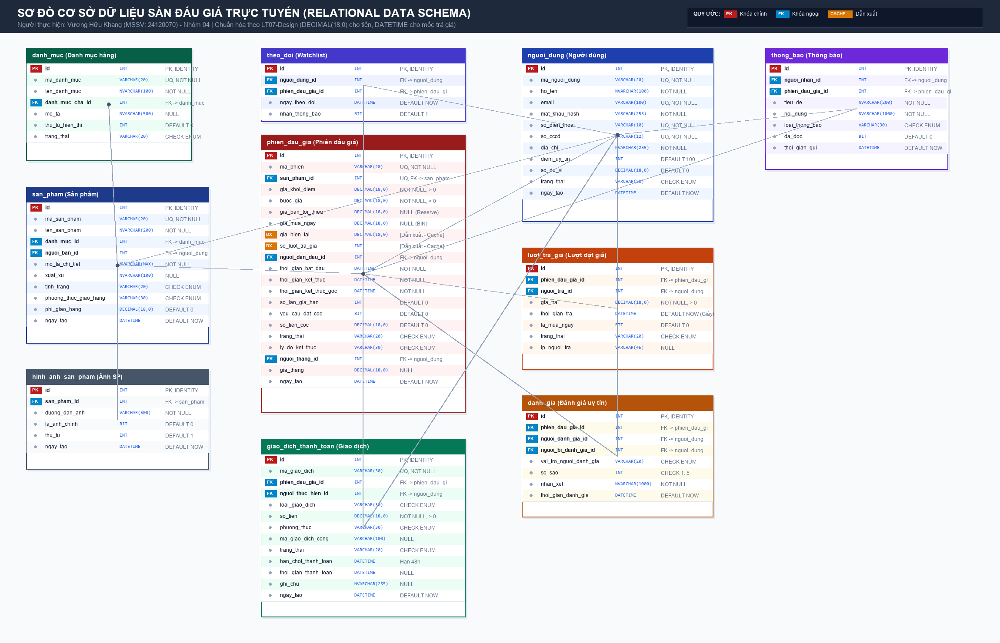

# THIẾT KẾ CƠ SỞ DỮ LIỆU SÀN ĐẤU GIÁ TRỰC TUYẾN
**Môn học:** Nhập môn Công nghệ Phần mềm  
**Học phần:** Bài tập tuần 8 – Thiết kế dữ liệu & UI/UX (theo bài giảng LT07-Design)  
**Phân công:** Người 2 – Thiết kế dữ liệu sàn đấu giá  
**Sinh viên thực hiện:** Vương Hữu Khang  
**MSSV:** 24120070  
**Nhóm:** Nhóm 04  
**Ngày thực hiện:** Tháng 11/2026  

---

## 1. LỰA CHỌN HỆ THỐNG LƯU TRỮ DỮ LIỆU (THEO LT07, SLIDE 4)

Theo bài giảng **LT07 - Design (slide 4)**, có hai hướng tiếp cận chính để tổ chức lưu trữ dữ liệu cho hệ thống phần mềm:

| Tiêu chí so sánh | Lưu trữ bằng Tập tin (File-based) | Lưu trữ bằng Hệ quản trị CSDL (RDBMS) |
| :--- | :--- | :--- |
| **Cơ chế quản lý** | Phần mềm tự tổ chức và quy định cấu trúc tập tin (JSON, CSV, XML, nhị phân). | Hệ quản trị CSDL (DBMS) chuyên dụng quản lý (SQL Server, PostgreSQL, MySQL...). |
| **Ưu điểm** | Gọn, nhẹ, đơn giản, không phụ thuộc dịch vụ ngoài, triển khai nhanh cho ứng dụng nhỏ. | Hiệu quả cao, bảo mật nhiều tầng, phân quyền chi tiết, tối ưu chỉ mục (Indexing), hỗ trợ ngôn ngữ truy vấn mạnh mẽ (SQL). |
| **Khuyết điểm** | Quản lý dữ liệu không hiệu quả khi dữ liệu lớn; khó xử lý đồng thời (concurrency); dễ xung đột ghi (write race condition); thiếu cơ chế giao dịch ACID. | Hệ thống nặng nề, phức tạp, tốn tài nguyên cài đặt, đòi hỏi thiết kế lược đồ quan hệ chặt chẽ từ đầu. |

### Quyết định lựa chọn của Người 2:
Hệ thống **Sàn đấu giá trực tuyến** bắt buộc phải lựa chọn **Hệ quản trị CSDL quan hệ (RDBMS)** (như PostgreSQL hoặc Microsoft SQL Server) vì các lý do cốt lõi sau:
1. **Tính toàn vẹn và giao dịch ACID (Atomicity, Consistency, Isolation, Durability):** Đấu giá trực tuyến là nghiệp vụ tài chính và cạnh tranh thời gian thực cực kỳ nhạy cảm. Nhiều người mua có thể cùng đặt giá tại một giây. RDBMS cung cấp các mức cô lập giao dịch (Transaction Isolation Levels) và khóa bản ghi (Row-level locking) để đảm bảo không xảy ra race condition hay đặt giá ảo.
2. **Ràng buộc toàn vẹn dữ liệu chặt chẽ (Integrity Constraints):** Hỗ trợ kiểm tra tự động các ràng buộc khóa chính (`PRIMARY KEY`), khóa ngoại (`FOREIGN KEY`), giá trị duy nhất (`UNIQUE`), và miền giá trị hợp lệ (`CHECK CONSTRAINT`), ngăn chặn sai sót dữ liệu ngay từ tầng lưu trữ.
3. **Hiệu năng truy vấn và lập chỉ mục (B-Tree Indexing):** Cho phép đánh chỉ mục trên các cột thường xuyên tìm kiếm và sắp xếp như `thoi_gian_ket_thuc`, `gia_hien_tai`, `danh_muc_id`, giúp trả lời hàng triệu truy vấn lọc sản phẩm trong thời gian dưới 50ms.

---

## 2. QUY ĐỊNH NGHIỆP VỤ SÀN ĐẤU GIÁ (BUSINESS REGULATIONS)

Dưới đây là 8 quy định nghiệp vụ cốt lõi làm cơ sở để thiết kế các bảng dữ liệu, kiểu dữ liệu và ràng buộc:

* **QĐ1 (Bước giá và giá khởi điểm):** Mọi sản phẩm đấu giá phải có giá khởi điểm (`gia_khoi_diem > 0`) và bước giá (`buoc_gia > 0`). Giá của lượt trả giá đầu tiên phải $\ge$ `gia_khoi_diem`. Các lượt trả giá tiếp theo phải thỏa mãn: $\text{giá trả sau} \ge \text{giá hiện tại cao nhất} + \text{bước giá}$. Mọi giá trị tiền đều là số nguyên dương và là bội số của bước giá tối thiểu quy định trên sàn (5.000 VNĐ).
* **QĐ2 (Chống tự đấu giá - Anti-Shill Bidding):** Người bán (chủ sở hữu sản phẩm) tuyệt đối không được phép tham gia đặt giá cho các phiên đấu giá do chính mình tạo ra nhằm mục đích tự kích giá ảo.
* **QĐ3 (Giá mua ngay - Buy-it-now):** Người bán có thể tùy chọn thiết lập `gia_mua_ngay` ($> \text{gia\_khoi\_diem}$). Nếu có người mua đặt mức giá bằng hoặc vượt giá mua ngay, phiên đấu giá sẽ kết thúc lập tức (`DA_KET_THUC`), người đó trở thành người thắng cuộc và hệ thống tự động khóa phiên để xuất hóa đơn thanh toán.
* **QĐ4 (Tự động gia hạn chống bắn tỉa - Sniper Protection):** Nếu có một lượt trả giá hợp lệ được ghi nhận trong vòng 5 phút cuối cùng trước thời điểm kết thúc phiên, hệ thống sẽ tự động gia hạn thời gian kết thúc của phiên thêm 5 phút (`so_lan_gia_han` tăng thêm 1, tối đa không quá 10 lần) để đảm bảo cơ hội cạnh tranh công bằng cho các bên.
* **QĐ5 (Phân định theo mốc thời gian chính xác):** Các lượt trả giá được hệ thống ghi nhận chính xác đến giây (`DATETIME`). Lượt gửi đến sau thời điểm kết thúc sẽ bị từ chối. Trường hợp hai người cùng đưa ra một mức giá, lượt nào được máy chủ ghi nhận trước sẽ hợp lệ; lượt ghi nhận sau sẽ bị từ chối do vi phạm quy tắc phải cao hơn giá hiện tại.
* **QĐ6 (Đặt cọc tham gia đấu giá):** Đối với các phiên đấu giá tài sản giá trị cao (có cờ `yeu_cau_dat_coc = TRUE`), người mua bắt buộc phải nộp tiền cọc bảo đảm (mặc định bằng 10% giá khởi điểm) trước khi được quyền đặt giá. Người không thắng cuộc sẽ được hoàn trả 100% tiền cọc trong vòng 24 giờ sau khi phiên kết thúc. Người thắng cuộc sẽ được cấn trừ tiền cọc trực tiếp vào hóa đơn thanh toán.
* **QĐ7 (Thời hạn thanh toán hóa đơn và xử phạt vi phạm):** Người thắng cuộc có nghĩa vụ thanh toán toàn bộ giá trị đơn hàng (giá trúng đấu giá + phí vận chuyển - tiền cọc nếu có) trong vòng 48 giờ kể từ thời điểm kết thúc phiên. Quá 48 giờ không thanh toán, người thắng bị xem là "bùng kèo", bị tịch thu toàn bộ tiền cọc, bị trừ điểm uy tín/khóa tài khoản, và sản phẩm được chuyển sang trạng thái hủy hoặc mời người trả giá cao thứ nhì.
* **QĐ8 (Đánh giá hai chiều sau giao dịch):** Khi giao dịch và vận chuyển hoàn tất thành công, cả người mua và người bán đều có quyền gửi 01 lượt đánh giá duy nhất cho đối phương trong vòng 14 ngày (chấm điểm từ 1 đến 5 sao kèm nhận xét bằng chữ). Đánh giá đã gửi không thể chỉnh sửa để bảo đảm tính khách quan.

---

## 3. DANH SÁCH THÀNH PHẦN DỮ LIỆU (10 BẢNG DỮ LIỆU)

Hệ thống sàn đấu giá trực tuyến được phân rã thành 10 bảng dữ liệu chuẩn hóa:

1. `nguoi_dung`: Quản lý hồ sơ tài khoản thành viên (đóng cả 2 vai trò: người bán và người mua), số dư ví, điểm uy tín, CCCD và trạng thái kích hoạt tài khoản.
2. `danh_muc`: Quản lý danh mục phân loại hàng hóa (hỗ trợ phân cấp cây cha - con thông qua trường `danh_muc_cha_id`).
3. `san_pham`: Quản lý thông tin chi tiết về sản phẩm do người bán đăng tải (thuộc danh mục nào, người bán là ai, tình trạng hàng, chính sách vận chuyển).
4. `hinh_anh_san_pham`: Lưu danh sách các đường dẫn (URL) hình ảnh minh họa cho sản phẩm, hỗ trợ đánh dấu ảnh đại diện chính.
5. `phien_dau_gia`: Thực thể trung tâm lưu trữ thông tin phiên đấu giá của sản phẩm, mức giá khởi điểm, bước giá, giá mua ngay, thời gian mở/đóng, trạng thái phiên, người thắng cuộc và giá chốt.
6. `luot_tra_gia`: Lưu trữ toàn bộ lịch sử chi tiết từng lần ra giá của người mua trong phiên, ghi nhận mốc thời gian chính xác và địa chỉ IP.
7. `theo_doi`: Danh sách sản phẩm/phiên đấu giá yêu thích (Watchlist) của người dùng nhằm nhận thông báo biến động giá theo thời gian thực.
8. `giao_dich_thanh_toan`: Quản lý dòng tiền và các giao dịch tài chính liên quan đến phiên (tiền đặt cọc, hoàn tiền cọc, thanh toán hóa đơn trúng đấu giá, phí sàn).
9. `danh_gia`: Lưu trữ phản hồi và đánh giá uy tín 2 chiều giữa người mua và người bán sau khi giao dịch đấu giá hoàn tất.
10. `thong_bao`: Quản lý hộp thư thông báo gửi tới người dùng (khi bị vượt giá, khi trúng đấu giá, khi phiên sắp kết thúc, thông báo hoàn cọc).

---

## 4. BẢNG ĐẶC TẢ CHI TIẾT THÀNH PHẦN DỮ LIỆU (THEO MẪU LT07, SLIDE 9)

> **Quy ước chuẩn hóa kiểu dữ liệu áp dụng:**
> - Khóa chính tự sinh: `INT` (Identity / Auto Increment).
> - Mã nghiệp vụ định dạng: `VARCHAR(n)` kèm `UNIQUE`, `NOT NULL`.
> - Chuỗi văn bản tiếng Việt: `NVARCHAR(n)`, văn bản dài dùng `NVARCHAR(MAX)`.
> - Tiền tệ (VNĐ): `DECIMAL(18,0)`, tuyệt đối **KHÔNG** sử dụng `FLOAT`.
> - Thời điểm có giờ phút giây: `DATETIME` đến giây.
> - Trạng thái: `VARCHAR(n)` kèm mệnh đề `CHECK (...)` liệt kê đầy đủ miền giá trị.
> - Tên bảng và tên trường: `snake_case`, viết chữ thường không dấu.

### 4.1. Bảng `nguoi_dung`
Lưu trữ thông tin tài khoản người dùng trên hệ thống sàn đấu giá.

| Field | Kiểu dữ liệu | Ràng buộc | Mô tả |
| :--- | :--- | :--- | :--- |
| `id` | INT | PK, Tự tăng | Khóa chính tự sinh nội bộ |
| `ma_nguoi_dung` | VARCHAR(20) | UNIQUE, NOT NULL | Mã người dùng hiển thị (Ví dụ: `ND000001`) |
| `ho_ten` | NVARCHAR(100) | NOT NULL | Họ và tên đầy đủ |
| `email` | VARCHAR(100) | UNIQUE, NOT NULL | Địa chỉ email đăng nhập |
| `mat_khau_hash` | VARCHAR(255) | NOT NULL | Chuỗi băm mật khẩu bảo mật (Bcrypt/Argon2) |
| `so_dien_thoai` | VARCHAR(10) | UNIQUE, NOT NULL | Số điện thoại di động (10 chữ số) |
| `so_cccd` | VARCHAR(12) | UNIQUE, NOT NULL | Số Căn cước công dân định danh cá nhân |
| `dia_chi` | NVARCHAR(255) | NOT NULL | Địa chỉ cư trú / giao nhận hàng hóa |
| `diem_uy_tin` | INT | NOT NULL, DEFAULT 100, CHECK $\ge 0$ | Điểm tín nhiệm giao dịch của thành viên |
| `so_du_vi` | DECIMAL(18,0) | NOT NULL, DEFAULT 0, CHECK $\ge 0$ | Số dư khả dụng trong ví sàn đấu giá (VNĐ) |
| `trang_thai` | VARCHAR(20) | NOT NULL, DEFAULT 'HOAT_DONG', CHECK IN ('HOAT_DONG', 'TAM_KHOA', 'BI_KHOA', 'CHUA_KICH_HOAT') | Trạng thái hoạt động của tài khoản |
| `ngay_tao` | DATETIME | NOT NULL, DEFAULT CURRENT_TIMESTAMP | Thời điểm đăng ký tài khoản |

---

### 4.2. Bảng `danh_muc`
Phân loại ngành hàng, sản phẩm đấu giá (hỗ trợ mô hình phân cấp danh mục cha - con).

| Field | Kiểu dữ liệu | Ràng buộc | Mô tả |
| :--- | :--- | :--- | :--- |
| `id` | INT | PK, Tự tăng | Khóa chính danh mục |
| `ma_danh_muc` | VARCHAR(20) | UNIQUE, NOT NULL | Mã danh mục nghiệp vụ (Ví dụ: `DM_DIENTU`) |
| `ten_danh_muc` | NVARCHAR(100) | NOT NULL | Tên danh mục ngành hàng |
| `danh_muc_cha_id` | INT | NULL, FK $\to$ `danh_muc(id)` | Khóa ngoại trỏ đến danh mục cha (đệ quy) |
| `mo_ta` | NVARCHAR(500) | NULL | Mô tả tóm tắt danh mục |
| `thu_tu_hien_thi` | INT | NOT NULL, DEFAULT 0, CHECK $\ge 0$ | Thứ tự ưu tiên sắp xếp trên giao diện |
| `trang_thai` | VARCHAR(20) | NOT NULL, DEFAULT 'HOAT_DONG', CHECK IN ('HOAT_DONG', 'TAM_AN') | Trạng thái hiển thị danh mục |

---

### 4.3. Bảng `san_pham`
Thông tin chi tiết mặt hàng do người bán đăng tải để đưa vào đấu giá.

| Field | Kiểu dữ liệu | Ràng buộc | Mô tả |
| :--- | :--- | :--- | :--- |
| `id` | INT | PK, Tự tăng | Khóa chính sản phẩm |
| `ma_san_pham` | VARCHAR(20) | UNIQUE, NOT NULL | Mã quản lý sản phẩm (Ví dụ: `SP000001`) |
| `ten_san_pham` | NVARCHAR(200) | NOT NULL | Tên hiển thị của sản phẩm |
| `danh_muc_id` | INT | NOT NULL, FK $\to$ `danh_muc(id)` | Khóa ngoại tham chiếu danh mục |
| `nguoi_ban_id` | INT | NOT NULL, FK $\to$ `nguoi_dung(id)` | Khóa ngoại người bán sở hữu sản phẩm |
| `mo_ta_chi_tiet` | NVARCHAR(MAX) | NOT NULL | Bài viết mô tả đầy đủ thông số, tính năng |
| `xuat_xu` | NVARCHAR(100) | NULL | Xuất xứ sản phẩm / Thương hiệu sản xuất |
| `tinh_trang` | VARCHAR(20) | NOT NULL, CHECK IN ('MOI_100', 'DA_QUA_SU_DUNG', 'LIKE_NEW', 'CO_VAT') | Tình trạng thực tế của sản phẩm |
| `phuong_thuc_giao_hang` | VARCHAR(30) | NOT NULL, CHECK IN ('CHUYEN_PHAT_NHANH', 'NGUOI_MUA_DEN_LAY', 'MIEN_PHI_GIAO_HANG') | Phương thức giao nhận hàng hóa |
| `phi_giao_hang` | DECIMAL(18,0) | NOT NULL, DEFAULT 0, CHECK $\ge 0$ | Cước phí chuyển phát ước tính (VNĐ) |
| `ngay_tao` | DATETIME | NOT NULL, DEFAULT CURRENT_TIMESTAMP | Thời điểm người bán tạo bài đăng |

---

### 4.4. Bảng `hinh_anh_san_pham`
Lưu trữ danh sách hình ảnh thực tế của sản phẩm.

| Field | Kiểu dữ liệu | Ràng buộc | Mô tả |
| :--- | :--- | :--- | :--- |
| `id` | INT | PK, Tự tăng | Khóa chính hình ảnh |
| `san_pham_id` | INT | NOT NULL, FK $\to$ `san_pham(id)` ON DELETE CASCADE | Khóa ngoại trỏ đến sản phẩm |
| `duong_dan_anh` | VARCHAR(500) | NOT NULL | Đường dẫn URL file ảnh lưu trên Cloud/CDN |
| `la_anh_chinh` | BIT | NOT NULL, DEFAULT 0 | Cờ đánh dấu ảnh đại diện chính của sản phẩm |
| `thu_tu` | INT | NOT NULL, DEFAULT 1, CHECK $\ge 1$ | Thứ tự hiển thị trong bộ sưu tập ảnh |
| `ngay_tao` | DATETIME | NOT NULL, DEFAULT CURRENT_TIMESTAMP | Thời điểm tải ảnh lên |

---

### 4.5. Bảng `phien_dau_gia`
Thực thể trọng tâm chứa thông tin phiên đấu giá, quy tắc tài chính và tiến độ thời gian.

| Field | Kiểu dữ liệu | Ràng buộc | Mô tả |
| :--- | :--- | :--- | :--- |
| `id` | INT | PK, Tự tăng | Khóa chính phiên đấu giá |
| `ma_phien` | VARCHAR(20) | UNIQUE, NOT NULL | Mã phiên đấu giá hiển thị (Ví dụ: `PDG000001`) |
| `san_pham_id` | INT | UNIQUE, NOT NULL, FK $\to$ `san_pham(id)` | Khóa ngoại tham chiếu 1-1 với sản phẩm |
| `gia_khoi_diem` | DECIMAL(18,0) | NOT NULL, CHECK $> 0$ | Mức giá bắt đầu phiên đấu giá (VNĐ) |
| `buoc_gia` | DECIMAL(18,0) | NOT NULL, CHECK $> 0$ | Bước giá tối thiểu cho mỗi lần trả giá (VNĐ) |
| `gia_ban_toi_thieu` | DECIMAL(18,0) | NULL, CHECK IS NULL OR $\ge$ `gia_khoi_diem` | Giá sàn bảo lưu bí mật của người bán (Reserve Price) |
| `gia_mua_ngay` | DECIMAL(18,0) | NULL, CHECK IS NULL OR $> \text{gia\_khoi\_diem}$ | Mức giá mua đứt để kết thúc phiên ngay lập tức |
| `gia_hien_tai` | DECIMAL(18,0) | NOT NULL, CHECK $\ge$ `gia_khoi_diem` | *Trường dẫn xuất:* Giá cao nhất hiện tại (cache) |
| `so_luot_tra_gia` | INT | NOT NULL, DEFAULT 0, CHECK $\ge 0$ | *Trường dẫn xuất:* Tổng số lượt trả giá đã đặt |
| `nguoi_dan_dau_id` | INT | NULL, FK $\to$ `nguoi_dung(id)` | *Trường dẫn xuất:* Người đang đặt mức giá cao nhất |
| `thoi_gian_bat_dau` | DATETIME | NOT NULL | Thời điểm chính thức mở phiên trả giá |
| `thoi_gian_ket_thuc` | DATETIME | NOT NULL, CHECK $>$ `thoi_gian_bat_dau` | Thời điểm kết thúc hiện tại của phiên |
| `thoi_gian_ket_thuc_goc` | DATETIME | NOT NULL | Thời điểm kết thúc ban đầu (trước khi gia hạn) |
| `so_lan_gia_han` | INT | NOT NULL, DEFAULT 0, CHECK BETWEEN 0 AND 10 | Số lần phiên đã được tự động gia hạn thêm 5 phút |
| `yeu_cau_dat_coc` | BIT | NOT NULL, DEFAULT 0 | Yêu cầu người tham gia phải nộp cọc trước hay không |
| `so_tien_coc` | DECIMAL(18,0) | NOT NULL, DEFAULT 0, CHECK $\ge 0$ | Số tiền đặt cọc cần nộp nếu có yêu cầu (VNĐ) |
| `trang_thai` | VARCHAR(20) | NOT NULL, DEFAULT 'CHO_DUYET', CHECK IN ('CHO_DUYET', 'SAP_DIEN_RA', 'DANG_DIEN_RA', 'DA_KET_THUC', 'DA_HUY') | Trạng thái vòng đời của phiên đấu giá |
| `ly_do_ket_thuc` | VARCHAR(30) | NULL, CHECK IS NULL OR IN ('HET_GIO_CO_NGUOI_THANG', 'HET_GIO_KHONG_DAT_GIA_SAN', 'KHONG_CO_LUOT_TRA_GIA', 'MUA_NGAY', 'NGUOI_BAN_HUY', 'HE_THONG_HUY') | Lý do phiên chuyển sang kết thúc hoặc hủy |
| `nguoi_thang_id` | INT | NULL, FK $\to$ `nguoi_dung(id)` | Khóa ngoại người chiến thắng phiên đấu giá |
| `gia_thang` | DECIMAL(18,0) | NULL, CHECK IS NULL OR $\ge$ `gia_khoi_diem` | Mức giá chốt thắng cuộc chung cuộc (VNĐ) |
| `ngay_tao` | DATETIME | NOT NULL, DEFAULT CURRENT_TIMESTAMP | Thời điểm lập phiên đấu giá trên hệ thống |

---

### 4.6. Bảng `luot_tra_gia`
Lịch sử chi tiết các lần đưa ra giá của người mua.

| Field | Kiểu dữ liệu | Ràng buộc | Mô tả |
| :--- | :--- | :--- | :--- |
| `id` | INT | PK, Tự tăng | Khóa chính lượt trả giá |
| `phien_dau_gia_id` | INT | NOT NULL, FK $\to$ `phien_dau_gia(id)` | Khóa ngoại tham chiếu phiên đấu giá |
| `nguoi_tra_id` | INT | NOT NULL, FK $\to$ `nguoi_dung(id)` | Khóa ngoại người đặt giá (thành viên mua) |
| `gia_tra` | DECIMAL(18,0) | NOT NULL, CHECK $> 0$ | Mức giá người mua đưa ra (VNĐ) |
| `thoi_gian_tra` | DATETIME | NOT NULL, DEFAULT CURRENT_TIMESTAMP | Thời điểm hệ thống ghi nhận lượt ra giá (đến giây) |
| `la_mua_ngay` | BIT | NOT NULL, DEFAULT 0 | Cờ đánh dấu lượt ra giá kích hoạt Mua ngay |
| `trang_thai` | VARCHAR(20) | NOT NULL, DEFAULT 'HOP_LE', CHECK IN ('HOP_LE', 'BI_VUOT_GIA', 'THANG_CUOC', 'BI_HUY') | Trạng thái hiệu lực của lượt trả giá |
| `ip_nguoi_tra` | VARCHAR(45) | NULL | Địa chỉ IPv4/IPv6 nhằm kiểm soát gian lận |

---

### 4.7. Bảng `theo_doi`
Quản lý danh sách sản phẩm yêu thích (Watchlist) của người dùng.

| Field | Kiểu dữ liệu | Ràng buộc | Mô tả |
| :--- | :--- | :--- | :--- |
| `id` | INT | PK, Tự tăng | Khóa chính theo dõi |
| `nguoi_dung_id` | INT | NOT NULL, FK $\to$ `nguoi_dung(id)` | Khóa ngoại người dùng theo dõi |
| `phien_dau_gia_id` | INT | NOT NULL, FK $\to$ `phien_dau_gia(id)` | Khóa ngoại phiên đấu giá được quan tâm |
| `ngay_theo_doi` | DATETIME | NOT NULL, DEFAULT CURRENT_TIMESTAMP | Thời điểm nhấn theo dõi phiên |
| `nhan_thong_bao` | BIT | NOT NULL, DEFAULT 1 | Cờ bật/tắt nhận chuông báo biến động giá |
| *Ràng buộc nhóm* | — | `UNIQUE(nguoi_dung_id, phien_dau_gia_id)` | Mỗi người dùng chỉ theo dõi 1 phiên tối đa 1 lần |

---

### 4.8. Bảng `giao_dich_thanh_toan`
Quản lý các luồng tiền thanh toán (cọc, hoàn cọc, hóa đơn mua hàng trúng đấu giá, phí dịch vụ).

| Field | Kiểu dữ liệu | Ràng buộc | Mô tả |
| :--- | :--- | :--- | :--- |
| `id` | INT | PK, Tự tăng | Khóa chính giao dịch |
| `ma_giao_dich` | VARCHAR(30) | UNIQUE, NOT NULL | Mã giao dịch tài chính hệ thống (Ví dụ: `GD202611080001`) |
| `phien_dau_gia_id` | INT | NOT NULL, FK $\to$ `phien_dau_gia(id)` | Khóa ngoại phiên đấu giá phát sinh giao dịch |
| `nguoi_thuc_hien_id` | INT | NOT NULL, FK $\to$ `nguoi_dung(id)` | Khóa ngoại người chi trả hoặc thụ hưởng |
| `loai_giao_dich` | VARCHAR(30) | NOT NULL, CHECK IN ('DAT_COC', 'HOAN_COC', 'TICH_THU_COC', 'THANH_TOAN_HOA_DON', 'PHI_DANG_SAN_PHAM', 'RUT_TIEN_BAN') | Bản chất loại giao dịch tài chính |
| `so_tien` | DECIMAL(18,0) | NOT NULL, CHECK $> 0$ | Số tiền giao dịch thực tế (VNĐ) |
| `phuong_thuc` | VARCHAR(30) | NOT NULL, CHECK IN ('VI_SAN', 'VNPAY', 'MOMO', 'CHUYEN_KHOAN_NGAN_HANG') | Phương thức thanh toán được sử dụng |
| `ma_giao_dich_cong` | VARCHAR(100) | NULL | Mã tham chiếu đối soát từ cổng thanh toán bên ngoài |
| `trang_thai` | VARCHAR(20) | NOT NULL, DEFAULT 'CHO_XU_LY', CHECK IN ('CHO_XU_LY', 'THANH_CONG', 'THAT_BAI', 'DA_HUY') | Tình trạng xử lý giao dịch |
| `han_chot_thanh_toan` | DATETIME | NULL | Mốc hết hạn 48 giờ đối với hóa đơn mua hàng |
| `thoi_gian_thanh_toan` | DATETIME | NULL | Thời điểm thanh toán thực tế thành công |
| `ghi_chu` | NVARCHAR(255) | NULL | Ghi chú giải trình giao dịch |
| `ngay_tao` | DATETIME | NOT NULL, DEFAULT CURRENT_TIMESTAMP | Thời điểm khởi tạo bản ghi giao dịch |

---

### 4.9. Bảng `danh_gia`
Lưu trữ đánh giá uy tín hai chiều sau khi phiên đấu giá hoàn tất.

| Field | Kiểu dữ liệu | Ràng buộc | Mô tả |
| :--- | :--- | :--- | :--- |
| `id` | INT | PK, Tự tăng | Khóa chính bản ghi đánh giá |
| `phien_dau_gia_id` | INT | NOT NULL, FK $\to$ `phien_dau_gia(id)` | Khóa ngoại phiên đấu giá đã kết thúc thành công |
| `nguoi_danh_gia_id` | INT | NOT NULL, FK $\to$ `nguoi_dung(id)` | Khóa ngoại thành viên thực hiện gửi đánh giá |
| `nguoi_bi_danh_gia_id` | INT | NOT NULL, FK $\to$ `nguoi_dung(id)` | Khóa ngoại thành viên được đánh giá |
| `vai_tro_nguoi_danh_gia` | VARCHAR(20) | NOT NULL, CHECK IN ('NGUOI_MUA', 'NGUOI_BAN') | Vai trò của người gửi nhận xét trong phiên |
| `so_sao` | INT | NOT NULL, CHECK BETWEEN 1 AND 5 | Số sao đánh giá độ hài lòng (1 đến 5 sao) |
| `nhan_xet` | NVARCHAR(1000) | NOT NULL | Nội dung phản hồi, nhận xét cụ thể |
| `thoi_gian_danh_gia` | DATETIME | NOT NULL, DEFAULT CURRENT_TIMESTAMP | Thời điểm gửi đánh giá (chỉ đọc, không cho sửa) |
| *Ràng buộc nhóm* | — | `UNIQUE(phien_dau_gia_id, nguoi_danh_gia_id)` | Mỗi người tham gia chỉ được đánh giá 1 lần duy nhất |

---

### 4.10. Bảng `thong_bao`
Hộp thư thông báo thời gian thực gửi đến người dùng.

| Field | Kiểu dữ liệu | Ràng buộc | Mô tả |
| :--- | :--- | :--- | :--- |
| `id` | INT | PK, Tự tăng | Khóa chính thông báo |
| `nguoi_nhan_id` | INT | NOT NULL, FK $\to$ `nguoi_dung(id)` | Khóa ngoại người dùng nhận thông báo |
| `phien_dau_gia_id` | INT | NULL, FK $\to$ `phien_dau_gia(id)` | Khóa ngoại phiên đấu giá liên quan (nếu có) |
| `tieu_de` | NVARCHAR(200) | NOT NULL | Tiêu đề thông báo ngắn gọn |
| `noi_dung` | NVARCHAR(1000) | NOT NULL | Nội dung chi tiết thông báo |
| `loai_thong_bao` | VARCHAR(30) | NOT NULL, CHECK IN ('BI_VUOT_GIA', 'THANG_DAU_GIA', 'PHIEN_SAP_KET_THUC', 'XAC_NHAN_DAT_GIA', 'THANH_TOAN_THANH_CONG', 'HOAN_TIEN_COC', 'PHIEN_BI_HUY') | Phân loại sự kiện thông báo |
| `da_doc` | BIT | NOT NULL, DEFAULT 0 | Cờ trạng thái đã đọc (1) hay chưa đọc (0) |
| `thoi_gian_gui` | DATETIME | NOT NULL, DEFAULT CURRENT_TIMESTAMP | Thời điểm hệ thống gửi thông báo |

---

## 5. GIẢI TRÌNH CHI TIẾT CÁC FIELD DẪN XUẤT (DERIVED FIELDS RATIONALE)

Trong thiết kế bảng `phien_dau_gia`, có 3 trường dẫn xuất được lưu trữ trực tiếp:
- `gia_hien_tai` (DECIMAL(18,0)): Giá đặt cao nhất hiện tại.
- `so_luot_tra_gia` (INT): Tổng số lần trả giá trong phiên.
- `nguoi_dan_dau_id` (INT): Người mua đang giữ mức giá cao nhất.

### 5.1. Phân tích bài toán đánh đổi (Trade-off Analysis):
1. **Nếu không lưu (Thuần chuẩn hóa 3NF):**
   - Mỗi lần hiển thị danh sách hàng trăm sản phẩm đấu giá trên trang chủ, hệ thống phải chạy câu lệnh truy vấn tính toán nặng:
     ```sql
     SELECT p.id, p.ma_phien, 
            COALESCE(MAX(l.gia_tra), p.gia_khoi_diem) AS gia_hien_tai,
            COUNT(l.id) AS so_luot_tra_gia
     FROM phien_dau_gia p
     LEFT JOIN luot_tra_gia l ON p.id = l.phien_dau_gia_id AND l.trang_thai = 'HOP_LE'
     WHERE p.trang_thai = 'DANG_DIEN_RA'
     GROUP BY p.id, p.ma_phien;
     ```
   - **Hậu quả:** Đối với sàn đấu giá có hàng chục nghìn người truy cập và tải lại trang liên tục, phép toán `JOIN` + `AGGREGATE (MAX, COUNT)` trên hàng triệu bản ghi `luot_tra_gia` sẽ gây nghẽn cổ chai CPU nghiêm trọng, thời gian phản hồi vượt quá 2 giây (vi phạm tiêu chuẩn NFR trong đề bài).
2. **Quyết định lưu sẵn (Denormalization / Caching vào bảng cha):**
   - Giúp tốc độ đọc danh sách sản phẩm đạt **O(1)** thông qua phép quét bảng đơn giản `SELECT gia_hien_tai, so_luot_tra_gia FROM phien_dau_gia WHERE trang_thai = 'DANG_DIEN_RA'`.

### 5.2. Giải pháp khắc phục nguy cơ lệch dữ liệu (Data Inconsistency):
Để đảm bảo các trường dẫn xuất luôn đồng bộ tuyệt đối với bảng `luot_tra_gia`, hệ thống áp dụng:
- **Khóa bản ghi (Row-Level Lock) trong Database Transaction:** Mỗi khi ghi nhận một lượt ra giá mới, câu lệnh SQL chạy trong transaction với khóa bi quan (`SELECT ... FOR UPDATE`):
  ```sql
  BEGIN TRANSACTION;
  -- Khóa dòng phiên đấu giá để ngăn chặn người khác cùng sửa
  SELECT gia_hien_tai, buoc_gia FROM phien_dau_gia WHERE id = @phien_id FOR UPDATE;
  
  -- Kiểm tra quy định bước giá
  IF (@gia_moi >= @gia_hien_tai + @buoc_gia)
  BEGIN
      INSERT INTO luot_tra_gia (phien_dau_gia_id, nguoi_tra_id, gia_tra, ...) VALUES (...);
      UPDATE phien_dau_gia 
      SET gia_hien_tai = @gia_moi,
          so_luot_tra_gia = so_luot_tra_gia + 1,
          nguoi_dan_dau_id = @nguoi_tra_id
      WHERE id = @phien_id;
  END
  COMMIT TRANSACTION;
  ```
- Nhờ cơ chế giao dịch ACID nguyên tử, tính toàn vẹn được bảo toàn 100%, loại trừ hoàn toàn nguy cơ lệch dữ liệu giữa bảng cha và bảng con.

---

## 6. BẢNG ÁNH XẠ QUY ĐỊNH NGHIỆP VỤ (`Quy định → Bảng / Field / Ràng buộc`)

Bảng dưới đây chứng minh cơ sở dữ liệu đã thiết kế hoàn toàn đầy đủ để kiểm tra và thực thi mọi quy định nghiệp vụ:

| Mã QĐ | Tên quy định nghiệp vụ | Bảng liên quan | Field & Ràng buộc tương ứng | Cơ chế kiểm tra / Thực thi |
| :--- | :--- | :--- | :--- | :--- |
| **QĐ1** | Bước giá & Giá khởi điểm | `phien_dau_gia`, `luot_tra_gia` | `phien_dau_gia.gia_khoi_diem > 0`, `buoc_gia > 0`, `luot_tra_gia.gia_tra` | `gia_tra >= gia_hien_tai + buoc_gia` (nếu là lượt đầu thì `gia_tra >= gia_khoi_diem`). `DECIMAL(18,0)` ngăn chặn sai số làm tròn. |
| **QĐ2** | Chống người bán tự đấu giá | `san_pham`, `phien_dau_gia`, `luot_tra_gia` | `san_pham.nguoi_ban_id`, `luot_tra_gia.nguoi_tra_id` | Khi ra giá, kiểm tra điều kiện `luot_tra_gia.nguoi_tra_id != san_pham.nguoi_ban_id`. Nếu trùng, hệ thống từ chối giao dịch. |
| **QĐ3** | Giá mua ngay (Buy-it-now) | `phien_dau_gia`, `luot_tra_gia` | `phien_dau_gia.gia_mua_ngay`, `luot_tra_gia.la_mua_ngay`, `phien_dau_gia.trang_thai` | Nếu `gia_tra >= gia_mua_ngay`: set `la_mua_ngay = 1`, cập nhật `phien_dau_gia.trang_thai = 'DA_KET_THUC'`, `ly_do_ket_thuc = 'MUA_NGAY'`, `nguoi_thang_id = nguoi_tra_id`. |
| **QĐ4** | Tự động gia hạn (Sniper Protection) | `phien_dau_gia`, `luot_tra_gia` | `thoi_gian_ket_thuc`, `thoi_gian_ket_thuc_goc`, `so_lan_gia_han`, `thoi_gian_tra` | Nếu `thoi_gian_tra >= thoi_gian_ket_thuc - 5 phút` và `so_lan_gia_han < 10`: tự động cập nhật `thoi_gian_ket_thuc = thoi_gian_ket_thuc + 5 phút` và tăng `so_lan_gia_han + 1`. |
| **QĐ5** | Phân định bằng giá & mốc thời gian | `luot_tra_gia` | `luot_tra_gia.thoi_gian_tra`, `luot_tra_gia.gia_tra` | Kiểu `DATETIME` lưu chính xác đến giây. Khi nhận giá cùng thời điểm, lượt ghi nhận trước giữ `HOP_LE`, lượt sau vi phạm điều kiện lớn hơn giá hiện tại sẽ bị từ chối. |
| **QĐ6** | Đặt cọc tham gia đấu giá | `phien_dau_gia`, `giao_dich_thanh_toan` | `phien_dau_gia.yeu_cau_dat_coc`, `phien_dau_gia.so_tien_coc`, `giao_dich_thanh_toan.loai_giao_dich` | Trước khi cho phép đặt giá, kiểm tra sự tồn tại của bản ghi `giao_dich_thanh_toan` có `loai_giao_dich = 'DAT_COC'` và `trang_thai = 'THANH_CONG'`. Khi phiên kết thúc, kích hoạt hoàn cọc (`HOAN_COC`). |
| **QĐ7** | Hạn thanh toán 48h & xử phạt | `giao_dich_thanh_toan`, `nguoi_dung`, `phien_dau_gia` | `giao_dich_thanh_toan.han_chot_thanh_toan`, `giao_dich_thanh_toan.trang_thai`, `nguoi_dung.diem_uy_tin` | `han_chot_thanh_toan = thoi_gian_ket_thuc + 48 giờ`. Quá hạn mà `trang_thai != 'THANH_CONG'`: cập nhật trạng thái đơn thành `'DA_HUY'`, chuyển cọc thành `'TICH_THU_COC'`, trừ `diem_uy_tin`. |
| **QĐ8** | Đánh giá hai chiều sau giao dịch | `danh_gia` | `danh_gia.so_sao`, `danh_gia.vai_tro_nguoi_danh_gia`, `UNIQUE(phien_dau_gia_id, nguoi_danh_gia_id)` | Ràng buộc `CHECK(so_sao BETWEEN 1 AND 5)`. Ràng buộc `UNIQUE` đảm bảo mỗi bên chỉ đánh giá 1 lần duy nhất, không cho sửa sau khi gửi. |

---

## 7. CHỨNG MINH KHẢ NĂNG TRUY XUẤT THÔNG TIN NGHIỆP VỤ

Theo tiêu chí đánh giá của bài tập, cơ sở dữ liệu phải đảm bảo truy xuất nhanh và chính xác 4 chỉ số cốt lõi:

1. **Giá cao nhất hiện tại:**
   - *Cách 1 (Tối ưu O(1)):* Đọc trực tiếp từ trường `phien_dau_gia.gia_hien_tai`.
   - *Cách 2 (Đối soát từ nguồn gốc):* 
     ```sql
     SELECT MAX(gia_tra) FROM luot_tra_gia WHERE phien_dau_gia_id = @phien_id AND trang_thai != 'BI_HUY';
     ```
2. **Người đang dẫn đầu phiên đấu giá:**
   - *Cách 1 (O(1)):* Lấy `phien_dau_gia.nguoi_dan_dau_id` (JOIN sang `nguoi_dung` để lấy tên).
   - *Cách 2 (Đối soát):* 
     ```sql
     SELECT TOP 1 nguoi_tra_id FROM luot_tra_gia 
     WHERE phien_dau_gia_id = @phien_id AND trang_thai = 'HOP_LE' 
     ORDER BY gia_tra DESC, thoi_gian_tra ASC;
     ```
3. **Người chiến thắng và giá thắng cuộc:**
   - Khi phiên ở trạng thái `trang_thai = 'DA_KET_THUC'`, truy vấn:
     ```sql
     SELECT p.nguoi_thang_id, u.ho_ten, p.gia_thang, p.ly_do_ket_thuc
     FROM phien_dau_gia p
     JOIN nguoi_dung u ON p.nguoi_thang_id = u.id
     WHERE p.id = @phien_id;
     ```
4. **Lịch sử trả giá của một người dùng trong phiên:**
   - Truy vấn đầy đủ diễn biến trả giá của người mua theo trình tự thời gian:
     ```sql
     SELECT l.gia_tra, l.thoi_gian_tra, l.trang_thai, l.la_mua_ngay
     FROM luot_tra_gia l
     WHERE l.phien_dau_gia_id = @phien_id AND l.nguoi_tra_id = @nguoi_dung_id
     ORDER BY l.thoi_gian_tra ASC;
     ```

---

## 8. SƠ ĐỒ DỮ LIỆU (RELATIONAL SCHEMA / ERD)

- Tệp sơ đồ thiết kế gốc (draw.io): [`Thiet-ke-du-lieu-San-Dau-Gia.drawio`](./Thiet-ke-du-lieu-San-Dau-Gia.drawio)
- Ảnh xuất sơ đồ (PNG chế độ sáng): [`Thiet-ke-du-lieu-San-Dau-Gia.png`](./Thiet-ke-du-lieu-San-Dau-Gia.png)



### Diễn giải các mối quan hệ chính trên sơ đồ:
- **`nguoi_dung` $\leftrightarrow$ `san_pham` (1 - N):** Một người dùng có thể đăng bán nhiều sản phẩm (`san_pham.nguoi_ban_id`).
- **`nguoi_dung` $\leftrightarrow$ `luot_tra_gia` (1 - N):** Một người dùng có thể tham gia trả giá nhiều lần cho các phiên khác nhau (`luot_tra_gia.nguoi_tra_id`). Thể hiện tính lưỡng dụng: một thành viên vừa có thể là người bán, vừa có thể là người mua trên sàn.
- **`danh_muc` $\leftrightarrow$ `san_pham` (1 - N):** Một danh mục chứa nhiều sản phẩm; danh mục hỗ trợ tự tham chiếu (`danh_muc_cha_id`) tạo cây phân cấp.
- **`san_pham` $\leftrightarrow$ `hinh_anh_san_pham` (1 - N):** Một sản phẩm có nhiều hình ảnh mô tả.
- **`san_pham` $\leftrightarrow$ `phien_dau_gia` (1 - 1):** Mỗi sản phẩm đấu giá tương ứng với duy nhất 1 phiên đấu giá hoạt động tại một thời điểm.
- **`phien_dau_gia` $\leftrightarrow$ `luot_tra_gia` (1 - N):** Một phiên có nhiều lượt trả giá liên tiếp nhau.
- **`phien_dau_gia` $\leftrightarrow$ `nguoi_dung` (N - 1):** Phiên liên kết với người chiến thắng (`nguoi_thang_id`) và người đang dẫn đầu (`nguoi_dan_dau_id`).
- **`phien_dau_gia` $\leftrightarrow$ `giao_dich_thanh_toan` (1 - N):** Một phiên có thể phát sinh nhiều giao dịch (nhiều người nộp cọc, hoàn cọc cho người thua, thanh toán hóa đơn của người thắng).
- **`phien_dau_gia` $\leftrightarrow$ `danh_gia` (1 - N):** Một phiên hoàn tất có tối đa 2 bản ghi đánh giá (người mua đánh giá người bán, và người bán đánh giá người mua).
- **`nguoi_dung` $\leftrightarrow$ `theo_doi` $\leftrightarrow$ `phien_dau_gia` (N - N):** Bảng quan hệ trung gian thể hiện người dùng theo dõi các phiên đấu giá.
- **`nguoi_dung` $\leftrightarrow$ `thong_bao` (1 - N):** Một người dùng nhận nhiều thông báo biến động từ hệ thống.

---

## 9. SCRIPT DDL VÀ DỮ LIỆU MẪU (SEED DATA)

Toàn bộ script tạo bảng DDL và dữ liệu mẫu kiểm thử một phiên đấu giá hoàn chỉnh với 5 lượt trả giá được đóng gói trong file SQL đính kèm:
- Tệp SQL nguồn: [`Thiet-ke-du-lieu-San-Dau-Gia.sql`](./Thiet-ke-du-lieu-San-Dau-Gia.sql)

### Kịch bản dữ liệu mẫu (Seed Data Scenario):
- **Sản phẩm:** MacBook Pro 14 inch M3 Pro (SP000001) do người bán Trần Văn Bán (ND000001) đăng bán.
- **Quy tắc phiên:** Mở phiên PDG000001 với giá khởi điểm 30.000.000 VNĐ, bước giá 500.000 VNĐ, giá bảo lưu 31.000.000 VNĐ, giá mua ngay 42.000.000 VNĐ, yêu cầu đặt cọc 3.000.000 VNĐ.
- **Diễn biến trả giá:**
  1. *08:30:15* – Lê Thị Mua Một (ND000002) trả 30.500.000 VNĐ.
  2. *08:45:20* – Phạm Hoàng Mua Hai (ND000003) trả 31.000.000 VNĐ (đạt giá sàn bảo lưu).
  3. *09:12:05* – Lê Thị Mua Một (ND000002) phản công trả 31.500.000 VNĐ.
  4. *09:40:50* – Vũ Đình Mua Ba (ND000004) tham gia trả 32.000.000 VNĐ.
  5. *09:58:30* – Vũ Đình Mua Ba (ND000004) đặt giá quyết định 32.500.000 VNĐ trong 5 phút cuối $\to$ Hệ thống kích hoạt QĐ4 gia hạn thêm 5 phút đến 10:05:00.
- **Kết quả:** Phiên kết thúc lúc 10:05:00, xác định Vũ Đình Mua Ba thắng cuộc với mức giá 32.500.000 VNĐ.
- **Hậu mãi & Thanh toán:**
  - Hoàn trả 3.000.000 VNĐ cọc cho 2 người thua cuộc (ND000002 và ND000003).
  - Xuất hóa đơn cho người thắng: $32.500.000 + 50.000 \text{ (vận chuyển)} - 3.000.000 \text{ (cọc)} = 29.550.000 \text{ VNĐ}$. Người thắng thanh toán thành công lúc 14:20:00 cùng ngày.
  - Cả hai bên gửi đánh giá 5 sao hài lòng về giao dịch.
