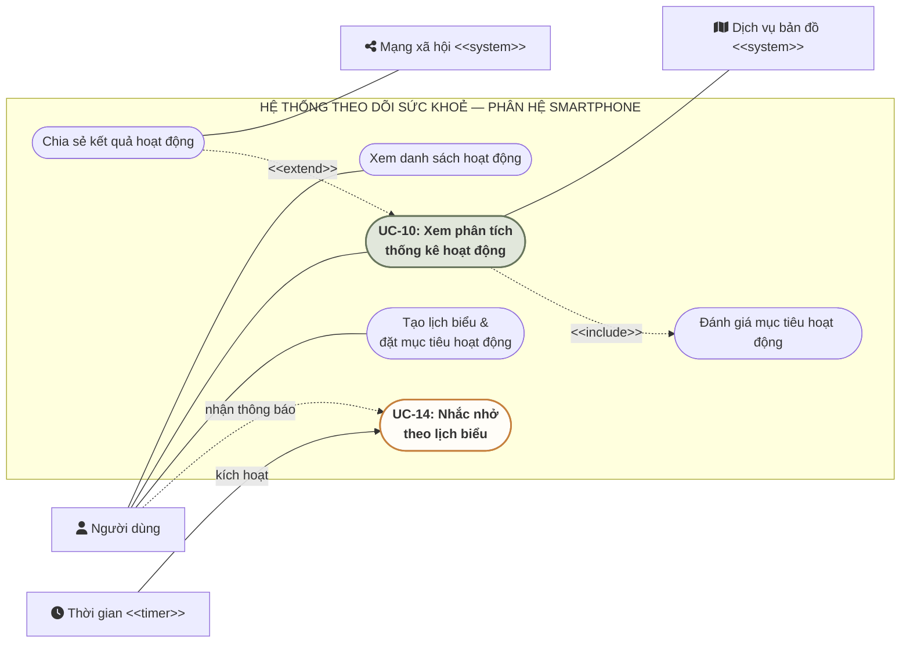

# Bài làm Thành viên C — Bài tập tuần 5: Mô hình hoá yêu cầu phần mềm
## Phân hệ Smartphone | Nhóm LT05

> **Trách nhiệm Thành viên C theo phân công:**
> - **Mục 03:** Bảng giả định toàn hệ thống (GĐ-00 → GĐ-09)
> - **Mục 04:** Sơ đồ Use Case phân hệ Smartphone & Ghi chú liên phân hệ
> - **Mục 05:** Bản đặc tả Use Case cốt lõi 14 mục chuẩn chỉnh (`UC-10`, kèm dự phòng `UC-14`)
> - **Mục 06:** Activity Diagram (Swimlane, Fork/Join) & Bảng truy vết

---

## 03. Bảng giả định (Assumptions)

Làm rõ các điểm đề bài chưa nêu hoặc thiếu trường hợp biên: công thức calo, độ cao, môn bơi lội, ngắt kết nối Bluetooth, ngưỡng tức thời, đánh giá mục tiêu và xử lý nhắc nhở.

| Mã | Chỗ đề chưa rõ | Giả định của bài làm | Ảnh hưởng đến |
| :--- | :--- | :--- | :--- |
| **GĐ-00** *(Ví dụ)* | Quãng đường thực tế đúng bằng mục tiêu (đề chỉ nêu trường hợp chưa đạt). | Quy ước đạt mục tiêu khi kết quả thực tế lớn hơn hoặc bằng mục tiêu (`≥`). Áp dụng cho cả quãng đường, thời gian và tốc độ trung bình. | Guard trong Activity Diagram; Quy tắc nghiệp vụ đánh giá mục tiêu (`BR-03`) trong Đặc tả `UC-10`. |
| **GĐ-01** | Xử lý khi ngắt Bluetooth lúc đang đồng bộ; thời điểm xoá dữ liệu lưu tạm trên đồng hồ. | Khi kết nối bị ngắt giữa chừng, smartwatch giữ nguyên dữ liệu và chuyển về trạng thái **Chờ đồng bộ** để đồng bộ lại khi kết nối lại. Dữ liệu tạm chỉ được xoá sau khi smartphone xác nhận đã lưu trữ an toàn. | State Chart (các trạng thái **Chờ đồng bộ**, **Đang đồng bộ**, **Đã đồng bộ**, **Đã xoá tạm**); Ghi chú phân hệ ở Sơ đồ Use Case. |
| **GĐ-02** | Định lượng cụm từ "tức thời" khi cảm biến nhận biết và ghi nhận hoạt động. | Quy ước cụ thể: (1) Cảm biến đồng hồ tự nhận diện loại hoạt động trong tối đa **10 giây**; (2) Tần suất làm mới các thông số trên màn hình đồng hồ là **1 giây/lần**. | Yêu cầu phi chức năng và Quy tắc nghiệp vụ của Đặc tả Use Case phân hệ smartwatch (`UC-01`). |
| **GĐ-03** | Công thức tính calo tiêu thụ và độ cao thay đổi (đề không có cảm biến độ cao, cân nặng, tuổi). | Độ cao thay đổi (m) tính bằng tổng các khoảng chênh cao dương (elevation gain) giữa các mốc GPS liên tiếp (Bơi lội = 0 m). Lượng calo (kcal) tính theo công thức MET chuẩn: `Calo = MET × 60 kg × (phút / 60)` (Đi bộ: 3.5, Chạy: 8.0, Đạp xe: 6.0, Bơi: 7.0, Khác: 5.0). | Quy tắc `BR-01`, `BR-02` và Bước 4 Luồng chính Đặc tả `UC-10`; Hành động tính thống kê trong Activity Diagram. |
| **GĐ-04** | Cách xử lý khi điện thoại mất mạng hoặc Dịch vụ bản đồ bị treo, lỗi không phản hồi. | Nếu Dịch vụ bản đồ không phản hồi sau **3 giây** (timeout) hoặc mất kết nối mạng, ứng dụng ẩn khung bản đồ, hiển thị thông báo ngoại tuyến nhưng vẫn tính toán và hiển thị đầy đủ các số liệu thống kê. | Luồng thay thế `3a` và Yêu cầu phi chức năng trong Đặc tả `UC-10`; Nhánh Decision kiểm tra tải bản đồ trong Activity Diagram. |
| **GĐ-05** | Thời điểm hệ thống đối chiếu mục tiêu và hiển thị lời khuyên cho người dùng. | Hệ thống tự động đối chiếu số liệu thực tế với mục tiêu đã đặt ngay khi người dùng mở xem phân tích chi tiết hoạt động đó (nếu có gắn mục tiêu) và hiển thị kết quả kèm lời khuyên ngay trên màn hình. | Quan hệ `<<include>>` trên Sơ đồ Use Case; Bước 5 Luồng chính và Luồng thay thế `5a`, `5b` Đặc tả `UC-10`; Activity Diagram. |
| **GĐ-06** | Đo quãng đường và vẽ bản đồ môn Bơi lội khi mất sóng GPS dưới nước. | Khi nhận diện môn Bơi lội, smartwatch đo quãng đường qua cảm biến chuyển động (số sải tay × 1,2 m/sải); chỉ lấy tọa độ GPS lúc bắt đầu và kết thúc khi tay nổi trên mặt nước; smartphone ghim vị trí hồ bơi thay vì vẽ lộ trình liên tục. | Quy tắc nghiệp vụ trong Đặc tả `UC-01` (smartwatch) và `UC-10` (smartphone). |
| **GĐ-07** | Xử lý khi người dùng bỏ qua thông báo nhắc nhở hoặc đang bận trong một buổi tập khác. | Đến mốc nhắc trước, nếu người dùng không bấm xác nhận sau 5 phút, ứng dụng nhắc lại thêm tối đa 1 lần rồi đóng thông báo. Nếu lúc đó smartwatch đang ở trạng thái theo dõi bài tập khác thì tự động bỏ qua để tránh ngắt quãng. | Đặc tả Use Case `UC-14`, Luồng thay thế `2a`, `5a` và Quy tắc `BR-05`, `BR-06`. |
| **GĐ-08** | Cấu trúc gói tin đồng bộ qua Bluetooth để smartphone đủ dữ liệu phân tích và vẽ biểu đồ. | Gói tin gồm: Mã hoạt động, Loại hoạt động, Thời gian bắt đầu/kết thúc, Tổng quãng đường, Tổng thời gian, Mảng tọa độ GPS gắn mốc thời gian, và Mảng nhịp tim theo chu kỳ 1 giây/lần. | Ghi chú phân hệ ở Sơ đồ Use Case; Tiền điều kiện của `UC-10`; State Chart. |
| **GĐ-09** | Xử lý khi mất tín hiệu GPS giữa chừng lúc chạy bộ/đạp xe qua hầm hoặc toà nhà cao tầng. | Nếu mất sóng GPS tạm thời, smartwatch ước tính quãng đường di chuyển bằng cảm biến bước chân/gia tốc cho đến khi bắt lại tín hiệu GPS, đảm bảo dữ liệu ghi nhận liên tục. | Đặc tả phân hệ Smartwatch (`UC-01`) của TV-B. |

---

## 04. Đóng góp Sơ đồ Use Case (Phân hệ Smartphone)

Xác định ranh giới phân hệ smartphone, các Actor tham gia, use case nội bộ, quan hệ `<<include>>`, `<<extend>>` và use case liên phân hệ để phối hợp hoàn chỉnh với sơ đồ của TV-B.

### Sơ đồ Use Case Phân hệ Smartphone (UML Mermaid)

### Ghi chú quan hệ Include và Extend (Phân hệ Smartphone)

| Loại quan hệ | Use case gốc | Use case liên kết | Lý do chọn & Điều kiện kích hoạt |
| :--- | :--- | :--- | :--- |
| **`<<include>>`** | Xem phân tích thống kê hoạt động thể chất (`UC-10`) | Đánh giá mục tiêu hoạt động | Mỗi lần xem phân tích hoạt động có gắn mục tiêu, hệ thống bắt buộc tự động so sánh số liệu thực tế với các chỉ số mục tiêu đã đặt (theo `GĐ-05`, `BR-03`). |
| **`<<extend>>`** | Xem phân tích thống kê hoạt động thể chất (`UC-10`) | Chia sẻ kết quả hoạt động lên mạng xã hội | Hành động chia sẻ là tuỳ chọn không bắt buộc, chỉ thực hiện khi người dùng muốn khoe thành tích.  *Điều kiện kích hoạt:* `[Người dùng nhấn nút chia sẻ kết quả lên MXH]`. |

### Ghi chú Use Case liên phân hệ (Smartwatch & Smartphone)

| Use case | Phân hệ đặt use case | Vai trò phân hệ còn lại | Lý do phân định |
| :--- | :--- | :--- | :--- |
| **Đồng bộ dữ liệu hoạt động** | **Phân hệ Smartphone** *(hoặc kích hoạt từ Smartwatch)* | **Smartwatch:** Truyền phát dữ liệu lưu tạm qua Bluetooth khi hai thiết bị ghép đôi. | Phân hệ smartphone là nơi tiếp nhận, kiểm tra toàn vẹn, lưu trữ vĩnh viễn vào CSDL và gửi tín hiệu xác nhận để smartwatch xoá bản lưu tạm (theo `GĐ-01`). |

---

## 05. Đặc tả Use Case cốt lõi (Phân hệ Smartphone)

Bản đặc tả 14 mục chuẩn chỉnh cho Use Case chính thức **UC-10: Xem phân tích thống kê hoạt động thể chất**, kèm phương án dự phòng **UC-14: Nhắc nhở hoạt động theo lịch biểu**.

### Bản đặc tả chính thức: UC-10 — Xem phân tích thống kê hoạt động thể chất

| Mục | Nội dung đặc tả (UC-10: Xem phân tích thống kê hoạt động thể chất) |
| :--- | :--- |
| **1. Mã và tên** | **UC-10: Xem phân tích thống kê hoạt động thể chất** |
| **2. Mô tả tóm tắt** | Phân hệ smartphone hiển thị bản đồ lộ trình trực quan, các số liệu thống kê tổng quát, kết quả đối chiếu mục tiêu (kèm lời khuyên) và số liệu chi tiết tốc độ, nhịp tim của hoạt động được Người dùng chọn. |
| **3. Actor chính** | Người dùng |
| **4. Actor phụ** | Dịch vụ bản đồ (Map Service) |
| **5. Kích hoạt** | Người dùng chọn xem chi tiết một hoạt động thể chất từ danh sách lịch sử trên ứng dụng smartphone. |
| **6. Tiền điều kiện** | Hoạt động thể chất đã được đồng bộ thành công sang smartphone và đang ở trạng thái **Đã đồng bộ**. |
| **7. Hậu điều kiện (thành công)** | Bản đồ lộ trình, các chỉ số thống kê tổng quát, kết quả đánh giá mục tiêu và thống kê chi tiết tốc độ/nhịp tim được hiển thị đầy đủ cho Người dùng. Đối tượng Hoạt động thể chất giữ nguyên trạng thái **Đã đồng bộ**. |
| **8. Hậu điều kiện (thất bại)** | Phân hệ smartphone thông báo lỗi không thể truy xuất hoặc xử lý dữ liệu. Đối tượng Hoạt động thể chất giữ nguyên trạng thái **Đã đồng bộ**. |
| **9. Luồng chính** | 1. Người dùng chọn xem phân tích thống kê một hoạt động thể chất. 2. Phân hệ smartphone truy xuất dữ liệu lưu trữ của hoạt động và gửi danh sách tọa độ GPS sang Dịch vụ bản đồ. 3. Dịch vụ bản đồ tạo và gửi trả về dữ liệu bản đồ trực quan của lộ trình di chuyển. 4. Phân hệ smartphone tính toán và hiển thị bản đồ lộ trình cùng các số liệu thống kê tổng quát gồm: thời gian (phút), quãng đường (km), calo tiêu thụ (kcal) và độ cao thay đổi (m) theo quy tắc **BR-01** và **BR-02**. 5. Phân hệ smartphone đối chiếu kết quả thực tế với mục tiêu trong lịch biểu và hiển thị thông báo hoàn thành mục tiêu theo quy tắc **BR-03**. 6. Người dùng yêu cầu xem chi tiết tốc độ và nhịp tim. 7. Phân hệ smartphone tính toán và hiển thị tốc độ/nhịp tim trung bình toàn lộ trình, chi tiết theo từng km và biểu đồ biến thiên theo thời gian theo quy tắc **BR-04**. |
| **10. Luồng thay thế** | **3a. Dịch vụ bản đồ không phản hồi hoặc mất mạng (theo GĐ-04):** - *Điều kiện:* Tại bước 3, Dịch vụ bản đồ không phản hồi sau 3 giây hoặc điện thoại mất mạng. - *Hành động:* Ứng dụng ẩn khung bản đồ, thông báo *"Không thể tải bản đồ lộ trình (chế độ ngoại tuyến)"* và chuyển sang **Bước 4** hiển thị các số liệu thống kê tổng quát.  **5a. Hoạt động không gắn với lịch biểu có mục tiêu (theo GĐ-05):** - *Điều kiện:* Tại bước 5, hoạt động thể chất không có mục tiêu cần đạt. - *Hành động:* Ứng dụng bỏ qua bước đối chiếu mục tiêu và chuyển thẳng sang **Bước 6**.  **5b. Chưa đạt mục tiêu đã đặt (theo BR-03, GĐ-00, GĐ-05):** - *Điều kiện:* Tại bước 5, có ít nhất một thông số thực tế nhỏ hơn giá trị mục tiêu. - *Hành động:* Ứng dụng hiển thị thông báo chưa hoàn thành mục tiêu kèm lời khuyên động viên hoặc gợi ý điều chỉnh lại mục tiêu, rồi chuyển sang **Bước 6**.  **6a. Người dùng đóng màn hình phân tích (không xem chi tiết):** - *Điều kiện:* Sau bước 5 (hoặc 5a, 5b), Người dùng thoát màn hình phân tích. - *Hành động:* Use case kết thúc thành công. |
| **11. Luồng ngoại lệ** | **2e. Dữ liệu hoạt động bị hỏng hoặc thời gian bằng 0:** - *Điều kiện:* Tại bước 2, tệp dữ liệu hoạt động bị hỏng cấu trúc hoặc tổng thời gian ghi nhận bằng 0 phút. - *Hành động:* Phân hệ smartphone báo lỗi *"Dữ liệu hoạt động bị hỏng, không thể tạo phân tích thống kê"* và kết thúc thất bại use case. |
| **12. Quy tắc nghiệp vụ** | - **BR-01 (Tính lượng calo tiêu thụ — áp dụng tại Bước 4):** `Lượng calo tiêu thụ (kcal) = MET × 60 (kg) × (Thời gian di chuyển (phút) / 60)`, với hệ số MET chuẩn: Đi bộ = 3.5, Chạy bộ = 8.0, Đạp xe = 6.0, Bơi lội = 7.0, Khác = 5.0 *(Nguồn: Đề bài đoạn 4 & Giả định GĐ-03)*.  - **BR-02 (Tính độ cao thay đổi — áp dụng tại Bước 4):** `Độ cao thay đổi (m) = Tổng các khoảng chênh lệch độ cao dương giữa hai mốc GPS liên tiếp`. Riêng môn *Bơi lội* mặc định bằng 0 m *(Nguồn: Đề bài đoạn 4 & Giả định GĐ-03, GĐ-06)*.  - **BR-03 (Đánh giá hoàn thành mục tiêu — áp dụng tại Bước 5, nhánh 5b):** Được công nhận **Đạt mục tiêu** khi thoả mãn đồng thời: `Quãng đường thực tế (km) ≥ Quãng đường mục tiêu (km)`, `Thời gian thực tế (phút) ≥ Thời gian mục tiêu (phút)`, và `Tốc độ trung bình (km/h) ≥ Tốc độ mục tiêu (km/h)`. Vi phạm bất kỳ tiêu chí nào thì tính là **Chưa đạt** và bắt buộc hiển thị lời khuyên *(Nguồn: Đề bài đoạn 5 & Giả định GĐ-00, GĐ-05)*.  - **BR-04 (Tính thống kê tốc độ và nhịp tim — áp dụng tại Bước 7):** `Tốc độ trung bình toàn lộ trình (km/h) = Tổng quãng đường (km) / (Tổng thời gian (phút) / 60)` `Nhịp tim trung bình (lần/phút) = Trung bình cộng các mẫu nhịp tim đo được trong buổi tập` Tốc độ và nhịp tim chi tiết được tính riêng cho từng phân đoạn 1 km lũy kế trên lộ trình *(Nguồn: Đề bài đoạn 4)*. |
| **13. Yêu cầu phi chức năng** | - Thời gian xử lý và hiển thị phân tích thống kê tổng quát không vượt quá **2 giây** kể từ khi nhận yêu cầu. - Thời gian chờ tối đa (timeout) khi truy vấn Dịch vụ bản đồ là **3 giây** (theo **GĐ-04**). |
| **14. Include, extend** | - **Include:** `UC-10` bao gồm (`<<include>>`) use case **Đánh giá mục tiêu hoạt động**. - **Extend:** `UC-10` được mở rộng (`<<extend>>`) bởi use case **Chia sẻ kết quả lên mạng xã hội** với điều kiện: `[Người dùng nhấn chọn chia sẻ kết quả]`. |

---

### Phương án Use Case dự phòng: UC-14 — Nhắc nhở hoạt động thể chất theo lịch biểu

> **Lý do chọn Use Case:**  
> Đại diện cho nhóm chức năng tự động hoá của smartphone, được kích hoạt bởi **Thời gian** chứ không có tác nhân người khởi động, đáp ứng câu hỏi gợi ý của bài giảng về use case do thời gian kích hoạt.

| Mục | Nội dung đặc tả (UC-14: Nhắc nhở hoạt động thể chất theo lịch biểu) |
| :--- | :--- |
| **1. Mã và tên** | **UC-14: Nhắc nhở hoạt động thể chất theo lịch biểu** |
| **2. Mô tả tóm tắt** | Phân hệ smartphone tự động quét lịch biểu định kỳ và phát thông báo nhắc nhở kèm mục tiêu rèn luyện cho Người dùng trước giờ bắt đầu theo số phút đã cài đặt. |
| **3. Actor chính** | Không có actor người (Kích hoạt tự động bởi **Thời gian hệ thống**). |
| **4. Actor phụ** | Người dùng (bên tiếp nhận thông báo). |
| **5. Kích hoạt** | Thời gian hệ thống chạm mốc nhắc nhở (`Thời gian bắt đầu − Số phút nhắc trước`) vào ngày trùng với tần suất lặp của lịch biểu. |
| **6. Tiền điều kiện** | Tồn tại ít nhất một lịch biểu hoạt động đang bật chế độ nhắc nhở (`Có nhắc nhở = Bật`). |
| **7. Hậu điều kiện (thành công)** | Thông báo nhắc nhở (tên hoạt động, loại hoạt động, thời gian bắt đầu, mục tiêu) hiển thị thành công cho Người dùng. |
| **8. Hậu điều kiện (thất bại)** | Hệ thống không thể phát thông báo và ghi nhận lỗi vào nhật ký dịch vụ. |
| **9. Luồng chính** | 1. Thời gian hệ thống điểm tới mốc kiểm tra lịch biểu. 2. Phân hệ smartphone truy xuất thông tin lịch biểu đến hạn gồm: tên hoạt động, loại hoạt động, giờ bắt đầu và số phút nhắc trước theo **BR-05**. 3. Phân hệ smartphone trích xuất thông tin mục tiêu tương ứng (quãng đường, thời gian, tốc độ). 4. Phân hệ smartphone tạo và hiển thị biểu ngữ thông báo nhắc nhở cho Người dùng. 5. Người dùng xác nhận đã xem thông báo. 6. Phân hệ smartphone đánh dấu hoàn tất lượt nhắc trong ngày. |
| **10. Luồng thay thế** | - **2a. Đang trong buổi tập khác (theo GĐ-07):** Tại bước 2, nếu phát hiện đồng hồ đang theo dõi bài tập khác, hệ thống tự động bỏ qua lần nhắc này và chuyển đến Bước 6. - **3a. Lịch biểu không đặt mục tiêu:** Tại bước 3, hệ thống tạo thông báo chỉ gồm tên hoạt động và thời gian còn lại, rồi chuyển sang Bước 4. - **5a. Người dùng không phản hồi (theo GĐ-07):** Sau 5 phút kể từ bước 4, nếu người dùng không tương tác, hệ thống nhắc lại thêm 1 lần nữa rồi chuyển sang Bước 6. |
| **11. Luồng ngoại lệ** | **4e. Quyền thông báo bị tắt:** Tại bước 4, nếu ứng dụng bị chặn quyền hiển thị thông báo, hệ thống ghi nhật ký lỗi và kết thúc thất bại use case. |
| **12. Quy tắc nghiệp vụ** | - **BR-05 (Mốc kích hoạt nhắc nhở):** Kích hoạt khi: (1) Ngày hiện tại đúng tần suất; (2) Có bật nhắc nhở; (3) `Thời gian = Giờ bắt đầu − Số phút nhắc trước` *(Nguồn: Đề bài đoạn 5)*. - **BR-06 (Giới hạn nhắc lại):** Chỉ nhắc lại tối đa 1 lần sau 5 phút nếu người dùng không bấm xác nhận *(Nguồn: Giả định GĐ-07)*. |
| **13. Yêu cầu phi chức năng** | Độ trễ từ thời điểm đến hạn nhắc nhở cho đến khi thông báo hiển thị trên màn hình không vượt quá **5 giây**. |
| **14. Include, extend** | Không có. |

---

## 06. Activity Diagram & Bảng truy vết

Dựng từ Use Case chính thức **UC-10: Xem phân tích thống kê hoạt động thể chất** với 3 làn (Swimlanes): **Người dùng**, **Phân hệ smartphone** và **Dịch vụ bản đồ**. Sơ đồ tuân thủ chặt chẽ ký pháp UML với đầy đủ Decision, Merge, Fork & Join.

### Luận cứ sử dụng cặp thanh song song Fork và Join
Sơ đồ áp dụng một cặp **Fork** và **Join** tại làn *Phân hệ smartphone* vì sau khi xác thực dữ liệu hợp lệ, hai nhóm tác vụ sau diễn ra hoàn toàn độc lập:
1. **Nhánh 1 (Xử lý nội bộ):** Phân hệ smartphone tự tính toán các số liệu tổng quát (tổng calo theo `BR-01`, độ cao thay đổi theo `BR-02`, quãng đường và thời gian).
2. **Nhánh 2 (Giao tiếp hệ thống ngoài):** Phân hệ smartphone gửi mảng tọa độ GPS sang *Dịch vụ bản đồ* để dựng hình ảnh bản đồ lộ trình (có xử lý timeout 3 giây theo `3a`).

Hai nhánh này không phụ thuộc kết quả của nhau, và thanh **Join** đồng bộ hóa cả hai trước khi hiển thị màn hình phân tích hoàn chỉnh.

### Sơ đồ Activity Diagram (Swimlane UML Mermaid)

```mermaid
flowchart TD
    %% Initial Node
    StartNode(( )):::initialNode --> Act_Select["Chọn hoạt động cần xem"]

    %% Swimlane 1: Người dùng
    subgraph Lane_User["Người dùng"]
        Act_Select
        Dec_Detail{"Xem chi tiết hay đóng?"}
        Act_ReqDetail["Yêu cầu xem tốc độ/nhịp tim"]
    end

    %% Swimlane 2: Phân hệ smartphone
    subgraph Lane_Phone["Phân hệ smartphone"]
        Act_Read["Đọc dữ liệu hoạt động"]
        Dec_Valid{"Dữ liệu hợp lệ?"}
        Act_ErrData["Báo lỗi dữ liệu hỏng"]:::errNode
        EndFail(( )):::failEndNode

        ForkBar[====== FORK BAR ======]:::barNode
        Act_CalcSum["Tính thống kê tổng quát<br>(calo, độ cao, km, phút)"]
        Act_SendCoords["Gửi tọa độ lộ trình"]
        
        Dec_MapRes{"Tải bản đồ OK?"}
        Act_HideMap["Ẩn bản đồ & báo ngoại tuyến"]
        Merge_Map{ }

        JoinBar[====== JOIN BAR ======]:::barNode
        Act_ShowSum["Hiển thị lộ trình & thống kê"]

        Dec_HasGoal{"Có đặt mục tiêu?"}
        Act_CompareGoal["Đối chiếu với mục tiêu"]
        Dec_GoalPass{"Đạt mục tiêu?"}
        Act_GoalPass["Báo hoàn thành mục tiêu"]:::passNode
        Act_GoalAdvise["Hiển thị lời khuyên"]
        Merge_Goal{ }

        Act_ShowDetail["Hiển thị TB, chi tiết từng km<br>& biểu đồ biến thiên"]
        Merge_End{ }
        EndSuccess(( )):::successEndNode
    end

    %% Swimlane 3: Dịch vụ bản đồ
    subgraph Lane_MapService["Dịch vụ bản đồ"]
        Act_GenMap["Tạo bản đồ lộ trình"]
    end

    %% Activity Flow
    Act_Select --> Act_Read
    Act_Read --> Dec_Valid

    %% Branch 2e: Data Error
    Dec_Valid -- "[dữ liệu bị lỗi]" --> Act_ErrData
    Act_ErrData --> EndFail

    %% Valid -> Fork
    Dec_Valid -- "[dữ liệu hợp lệ]" --> ForkBar

    %% Parallel Branch A
    ForkBar --> Act_CalcSum
    Act_CalcSum --> JoinBar

    %% Parallel Branch B (Map Service)
    ForkBar --> Act_SendCoords
    Act_SendCoords --> Act_GenMap
    Act_GenMap --> Dec_MapRes

    %% Branch 3a: Map Error / Timeout
    Dec_MapRes -- "[lỗi / quá hạn 3s]" --> Act_HideMap
    Act_HideMap --> Merge_Map
    Dec_MapRes -- "[thành công]" --> Merge_Map
    Merge_Map --> JoinBar

    %% After Join -> Display Summary
    JoinBar --> Act_ShowSum
    Act_ShowSum --> Dec_HasGoal

    %% Goal Evaluation Branch
    Dec_HasGoal -- "[không có mục tiêu]" --> Merge_Goal
    Dec_HasGoal -- "[có đặt mục tiêu]" --> Act_CompareGoal
    Act_CompareGoal --> Dec_GoalPass

    Dec_GoalPass -- "[đạt mục tiêu]" --> Act_GoalPass
    Dec_GoalPass -- "[chưa đạt]" --> Act_GoalAdvise
    Act_GoalPass --> Merge_Goal
    Act_GoalAdvise --> Merge_Goal

    %% To User Decision
    Merge_Goal --> Dec_Detail

    %% Branch 6a: Close or View Detail
    Dec_Detail -- "[đóng]" --> Merge_End
    Dec_Detail -- "[xem chi tiết]" --> Act_ReqDetail
    Act_ReqDetail --> Act_ShowDetail
    Act_ShowDetail --> Merge_End

    Merge_End --> EndSuccess

    %% Node Styles
    classDef initialNode fill:#40281d,stroke:#40281d,stroke-width:2px;
    classDef failEndNode fill:#a24b3d,stroke:#a24b3d,stroke-width:4px;
    classDef successEndNode fill:#68765d,stroke:#68765d,stroke-width:4px;
    classDef errNode fill:#f3dfd9,stroke:#a24b3d,stroke-width:1.5px;
    classDef passNode fill:#e1e7db,stroke:#68765d,stroke-width:1.5px;
    classDef barNode fill:#40281d,stroke:#40281d,color:#ffffff,font-weight:bold;
```

---

### Bảng truy vết từ Đặc tả (UC-10) sang Activity Diagram

| Trong bản đặc tả (UC-10) | Trong Activity Diagram tương ứng |
| :--- | :--- |
| **Luồng ngoại lệ `2e`:** Dữ liệu lỗi cấu trúc hoặc thời gian bằng 0 tại Bước 2. | **Decision 1**: Nhánh guard `[dữ liệu bị lỗi]` rẽ sang hành động *"Báo lỗi dữ liệu hỏng"* và kết thúc tại **Kết thúc (Thất bại)**; nhánh `[dữ liệu hợp lệ]` đi vào thanh **Fork**. |
| **Luồng thay thế `3a`:** Dịch vụ bản đồ quá 3 giây không phản hồi hoặc mất mạng (theo `GĐ-04`). | **Decision 2**: Nhánh guard `[lỗi / quá hạn 3s]` dẫn tới *"Ẩn bản đồ & báo ngoại tuyến"*, sau đó gom với nhánh `[thành công]` tại nút **Merge bản đồ** trước khi vào thanh **Join**. |
| **Luồng thay thế `5a`:** Hoạt động không gắn với lịch biểu có mục tiêu (theo `GĐ-05`). | **Decision 3**: Nhánh guard `[không có mục tiêu]` đi vòng qua bước đối chiếu và gom thẳng vào nút **Merge mục tiêu**; nhánh `[có đặt mục tiêu]` đi vào *"Đối chiếu với mục tiêu"*. |
| **Luồng thay thế `5b`:** Kết quả thực tế chưa đạt mục tiêu đã đặt (theo `BR-03`, `GĐ-00`). | **Decision 4**: Nhánh guard `[chưa đạt]` rẽ sang *"Hiển thị lời khuyên"*; nhánh `[đạt mục tiêu]` rẽ sang *"Báo hoàn thành mục tiêu"*. Cả hai gom lại tại nút **Merge mục tiêu**. |
| **Luồng thay thế `6a`:** Người dùng đóng giao diện mà không xem chi tiết tốc độ/nhịp tim. | **Decision 5**: Nhánh guard `[đóng]` đi thẳng xuống nút **Merge kết thúc** tới điểm **Kết thúc (Thành công)**; nhánh `[xem chi tiết]` đi qua hành động yêu cầu và hiển thị chi tiết rồi mới gom vào **Merge kết thúc**. |
