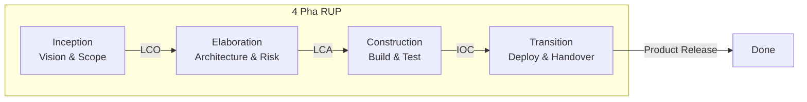

# Mô Hình Phát Triển Phần Mềm RUP (Rational Unified Process)

**Giảng viên:** ThS. Ngô Ngọc Đăng Khoa

**Giảng viên trợ giảng:** ThS. Hồ Tuấn Thanh

**Sinh viên thực hiện:**

| MSSV | Họ và tên |
|------|-----------|
| 24120091 | Lâm Duy Minh |
| 24120089 | Tạ Quang Mạnh |
| 24120070 | Vương Hữu Khang |
| 24120115 | Lê Tấn Phát |

---

## 1. Tên Mô Hình

**RUP — Rational Unified Process** (Quy trình Thống nhất của Rational)

Còn được biết đến với tên gọi **UP** (Unified Process) khi nói đến phiên bản tổng quát, không gắn với thương hiệu Rational.

---

## 2. Thời Điểm Xuất Hiện

| Mốc thời gian | Sự kiện |
|---|---|
| **1995–1996** | Hợp nhất 3 phương pháp luận OO nổi tiếng: **Booch Method** (Grady Booch), **OMT** (James Rumbaugh), **OOSE/Objectory** (Ivar Jacobson) |
| **1998** | Rational Software chính thức phát hành **RUP phiên bản 1.0** |
| **1999** | Ra mắt cùng với **UML 1.3** — ngôn ngữ mô hình hoá thống nhất |
| **2003** | IBM mua lại Rational Software, RUP trở thành sản phẩm của **IBM Rational** |

---

## 3. Đơn Vị Đề Xuất

- **Rational Software Corporation** (nay là **IBM Rational**)
- Ba tác giả chính — được gọi là **"Three Amigos"**:
  - **Grady Booch** — phương pháp Booch
  - **James Rumbaugh** — phương pháp OMT (Object Modeling Technique)
  - **Ivar Jacobson** — phương pháp OOSE/Objectory & Use-Case Driven Development
- Đồng thời là 3 tác giả chính của **UML (Unified Modeling Language)**

---

## 4. Trình Bày Mô Hình

### 4.1 Tổng Quan Kiến Trúc RUP

RUP là một **quy trình phát triển phần mềm lặp và tăng dần (iterative & incremental)**, dựa trên kiến trúc hướng đối tượng và được điều khiển bởi Use-Case.

### 4.2 Hai Chiều Của RUP

RUP được mô tả bằng **biểu đồ 2 chiều** (còn gọi là "RUP Hump Chart"). Trục ngang là 4 pha theo thời gian, trục dọc là 9 discipline theo nội dung công việc. Mức độ nỗ lực (effort) của mỗi discipline thay đổi theo từng pha:

**Bảng mức độ nỗ lực (effort) theo pha:**

| Discipline | Inception | Elaboration | Construction | Transition |
|---|:---:|:---:|:---:|:---:|
| Business Modeling | **Cao** | Trung bình | Thấp | -- |
| Requirements | **Cao** | **Cao** | Thấp | -- |
| Analysis & Design | Trung bình | **Cao** | Trung bình | Thấp |
| Implementation | Thấp | Trung bình | **Cao** | Thấp |
| Test | Thấp | Trung bình | **Cao** | **Cao** |
| Deployment | -- | -- | Thấp | **Cao** |
| Config & Change Mgmt | Thấp | Trung bình | Trung bình | Trung bình |
| Project Management | **Cao** | **Cao** | Trung bình | Trung bình |
| Environment | Trung bình | **Cao** | Thấp | Thấp |

> Ghi chú: **Cao** = effort tập trung nhiều nhất, `--` = gần như không có.
>
> Biểu đồ gốc (Hump Chart) có dạng đường cong lồi, thể hiện mỗi discipline có "đỉnh" effort ở một pha khác nhau. Ví dụ: Requirements đạt đỉnh ở Inception–Elaboration, Implementation đạt đỉnh ở Construction, Deployment đạt đỉnh ở Transition.

#### Trục ngang — 4 Pha (Phases) — khía cạnh **thời gian**:

| Pha | Tên tiếng Việt | Mục tiêu chính |
|-----|----------------|-----------------|
| **Inception** | Khởi đầu | Xác định phạm vi, tầm nhìn, tính khả thi, rủi ro chính |
| **Elaboration** | Chi tiết hoá | Xây dựng kiến trúc cơ sở, phân tích rủi ro, lập kế hoạch chi tiết |
| **Construction** | Xây dựng | Phát triển sản phẩm, coding, tích hợp |
| **Transition** | Chuyển giao | Triển khai, đào tạo, bàn giao cho người dùng |

#### Trục dọc — 9 Luồng Công Việc (Disciplines/Workflows) — khía cạnh **nội dung**:

| # | Discipline | Mô tả |
|---|-----------|-------|
| 1 | **Business Modeling** | Mô hình hoá nghiệp vụ, hiểu bối cảnh kinh doanh |
| 2 | **Requirements** | Thu thập & quản lý yêu cầu |
| 3 | **Analysis & Design** | Phân tích & thiết kế hệ thống |
| 4 | **Implementation** | Lập trình, viết code |
| 5 | **Test** | Kiểm thử |
| 6 | **Deployment** | Triển khai |
| 7 | **Configuration & Change Mgmt** | Quản lý cấu hình & thay đổi |
| 8 | **Project Management** | Quản lý dự án |
| 9 | **Environment** | Thiết lập môi trường phát triển |

### 4.3 Đặc Điểm Cốt Lõi (6 Best Practices)

1. **Phát triển lặp (Iterative Development)** — mỗi pha gồm nhiều iteration
2. **Quản lý yêu cầu (Manage Requirements)** — sử dụng Use-Case
3. **Kiến trúc dựa trên component (Component-based Architecture)**
4. **Mô hình hoá trực quan (Visual Modeling)** — dùng UML
5. **Kiểm tra chất lượng liên tục (Continuously Verify Quality)**
6. **Quản lý thay đổi (Control Changes)**

---

## 5. Các Bước Phát Triển Chi Tiết — WHAT / WHO / INPUT / OUTPUT

### 5.1 Pha 1: INCEPTION (Khởi đầu)

| Hạng mục | Chi tiết |
|----------|---------|
| **WHAT** (Làm gì) | • Xác định tầm nhìn dự án (Vision)<br>• Xác định phạm vi (Scope)<br>• Xây dựng Business Case (lý do kinh doanh)<br>• Xác định các actor & use-case chính (10–20%)<br>• Đánh giá rủi ro ban đầu<br>• Ước lượng chi phí & lịch trình sơ bộ<br>• Xác định tính khả thi |
| **WHO** (Ai tham gia) | • **Project Manager** — lập kế hoạch sơ bộ<br>• **Business Analyst** — phân tích nghiệp vụ, viết Vision<br>• **System Analyst** — xác định use-case chính<br>• **Stakeholders / Sponsor** — phê duyệt tầm nhìn<br>• **Architect** — đánh giá khả thi kỹ thuật |
| **INPUT** | • Ý tưởng kinh doanh / yêu cầu từ khách hàng<br>• Nghiên cứu thị trường<br>• Hệ thống cũ (nếu có) |
| **OUTPUT** | • **Vision Document** — tài liệu tầm nhìn<br>• **Use-Case Model** (sơ bộ, 10–20% use-case)<br>• **Business Case** — phân tích lợi ích chi phí<br>• **Risk List** — danh sách rủi ro ban đầu<br>• **Project Plan** (sơ bộ)<br>• **Prototype** khả thi (nếu cần) |
| **Milestone** | **Lifecycle Objective (LCO)** — stakeholders đồng ý về phạm vi, ước lượng, và quyết định Go/No-Go |

---

### 5.2 Pha 2: ELABORATION (Chi tiết hoá)

| Hạng mục | Chi tiết |
|----------|---------|
| **WHAT** (Làm gì) | • Hoàn thiện 80% use-case<br>• Thiết kế kiến trúc phần mềm (Software Architecture Document)<br>• Xây dựng Architectural Prototype<br>• Phân tích & giảm thiểu rủi ro chính<br>• Lập kế hoạch chi tiết cho pha Construction<br>• Thiết kế database, class diagram, sequence diagram<br>• Thiết lập môi trường phát triển |
| **WHO** (Ai tham gia) | • **Software Architect** — thiết kế kiến trúc hệ thống<br>• **System Analyst / BA** — chi tiết hoá use-case<br>• **Database Designer** — thiết kế CSDL<br>• **UI/UX Designer** — thiết kế giao diện<br>• **Developer (Senior)** — xây dựng architectural prototype<br>• **Project Manager** — quản lý rủi ro, lập kế hoạch |
| **INPUT** | • Vision Document<br>• Use-Case Model sơ bộ<br>• Risk List<br>• Yêu cầu phi chức năng |
| **OUTPUT** | • **Software Architecture Document (SAD)**<br>• **Use-Case Model** (80% hoàn thiện)<br>• **Design Model** — Class Diagram, Sequence Diagram, Component Diagram<br>• **Data Model** — ERD, Database Schema<br>• **Architectural Prototype** — bản mẫu kiến trúc chạy được<br>• **Updated Risk List**<br>• **Detailed Project Plan** cho pha Construction<br>• **Development Environment** đã thiết lập |
| **Milestone** | **Lifecycle Architecture (LCA)** — kiến trúc ổn định, rủi ro chính được giải quyết |

---

### 5.3 Pha 3: CONSTRUCTION (Xây dựng)

| Hạng mục | Chi tiết |
|----------|---------|
| **WHAT** (Làm gì) | • Phát triển toàn bộ chức năng (coding)<br>• Tích hợp các component / module<br>• Kiểm thử đơn vị (Unit Test)<br>• Kiểm thử tích hợp (Integration Test)<br>• Kiểm thử hệ thống (System Test)<br>• Viết tài liệu hướng dẫn sử dụng<br>• Chuẩn bị triển khai (deployment plan) |
| **WHO** (Ai tham gia) | • **Developers / Programmers** — lập trình chính<br>• **Testers / QA** — kiểm thử<br>• **Technical Writer** — viết tài liệu<br>• **DBA** — triển khai & tối ưu database<br>• **Project Manager** — theo dõi tiến độ<br>• **UI Developer / Front-end** — xây dựng giao diện |
| **INPUT** | • Software Architecture Document<br>• Design Model<br>• Data Model<br>• Use-Case Model hoàn thiện<br>• Coding Standards |
| **OUTPUT** | • **Source Code** hoàn thiện<br>• **Executable Software** (Beta Release)<br>• **Unit Test Reports**<br>• **Integration Test Reports**<br>• **User Manual** (bản nháp)<br>• **Deployment Plan**<br>• **Release Notes** |
| **Milestone** | **Initial Operational Capability (IOC)** — phần mềm sẵn sàng cho beta testing |

---

### 5.4 Pha 4: TRANSITION (Chuyển giao)

| Hạng mục | Chi tiết |
|----------|---------|
| **WHAT** (Làm gì) | • Triển khai phần mềm lên môi trường production<br>• User Acceptance Test (UAT)<br>• Đào tạo người dùng cuối<br>• Chuyển đổi dữ liệu (data migration)<br>• Sửa lỗi sau triển khai (bug fixing)<br>• Tinh chỉnh hiệu năng<br>• Bàn giao chính thức |
| **WHO** (Ai tham gia) | • **Deployment Engineer / DevOps** — triển khai<br>• **Testers / QA** — UAT<br>• **Trainer** — đào tạo end-user<br>• **Support Team** — hỗ trợ sau triển khai<br>• **End Users** — kiểm thử chấp nhận<br>• **Project Manager** — nghiệm thu |
| **INPUT** | • Beta Release (phần mềm)<br>• User Manual<br>• Deployment Plan<br>• Training Material |
| **OUTPUT** | • **Production Release** — phiên bản chính thức<br>• **UAT Sign-off** — biên bản nghiệm thu<br>• **Training Records** — hồ sơ đào tạo<br>• **Final User Documentation**<br>• **Post-Implementation Review**<br>• **Lessons Learned** |
| **Milestone** | **Product Release** — sản phẩm được chấp nhận và vận hành chính thức |

---

## 6. Ví Dụ Cụ Thể: Website E-Commerce (Bán Hàng Trực Tuyến)

> **Dự án**: Xây dựng website bán hàng điện tử **"ShopVN"** — bán điện thoại, laptop, phụ kiện công nghệ

---

### 6.1 Pha INCEPTION — Khởi đầu dự án ShopVN

| Hạng mục | Ví dụ cụ thể |
|----------|--------------|
| **WHAT** | • Xác định tầm nhìn: "Xây dựng sàn e-commerce bán điện tử cho thị trường Việt Nam"<br>• Xác định phạm vi: quản lý sản phẩm, giỏ hàng, thanh toán online, quản lý đơn hàng, tài khoản người dùng<br>• Phân tích đối thủ: Tiki, Shopee, Lazada<br>• Đánh giá rủi ro: tích hợp cổng thanh toán, bảo mật thông tin thẻ, hiệu năng khi flash sale<br>• Ước lượng: 8 tháng, 10 thành viên, \$150,000 |
| **WHO** | • PM: Nguyễn Văn A<br>• BA: Trần Thị B — phỏng vấn stakeholder, phân tích nghiệp vụ bán hàng online<br>• Architect: Lê Văn C — đánh giá: dùng microservices hay monolithic?<br>• Sponsor: CEO công ty |
| **INPUT** | • Yêu cầu từ phòng kinh doanh<br>• Báo cáo nghiên cứu thị trường e-commerce VN<br>• Tham khảo hệ thống cũ (nếu có) |
| **OUTPUT** | • **Vision Document**: "ShopVN — Nền tảng thương mại điện tử chuyên điện tử, hỗ trợ thanh toán đa kênh"<br>• **Use-Case chính** (sơ bộ):<br>&emsp;– UC01: Đăng ký / Đăng nhập<br>&emsp;– UC02: Tìm kiếm sản phẩm<br>&emsp;– UC03: Thêm vào giỏ hàng<br>&emsp;– UC04: Thanh toán đơn hàng<br>&emsp;– UC05: Quản lý đơn hàng (Admin)<br>• **Business Case**: ROI dự kiến 200% sau 2 năm<br>• **Risk List**: Bảo mật thanh toán (High), Hiệu năng flash sale (Medium) |

**Milestone LCO**: Ban giám đốc phê duyệt — **GO**

---

### 6.2 Pha ELABORATION — Chi tiết hoá ShopVN

| Hạng mục | Ví dụ cụ thể |
|----------|--------------|
| **WHAT** | • Chi tiết hoá 80% use-case (khoảng 25–30 use-case)<br>• Thiết kế kiến trúc: **Microservices** gồm: User Service, Product Service, Order Service, Payment Service, Notification Service<br>• Thiết kế database: bảng `users`, `products`, `categories`, `orders`, `order_items`, `payments`, `reviews`<br>• Thiết kế API: RESTful API cho từng service<br>• Prototype: UI/UX mockup cho trang chủ, trang sản phẩm, giỏ hàng, checkout<br>• Quyết định tech stack: React.js + Node.js + PostgreSQL + Redis + Docker |
| **WHO** | • Architect: Lê Văn C — thiết kế microservices architecture<br>• BA: chi tiết hoá use-case "Thanh toán" gồm: thanh toán COD, VNPay, MoMo, thẻ VISA/Master<br>• DB Designer: thiết kế ERD, quan hệ giữa sản phẩm – đơn hàng – thanh toán<br>• UX Designer: wireframe Figma cho 15 màn hình chính<br>• Senior Dev: xây dựng architectural prototype — login + hiển thị sản phẩm + API gateway |
| **INPUT** | • Vision Document, Use-Case sơ bộ từ Inception<br>• Yêu cầu phi chức năng: response time < 2s, hỗ trợ 10,000 concurrent users, uptime 99.9% |
| **OUTPUT** | • **Software Architecture Document**:<br>&emsp;– Component Diagram: 5 microservices + API Gateway + Message Queue (RabbitMQ)<br>&emsp;– Deployment Diagram: AWS EC2 + RDS + S3 + CloudFront<br>• **Design Model**:<br>&emsp;– Class Diagram cho Product Service: `Product`, `Category`, `ProductImage`, `ProductVariant`<br>&emsp;– Sequence Diagram cho "Checkout Flow": User → Cart → Order → Payment Gateway → Notification<br>• **Database Schema**: 15 bảng chính với quan hệ<br>• **UI Prototype**: Figma interactive prototype<br>• **Architectural Prototype chạy được**: Demo login + browse products |

**Milestone LCA**: Kiến trúc microservices được phê duyệt, rủi ro thanh toán đã giảm thiểu bằng prototype tích hợp VNPay sandbox

---

### 6.3 Pha CONSTRUCTION — Xây dựng ShopVN

| Hạng mục | Ví dụ cụ thể |
|----------|--------------|
| **WHAT** | • **Iteration 1** (4 tuần): User Service — đăng ký, đăng nhập, quản lý profile, phân quyền (JWT + OAuth2)<br>• **Iteration 2** (4 tuần): Product Service — CRUD sản phẩm, tìm kiếm (Elasticsearch), bộ lọc, phân trang<br>• **Iteration 3** (4 tuần): Cart & Order Service — giỏ hàng, đặt hàng, quản lý trạng thái đơn<br>• **Iteration 4** (4 tuần): Payment Service — tích hợp VNPay, MoMo, COD, hoàn tiền<br>• **Iteration 5** (3 tuần): Notification + Admin Dashboard — email, SMS, push notification; quản trị đơn hàng, thống kê<br>• **Iteration 6** (3 tuần): Review & Rating, Wishlist, Coupon/Promotion<br>• Unit Test mỗi iteration, Integration Test cuối mỗi iteration |
| **WHO** | • **5 Developers**: 2 Backend (Node.js), 2 Frontend (React.js), 1 Mobile (React Native)<br>• **2 Testers**: viết test case, chạy automated test (Jest, Cypress)<br>• **1 DBA**: tối ưu query, index cho bảng `products` (hàng triệu records)<br>• **1 DevOps**: CI/CD pipeline (GitHub Actions), Docker, Kubernetes<br>• **1 Technical Writer**: viết API documentation (Swagger), User Manual<br>• **PM**: sprint review mỗi 2 tuần |
| **INPUT** | • SAD, Design Model, Database Schema<br>• UI/UX Design Files (Figma)<br>• Coding Standards document<br>• API Contract (OpenAPI Spec) |
| **OUTPUT** | • **Source Code** trên GitHub (monorepo hoặc multi-repo)<br>• **Beta Release v0.9**: website ShopVN chạy được trên staging environment<br>&emsp;– Đăng ký/đăng nhập<br>&emsp;– Browse & tìm kiếm sản phẩm<br>&emsp;– Giỏ hàng & đặt hàng<br>&emsp;– Thanh toán VNPay, MoMo, COD<br>&emsp;– Admin dashboard<br>• **Test Reports**: 95% unit test pass, 90% integration test pass<br>• **API Documentation** (Swagger UI)<br>• **User Manual** (bản nháp) |

**Milestone IOC**: Beta release sẵn sàng cho UAT

---

### 6.4 Pha TRANSITION — Chuyển giao ShopVN

| Hạng mục | Ví dụ cụ thể |
|----------|--------------|
| **WHAT** | • **UAT** với 20 nhân viên nội bộ: test mua hàng thực tế, thanh toán thẻ test<br>• **Beta testing** với 500 khách hàng thực: thu thập feedback<br>• Sửa 45 bug được report (15 critical, 30 minor)<br>• **Data migration**: import 10,000 sản phẩm từ file Excel của phòng kinh doanh<br>• **Performance tuning**: tối ưu để đạt < 2s response time, load test 10,000 concurrent users<br>• **Đào tạo**: 2 buổi cho nhân viên bán hàng, 1 buổi cho admin<br>• **Go-live**: deploy production trên AWS, config domain shopvn.vn, SSL certificate<br>• **Monitoring**: setup Grafana + Prometheus để giám sát hệ thống |
| **WHO** | • **DevOps**: deploy production, setup monitoring, CDN<br>• **QA Team**: UAT, regression test<br>• **Trainer**: đào tạo 15 nhân viên vận hành<br>• **Support Team**: hotline hỗ trợ kỹ thuật 24/7 trong 2 tuần đầu<br>• **End Users**: 500 beta users thử nghiệm<br>• **PM**: nghiệm thu, ký biên bản |
| **INPUT** | • Beta Release v0.9<br>• User Manual<br>• Deployment Plan<br>• Data migration scripts<br>• Training materials (slides, video) |
| **OUTPUT** | • **Production Release v1.0** — shopvn.vn live<br>• **UAT Sign-off**: 20/20 kịch bản UAT pass<br>• **Go-live Checklist** hoàn tất: SSL, Payment live, Monitoring, Backup<br>• **Training Records**: 15 nhân viên hoàn thành đào tạo<br>• **Post-Implementation Review**: website đạt 99.9% uptime trong tuần đầu<br>• **Lessons Learned Document**: "Nên tích hợp cổng thanh toán sớm hơn từ pha Elaboration" |

**Milestone Product Release**: ShopVN chính thức vận hành, nghiệm thu hoàn tất

---

## 7. Điểm Mạnh Của RUP

| # | Điểm mạnh | Giải thích |
|---|-----------|------------|
| 1 | **Phát triển lặp & tăng dần** | Giảm rủi ro so với Waterfall, phát hiện lỗi sớm qua từng iteration |
| 2 | **Quản lý rủi ro tốt** | Rủi ro được xác định và xử lý từ pha Inception & Elaboration, trước khi coding nhiều |
| 3 | **Điều khiển bởi Use-Case** | Đảm bảo phần mềm đáp ứng đúng nhu cầu nghiệp vụ của người dùng |
| 4 | **Kiến trúc trung tâm** | Xây dựng kiến trúc vững chắc từ sớm (pha Elaboration), giảm rủi ro kỹ thuật |
| 5 | **Mô hình hoá trực quan (UML)** | Dễ giao tiếp giữa các thành viên, tài liệu rõ ràng, dễ bảo trì |
| 6 | **Linh hoạt & tuỳ chỉnh** | Có thể tailor (điều chỉnh) RUP cho phù hợp với quy mô dự án (nhỏ → lớn) |
| 7 | **Quy trình đầy đủ** | Bao phủ toàn bộ vòng đời phát triển: từ nghiệp vụ → yêu cầu → thiết kế → code → test → triển khai |
| 8 | **Kiểm tra chất lượng liên tục** | Test được thực hiện xuyên suốt, không chỉ cuối dự án |
| 9 | **Quản lý thay đổi** | Có discipline riêng cho Configuration & Change Management |

---

## 8. Điểm Yếu Của RUP

| # | Điểm yếu | Giải thích |
|---|----------|------------|
| 1 | **Phức tạp & nặng nề** | Quy trình đồ sộ với nhiều artifact, role, discipline — khó áp dụng cho dự án nhỏ |
| 2 | **Chi phí cao** | Cần nhiều tài liệu, nhiều vai trò chuyên biệt, tool hỗ trợ (IBM Rational Rose, RequisitePro) thường tốn phí |
| 3 | **Đòi hỏi kinh nghiệm** | Team cần có kinh nghiệm RUP & UML, nếu không sẽ dễ áp dụng sai |
| 4 | **Overhead tài liệu** | Quá nhiều tài liệu có thể làm giảm năng suất nếu không tailor hợp lý |
| 5 | **Không phù hợp dự án nhỏ** | Với dự án < 5 người, RUP đầy đủ quá "overkill" (Agile/Scrum phù hợp hơn) |
| 6 | **Khó ước lượng chính xác** | Vì phát triển lặp, tổng chi phí & thời gian có thể khó kiểm soát nếu quản lý yếu |
| 7 | **Gắn với công cụ thương mại** | RUP gốc gắn với bộ công cụ IBM Rational (có phí), dù có thể dùng tool miễn phí thay thế |
| 8 | **Ít linh hoạt hơn Agile** | So với Scrum/XP, RUP vẫn có tính "plan-driven" hơn, khó thích ứng nhanh với thay đổi liên tục |

---

## 9. So Sánh Nhanh RUP vs Các Mô Hình Khác

| Tiêu chí | RUP | Waterfall | Agile (Scrum) |
|----------|-----|-----------|---------------|
| Phát triển | Lặp & tăng dần | Tuyến tính | Lặp & tăng dần |
| Tài liệu | Nhiều | Rất nhiều | Ít (vừa đủ) |
| Linh hoạt | Trung bình | Thấp | Cao |
| Quản lý rủi ro | Tốt | Kém | Tốt |
| Phù hợp dự án | Vừa → Lớn | Yêu cầu rõ ràng | Nhỏ → Vừa |
| UML / Kiến trúc | Bắt buộc | Tuỳ chọn | Tuỳ chọn |

---

## 10. Tài Liệu & Template Tham Khảo

### 10.1 Tài liệu gốc

| Tài liệu | Mô tả |
|----------|-------|
| **"The Unified Software Development Process"** — Ivar Jacobson, Grady Booch, James Rumbaugh (1999) | Sách gốc mô tả Unified Process |
| **"The Rational Unified Process: An Introduction"** — Philippe Kruchten (3rd Edition, 2003) | Sách nhập môn RUP phổ biến nhất |
| **"The Rational Unified Process Made Easy"** — Per Kroll, Philippe Kruchten (2003) | Hướng dẫn tailoring RUP cho dự án thực tế |
| **IBM Rational RUP Online** | Tài liệu chính thức của IBM (cần license) |

### 10.2 Template Artifact Chính

Dưới đây là danh sách các template quan trọng nhất trong RUP:

#### Pha Inception
| Template | Nội dung |
|----------|---------|
| **Vision Document Template** | Tầm nhìn dự án, vấn đề cần giải quyết, stakeholder, tính năng chính, ràng buộc |
| **Business Case Template** | Phân tích lợi ích – chi phí, ROI, alternatives |
| **Use-Case Model Template** | Use-Case Diagram + Use-Case Brief cho mỗi UC |
| **Risk List Template** | ID, mô tả rủi ro, probability, impact, mitigation strategy |
| **Glossary Template** | Bảng thuật ngữ dự án |

#### Pha Elaboration
| Template | Nội dung |
|----------|---------|
| **Software Architecture Document (SAD) Template** | Architectural goals, views (logical, process, deployment, implementation), design decisions |
| **Use-Case Specification Template** | Actor, precondition, main flow, alternative flow, postcondition, UI mockup |
| **Supplementary Specification Template** | Yêu cầu phi chức năng: performance, security, usability, reliability |
| **Design Model Template** | Class Diagram, Sequence Diagram, State Diagram |
| **Data Model Template** | ERD, bảng, quan hệ, data dictionary |

#### Pha Construction
| Template | Nội dung |
|----------|---------|
| **Test Plan Template** | Phạm vi test, chiến lược, test environment, schedule |
| **Test Case Template** | Test case ID, mô tả, precondition, steps, expected result, actual result |
| **Release Note Template** | Version, new features, bug fixes, known issues |

#### Pha Transition
| Template | Nội dung |
|----------|---------|
| **Deployment Plan Template** | Môi trường, steps triển khai, rollback plan, checklist |
| **Training Plan Template** | Đối tượng, nội dung, schedule, đánh giá |
| **UAT Sign-off Template** | Kịch bản test, kết quả, chữ ký nghiệm thu |
| **Lessons Learned Template** | What went well, what went wrong, recommendations |

### 10.3 Nguồn Template Miễn Phí

| Nguồn | Link / Mô tả |
|-------|------|
| **OpenUP (Open Unified Process)** | Phiên bản mã nguồn mở của RUP do Eclipse Foundation duy trì — bao gồm template đầy đủ, miễn phí |
| **IBM Rational Method Composer** | Công cụ chính thức để tailor RUP (cần license IBM) |
| **Sparx Enterprise Architect** | Hỗ trợ template UML + RUP artifact (bản dùng thử) |
| **StarUML / Visual Paradigm Community** | Công cụ UML miễn phí/giá rẻ, có template RUP |

### 10.4 Ví Dụ Cấu Trúc Thư Mục Template RUP

```
RUP-Templates/
├── 01-Inception/
│   ├── Vision_Document_Template.docx
│   ├── Business_Case_Template.xlsx
│   ├── Use_Case_Model_Template.docx
│   ├── Risk_List_Template.xlsx
│   └── Glossary_Template.docx
├── 02-Elaboration/
│   ├── Software_Architecture_Document_Template.docx
│   ├── Use_Case_Specification_Template.docx
│   ├── Supplementary_Specification_Template.docx
│   ├── Design_Model/ (UML files)
│   └── Data_Model_Template.docx
├── 03-Construction/
│   ├── Test_Plan_Template.docx
│   ├── Test_Case_Template.xlsx
│   └── Release_Note_Template.docx
├── 04-Transition/
│   ├── Deployment_Plan_Template.docx
│   ├── Training_Plan_Template.docx
│   ├── UAT_Signoff_Template.docx
│   └── Lessons_Learned_Template.docx
└── Cross-Phase/
    ├── Project_Plan_Template.mpp
    ├── Change_Request_Template.docx
    └── Status_Report_Template.docx
```

---

## 11. Tóm Tắt



> **RUP** là mô hình phát triển phần mềm **lặp, tăng dần, hướng kiến trúc, điều khiển bởi use-case**, phù hợp cho các dự án **vừa đến lớn** cần quy trình bài bản. Với các dự án nhỏ, nên **tailor** (tinh gọn) RUP hoặc cân nhắc Agile/Scrum.
