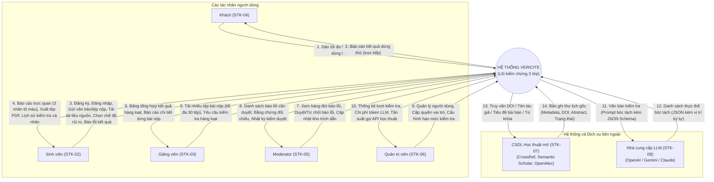

# BÁO CÁO PHÂN TÍCH YÊU CẦU PHẦN MỀM VERICITE (PA02)
## PHẦN VIỆC PHỤ TRÁCH: MỤC 2 & MỤC 3
**Thành viên thực hiện:** Vương Hữu Khang – MSSV: 24120070  
**Nhóm:** Nhóm 04 – Môn: Nhập môn Công nghệ Phần mềm  
**Đồ án:** VeriCite – Hệ thống kiểm chứng trích dẫn và phát hiện ảo giác học thuật trong văn bản do AI sinh ra  
**Tài liệu tham chiếu:** Biểu mẫu chuẩn `Template#1-PhanTich-2019`, Phân công nhóm `phan-cong-nhom-PA02.md`, Đề cương dự án `VeriCite.md`

---

# 2 Mô tả bài toán

### 2.1 Phát biểu bài toán

Sự bùng nổ của các mô hình ngôn ngữ lớn (LLM) đã mang lại tiện ích to lớn trong việc hỗ trợ soạn thảo nội dung, nhưng đồng thời làm bùng phát vấn nạn nghiêm trọng: **"ảo giác trích dẫn" (citation hallucination)**. Các mô hình LLM thường xuyên tự tạo ra các tài liệu tham khảo hoàn toàn bịa đặt nhưng gán tên tác giả có thật, tạo ra các mã định danh số (DOI) giả mạo hoặc trỏ sang bài báo khác, sai lệch năm xuất bản, gán sai nơi công bố, hoặc tự ý diễn giải sai lệch các câu trích nguyên văn so với tài liệu gốc. Các giải pháp hiện nay chủ yếu dùng chính LLM để kiểm tra LLM (dẫn đến nguy cơ ảo giác lặp lại), chỉ đưa ra điểm số tổng thể mơ hồ mà thiếu giải thích chi tiết sai lệch từng trường, và hoàn toàn không có khả năng tích lũy tri thức về các trích dẫn ma đã phát hiện.

Hệ thống **VeriCite** được xây dựng trên một nguyên tắc cốt lõi làm nên sự khác biệt: **"LLM chỉ đảm nhận việc nó làm tốt là bóc tách thông tin từ văn bản tự do; việc xác minh tuyệt đối ưu tiên các nguồn dữ liệu học thuật tất định"** (các cơ sở dữ liệu học thuật mở CrossRef, Semantic Scholar, OpenAlex và tệp tài liệu gốc do người dùng cung cấp). Nhờ nguyên tắc này, quá trình kiểm chứng đạt tính tái lập 100%, không bị ảnh hưởng bởi tính ngẫu nhiên hay ảo giác của trí tuệ nhân tạo.

**VeriCite** là một ứng dụng nền tảng web cho phép người dùng đưa vào một trong ba dạng dữ liệu: (1) đoạn văn bản do AI sinh ra, (2) danh mục tài liệu tham khảo, hoặc (3) tệp báo cáo hoàn chỉnh (định dạng PDF hoặc DOCX); cùng tùy chọn tải lên tài liệu nguồn đối chiếu (định dạng PDF) mà văn bản đã trích dẫn. Hệ thống tự động bóc tách nội dung thành từng thực thể độc lập gồm: trích dẫn, câu trích và nhận định học thuật; sau đó đưa qua quy trình kiểm chứng 3 lớp tất định và trả về báo cáo chi tiết. Trong báo cáo, mỗi mục được gán đúng một trong ba nhãn chuẩn học thuật:
- *Đã xác minh* (được tô màu xanh lá): Trích dẫn có thật, khớp chính xác bản ghi nguồn hoặc câu trích khớp trung thực với tài liệu đối chiếu.
- *Chưa xác minh được* (được tô màu vàng/cam): Không tìm thấy bản ghi trên các CSDL mở (sách, luận văn nội bộ, tài liệu tiếng Việt...) hoặc nhận định chưa có nguồn; hệ thống tuyệt đối không bao giờ quy chụp là bịa khi chưa có căn cứ.
- *Mâu thuẫn với nguồn* (được tô màu đỏ): Trích dẫn có thật nhưng sai lệch chi tiết trường (năm, tác giả, tạp chí), DOI sai bài, câu trích bị sửa đổi làm sai lệch nghĩa, hoặc trích dẫn trùng khớp với Kho trích dẫn ma đã được cộng đồng xác nhận là bịa đặt.

Mỗi nhãn đều đi kèm mã lý do minh bạch, vị trí đoạn văn, liên kết kiểm chứng nguồn gốc trực tiếp và các từ ngữ sai khác được tô sáng trực quan.

**Sáu (06) nghiệp vụ chính của hệ thống bao gồm:**
1. **Kiểm tra trích dẫn (Lớp 1):** Xác định sự tồn tại thực tế của tài liệu tham khảo thông qua tra cứu tất định trên CrossRef, Semantic Scholar, OpenAlex; đối chiếu chi tiết từng trường (tác giả, năm xuất bản, tiêu đề, nơi đăng/tạp chí, DOI) với bản ghi gốc; kiểm tra đối chiếu nhanh với Kho trích dẫn ma và Danh sách trích dẫn thật đã xác nhận.
2. **So khớp câu trích (Lớp 2):** Đối chiếu các câu trích dẫn nguyên văn với tài liệu nguồn do người dùng tải lên, xác định đoạn khớp nhất, tính toán độ tương đồng và chỉ rõ vị trí (trang, đoạn); tô sáng các từ ngữ bị thay đổi/sai lệch.
3. **Đánh dấu nhận định không có nguồn và gợi ý tài liệu (Lớp 3):** Nhận diện các nhận định học thuật không kèm nguồn tham khảo, gán cảnh báo và truy vấn tự động tối đa 5 tài liệu liên quan từ CSDL học thuật mở để người dùng tự đối chiếu (không gọi LLM phán xét đúng sai).
4. **Báo cáo và lưu trữ:** Trực quan hóa kết quả bằng màu sắc trực tiếp trên văn bản gốc; cung cấp danh mục chi tiết sắp xếp theo mức độ rủi ro; cho phép xuất báo cáo PDF độc lập làm minh chứng học thuật; quản lý lịch sử kiểm tra có thời hạn lưu trữ an toàn.
5. **Phản hồi và kiểm duyệt:** Cho phép người dùng gửi báo lỗi kết quả kiểm tra kèm chứng cứ; cung cấp giao diện hàng đợi cho Moderator thẩm định và phê duyệt để cập nhật Kho trích dẫn ma và Danh sách trích dẫn thật đã xác nhận.
6. **Quản trị hệ thống:** Quản lý tài khoản người dùng, phân quyền các vai trò (Sinh viên, Giảng viên, Moderator, Quản trị viên), thiết lập và giám sát hạn mức kiểm tra, theo dõi thống kê lượt dùng và kiểm soát chi phí token API gọi LLM.

**Mục tiêu định lượng:** Trên bộ dữ liệu kiểm thử chuẩn 120 trích dẫn (gồm 60 trích dẫn thật và 60 trích dẫn bịa), hệ thống cam kết đạt các chỉ tiêu: phát hiện ít nhất 90% trích dẫn bịa; tỷ lệ báo nhầm trích dẫn thật thành bịa không vượt quá 5%; và thời gian xử lý một lượt 20 trích dẫn không quá 30 giây.

### 2.2 Môi trường hoạt động

- **Phía người dùng (Client):**
  - Trình duyệt web hiện đại hỗ trợ chuẩn HTML5 và ES2020: Google Chrome, Microsoft Edge, Mozilla Firefox, Apple Safari (hỗ trợ hai phiên bản phát hành gần nhất).
  - Giao diện web responsive thích ứng đa nền tảng: máy tính để bàn (Desktop), máy tính xách tay (Laptop), máy tính bảng (Tablet) và điện thoại thông minh (Mobile với chiều rộng màn hình tối thiểu từ 360px trở lên; trên điện thoại tối ưu trải nghiệm dán văn bản và xem báo cáo).
  - Yêu cầu thiết bị có kết nối mạng Internet ổn định; không yêu cầu người dùng cài đặt thêm bất kỳ phần mềm hay tiện ích mở rộng nào.
- **Phía máy chủ (Server):**
  - Hệ điều hành Linux (khuyến nghị phiên bản Ubuntu Server 24.04 LTS 64-bit).
  - Nền tảng ứng dụng được đóng gói và vận hành hoàn toàn trong các container Docker qua Docker Compose trên máy chủ ảo (VPS) với cấu hình tối thiểu 2 vCPU, 4 GB RAM và 40 GB dung lượng lưu trữ SSD.
  - Mọi luồng truyền thông giữa máy khách và máy chủ đều bắt buộc mã hóa qua giao thức HTTPS (sử dụng chứng chỉ TLS 1.2 trở lên). Máy chủ có kết nối Internet băng thông ổn định để gửi truy vấn ra các API học thuật và dịch vụ LLM bên ngoài.
- **Dịch vụ tích hợp bên ngoài (External Services):**
  - Cơ sở dữ liệu học thuật mở: CrossRef REST API (định danh DOI và bài báo), Semantic Scholar Academic Graph API (tra cứu trích dẫn và bài viết), OpenAlex API (tra cứu học thuật quy mô lớn).
  - Nhà cung cấp dịch vụ mô hình ngôn ngữ lớn (LLM Provider API): OpenAI API, Google Gemini API hoặc Anthropic Claude API; hỗ trợ giao thức gọi hàm hoặc xuất dữ liệu JSON có cấu trúc (Structured Outputs/JSON Schema) phục vụ bóc tách thông tin bám sát văn bản gốc.

### 2.3 Ràng buộc thiết kế và triển khai

Các ràng buộc kỹ thuật, công nghệ và tiêu chuẩn mà nhóm phát triển cam kết tuân thủ trong suốt vòng đời dự án được tổng hợp tại Bảng 2.1.

**Bảng 2.1.** *Các ràng buộc thiết kế và triển khai của hệ thống VeriCite*

| **STT** | **Hạng mục** | **Lựa chọn công nghệ / Chuẩn quy định** | **Lý do lựa chọn & Ràng buộc** |
|:---:|---|---|---|
| 1 | **Giao diện người dùng (Frontend)** | React, TypeScript, Vite, Tailwind CSS | Xây dựng ứng dụng trang đơn (SPA) mượt mà; bản build tĩnh được Nginx phục vụ trực tiếp, giảm tải tài nguyên CPU/RAM cho VPS 4 GB; TypeScript kiểm soát chặt chẽ kiểu dữ liệu, hạn chế lỗi lúc runtime. |
| 2 | **Máy chủ nghiệp vụ (Backend)** | Python 3.12, FastAPI, Uvicorn | Python sở hữu hệ sinh thái xử lý văn bản và tài liệu khoa học xuất sắc (PyMuPDF, python-docx, RapidFuzz) cùng SDK chính thức của các hãng LLM; FastAPI hỗ trợ bất đồng bộ (asyncio) hiệu năng cao và tự động sinh tài liệu chuẩn OpenAPI. |
| 3 | **Cơ sở dữ liệu (Database)** | PostgreSQL 16 | Hệ quản trị CSDL quan hệ chuẩn mực, độ tin cậy và toàn vẹn dữ liệu cao; kiểu dữ liệu JSONB hỗ trợ lưu trữ linh hoạt cấu trúc kết quả phân tích; tích hợp tính năng tìm kiếm toàn văn (Full-text search). |
| 4 | **Bộ nhớ đệm & Hàng đợi (Cache & Queue)** | Redis 7, Celery | Redis lưu đệm (cache) kết quả tra cứu CSDL học thuật để tránh vượt giới hạn gọi API (Rate limit) và tiết kiệm chi phí; Celery quản lý hàng đợi tác vụ xử lý nền cho các lượt kiểm tra dài và kiểm tra hàng loạt, có cơ chế thử lại có giãn cách. |
| 5 | **Tích hợp mô hình LLM** | Adapter Pattern, JSON Schema cố định, Thuật toán kiểm tra bám văn bản gốc | Đóng gói qua lớp trừu tượng (Adapter) để dễ dàng hoán đổi nhà cung cấp LLM; áp dụng schema JSON cố định; áp dụng thuật toán so khớp chuỗi tất định bắt buộc mọi giá trị tách ra phải trùng nguyên văn vị trí trong văn bản gốc. |
| 6 | **Đóng gói & Triển khai** | Docker, Docker Compose, Nginx Reverse Proxy, GitHub Actions | Đảm bảo tính nhất quán tuyệt đối giữa môi trường phát triển cục bộ và môi trường máy chủ demo; tích hợp quy trình CI/CD tự động chạy kiểm thử đơn vị và kiểm thử hồi quy trước mỗi bản phát hành. |
| 7 | **Quy trình & Tiêu chuẩn tài liệu** | Mô hình RUP/Scrum lai, Chuẩn mô hình hóa UML 2.5, Chuẩn đặc tả ISO/IEC/IEEE 29148 | Phù hợp với nhóm sinh viên quy mô nhỏ và tiến độ đồ án; tài liệu tuân thủ nghiêm ngặt quy định học thuật của bộ môn và chuẩn mực công nghiệp phần mềm. |
| 8 | **An toàn thông tin & Bảo mật** | Nguyên tắc bảo mật OWASP Top 10, Thuật toán băm mật khẩu Argon2id, Mã hóa đường truyền TLS 1.2+ | Bảo vệ dữ liệu cá nhân của người dùng; bảo vệ bản quyền và tính riêng tư của các tài liệu học thuật tải lên; phòng chống tấn công dò quét mật khẩu (brute-force) và tấn công trung gian (MitM). |

---

# 3 Tổng quan yêu cầu

## 3.1 Danh sách các stakeholder và Sơ đồ ngữ cảnh

### 3.1.1 Danh sách Stakeholder

Dự án xác định rõ 8 nhóm stakeholder trực tiếp và gián tiếp có ảnh hưởng hoặc chịu sự tác động từ hệ thống, được chi tiết hóa tại Bảng 3.1.

**Bảng 3.1.** *Danh sách các bên liên quan (Stakeholder) của hệ thống VeriCite*

| **STT** | **Mã** | **Tên Stakeholder** | **Mô tả vai trò trong hệ thống** | **Nhu cầu chính đối với hệ thống** | **Mức độ ảnh hưởng** |
|:---:|:---:|---|---|---|:---:|
| 1 | **STK-01** | Giảng viên hướng dẫn đồ án | Người định hướng nghiệp vụ, thẩm định phạm vi bài toán, theo dõi tiến độ và đánh giá nghiệm thu sản phẩm. | Sản phẩm giải quyết đúng bài toán thực tế, bám sát phạm vi đề ra; tài liệu kỹ thuật tuân thủ biểu mẫu và chuẩn mực môn học. | Rất cao |
| 2 | **STK-02** | Sinh viên (Người dùng chính) | Người dùng trực tiếp sử dụng hệ thống để rà soát bài viết học thuật, tiểu luận, khóa luận do AI hỗ trợ soạn thảo. | Kiểm tra nhanh chóng xem trích dẫn và câu trích có thật và chính xác hay không trước khi nộp bài; nhận cảnh báo rõ ràng kèm nguồn đối chiếu để sửa lỗi. | Rất cao |
| 3 | **STK-03** | Giảng viên (Người dùng) | Người dùng sử dụng hệ thống để thẩm tra bài nộp của học viên, đánh giá mức độ trung thực học thuật của danh mục tham khảo. | Khả năng kiểm tra hàng loạt nhiều bài nộp cùng lúc; báo cáo tổng hợp chỉ rõ bài nào có dấu hiệu ngụy tạo trích dẫn; xuất báo cáo PDF làm chứng cứ. | Cao |
| 4 | **STK-04** | Khách (Guest User) | Người dùng vãng lai truy cập hệ thống lần đầu mà chưa thực hiện đăng ký tài khoản. | Trải nghiệm nhanh tính năng kiểm tra trích dẫn cơ bản với số lượng giới hạn mà không cần tốn thời gian đăng ký tài khoản. | Thấp |
| 5 | **STK-05** | Moderator (Kiểm duyệt viên) | Thành viên chuyên trách tiếp nhận, xem xét và xử lý các yêu cầu báo cáo lỗi kết quả kiểm tra do người dùng gửi lên. | Công cụ quản lý hàng đợi báo lỗi trực quan; xem xét bằng chứng đối chiếu và thực hiện phê duyệt/từ chối để cập nhật Kho trích dẫn ma và Danh sách trích dẫn thật. | Trung bình |
| 6 | **STK-06** | Quản trị viên (Administrator) | Người chịu trách nhiệm vận hành, giám sát hoạt động kỹ thuật, quản lý người dùng và an toàn hệ thống. | Quản lý danh sách tài khoản, phân quyền vai trò; cấu hình hạn mức kiểm tra; giám sát số lượng token LLM tiêu thụ và chi phí API để không vượt ngân sách. | Trung bình |
| 7 | **STK-07** | CSDL học thuật mở (CrossRef, Semantic Scholar, OpenAlex) | Hệ thống máy chủ bên ngoài cung cấp nguồn dữ liệu thư tịch học thuật tất định làm căn cứ xác minh. | Các yêu cầu truy vấn từ VeriCite phải tuân thủ nghiêm ngặt điều khoản sử dụng, đúng định dạng và không vượt quá ngưỡng giới hạn tần suất (Rate limit). | Rất cao |
| 8 | **STK-08** | Nhà cung cấp dịch vụ LLM (OpenAI, Google, Anthropic) | Hệ thống trí tuệ nhân tạo bên ngoài cung cấp năng lực bóc tách thông tin có cấu trúc từ văn bản tự do qua API. | Dữ liệu đầu vào chuẩn xác; quản lý số lượng token gọi trong hạn mức gói cước; thanh toán chi phí tiêu thụ theo quy định dịch vụ. | Trung bình |

### 3.1.2 Sơ đồ ngữ cảnh (Context Diagram)

Sơ đồ ngữ cảnh mô tả ranh giới hệ thống VeriCite, vị trí tương tác của 5 tác nhân người dùng và 2 tác nhân hệ thống bên ngoài, cùng các luồng dữ liệu vào/ra tương ứng.

**Bảng 3.2.** *Mô tả chi tiết các luồng dữ liệu trong Sơ đồ ngữ cảnh*

| **Tác nhân tương tác** | **Luồng dữ liệu vào hệ thống (Input Data Flow)** | **Luồng dữ liệu ra tới tác nhân (Output Data Flow)** |
|---|---|---|
| **Khách (STK-04)** | Đoạn văn bản dán trực tiếp chứa tối đa 5 trích dẫn dùng thử (tuân thủ QĐ1). | Báo cáo kết quả kiểm tra tại chỗ trên màn hình, thể hiện trạng thái xác minh sơ bộ. |
| **Sinh viên (STK-02)** | Thông tin tài khoản đăng ký/đăng nhập; văn bản cần kiểm tra (dán trực tiếp hoặc tệp PDF/DOCX); tệp tài liệu nguồn đối chiếu (PDF); tùy chọn chế độ rủi ro (*Thông thường* hoặc *Học thuật nghiêm ngặt*); yêu cầu báo lỗi kết quả kèm chứng cứ. | Giao diện báo cáo kết quả chi tiết với văn bản được tô 3 màu nhãn (*Đã xác minh*, *Chưa xác minh được*, *Mâu thuẫn với nguồn*); mã lý do; liên kết nguồn gốc; tệp báo cáo PDF tải về; danh sách lịch sử kiểm tra. |
| **Giảng viên (STK-03)** | Gói tệp bài nộp của học viên (tải hàng loạt tối đa 30 tệp PDF/DOCX); các tham số kiểm tra lớp học. | Thanh tiến độ xử lý hàng đợi nền; bảng tổng hợp thống kê kết quả toàn bộ các bài nộp; báo cáo chi tiết cho từng bài nộp của học viên; tệp xuất PDF tổng hợp. |
| **Moderator (STK-05)** | Quyết định phê duyệt/từ chối báo lỗi; lý do thẩm định; yêu cầu thêm mới, sửa đổi hoặc xóa bỏ bản ghi trong Kho trích dẫn ma và Danh sách trích dẫn thật đã xác nhận. | Danh sách hàng đợi các báo lỗi đang chờ duyệt; chi tiết văn bản báo lỗi kèm chứng cứ do người dùng cung cấp; bản ghi nguồn đã khớp; nhật ký kiểm duyệt hệ thống. |
| **Quản trị viên (STK-06)** | Lệnh quản lý tài khoản (khóa/mở khóa); quyết định phân vai (Sinh viên, Giảng viên, Moderator); cấu hình hạn mức kiểm tra (số lượt/ngày, số trích dẫn/lượt); thiết lập ngưỡng cảnh báo ngân sách. | Bảng điều khiển (Dashboard) thống kê tổng lượt kiểm tra, phân bố số lượng mục theo các nhãn; báo cáo chi phí token LLM ước tính; thống kê tỷ lệ lỗi và thời gian phản hồi của CSDL ngoài; thông báo cảnh báo vượt 80% ngân sách. |
| **CSDL học thuật mở (STK-07)** | Yêu cầu tra cứu siêu dữ liệu bài báo qua mã định danh DOI hoặc truy vấn tiêu đề, tác giả, năm công bố; truy vấn tìm kiếm tài liệu gợi ý theo từ khóa. | Tập dữ liệu siêu dữ liệu (metadata) thư tịch gốc chuẩn hóa (tiêu đề, tác giả, năm, tạp chí/hội nghị, DOI chính thức); mã trạng thái phản hồi HTTP. |
| **Nhà cung cấp LLM (STK-08)** | Nội dung văn bản thô kèm prompt yêu cầu bóc tách và định dạng JSON Schema quy định nghiêm ngặt vị trí ký tự. | Cấu trúc dữ liệu JSON chứa danh sách trích dẫn, câu trích và nhận định học thuật kèm tọa độ ký tự bám sát nguyên văn văn bản gốc; lượng token đã tiêu thụ. |

---

## 3.2 Danh sách yêu cầu

### Bảng các quy định nghiệp vụ áp dụng trong toàn hệ thống (QĐ1 – QĐ10)

Để đảm bảo tính nhất quán giữa các yêu cầu chức năng, đặc tả use case và giao diện người dùng, toàn bộ hệ thống áp dụng thống nhất 10 quy định nghiệp vụ cốt lõi tại Bảng 3.3.

**Bảng 3.3.** *Bảng quy định nghiệp vụ hệ thống (QĐ1 – QĐ10)*

| **Mã QĐ** | **Tên quy định nghiệp vụ** | **Nội dung chi tiết quy định** | **Yêu cầu & Use Case liên quan** |
|:---:|---|---|---|
| **QĐ1** | Hạn mức dùng thử cho khách vãng lai | Khách vãng lai không cần đăng nhập được thực hiện tối đa 3 lượt kiểm tra trong một ngày (kiểm soát theo địa chỉ IP và phiên làm việc); mỗi lượt kiểm tra tối đa 5 trích dẫn; chỉ hỗ trợ hình thức dán trực tiếp danh mục trích dẫn (không hỗ trợ tải tệp tài liệu nguồn đối chiếu). | FR-02, U003, SC-05 |
| **QĐ2** | Giới hạn dữ liệu đầu vào cho một lượt kiểm tra | Mỗi lượt kiểm tra của người dùng đã đăng nhập chấp nhận văn bản dán trực tiếp tối đa 5.000 từ, hoặc tệp tải lên (PDF, DOCX) tối đa 20 trang hoặc dung lượng không quá 10 MB. Tối đa 50 trích dẫn trong một lượt kiểm tra. Tệp tài liệu nguồn đối chiếu (PDF có lớp văn bản) dung lượng tối đa 50 MB. Vượt quá giới hạn trên, hệ thống từ chối xử lý, nêu rõ chỉ số vượt ngưỡng và không trừ hạn mức của người dùng. | FR-03, FR-04, U004, SC-01 |
| **QĐ3** | Giới hạn kiểm tra hàng loạt cho giảng viên | Tài khoản vai trò Giảng viên được phép tải lên tối đa 30 tệp bài nộp trong một đợt kiểm tra hàng loạt. Tác vụ được đẩy vào hàng đợi xử lý nền (Celery), hiển thị tiến độ tổng thể. Lỗi xử lý tại một tệp cục bộ không được làm gián đoạn hay dừng quá trình xử lý của 29 tệp còn lại. | FR-13, U009, SC-03 |
| **QĐ4** | Quy tắc gán nhãn 3 trạng thái và mã lý do | Mọi mục (trích dẫn, câu trích, nhận định) sau khi kiểm chứng phải được gán đúng một trong ba nhãn chuẩn: • **Đã xác minh** *(Verified - Xanh lá)*: Tìm thấy bản ghi gốc trùng khớp trên CSDL học thuật; hoặc trùng khớp với Danh sách trích dẫn thật đã xác nhận; hoặc câu trích khớp chính xác/đạt ngưỡng với tài liệu nguồn. • **Chưa xác minh được** *(Unverified - Vàng/Cam)*: Không tìm thấy bản ghi trên CSDL mở (sách, luận văn, tài liệu tiếng Việt); hoặc CSDL ngoài gặp sự cố mạng/timeout; hoặc nhận định không có tài liệu nguồn đối chiếu. Tuyệt đối không quy chụp là bịa đặt. • **Mâu thuẫn với nguồn** *(Conflicted - Đỏ)*: Trích dẫn có thật nhưng sai lệch chi tiết trường (năm, tác giả, nơi công bố); DOI trỏ tới bài khác; câu trích sai lệch so với nguồn; hoặc trích dẫn trùng khớp với Kho trích dẫn ma. | FR-05, FR-06, FR-09, U004, U006 |
| **QĐ5** | Nguyên tắc gợi ý tài liệu ở Lớp 3 | Với các nhận định học thuật không có nguồn trích dẫn và người dùng không tải tài liệu nguồn đối chiếu, hệ thống sử dụng các từ khóa đã bóc tách để truy vấn tìm kiếm tối đa 5 tài liệu liên quan trên Semantic Scholar và OpenAlex. Tài liệu gợi ý chỉ mang tính chất tham khảo cho người dùng tự tra cứu đối chiếu, **tuyệt đối không bao giờ làm nhãn của nhận định đổi thành *Đã xác minh***. Lớp 3 không gọi LLM để phán xét đúng/sai. | FR-08, U004, U006 |
| **QĐ6** | Ngưỡng so khớp câu trích ở Lớp 2 | Câu trích dẫn nguyên văn được đối chiếu với tài liệu nguồn qua so khớp chính xác và so khớp gần đúng (RapidFuzz/Levenshtein): • Khớp chính xác (100%): Gán nhãn *Đã xác minh*, chỉ rõ trang và đoạn văn. • Khớp gần đúng đạt ngưỡng tiêu chuẩn từ 90% trở lên (ở chế độ *Thông thường*): Gán nhãn *Đã xác minh*. • Khớp một phần từ 70% đến dưới 90% (hoặc không tìm thấy): Gán nhãn *Mâu thuẫn với nguồn* kèm trích đoạn nguồn gần nhất. • Mọi trường hợp khớp gần đúng dưới 100% bắt buộc phải **tô sáng các từ ngữ bị sai lệch, thay đổi hoặc số liệu bị sửa**. | FR-07, U004, U005, SC-02 |
| **QĐ7** | Quy tắc hiển thị báo cáo và chế độ rủi ro | Hệ thống cung cấp tối thiểu hai chế độ kiểm tra: *Thông thường* và *Học thuật nghiêm ngặt*. **Không có bất kỳ chế độ nào được phép ẩn các mục *Chưa xác minh được* hay *Mâu thuẫn với nguồn* khỏi báo cáo trên màn hình hoặc tệp xuất PDF** (tránh làm báo cáo trông "sạch" giả tạo). Ở chế độ *Học thuật nghiêm ngặt*, ngưỡng so khớp câu trích nâng lên 95%, và toàn bộ các mục có nhãn khác *Đã xác minh* được tự động đưa lên đầu báo cáo thành danh mục ưu tiên xử lý. | FR-10, FR-11, U006, U007 |
| **QĐ8** | Chính sách lưu trữ dữ liệu và quyền riêng tư | Tệp tài liệu người dùng tải lên (văn bản kiểm tra, tài liệu nguồn) chỉ được sử dụng cho phiên kiểm tra của chính họ và được hệ thống tự động xóa vĩnh viễn khỏi máy chủ sau 30 ngày hoặc ngay khi người dùng chủ động xóa lượt kiểm tra. Người dùng A tuyệt đối không xem được dữ liệu của người dùng B. Tuyệt đối không gửi thông tin định danh cá nhân (tên, email) của người dùng sang các dịch vụ LLM bên ngoài. | FR-12, NFR-05, U008 |
| **QĐ9** | Quy định bảo mật tài khoản và xác thực | Mật khẩu tài khoản phải có độ dài tối thiểu từ 8 ký tự trở lên, áp dụng hướng dẫn an toàn NIST SP 800-63B (chặn các mật khẩu phổ biến, dễ đoán, mật khẩu đã bị rò rỉ). Mật khẩu được lưu trữ dưới dạng mã băm Argon2id có salt ngẫu nhiên. Hệ thống tự động khóa tài khoản tạm thời 15 phút sau 5 lần nhập sai mật khẩu liên tiếp nhằm ngăn chặn tấn công brute-force. | FR-01, NFR-04, U001, U002 |
| **QĐ10** | Quy trình kiểm duyệt kho trích dẫn ma và trích dẫn thật | Báo lỗi kết quả từ người dùng được đưa vào hàng đợi kiểm duyệt ở trạng thái "Chờ duyệt" và không làm thay đổi kết quả kiểm tra tự động cho đến khi có quyết định chính thức. Moderator thẩm định chứng cứ: • Chấp nhận báo lỗi "Trích dẫn là bịa": Thêm trích dẫn vào *Kho trích dẫn ma*. • Chấp nhận báo lỗi "Trích dẫn có thật bị gán sai": Gỡ khỏi Kho trích dẫn ma (nếu có) và thêm vào *Danh sách trích dẫn thật đã xác nhận* kèm liên kết bằng chứng xác thực. Mọi thao tác can thiệp đều phải được lưu vết trong nhật ký kiểm toán (Audit log) gồm người duyệt, thời điểm và lý do. | FR-14, FR-15, U010, U011, U012, SC-04 |

---

### 3.2.1 Đặc tả yêu cầu chức năng

Yêu cầu chức năng của hệ thống VeriCite gồm 17 yêu cầu (FR-01 đến FR-17), được phân chia thành 5 nhóm nghiệp vụ như tổng hợp tại Bảng 3.4.

**Bảng 3.4.** *Phân nhóm yêu cầu chức năng của hệ thống VeriCite*

| **Nhóm chức năng** | **Mã yêu cầu** | **Tên yêu cầu chức năng** | **Độ ưu tiên (MoSCoW)** | **Quy định áp dụng** |
|---|---|---|:---:|:---:|
| **Nhóm 1: Quản lý tài khoản** | **FR-01** | Đăng ký, đăng nhập và phân quyền theo vai | Must Have | QĐ9 |
| | **FR-02** | Kiểm tra dùng thử cho khách vãng lai | Should Have | QĐ1 |
| **Nhóm 2: Kiểm tra nội dung** | **FR-03** | Nhập dữ liệu kiểm tra và tải tài liệu nguồn | Must Have | QĐ2 |
| | **FR-04** | Bóc tách trích dẫn, câu trích và nhận định | Must Have | QĐ2 |
| | **FR-05** | Xác minh sự tồn tại của trích dẫn (Lớp 1) | Must Have | QĐ4 |
| | **FR-06** | Đối chiếu chi tiết các trường trích dẫn (Lớp 1) | Must Have | QĐ4 |
| | **FR-07** | So khớp câu trích với tài liệu nguồn (Lớp 2) | Must Have | QĐ6 |
| | **FR-08** | Đánh dấu nhận định thiếu nguồn và gợi ý tài liệu (Lớp 3) | Should Have | QĐ5 |
| | **FR-09** | Gán nhãn và tổng hợp báo cáo chi tiết | Must Have | QĐ4, QĐ5 |
| | **FR-10** | Tùy chọn chế độ rủi ro kiểm tra | Should Have | QĐ7 |
| **Nhóm 3: Kết quả & Lịch sử** | **FR-11** | Xuất báo cáo kết quả định dạng PDF | Must Have | QĐ7 |
| | **FR-12** | Quản lý và tra cứu lịch sử kiểm tra cá nhân | Must Have | QĐ8 |
| | **FR-13** | Kiểm tra bài nộp hàng loạt cho giảng viên | Should Have | QĐ3 |
| **Nhóm 4: Phản hồi & Kiểm duyệt**| **FR-14** | Báo lỗi kết quả kiểm tra | Should Have | QĐ10 |
| | **FR-15** | Kiểm duyệt báo lỗi và quản lý kho trích dẫn | Should Have | QĐ10 |
| **Nhóm 5: Quản trị hệ thống** | **FR-16** | Quản lý tài khoản người dùng và hạn mức | Should Have | QĐ1, QĐ2, QĐ3 |
| | **FR-17** | Thống kê lượt kiểm tra và giám sát chi phí API | Could Have | — |

---

#### Chi tiết các yêu cầu chức năng (FR-01 đến FR-17)

##### FR-01: Đăng ký, đăng nhập và phân quyền theo vai
- **Nhóm yêu cầu:** Quản lý tài khoản
- **Độ ưu tiên:** Must Have
- **Tác nhân:** Khách (STK-04), Người dùng đã đăng ký (STK-02, STK-03, STK-05, STK-06)
- **Quy định liên quan:** QĐ9
- **Mô tả:** Hệ thống cung cấp chức năng cho phép người dùng đăng ký tài khoản mới bằng địa chỉ email và mật khẩu hợp lệ theo quy định QĐ9 (độ dài tối thiểu 8 ký tự, không chứa chuỗi dễ đoán hay mật khẩu lộ lọt). Tài khoản đăng ký mới mặc định được gán vai trò Sinh viên. Hệ thống cung cấp chức năng đăng nhập, đăng xuất an toàn; duy trì phiên làm việc bằng JSON Web Token (JWT) có thời hạn; tự động khóa tài khoản tạm thời 15 phút sau 5 lần đăng nhập thất bại liên tiếp nhằm chống brute-force. Hệ thống kiểm soát quyền truy cập tài nguyên nghiêm ngặt ở cấp API dựa trên vai trò người dùng (Role-Based Access Control - RBAC).
- **Tiêu chí kiểm chứng:**
  1. Đăng ký với mật khẩu dưới 8 ký tự hoặc nằm trong danh sách mật khẩu yếu/phổ biến (ví dụ: `12345678`, `password`) bị hệ thống từ chối và hiển thị thông báo lý do rõ ràng.
  2. Đăng ký thành công với mật khẩu hợp lệ, mật khẩu lưu trong cơ sở dữ liệu bắt buộc phải được mã hóa băm bằng thuật toán Argon2id có salt.
  3. Thực hiện đăng nhập sai 5 lần liên tiếp trên một tài khoản, hệ thống từ chối lượt đăng nhập thứ 6 và hiển thị thông báo khóa tạm thời trong 15 phút.
  4. Người dùng vai trò Sinh viên gọi trực tiếp API của Quản trị viên hoặc Moderator bị chặn với mã phản hồi HTTP 403 Forbidden.

##### FR-02: Kiểm tra dùng thử cho khách vãng lai
- **Nhóm yêu cầu:** Quản lý tài khoản
- **Độ ưu tiên:** Should Have
- **Tác nhân:** Khách (STK-04)
- **Quy định liên quan:** QĐ1
- **Mô tả:** Hệ thống cho phép người dùng vãng lai chưa có tài khoản trải nghiệm tính năng kiểm tra trích dẫn trực tiếp tại trang chủ. Khách dán tối đa 5 trích dẫn vào ô nhập liệu; hệ thống thực hiện kiểm tra Lớp 1 (xác minh sự tồn tại và đối chiếu trường trích dẫn qua CSDL mở) và trả về kết quả hiển thị trên màn hình. Mỗi địa chỉ IP/phiên làm việc chỉ được thực hiện tối đa 3 lượt kiểm tra trong một ngày. Chức năng dùng thử không hỗ trợ tải tệp tài liệu đối chiếu (Lớp 2), không lưu lịch sử và không hỗ trợ xuất báo cáo PDF.
- **Tiêu chí kiểm chứng:**
  1. Khách dán từ 1 đến 5 trích dẫn, hệ thống xử lý và trả về nhãn trạng thái trực tiếp trên giao diện mà không yêu cầu đăng nhập.
  2. Khách dán nhiều hơn 5 trích dẫn, hệ thống thông báo vượt quá số lượng cho phép của lượt dùng thử và yêu cầu xóa bớt hoặc đăng ký tài khoản.
  3. Sau 3 lượt dùng thử thành công trong cùng một ngày từ một IP, lượt thứ 4 bị chặn kèm thông báo đã hết hạn mức dùng thử trong ngày và nút điều hướng tới trang Đăng ký.

##### FR-03: Nhập dữ liệu kiểm tra và tải tài liệu nguồn
- **Nhóm yêu cầu:** Kiểm tra nội dung
- **Độ ưu tiên:** Must Have
- **Tác nhân:** Sinh viên (STK-02), Giảng viên (STK-03)
- **Quy định liên quan:** QĐ2
- **Mô tả:** Hệ thống cung cấp giao diện cho người dùng đã đăng nhập nhập dữ liệu kiểm tra thông qua một trong hai hình thức: dán văn bản trực tiếp (tối đa 5.000 từ) hoặc tải lên tệp văn bản (định dạng PDF hoặc DOCX, dung lượng tối đa 10 MB, tối đa 20 trang). Người dùng có thể tùy chọn tải kèm một tệp tài liệu nguồn đối chiếu (định dạng PDF có lớp văn bản, dung lượng tối đa 50 MB) để phục vụ so khớp câu trích (Lớp 2). Hệ thống kiểm tra dung lượng, định dạng tệp và số lượng trích dẫn (tối đa 50 trích dẫn theo QĐ2). Giao diện hiển thị rõ ràng thông báo cảnh báo về việc nội dung văn bản sẽ được gửi tới dịch vụ LLM bên ngoài để bóc tách thông tin và yêu cầu người dùng xác nhận trước khi bắt đầu.
- **Tiêu chí kiểm chứng:**
  1. Tải lên tệp không đúng định dạng (ví dụ `.txt`, `.exe`) hoặc vượt quá 10 MB bị hệ thống từ chối ngay tại giao diện với thông báo lỗi cụ thể.
  2. Tệp PDF scan không có lớp văn bản (text layer) khi tải làm tài liệu nguồn đối chiếu bị hệ thống phát hiện và yêu cầu cung cấp tệp có lớp văn bản.
  3. Khi văn bản vượt quá 5.000 từ hoặc chứa quá 50 trích dẫn, hệ thống từ chối tạo lượt kiểm tra và nêu rõ giới hạn vi phạm theo QĐ2.
  4. Nút bấm kích hoạt kiểm tra chỉ khả dụng khi người dùng đã đánh dấu vào ô xác nhận đồng ý gửi văn bản tới dịch vụ LLM.

##### FR-04: Bóc tách trích dẫn, câu trích và nhận định
- **Nhóm yêu cầu:** Kiểm tra nội dung
- **Độ ưu tiên:** Must Have
- **Tác nhân:** Hệ thống (tự động)
- **Quy định liên quan:** QĐ2
- **Mô tả:** Hệ thống trích xuất mã định danh số (DOI) bằng biểu thức chính quy (Regex), sau đó gửi văn bản tới dịch vụ LLM kèm prompt chuyên biệt để bóc tách thành danh sách các thực thể theo định dạng JSON Schema cố định, bao gồm:
  - *Trích dẫn (Citations):* tác giả, năm, tiêu đề, nơi xuất bản/tạp chí, DOI (nếu có).
  - *Câu trích (Direct quotes):* nội dung câu trích nguyên văn trong dấu ngoặc kép hoặc khối trích dẫn, kèm trích dẫn tương ứng.
  - *Nhận định học thuật (Claims):* các câu khẳng định học thuật không có trích dẫn đi kèm, kèm theo 2–4 từ khóa tra cứu.
  Mỗi giá trị bóc tách bắt buộc phải kèm theo tọa độ chỉ số ký tự bắt đầu và kết thúc trong văn bản gốc. Hệ thống chạy thuật toán kiểm tra bám văn bản gốc (Faithfulness validation): bất kỳ trường thông tin nào không trùng khớp nguyên văn với chuỗi ký tự tại tọa độ khai báo sẽ bị loại bỏ và yêu cầu LLM bóc tách lại (tối đa 2 lần). Bước bóc tách tuyệt đối không đưa ra phán xét đúng/sai.
- **Tiêu chí kiểm chứng:**
  1. 100% đầu ra bóc tách được lưu trữ đều hợp lệ theo đúng cấu trúc JSON Schema đã quy định.
  2. Kiểm tra bám văn bản: Nếu giá trị trường bóc tách bị sai khác dù chỉ 1 ký tự so với văn bản gốc tại tọa độ chỉ định, hệ thống phát hiện và kích hoạt gọi lại.
  3. Dữ liệu trích xuất hoàn toàn không chứa nhận xét hay gán nhãn phán xét đúng/sai của mô hình LLM.

##### FR-05: Xác minh sự tồn tại của trích dẫn (Lớp 1)
- **Nhóm yêu cầu:** Kiểm tra nội dung
- **Độ ưu tiên:** Must Have
- **Tác nhân:** Hệ thống (tự động)
- **Quy định liên quan:** QĐ4
- **Mô tả:** Với từng trích dẫn đã bóc tách, hệ thống chuẩn hóa chuỗi và tính toán mã băm (dấu vân tay trích dẫn) để tra cứu trước trong *Kho trích dẫn ma* và *Danh sách trích dẫn thật đã xác nhận*. Nếu trùng khớp với Kho trích dẫn ma, hệ thống gán ngay nhãn *Mâu thuẫn với nguồn* kèm mã lý do cảnh báo "Đã xác nhận là trích dẫn bịa" mà không cần gọi API ra ngoài. Nếu trùng với Danh sách trích dẫn thật, hệ thống gán nhãn *Đã xác minh* kèm bằng chứng của Moderator. Nếu không trùng, hệ thống tiến hành tra cứu tất định theo DOI hoặc truy vấn tiêu đề trên CrossRef, Semantic Scholar và OpenAlex. Nếu không tìm thấy ở bất kỳ nguồn nào, hệ thống gán nhãn *Chưa xác minh được* với mã lý do cảnh báo cao "Không tìm thấy trên các CSDL học thuật mở" và liệt kê các nguồn đã tra cứu. Nếu DOI trỏ sang một bài viết hoàn toàn khác, hệ thống gán nhãn *Mâu thuẫn với nguồn*.
- **Tiêu chí kiểm chứng:**
  1. Trên bộ kiểm thử chuẩn 120 trích dẫn: ít nhất 90% trích dẫn bịa không bị gán nhãn *Đã xác minh*; không quá 5% trích dẫn thật bị gán nhãn khác *Đã xác minh*.
  2. Trích dẫn đã nằm trong Kho trích dẫn ma được nhận diện chính xác ngay cả khi có sai khác nhỏ về chữ hoa/thường hoặc dấu câu, không phát sinh bất kỳ lệnh gọi API ra CSDL ngoài.
  3. Khi một trích dẫn không tìm thấy trên cả 3 CSDL, hệ thống gán nhãn *Chưa xác minh được*, tuyệt đối không tự ý gán nhãn *Mâu thuẫn với nguồn* (trừ khi sai DOI hoặc trùng kho ma).

##### FR-06: Đối chiếu chi tiết các trường trích dẫn (Lớp 1)
- **Nhóm yêu cầu:** Kiểm tra nội dung
- **Độ ưu tiên:** Must Have
- **Tác nhân:** Hệ thống (tự động)
- **Quy định liên quan:** QĐ4
- **Mô tả:** Đối với các trích dẫn tìm thấy bản ghi gốc trên CSDL học thuật mở, hệ thống thực hiện thuật toán so khớp chi tiết từng trường thông tin chính: tên các tác giả, năm xuất bản, tiêu đề bài viết, tên tạp chí/hội nghị và DOI. Nếu tất cả các trường cốt lõi đều trùng khớp (chấp nhận sai khác về cách viết tắt tên tác giả hoặc dấu câu chuẩn hóa), trích dẫn được gán nhãn *Đã xác minh*. Nếu phát hiện có trường bị sai lệch (ví dụ: đúng tên bài nhưng sai năm xuất bản, bịa tên đồng tác giả, hoặc sai tên tạp chí), hệ thống gán nhãn *Mâu thuẫn với nguồn*, đồng thời ghi rõ trường bị sai lệch kèm theo giá trị chính xác trích xuất từ bản ghi gốc để người dùng sửa đổi.
- **Tiêu chí kiểm chứng:**
  1. Một bài báo có thật nhưng bị sửa năm xuất bản từ 2020 thành 2024: hệ thống gán nhãn *Mâu thuẫn với nguồn*, chỉ rõ trường "Năm xuất bản" bị sai và hiển thị giá trị đúng là "2020".
  2. Tên tác giả viết tắt (ví dụ: "A. Vaswani" so với bản gốc "Ashish Vaswani") được hệ thống nhận diện là tương đương và vẫn giữ nhãn *Đã xác minh*.

##### FR-07: So khớp câu trích với tài liệu nguồn (Lớp 2)
- **Nhóm yêu cầu:** Kiểm tra nội dung
- **Độ ưu tiên:** Must Have
- **Tác nhân:** Hệ thống (tự động)
- **Quy định liên quan:** QĐ6, QĐ7
- **Mô tả:** Khi người dùng có tải lên tệp tài liệu nguồn đối chiếu (PDF có lớp văn bản), hệ thống trích xuất nội dung văn bản từ tệp và thực hiện tìm kiếm từng câu trích dẫn nguyên văn trong tài liệu nguồn. Hệ thống thực hiện so khớp chính xác trước, sau đó áp dụng thuật toán so khớp chuỗi gần đúng (Levenshtein distance/RapidFuzz) theo ngưỡng quy định tại QĐ6:
  - Nếu độ tương đồng đạt từ 90% trở lên (ở chế độ *Thông thường*) hoặc từ 95% trở lên (ở chế độ *Học thuật nghiêm ngặt* theo QĐ7): gán nhãn *Đã xác minh*, hiển thị vị trí số trang và đoạn văn khớp trong tệp nguồn.
  - Nếu độ tương đồng chỉ đạt từ 70% đến dưới 90% (hoặc dưới 95% ở chế độ nghiêm ngặt): gán nhãn *Mâu thuẫn với nguồn*, hiển thị đoạn văn bản gốc tương đồng nhất và **tô sáng các từ ngữ bị thay đổi, thêm bớt hoặc làm sai lệch**.
  - Nếu độ tương đồng dưới 70% hoặc không tìm thấy câu văn tương tự: gán nhãn *Mâu thuẫn với nguồn* với lý do "Không tìm thấy nội dung trong tài liệu nguồn đối chiếu".
  Nếu người dùng không tải tệp tài liệu nguồn, nội dung câu trích được gán nhãn *Chưa xác minh được* kèm ghi chú "Chưa có tài liệu nguồn để đối chiếu".
- **Tiêu chí kiểm chứng:**
  1. Câu trích hoàn toàn khớp nguyên văn với trang 15 của giáo trình tải lên: hệ thống gán nhãn *Đã xác minh* và ghi chú "Trang 15".
  2. Câu trích bị AI cố tình sửa đổi một con số hoặc thay đổi từ khóa quan trọng (độ tương đồng 85%): hệ thống gán nhãn *Mâu thuẫn với nguồn* và tô màu nổi bật đúng vị trí các từ bị sửa.
  3. Ở chế độ *Học thuật nghiêm ngặt*, câu trích đạt độ tương đồng 92% (dưới ngưỡng 95%) bắt buộc phải bị chuyển sang nhãn *Mâu thuẫn với nguồn*.

##### FR-08: Đánh dấu nhận định thiếu nguồn và gợi ý tài liệu (Lớp 3)
- **Nhóm yêu cầu:** Kiểm tra nội dung
- **Độ ưu tiên:** Should Have
- **Tác nhân:** Hệ thống (tự động)
- **Quy định liên quan:** QĐ5
- **Mô tả:** Đối với các câu nhận định học thuật không được gắn kèm trích dẫn trong văn bản và người dùng không cung cấp tài liệu nguồn đối chiếu, hệ thống tự động gán nhãn *Chưa xác minh được* kèm thông báo cảnh báo "Nhận định chưa có nguồn đối chiếu". Hệ thống sử dụng 2–4 từ khóa học thuật đã được bóc tách từ nhận định ở bước FR-04 để gửi truy vấn tìm kiếm tự động trên Semantic Scholar và OpenAlex; trả về tối đa 5 tài liệu học thuật liên quan nhất gồm: tiêu đề bài viết, năm công bố, tác giả và liên kết URL/DOI để người dùng tự tra cứu tham khảo. Tuân thủ nghiêm ngặt QĐ5: các tài liệu gợi ý tuyệt đối không làm thay đổi nhãn của nhận định sang *Đã xác minh*, và quy trình gợi ý Lớp 3 không gọi mô hình LLM để phán xét đúng/sai.
- **Tiêu chí kiểm chứng:**
  1. Không có bất kỳ nhận định nào đi qua Lớp 3 được hệ thống tự động chuyển sang nhãn *Đã xác minh*.
  2. Nhật ký hệ thống (System logs) chứng minh Lớp 3 không phát sinh bất kỳ lệnh gọi API nào tới nhà cung cấp LLM.
  3. Kết quả hiển thị đúng cảnh báo và danh sách tối đa 5 tài liệu gợi ý có liên kết mở được trang bài báo gốc.

##### FR-09: Gán nhãn và tổng hợp báo cáo chi tiết
- **Nhóm yêu cầu:** Kiểm tra nội dung
- **Độ ưu tiên:** Must Have
- **Tác nhân:** Hệ thống (tự động)
- **Quy định liên quan:** QĐ4, QĐ5
- **Mô tả:** Hệ thống tổng hợp toàn bộ kết quả thẩm tra từ Lớp 1, Lớp 2 và Lớp 3; gán đúng một nhãn học thuật chuẩn và một mã lý do duy nhất cho từng mục theo quy tắc tại QĐ4 và QĐ5. Hệ thống xây dựng giao diện báo cáo trực quan hai phần:
  - *Khối văn bản trực quan:* Hiển thị toàn bộ văn bản gốc với từng đoạn trích dẫn, câu trích và nhận định được tô màu nền tương ứng theo nhãn (*Đã xác minh*: xanh lá; *Chưa xác minh được*: vàng/cam; *Mâu thuẫn với nguồn*: đỏ). Bấm chuột vào đoạn văn bản sẽ cuộn tới mục chi tiết tương ứng.
  - *Danh mục chi tiết từng mục:* Hiển thị danh sách các mục được sắp xếp ưu tiên theo mức độ cảnh báo (mục *Mâu thuẫn với nguồn* và *Chưa xác minh được* đưa lên trước); mỗi mục nêu rõ: nhãn, mã lý do, lớp kiểm chứng thực hiện, liên kết tới bản ghi gốc CSDL hoặc vị trí trang tài liệu nguồn, và nút "Báo lỗi kết quả". Phần đầu báo cáo có thanh tóm tắt thống kê tổng số lượng và tỷ lệ phần trăm theo từng nhãn.
- **Tiêu chí kiểm chứng:**
  1. 100% các mục trong văn bản đều được gán đúng một nhãn duy nhất kèm một mã lý do giải thích.
  2. Tổng số mục thống kê ở thanh tóm tắt bằng chính xác tổng số mục chi tiết bên dưới.
  3. Thao tác nhấp chuột vào một đoạn tô màu trên văn bản lập tức kích hoạt mở đúng thẻ thông tin chi tiết của mục đó.

##### FR-10: Tùy chọn chế độ rủi ro kiểm tra
- **Nhóm yêu cầu:** Kiểm tra nội dung
- **Độ ưu tiên:** Should Have
- **Tác nhân:** Sinh viên (STK-02), Giảng viên (STK-03)
- **Quy định liên quan:** QĐ7
- **Mô tả:** Trước khi tiến hành kiểm tra, hệ thống cho phép người dùng lựa chọn một trong hai chế độ rủi ro: *Thông thường* (Default) hoặc *Học thuật nghiêm ngặt* (Strict Academic). Chế độ được chọn sẽ lưu cùng lượt kiểm tra và thể hiện rõ trên báo cáo. Ở chế độ *Học thuật nghiêm ngặt*, ngưỡng so khớp câu trích nguyên văn được nâng lên 95% (theo QĐ6) và toàn bộ các mục có nhãn khác *Đã xác minh* được tự động đưa lên đầu danh mục báo cáo thành "Danh sách cần xử lý khẩn cấp". Tuân thủ tuyệt đối quy định QĐ7: cả hai chế độ đều hiển thị đầy đủ 100% các mục, không có chế độ nào được ẩn mục khỏi báo cáo hoặc tệp PDF xuất ra.
- **Tiêu chí kiểm chứng:**
  1. Cùng một văn bản đầu vào, báo cáo xuất ra ở cả hai chế độ có tổng số lượng mục hoàn toàn bằng nhau (không mục nào bị ẩn).
  2. Ở chế độ *Học thuật nghiêm ngặt*, câu trích đạt độ tương đồng 92% bị gán nhãn *Mâu thuẫn với nguồn*, và toàn bộ mục *Mâu thuẫn với nguồn* cùng *Chưa xác minh được* được gom lên đầu báo cáo.
  3. Thông tin tên chế độ rủi ro được in rõ ràng trên giao diện báo cáo, tệp xuất PDF và danh sách lịch sử.

##### FR-11: Xuất báo cáo kết quả định dạng PDF
- **Nhóm yêu cầu:** Kết quả & Lịch sử
- **Độ ưu tiên:** Must Have
- **Tác nhân:** Sinh viên (STK-02), Giảng viên (STK-03)
- **Quy định liên quan:** QĐ7
- **Mô tả:** Hệ thống cho phép người dùng đã đăng nhập xuất toàn bộ kết quả kiểm tra thành một tệp tài liệu PDF độc lập, phục vụ lưu trữ hoặc đính kèm làm minh chứng khi nộp bài học thuật. Tệp PDF được định dạng trang nghiêm, hiển thị đầy đủ thông tin: Mã định danh lượt kiểm tra (Check ID), thời điểm kiểm tra, tên tài khoản, chế độ rủi ro áp dụng; khối thống kê tóm tắt số lượng mục theo 3 nhãn; danh sách chi tiết từng mục gồm nhãn trạng thái, trích đoạn văn bản, mã lý do, liên kết nguồn gốc mở được và đoạn văn bản đối chiếu; mã phản hồi nhanh (QR Code) để tra cứu xác thực báo cáo trên hệ thống. Tuân thủ QĐ7, tệp PDF không ẩn bất kỳ mục nào.
- **Tiêu chí kiểm chứng:**
  1. Tệp PDF xuất ra hiển thị tiếng Việt hoàn toàn đúng font chữ, không lỗi dấu hoặc định dạng bảng.
  2. Số lượng mục, trạng thái nhãn và mã lý do trong tệp PDF khớp chính xác 100% với giao diện báo cáo web.
  3. Các đường link liên kết nguồn ngoài trong tệp PDF có thể nhấp chuột trực tiếp để mở trình duyệt tới trang gốc.

##### FR-12: Quản lý và tra cứu lịch sử kiểm tra cá nhân
- **Nhóm yêu cầu:** Kết quả & Lịch sử
- **Độ ưu tiên:** Must Have
- **Tác nhân:** Sinh viên (STK-02), Giảng viên (STK-03)
- **Quy định liên quan:** QĐ8
- **Mô tả:** Hệ thống tự động lưu trữ thông tin các lượt kiểm tra của người dùng đã đăng nhập vào lịch sử cá nhân. Người dùng có thể xem danh sách lịch sử gồm: thời điểm kiểm tra, tên tệp/tiêu đề lượt kiểm tra, chế độ rủi ro, tóm tắt số lượng mục theo từng nhãn; cho phép nhấp vào để mở lại báo cáo chi tiết hoặc tải lại tệp PDF. Người dùng có quyền chủ động xóa một lượt kiểm tra khỏi lịch sử. Tuân thủ QĐ8, các tệp văn bản và tài liệu nguồn tải lên sẽ được tiến trình nền của hệ thống tự động xóa vĩnh viễn sau 30 ngày (chỉ giữ lại dữ liệu siêu dữ liệu báo cáo), hoặc xóa ngay lập tức khi người dùng xóa lượt kiểm tra. Đảm bảo tính riêng tư tuyệt đối: người dùng A không thể xem lịch sử của người dùng B.
- **Tiêu chí kiểm chứng:**
  1. Người dùng A đăng nhập không thể thấy hoặc truy cập vào bất kỳ lượt kiểm tra nào của người dùng B (kể cả khi cố tình nhập ID trên thanh địa chỉ URL).
  2. Khi người dùng bấm xóa một lượt kiểm tra, toàn bộ bản ghi báo cáo và tệp đính kèm trên máy chủ bị xóa vĩnh viễn, không thể khôi phục hay truy cập lại.
  3. Tiến trình dọn dẹp chạy định kỳ quét và xóa thành công các tệp tài liệu lưu trữ có thời gian quá 30 ngày.

##### FR-13: Kiểm tra bài nộp hàng loạt cho giảng viên
- **Nhóm yêu cầu:** Kết quả & Lịch sử
- **Độ ưu tiên:** Should Have
- **Tác nhân:** Giảng viên (STK-03)
- **Quy định liên quan:** QĐ3
- **Mô tả:** Hệ thống cung cấp giao diện riêng cho tài khoản có vai trò Giảng viên cho phép chọn và tải lên đồng thời tối đa 30 tệp bài nộp của học viên (định dạng PDF hoặc DOCX) trong một đợt kiểm tra theo quy định QĐ3. Hệ thống tiếp nhận gói tệp, sinh tác vụ nền và xử lý tuần tự/song song qua hàng đợi Celery, hiển thị thanh tiến độ phần trăm theo thời gian thực trên màn hình. Khi hoàn tất, hệ thống trả về bảng tổng hợp kết quả toàn lớp gồm: Tên học viên/tên tệp bài nộp, tổng số trích dẫn, số mục *Mâu thuẫn với nguồn*, số mục *Chưa xác minh được*, số mục *Đã xác minh*, và nút bấm mở xem báo cáo chi tiết hoặc xuất PDF riêng cho từng bài. Đảm bảo nguyên tắc cô lập lỗi: một tệp bị lỗi định dạng hoặc hỏng không làm dừng quá trình xử lý của các tệp còn lại trong danh sách.
- **Tiêu chí kiểm chứng:**
  1. Giảng viên tải lên danh sách 30 tệp bài nộp, hệ thống tiếp nhận và khởi tạo tiến trình xử lý nền thành công.
  2. Giả lập đưa vào 1 tệp bị hỏng (corrupted PDF) trong gói 10 tệp: hệ thống đánh dấu tệp đó bị lỗi, 9 tệp còn lại vẫn được xử lý hoàn tất và hiển thị kết quả bình thường trên bảng tổng hợp.
  3. Bảng tổng hợp hiển thị đầy đủ thống kê của từng bài nộp và cho phép nhấp mở xem báo cáo chi tiết từng bài.

##### FR-14: Báo lỗi kết quả kiểm tra
- **Nhóm yêu cầu:** Phản hồi & Kiểm duyệt
- **Độ ưu tiên:** Should Have
- **Tác nhân:** Sinh viên (STK-02), Giảng viên (STK-03)
- **Quy định liên quan:** QĐ10
- **Mô tả:** Tại giao diện xem báo cáo kết quả chi tiết, bên cạnh mỗi mục (trích dẫn, câu trích) hệ thống cung cấp nút bấm "Báo kết quả sai". Khi nhấp vào, hệ thống hiển thị hộp thoại cho phép người dùng chọn phân loại lỗi (ví dụ: *Gán nhãn sai*, *Bản ghi đối chiếu sai bài*, *Trích dẫn có thật nhưng bị báo mâu thuẫn*, *Trích dẫn bịa nhưng được xác minh*, *Khác*), nhập đoạn văn bản giải trình lý do và đính kèm đường dẫn (URL) hoặc tệp minh chứng xác thực. Sau khi gửi, yêu cầu báo lỗi được ghi nhận vào hàng đợi kiểm duyệt với trạng thái "Chờ duyệt". Tuân thủ QĐ10, việc gửi báo lỗi không làm thay đổi kết quả kiểm tra tức thì; người báo lỗi nhận được mã theo dõi và nhận thông báo khi có kết quả duyệt từ Moderator.
- **Tiêu chí kiểm chứng:**
  1. Người dùng gửi báo lỗi thành công kèm lý do và chứng cứ; trạng thái báo lỗi được ghi nhận vào hệ thống là "Chờ duyệt".
  2. Báo cáo kiểm tra của lượt đó không bị tự ý thay đổi nhãn hay nội dung ngay sau khi gửi báo lỗi.
  3. Người dùng có thể theo dõi danh sách các phản hồi báo lỗi của mình và trạng thái xử lý trong mục thông báo cá nhân.

##### FR-15: Kiểm duyệt báo lỗi và quản lý kho trích dẫn
- **Nhóm yêu cầu:** Phản hồi & Kiểm duyệt
- **Độ ưu tiên:** Should Have
- **Tác nhân:** Moderator (STK-05)
- **Quy định liên quan:** QĐ10
- **Mô tả:** Hệ thống cung cấp bảng điều khiển dành riêng cho vai trò Moderator để quản lý hàng đợi các phản hồi báo lỗi từ người dùng. Moderator có thể xem chi tiết nội dung mục bị báo lỗi, giải trình của người dùng, bằng chứng đính kèm và bản ghi nguồn của hệ thống. Moderator thực hiện thẩm định và đưa ra quyết định:
  - *Chấp nhận báo lỗi "Trích dẫn là bịa":* Hệ thống tự động thêm dấu vân tay trích dẫn vào *Kho trích dẫn ma* để chặn đứng các lượt kiểm tra tương lai.
  - *Chấp nhận báo lỗi "Trích dẫn có thật bị gán sai":* Hệ thống tự động gỡ trích dẫn khỏi Kho trích dẫn ma (nếu đang có) và thêm vào *Danh sách trích dẫn thật đã xác nhận* kèm liên kết bằng chứng xác thực.
  - *Từ chối báo lỗi:* Ghi rõ lý do từ chối gửi thông báo phản hồi lại cho người báo.
  Moderator có quyền trực tiếp tra cứu, chỉnh sửa và gỡ bỏ các bản ghi trong Kho trích dẫn ma và Danh sách trích dẫn thật. Toàn bộ các thao tác phê duyệt, chỉnh sửa đều được ghi nhận vào nhật ký kiểm toán (Audit log) không thể xóa sửa.
- **Tiêu chí kiểm chứng:**
  1. Khi Moderator duyệt chấp nhận một trích dẫn là bịa, thực hiện kiểm tra lại chính trích dẫn đó trong một lượt mới: hệ thống gán ngay nhãn *Mâu thuẫn với nguồn* với cảnh báo "Trùng khớp Kho trích dẫn ma", không phát sinh gọi CSDL ngoài.
  2. Khi Moderator duyệt chấp nhận một trích dẫn có thật bị báo nhầm, trích dẫn đó được ghi nhận vào Danh sách trích dẫn thật; lượt kiểm tra mới lập tức gán nhãn *Đã xác minh*.
  3. Nhật ký kiểm toán ghi nhận đầy đủ ID người duyệt, thời điểm chính xác và lý do duyệt cho từng hành động.

##### FR-16: Quản lý người dùng và hạn mức
- **Nhóm yêu cầu:** Quản trị hệ thống
- **Độ ưu tiên:** Should Have
- **Tác nhân:** Quản trị viên (STK-06)
- **Quy định liên quan:** QĐ1, QĐ2, QĐ3
- **Mô tả:** Hệ thống cung cấp giao diện quản trị cho phép Quản trị viên tra cứu danh sách người dùng, xem chi tiết thông tin tài khoản, thực hiện thao tác khóa hoặc mở khóa tài khoản người dùng, cấp hoặc thu hồi các vai trò đặc quyền (Giảng viên, Moderator). Quản trị viên có quyền cấu hình hạn mức kiểm tra linh hoạt (số lượt kiểm tra tối đa trong ngày, số lượng trích dẫn tối đa trong một lượt) áp dụng chung theo từng nhóm vai trò hoặc áp dụng riêng biệt cho từng tài khoản cá biệt. Khi người dùng đạt tới hạn mức cho phép, hệ thống từ chối tạo lượt kiểm tra mới và gửi thông báo giải thích rõ ràng; các lượt kiểm tra bị lỗi hệ thống nội bộ tuyệt đối không bị khấu trừ vào hạn mức của người dùng.
- **Tiêu chí kiểm chứng:**
  1. Tài khoản bị Quản trị viên khóa không thể đăng nhập vào hệ thống; phiên làm việc hiện tại (nếu có) bị vô hiệu hóa ngay lập tức.
  2. Quản trị viên thay đổi hạn mức của Sinh viên từ 10 lượt/ngày thành 15 lượt/ngày: chính sách mới có hiệu lực ngay lập tức ở lượt kiểm tra kế tiếp của người dùng.
  3. Một lượt kiểm tra bị lỗi do máy chủ LLM quá tải không làm giảm số lượt kiểm tra còn lại trong ngày của người dùng.

##### FR-17: Thống kê lượt kiểm tra và giám sát chi phí API
- **Nhóm yêu cầu:** Quản trị hệ thống
- **Độ ưu tiên:** Could Have
- **Tác nhân:** Quản trị viên (STK-06)
- **Quy định liên quan:** Không có
- **Mô tả:** Hệ thống cung cấp trang thống kê trực quan (Dashboard) cho Quản trị viên theo dõi hoạt động vận hành theo mốc thời gian (hôm nay, 7 ngày qua, 30 ngày qua hoặc khoảng ngày tùy chọn): tổng số lượt kiểm tra đã thực hiện; biểu đồ phân bố số lượng mục theo 3 nhãn (*Đã xác minh*, *Chưa xác minh được*, *Mâu thuẫn với nguồn*); tổng số lượng token LLM đã tiêu thụ và ước tính chi phí quy đổi (USD / VNĐ) so với ngân sách định mức; tần suất và tỷ lệ thành công/lỗi khi gọi các CSDL học thuật mở (CrossRef, Semantic Scholar, OpenAlex). Hệ thống tự động kích hoạt cảnh báo nổi bật trên trang quản trị khi chi phí tiêu thụ token LLM chạm ngưỡng 80% ngân sách trần quy định.
- **Tiêu chí kiểm chứng:**
  1. Số liệu thống kê token LLM trên giao diện quản trị khớp chính xác với tổng số token ghi nhận trong nhật ký gọi API hệ thống trong cùng khoảng thời gian.
  2. Khi chi phí tích lũy giả lập vượt 80% ngân sách (ví dụ vượt 8 USD trên ngân sách 10 USD), giao diện quản trị tự động xuất hiện cảnh báo viền đỏ nổi bật.

---

### Biểu mẫu nghiệp vụ chuẩn

#### Biểu mẫu BM1: Biểu mẫu nhập kiểm tra mới (Form nhập kiểm tra)

Biểu mẫu BM1 quy định cấu trúc và ràng buộc dữ liệu tại màn hình Khởi tạo lượt kiểm tra mới (Use Case U004, U005), mô tả chi tiết tại Bảng 3.5.

**Bảng 3.5.** *Đặc tả biểu mẫu BM1 – Form nhập kiểm tra mới*

| **STT** | **Tên trường dữ liệu** | **Kiểu dữ liệu** | **Bắt buộc** | **Giá trị mặc định** | **Quy tắc và Ràng buộc dữ liệu** |
|:---:|---|:---:|:---:|:---:|---|
| 1 | **Tiêu đề đợt kiểm tra** | Text | Không | "Kiểm tra ngày dd/mm/yyyy" | Độ dài từ 1 đến 150 ký tự; dùng để hiển thị gợi nhớ trong danh sách lịch sử cá nhân. |
| 2 | **Hình thức nhập dữ liệu** | Radio Button | Có | "Dán văn bản" | Một trong hai lựa chọn: `Dán văn bản` hoặc `Tải tệp văn bản`. |
| 3 | **Khung dán văn bản kiểm tra** | Text Area | Điều kiện | Trống | Bắt buộc nếu chọn hình thức "Dán văn bản"; độ dài không quá 5.000 từ; chứa văn bản học thuật hoặc danh mục tham khảo. |
| 4 | **Tệp văn bản kiểm tra tải lên** | File Upload | Điều kiện | Trống | Bắt buộc nếu chọn "Tải tệp văn bản"; chấp nhận định dạng `.pdf`, `.docx`; dung lượng tệp tối đa 10 MB, độ dài tối đa 20 trang (theo QĐ2). |
| 5 | **Tệp tài liệu nguồn đối chiếu** | File Upload | Không | Trống | Tùy chọn; chấp nhận định dạng `.pdf` có lớp văn bản (text layer); dung lượng tối đa 50 MB; dùng để thực hiện đối chiếu câu trích nguyên văn ở Lớp 2. |
| 6 | **Chế độ rủi ro kiểm tra** | Dropdown / Radio | Có | "Thông thường" | Chọn một trong hai giá trị: `Thông thường` (ngưỡng khớp câu trích 90%) hoặc `Học thuật nghiêm ngặt` (ngưỡng 95%, ưu tiên mục cần xử lý theo QĐ7). |
| 7 | **Xác nhận gửi dữ liệu tới LLM** | Checkbox | Có | Chưa chọn (False) | Bắt buộc phải đánh dấu chọn (True) để xác nhận người dùng đã đọc và đồng ý việc văn bản sẽ được chuyển tới dịch vụ LLM bên ngoài để bóc tách thông tin. |

#### Biểu mẫu BM2: Biểu mẫu báo cáo kết quả kiểm tra

Biểu mẫu BM2 quy định cấu trúc dữ liệu xuất bản và hiển thị trên màn hình Báo cáo kết quả kiểm tra (U006) và Báo cáo PDF xuất ra (U007), mô tả chi tiết tại Bảng 3.6.

**Bảng 3.6.** *Đặc tả biểu mẫu BM2 – Báo cáo kết quả kiểm tra VeriCite*

| **Thành phần báo cáo** | **Tên trường dữ liệu** | **Ý nghĩa và Quy cách hiển thị** |
|---|---|---|
| **Phần 1: Thông tin chung (Header)** | Mã lượt kiểm tra (Check ID) | Mã chuỗi định danh duy nhất (UUID), ví dụ: `VC-2026-04821`. |
| | Thời điểm thực hiện | Ngày giờ hoàn tất kiểm tra theo định dạng chuẩn `dd/mm/yyyy hh:mm:ss`. |
| | Người thực hiện | Tên hiển thị và email tài khoản người dùng đã đăng nhập. |
| | Tên tài liệu / Tiêu đề lượt | Tên tệp đã tải lên hoặc tiêu đề do người dùng tự đặt. |
| | Chế độ rủi ro áp dụng | Thể hiện rõ một trong hai nhãn: `Thông thường` hoặc `Học thuật nghiêm ngặt`. |
| | Tài liệu nguồn đối chiếu | Tên tệp tài liệu nguồn đã dùng (hoặc ghi rõ "Không cung cấp"). |
| **Phần 2: Tóm tắt chỉ số (Summary)** | Tổng số mục đã kiểm chứng | Tổng số lượng trích dẫn, câu trích và nhận định được phát hiện ($N$). |
| | Số lượng & Tỷ lệ *Đã xác minh* | Số lượng mục và tỷ lệ % mang nhãn xanh lá. |
| | Số lượng & Tỷ lệ *Chưa xác minh được* | Số lượng mục và tỷ lệ % mang nhãn vàng/cam. |
| | Số lượng & Tỷ lệ *Mâu thuẫn với nguồn* | Số lượng mục và tỷ lệ % mang nhãn đỏ. |
| **Phần 3: Trực quan hóa văn bản** | Khung văn bản tô màu | Toàn văn bản gốc được phân đoạn và tô màu nền trực tiếp theo 3 màu nhãn; cho phép nhấp chuột để cuộn xuống bảng chi tiết. |
| **Phần 4: Danh mục chi tiết từng mục** | Số thứ tự & Vị trí mục | Thứ tự mục (Mục #01, #02...) và vị trí chỉ số ký tự trong văn bản. |
| | Phân loại mục | Loại thực thể: `Trích dẫn`, `Câu trích nguyên văn`, hoặc `Nhận định học thuật`. |
| | Nội dung trích xuất | Chuỗi văn bản gốc trích xuất từ bài nộp. |
| | Nhãn trạng thái kiểm chứng | Một trong 3 nhãn: *Đã xác minh*, *Chưa xác minh được*, *Mâu thuẫn với nguồn*. |
| | Lớp kiểm chứng thực hiện | Chỉ rõ lớp nghiệp vụ đã xử lý: `Lớp 1 (CSDL học thuật)`, `Lớp 2 (So khớp nguồn)`, hoặc `Lớp 3 (Gợi ý tài liệu)`. |
| | Mã lý do & Giải thích chi tiết | Mã lý do chuẩn (ví dụ: `C01: Khớp bản ghi CSDL`, `C04: Sai lệch năm xuất bản`, `Q02: Câu trích sai lệch từ ngữ`, `N01: Không tìm thấy nguồn`) kèm câu giải thích bằng tiếng Việt. |
| | Dữ liệu đối chiếu & Tô sáng khác biệt | Đối với trích dẫn: hiển thị giá trị trường đúng từ bản ghi gốc. Đối với câu trích: hiển thị đoạn văn bản nguồn và tô màu nổi bật các từ bị thay đổi/sai lệch. Đối với nhận định: hiển thị danh sách tối đa 5 tài liệu gợi ý tham khảo. |
| | Liên kết kiểm chứng (Source URL) | Đường dẫn URL/DOI mở trực tiếp bản ghi trên CrossRef, Semantic Scholar hoặc OpenAlex. |
| | Thao tác phản hồi | Nút bấm "Báo kết quả sai" dẫn tới hộp thoại báo lỗi (FR-14). |
| **Phần 5: Xác thực & Điều hướng** | Mã QR xác thực báo cáo | Mã QR Code chứa đường dẫn trực tiếp xác thực tính toàn vẹn của báo cáo trên máy chủ VeriCite (dành riêng cho bản PDF). |
| | Nút xuất tệp PDF | Nút bấm tải về bản PDF chính thức theo chuẩn BM2. |

---

### 3.2.2 Đặc tả yêu cầu phi chức năng

Hệ thống VeriCite xác định 11 yêu cầu phi chức năng (NFR-01 đến NFR-11) với các chỉ số đo lường định lượng nghiêm ngặt nhằm đảm bảo chất lượng, hiệu năng, an toàn và độ tin cậy, được tổng hợp tại Bảng 3.7.

**Bảng 3.7.** *Danh sách các yêu cầu phi chức năng (NFR-01 đến NFR-11)*

| **Mã NFR** | **Tên yêu cầu phi chức năng** | **Phân nhóm chất lượng** | **Độ ưu tiên (MoSCoW)** | **Tiêu chí đo lường định lượng cốt lõi** |
|:---:|---|:---:|:---:|---|
| **NFR-01** | Thời gian xử lý kiểm tra | Hiệu năng (Performance) | Must Have | Lượt kiểm tra 20 trích dẫn (Lớp 1 & Lớp 2) hoàn tất $\le 30$ giây trong ít nhất 95% trường hợp. |
| **NFR-02** | Độ chính xác phát hiện trích dẫn | Chất lượng (Accuracy) | Must Have | Phát hiện $\ge 90\%$ trích dẫn bịa; tỷ lệ báo nhầm trích dẫn thật thành bịa $\le 5\%$ trên bộ kiểm thử 120 trích dẫn. |
| **NFR-03** | Khả năng chịu tải đồng thời | Hiệu năng & Chịu tải | Should Have | Phục vụ đồng thời 30 người dùng hoạt động cùng lúc không phát sinh lỗi; 95% yêu cầu giao diện phản hồi $\le 3$ giây. |
| **NFR-04** | Bảo mật truyền tải và mật khẩu | An toàn thông tin (Security)| Must Have | 100% kết nối qua HTTPS (TLS 1.2+); mật khẩu băm Argon2id; khóa tài khoản 15 phút sau 5 lần sai. |
| **NFR-05** | Bảo vệ tài liệu và kiểm soát truy cập | Quyền riêng tư (Privacy) | Must Have | Tệp tải lên tự động xóa vĩnh viễn sau 30 ngày; cô lập dữ liệu người dùng tuyệt đối (HTTP 403 khi truy cập chéo). |
| **NFR-06** | Tính minh bạch của kết quả | Khả năng truy vết (Traceability) | Must Have | 100% mục có mã lý do giải thích bằng tiếng Việt và liên kết nguồn; lưu vết phiên bản mô hình và thời điểm. |
| **NFR-07** | Tính tái lập của lớp tất định | Độ tin cậy (Reliability) | Must Have | Lớp 1, 2, 3 không gọi LLM; cùng một đầu vào và nguồn đối chiếu cho ra kết quả trùng khớp 100% giữa các lần chạy. |
| **NFR-08** | Khả năng chịu lỗi dịch vụ bên ngoài | Độ tin cậy (Fault Tolerance) | Must Have | CSDL ngoài lỗi thì gán *Chưa xác minh được*, không bao giờ quy kết là bịa; LLM lỗi thì báo lỗi phiên, không tạo rác. |
| **NFR-09** | Khả năng sử dụng và giao diện | Khả dụng (Usability) | Should Have | Giao diện tiếng Việt 100%, responsive từ 360px; ít nhất 8/10 người dùng mới tự hoàn tất kiểm tra trong 5 phút. |
| **NFR-10** | Kiểm soát chi phí gọi API | Quản trị chi phí (Cost) | Should Have | Lưu đệm Redis tránh gọi lặp CSDL; chỉ bước bóc tách gọi LLM; chi phí phát triển & kiểm thử không vượt 10 USD. |
| **NFR-11** | Sao lưu và khôi phục dữ liệu | Lưu trữ dữ liệu (Recovery) | Should Have | Sao lưu CSDL tự động hằng ngày, lưu giữ 7 bản sao gần nhất; thời gian mất mát dữ liệu tối đa (RPO) $\le 24$ giờ. |

---

#### Chi tiết các yêu cầu phi chức năng (NFR-01 đến NFR-11)

##### NFR-01: Thời gian xử lý kiểm tra
- **Phân nhóm:** Hiệu năng hệ thống (Performance)
- **Mức độ ưu tiên:** Must Have
- **Mô tả:** Trong bối cảnh người dùng chờ đợi kết quả trực tiếp trên màn hình trình duyệt, một lượt kiểm tra thông thường gồm 20 trích dẫn (không tính thời gian chạy Lớp 3) phải hoàn tất toàn bộ quy trình bóc tách và đối chiếu trong thời gian không quá 30 giây. Trong suốt thời gian xử lý, giao diện phải hiển thị thanh tiến độ sinh động phản ánh các công đoạn đang diễn ra (Bóc tách văn bản $\rightarrow$ Tra cứu CSDL học thuật $\rightarrow$ So khớp tài liệu nguồn $\rightarrow$ Tổng hợp báo cáo).
- **Tiêu chí kiểm chứng định lượng:**
  - Chạy thử nghiệm 20 lượt kiểm tra độc lập, mỗi lượt chứa 20 trích dẫn học thuật với bộ nhớ đệm Redis ở trạng thái trống: có ít nhất 19/20 lượt (tỷ lệ $\ge 95\%$) hoàn tất và hiển thị báo cáo đầy đủ trong thời gian $\le 30$ giây.

##### NFR-02: Độ chính xác phát hiện trích dẫn
- **Phân nhóm:** Chất lượng phần mềm (Accuracy & Quality)
- **Mức độ ưu tiên:** Must Have
- **Mô tả:** Hệ thống phải đạt độ tin cậy khoa học cao trong việc phân biệt giữa trích dẫn có thật và trích dẫn do AI bịa đặt. Trên bộ dữ liệu kiểm thử chuẩn gồm 120 trích dẫn (60 trích dẫn có thật từ nhiều nguồn bài báo, sách, giáo trình tiếng Việt và 60 trích dẫn ảo giác do ChatGPT/Claude tự tạo ra), hệ thống phải phát hiện và ngăn chặn việc gán nhãn sai lệch.
- **Tiêu chí kiểm chứng định lượng:**
  - Tỷ lệ phát hiện trích dẫn bịa (Recall trên tập trích dẫn ảo giác): ít nhất 90% trích dẫn bịa (tối thiểu 54/60 mục) không bị gán nhãn nhầm thành *Đã xác minh*.
  - Tỷ lệ báo nhầm trích dẫn thật (False Positive Rate): không vượt quá 5% số trích dẫn có thật (tối đa 3/60 mục) bị gán nhãn thành *Mâu thuẫn với nguồn*.
  - Kết quả kiểm thử trên toàn bộ tập dữ liệu mẫu được nghiệm thu và xác nhận đạt chỉ tiêu tại mốc đồ án M4.

##### NFR-03: Khả năng chịu tải đồng thời
- **Phân nhóm:** Hiệu năng & Khả năng chịu tải (Scalability & Concurrency)
- **Mức độ ưu tiên:** Should Have
- **Mô tả:** Hệ thống phải đáp ứng ổn định nhu cầu truy cập cùng lúc của quy mô một lớp học đại học (tương đương 30 sinh viên cùng truy cập và thực hiện kiểm tra trước thời hạn nộp bài). Các lượt kiểm tra dài hoặc kiểm tra hàng loạt được điều phối xử lý qua hàng đợi tác vụ nền Celery để đảm bảo máy chủ không bị nghẽn và giao diện người dùng luôn phản hồi mượt mà.
- **Tiêu chí kiểm chứng định lượng:**
  - Thực hiện kiểm thử tải (Stress test) giả lập 30 phiên người dùng tương tác đồng thời liên tục trong 10 phút: tỷ lệ lỗi HTTP 5xx đạt 0%, và ít nhất 95% các yêu cầu điều hướng giao diện có thời gian phản hồi dưới 3 giây.

##### NFR-04: Bảo mật truyền tải và mật khẩu
- **Phân nhóm:** An toàn thông tin (Security)
- **Mức độ ưu tiên:** Must Have
- **Mô tả:** Toàn bộ các kết nối truyền thông giữa máy khách và máy chủ bắt buộc phải được mã hóa qua HTTPS với giao thức TLS 1.2 trở lên, cấu hình chuyển hướng tự động toàn bộ lưu lượng HTTP sang HTTPS. Mật khẩu người dùng tuyệt đối không được lưu dưới dạng văn bản thô (plain-text), chỉ được lưu trữ dưới dạng chuỗi băm bằng thuật toán Argon2id với độ phức tạp cao kèm salt ngẫu nhiên riêng cho từng tài khoản. Áp dụng cơ chế khóa tạm thời tài khoản 15 phút sau 5 lần đăng nhập thất bại liên tiếp nhằm chống tấn công vét cạn.
- **Tiêu chí kiểm chứng định lượng:**
  - Quét an toàn giao thức HTTPS bằng công cụ chuyên dụng (SSL Labs hoặc testssl.sh) đạt điểm đánh giá từ cấp A trở lên.
  - Kiểm tra trực tiếp trong bảng `users` của cơ sở dữ liệu PostgreSQL: 100% bản ghi mật khẩu đều là chuỗi băm định dạng `$argon2id$`.
  - Giả lập kịch bản tấn công gửi 6 yêu cầu đăng nhập sai mật khẩu liên tiếp: tài khoản bị khóa lập tức tại lần thứ 5 và từ chối xử lý ở lần thứ 6 trong vòng 15 phút.

##### NFR-05: Bảo vệ tài liệu và kiểm soát truy cập
- **Phân nhóm:** Quyền riêng tư và bảo mật dữ liệu (Privacy & Access Control)
- **Mức độ ưu tiên:** Must Have
- **Mô tả:** Bài nộp và tài liệu học thuật của người dùng là tài sản học thuật riêng tư. Hệ thống thực thi phân quyền truy cập nghiêm ngặt ở tầng cơ sở dữ liệu và API: người dùng A tuyệt đối không thể đọc, chỉnh sửa hoặc xóa tệp và báo cáo kiểm tra của người dùng B. Tệp văn bản kiểm tra và tài liệu nguồn tải lên máy chủ sẽ được tiến trình tự động dọn dẹp xóa vĩnh viễn sau 30 ngày hoặc ngay khi người dùng chủ động xóa lượt kiểm tra. Khi gửi văn bản tới dịch vụ LLM để bóc tách, hệ thống tuyệt đối loại bỏ các trường định danh cá nhân (tên người dùng, email, mã số sinh viên).
- **Tiêu chí kiểm chứng định lượng:**
  - Người dùng A sử dụng mã Check ID của người dùng B để gọi trực tiếp API `GET /api/reports/{id}`: máy chủ chặn đứng và trả về mã lỗi HTTP 403 Forbidden hoặc 404 Not Found, đồng thời ghi log cảnh báo an ninh.
  - Rà soát toàn bộ nhật ký gói tin gửi sang API của nhà cung cấp LLM: 100% nội dung không chứa chuỗi ký tự thể hiện email hoặc họ tên của người dùng.

##### NFR-06: Tính minh bạch của kết quả
- **Phân nhóm:** Khả năng truy vết và giải thích (Traceability & Explainability)
- **Mức độ ưu tiên:** Must Have
- **Mô tả:** Mọi kết luận gán nhãn đưa ra trên hệ thống VeriCite đều phải minh bạch và có căn cứ khoa học rõ ràng, giúp người dùng hiểu chính xác vì sao một mục bị coi là lỗi để tự đối chiếu lại. Mỗi mục được phân tích bắt buộc phải có mã lý do giải thích bằng tiếng Việt, ghi rõ lớp nghiệp vụ đã kiểm chứng và liên kết mở trực tiếp tới nguồn tham khảo hoặc trích đoạn đối chiếu trong tệp gốc. Mỗi lượt kiểm tra đều lưu kèm siêu dữ liệu về phiên bản prompt bóc tách, phiên bản mô hình LLM và dấu thời gian tra cứu CSDL để phục vụ việc tái hiện giải trình khi có khiếu nại.
- **Tiêu chí kiểm chứng định lượng:**
  - Lấy mẫu ngẫu nhiên 50 mục kết quả bất kỳ trong cơ sở dữ liệu: 100% mục đều có đầy đủ mã lý do, mô tả lý do bằng tiếng Việt và chỉ định rõ lớp kiểm chứng (Lớp 1, 2 hoặc 3).
  - 100% các mục mang nhãn *Đã xác minh* ở Lớp 1 đều chứa liên kết URL/DOI truy cập được tới bản ghi thư tịch gốc của bài báo.

##### NFR-07: Tính tái lập của lớp tất định
- **Phân nhóm:** Độ tin cậy hệ thống (Reliability & Determinism)
- **Mức độ ưu tiên:** Must Have
- **Mô tả:** Để đảm bảo tính công bằng và nhất quán trong học thuật, các lớp kiểm chứng cốt lõi của hệ thống (Lớp 1: Tra cứu CSDL học thuật; Lớp 2: So khớp câu trích; Lớp 3: Tìm kiếm tài liệu gợi ý) bắt buộc phải hoạt động theo nguyên tắc tất định (Deterministic), tuyệt đối không gọi mô hình LLM để phán xét suy luận đúng/sai. Với cùng một tập đầu vào đã bóc tách và cùng dữ liệu nguồn đối chiếu, việc chạy lại quy trình kiểm chứng phải luôn cho ra kết quả gán nhãn và mã lý do trùng khớp 100%.
- **Tiêu chí kiểm chứng định lượng:**
  - Chạy lặp lại 3 lần trên cùng một bộ dữ liệu 50 trích dẫn với trạng thái lưu đệm cố định: 100% kết quả phân loại nhãn và mã lý do ở cả 3 lần chạy hoàn toàn trùng khớp từng ký tự.
  - Kiểm tra toàn bộ mã nguồn và nhật ký thực thi của Lớp 1, Lớp 2 và Lớp 3: xác nhận không có bất kỳ dòng lệnh nào khởi tạo kết nối hay gửi prompt tới API LLM.

##### NFR-08: Khả năng chịu lỗi dịch vụ bên ngoài
- **Phân nhóm:** Độ tin cậy và khả năng chịu lỗi (Fault Tolerance)
- **Mức độ ưu tiên:** Must Have
- **Mô tả:** Hệ thống phải vận hành ổn định trước các sự cố thường gặp từ dịch vụ bên thứ ba (CSDL học thuật ngoài bị nghẽn mạng, quá tải giới hạn tần suất 429 Too Many Requests, lỗi máy chủ 503 Service Unavailable, hoặc API LLM bị quá thời gian chờ Timeout). Khi gặp lỗi CSDL học thuật, hệ thống kích hoạt cơ chế thử lại có giãn cách (Exponential Backoff); nếu vẫn thất bại, hệ thống gán nhãn *Chưa xác minh được* với lý do "Không thể kết nối CSDL ngoài để tra cứu", tuyệt đối không bao giờ suy diễn trích dẫn là bịa đặt. Khi dịch vụ LLM gặp lỗi không thể bóc tách, toàn bộ lượt kiểm tra chuyển sang trạng thái "Lỗi xử lý" và hoàn lại hạn mức cho người dùng, không tạo ra dữ liệu kết quả dở dang.
- **Tiêu chí kiểm chứng định lượng:**
  - Giả lập ngắt kết nối hoặc phản hồi lỗi HTTP 503 từ máy chủ CrossRef: trích dẫn liên quan được ghi nhận mã lý do "Sự cố kết nối CSDL", nhãn giữ nguyên là *Chưa xác minh được*, không bị gán nhãn *Mâu thuẫn với nguồn*.
  - Giả lập thời gian chờ gọi LLM vượt quá 60 giây (Timeout): lượt kiểm tra được đánh dấu trạng thái thất bại, không phát sinh dữ liệu rác trong bảng kết quả và hạn mức của người dùng không bị khấu trừ.

##### NFR-09: Khả năng sử dụng và giao diện
- **Phân nhóm:** Khả dụng và trải nghiệm người dùng (Usability)
- **Mức độ ưu tiên:** Should Have
- **Mô tả:** Toàn bộ giao diện người dùng được thiết kế bằng tiếng Việt chuẩn xác, giao diện hiện đại, trực quan, hỗ trợ thiết kế thích ứng (Responsive) hiển thị mượt mà trên màn hình máy tính để bàn, máy tính bảng và điện thoại di động (độ phân giải chiều rộng từ 360px trở lên). Bố cục giao diện đơn giản, rõ ràng, cho phép người dùng mới lần đầu tiếp cận có thể dễ dàng hiểu cách nhập dữ liệu kiểm tra và đọc hiểu tường tận báo cáo kết quả mà không cần phải đọc tài liệu hướng dẫn sử dụng.
- **Tiêu chí kiểm chứng định lượng:**
  - Tiến hành thử nghiệm chấp nhận người dùng (UAT) trên nhóm 10 sinh viên chưa từng sử dụng VeriCite: ít nhất 8/10 sinh viên tự hoàn thành một lượt kiểm tra văn bản và giải thích được ý nghĩa 3 nhãn màu trên báo cáo kết quả trong vòng dưới 5 phút mà không cần bất kỳ sự trợ giúp nào.
  - Giao diện hiển thị đúng chuẩn, không bị vỡ khung hay lỗi bố cục trên hai phiên bản phát hành gần nhất của các trình duyệt Chrome, Edge, Firefox và Safari.

##### NFR-10: Kiểm soát chi phí gọi API
- **Phân nhóm:** Quản trị chi phí vận hành (Cost Management)
- **Mức độ ưu tiên:** Should Have
- **Mô tả:** Do ngân sách tài chính đồ án có hạn (ngân sách tiền mặt khoảng 1 triệu đồng, tương đương khoảng 40 USD), hệ thống phải áp dụng triệt để các biện pháp kỹ thuật nhằm tối ưu hóa chi phí gọi API. Hệ thống áp dụng cơ chế lưu đệm Redis cho mọi kết quả tra cứu CSDL học thuật (với thời gian TTL hợp lý) để tránh gọi trùng lặp; chỉ sử dụng LLM duy nhất ở bước bóc tách văn bản thô theo prompt ngắn gọn; Lớp 3 chỉ thực hiện truy vấn khi nhận định hoàn toàn không có nguồn. Toàn bộ chi phí tiêu thụ token LLM trong suốt các giai đoạn phát triển và kiểm thử đồ án bắt buộc phải được kiểm soát không vượt quá 10 USD. Thiết lập giới hạn chi tiêu cứng (Hard limit) trên trang quản trị của nhà cung cấp LLM để ngăn ngừa rủi ro vượt ngân sách ngoài ý muốn.
- **Tiêu chí kiểm chứng định lượng:**
  - Báo cáo thống kê chi phí API tại mốc nghiệm thu đồ án M4 ghi nhận tổng số tiền tiêu thụ token LLM lũy kế không vượt quá 10 USD.
  - Thực hiện kiểm tra lại cùng một danh mục trích dẫn lần thứ hai liên tiếp: hệ thống tái sử dụng kết quả trong bộ nhớ đệm Redis, nhật ký ghi nhận số lượng lệnh gọi API ra CSDL ngoài là 0.

##### NFR-11: Sao lưu và khôi phục dữ liệu
- **Phân nhóm:** Quản trị lưu trữ và phục hồi (Data Recovery & Backup)
- **Mức độ ưu tiên:** Should Have
- **Mô tả:** Để phòng ngừa sự cố mất mát dữ liệu tài khoản, lịch sử kiểm tra và đặc biệt là Kho trích dẫn ma đã được tích lũy công phu qua thời gian, hệ thống phải thiết lập tiến trình tự động sao lưu toàn bộ cơ sở dữ liệu PostgreSQL định kỳ hằng ngày vào khung giờ thấp điểm (02:00 sáng). Hệ thống duy trì lưu giữ tối thiểu 7 bản sao lưu gần nhất. Quy trình khôi phục dữ liệu từ bản sao lưu phải được văn bản hóa và diễn tập thử nghiệm, đảm bảo khả năng khôi phục hoạt động hệ thống bình thường với lượng dữ liệu tổn thất tối đa không vượt quá 24 giờ (RPO $\le 24$ giờ).
- **Tiêu chí kiểm chứng định lượng:**
  - Tiến hành diễn tập khôi phục thử nghiệm một bản sao lưu ngẫu nhiên vào môi trường cơ sở dữ liệu kiểm thử (Staging): toàn bộ cấu trúc bảng và dữ liệu được phục hồi nguyên vẹn và hoạt động bình thường.
  - Thư mục lưu trữ bản sao lưu ghi nhận liên tục sự hiện diện của đầy đủ 7 tệp sao lưu tương ứng với 7 ngày gần nhất.

---
*Báo cáo được hoàn thiện theo đúng phân công trong `phan-cong-nhom-PA02.md` và tuân thủ chặt chẽ biểu mẫu `Template#1-PhanTich-2019`.*
