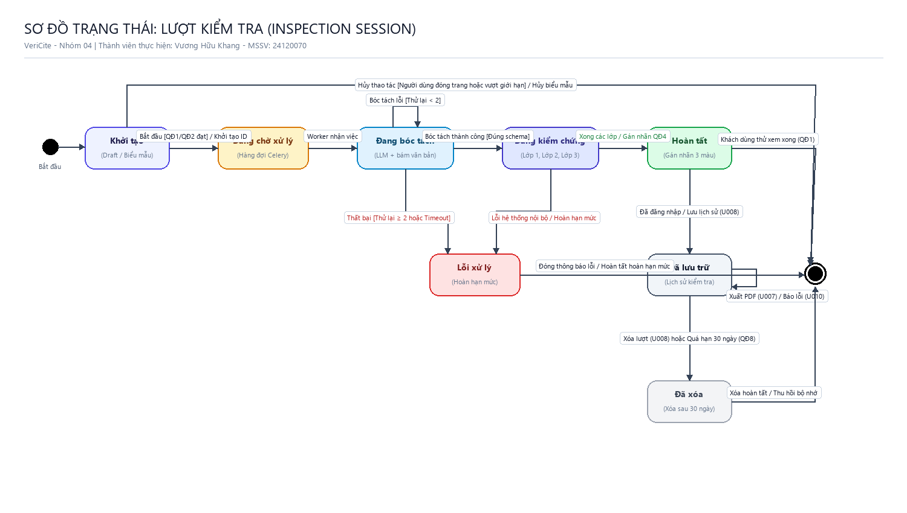
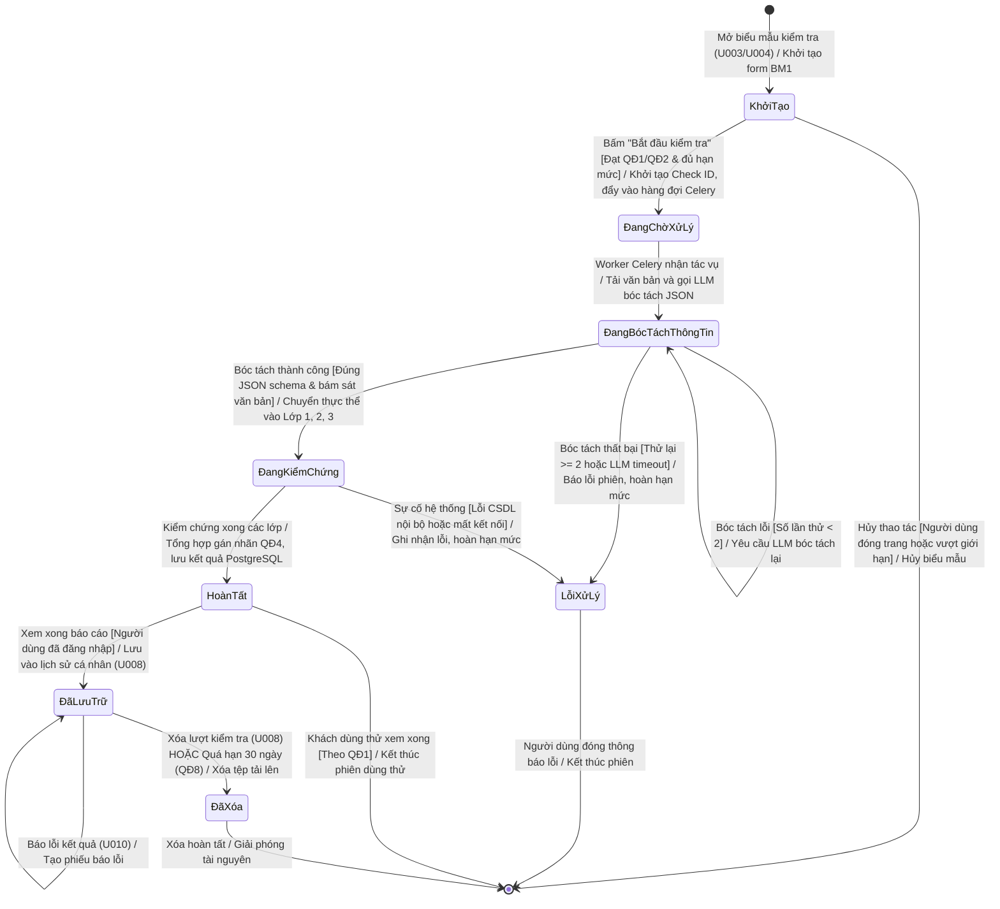
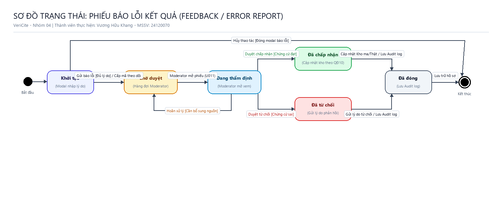
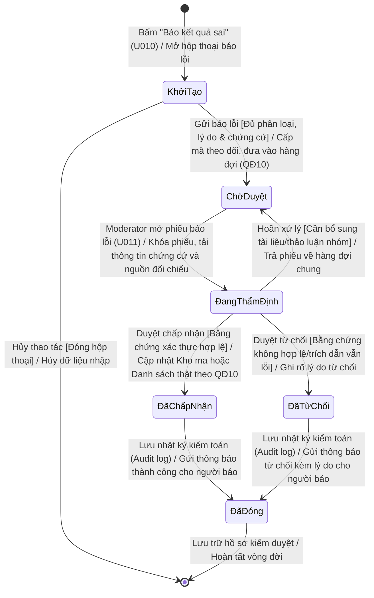
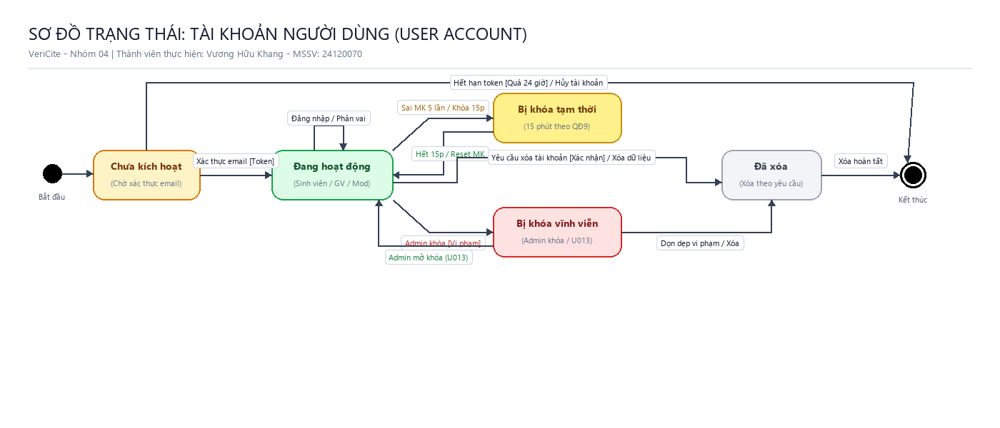
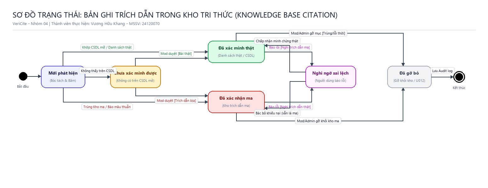
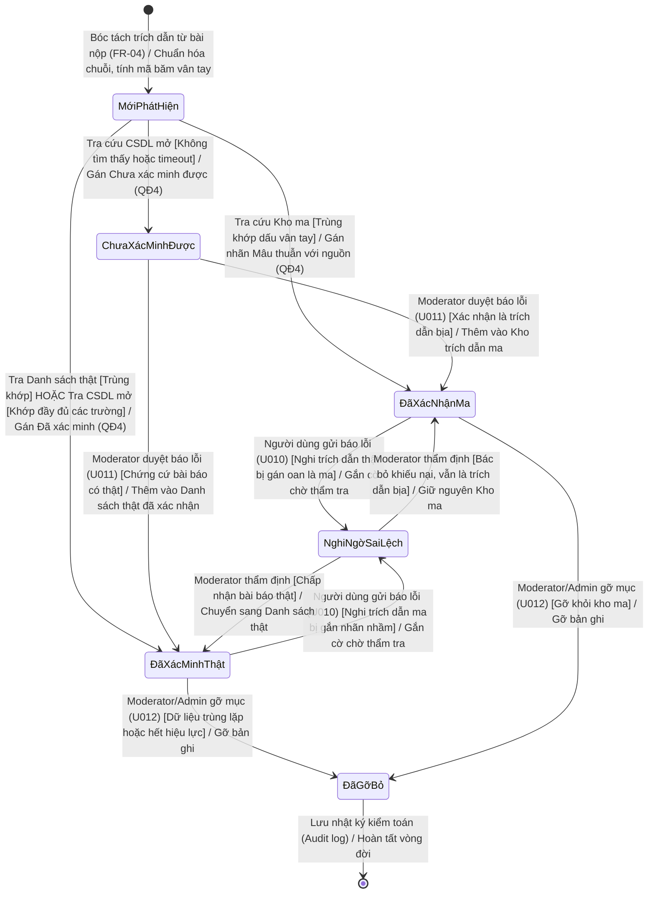

# TÀI LIỆU BỔ SUNG SƠ ĐỒ TRẠNG THÁI (STATE CHARTS) – PA02
## HỆ THỐNG KIỂM CHỨNG TRÍCH DẪN VERICITE
**Môn học:** Nhập môn Công nghệ Phần mềm  
**Nhóm thực hiện:** Nhóm 04 (Lớp 24_3)  
**Thành viên phụ trách:** Vương Hữu Khang – MSSV: 24120070  
**Phạm vi:** Bổ sung 4 Sơ đồ trạng thái (State Charts) và 4 Bảng chuyển trạng thái (State Transition Tables) cho các thực thể trọng yếu:
1. **Lượt kiểm tra** (*Inspection Session*)
2. **Phiếu báo lỗi kết quả** (*Error Report / Feedback*)
3. **Tài khoản người dùng** (*User Account*)
4. **Bản ghi trích dẫn trong kho tri thức** (*Knowledge Base Citation*)

**Tuân thủ nghiêm ngặt quy ước đồ án:**
- Tên trạng thái dùng danh từ/tính từ chỉ trạng thái: *Khởi tạo, Đang chờ xử lý, Đang bóc tách, Đang kiểm chứng, Hoàn tất, Lỗi xử lý, Đã lưu trữ, Đã xóa, Chờ duyệt, Đang thẩm định, Đã chấp nhận, Đã từ chối, Đã đóng, Chưa kích hoạt, Đang hoạt động, Bị khóa tạm thời, Bị khóa vĩnh viễn, Mới phát hiện, Chưa xác minh được, Đã xác minh thật, Đã xác nhận ma, Nghi ngờ sai lệch, Đã gỡ bỏ* (tuyệt đối không dùng động từ).
- Nhãn mũi tên tuân thủ cú pháp chuẩn UML State Machine: `sự kiện [điều kiện] / hành động`.
- Đầy đủ trạng thái bắt đầu (Initial State `●`) và trạng thái kết thúc (Final State `◉`).
- Đồng bộ chuẩn xác với 15 Use Case (U001–U015) và các quy định nghiệp vụ cốt lõi (QĐ1–QĐ10, FR-01–FR-17).
- Kèm đầy đủ file thiết kế gốc `.drawio` (nền trắng) và ảnh xuất độ phân giải cao `.png` (chế độ sáng).

---

# 1. Sơ đồ trạng thái Lượt kiểm tra (Inspection Session)

### 1.1. Ý nghĩa và Căn cứ nghiệp vụ
Thực thể **Lượt kiểm tra** đại diện cho một phiên làm việc kiểm chứng văn bản hoặc danh mục tham khảo do người dùng khởi tạo (U003 cho Khách dùng thử, U004 cho Sinh viên/Giảng viên kiểm tra văn bản đơn lẻ, U005 tải tài liệu nguồn đối chiếu, U008 xem/xóa lịch sử, U009 kiểm tra hàng loạt). Vòng đời của lượt kiểm tra được chi phối bởi:
- **QĐ1:** Hạn mức dùng thử cho khách vãng lai (tối đa 3 lượt/ngày, 5 trích dẫn/lượt, không tải tài liệu nguồn).
- **QĐ2:** Giới hạn đầu vào (tối đa 5.000 từ, tệp $\le 20$ trang/10 MB, tối đa 50 trích dẫn, tệp nguồn $\le 50$ MB).
- **QĐ3:** Giới hạn hàng loạt ($\le 30$ tệp, xử lý bất đồng bộ qua Celery, cô lập lỗi từng tệp).
- **QĐ4, QĐ6, QĐ7:** Quy tắc gán nhãn 3 màu, ngưỡng so khớp 90%/95%, không ẩn mục khỏi báo cáo.
- **QĐ8:** Chính sách tự động xóa vĩnh viễn tệp tải lên sau 30 ngày hoặc khi người dùng chủ động xóa lượt.
- **NFR-01, NFR-08:** Thời gian xử lý $\le 30$ giây cho 20 trích dẫn; chịu lỗi và hoàn hạn mức khi LLM hoặc dịch vụ ngoài gặp sự cố.

### 1.2. Sơ đồ trạng thái (State Diagram)

*Tệp thiết kế gốc draw.io:* [`PA02_Nhom04_SC_LuotKiemTra.drawio`](PA02_Nhom04_SC_LuotKiemTra.drawio)

### 1.3. Bảng chuyển trạng thái (State Transition Table) – Lượt kiểm tra

| STT | Trạng thái nguồn | Sự kiện kích hoạt (Trigger) [Điều kiện bảo vệ - Guard] | Hành động thực hiện (Action) | Trạng thái đích | Căn cứ Use Case & Quy định |
|:---:|---|---|---|---|---|
| 1 | `[*]` (Bắt đầu) | Người dùng truy cập trang kiểm tra | Khởi tạo biểu mẫu nhập liệu trống theo chuẩn BM1 | `Khởi tạo` | U003, U004 |
| 2 | `Khởi tạo` | Bấm nút "Bắt đầu kiểm tra" [Dữ liệu hợp lệ theo QĐ1/QĐ2 & còn đủ hạn mức ngày] | Sinh mã định danh duy nhất (Check ID), trừ tạm thời hạn mức, đẩy tác vụ vào hàng đợi Celery | `Đang chờ xử lý` | U004, QĐ2, QĐ9 |
| 3 | `Khởi tạo` | Người dùng đóng trình duyệt / chuyển trang HOẶC [Dữ liệu vượt giới hạn QĐ2/hết hạn mức] | Hủy dữ liệu form tạm thời, hiển thị thông báo lỗi giới hạn (nếu vi phạm), không trừ hạn mức | `[*]` (Kết thúc) | U004 (4a), QĐ2 |
| 4 | `Đang chờ xử lý` | Tiến trình nền (Worker) tiếp nhận tác vụ từ hàng đợi | Tải văn bản/tệp đính kèm, trích xuất DOI bằng Regex, chuẩn bị prompt và gửi yêu cầu tới LLM | `Đang bóc tách thông tin` | U004 (bước 5), FR-04 |
| 5 | `Đang bóc tách thông tin` | LLM trả về kết quả nhưng sai schema hoặc không qua kiểm tra bám văn bản [Số lần thử lại < 2] | Tăng biến đếm thử lại, gửi lại prompt yêu cầu LLM bóc tách lại bám sát tọa độ ký tự | `Đang bóc tách thông tin` | FR-04 |
| 6 | `Đang bóc tách thông tin` | LLM trả về lỗi/timeout HOẶC [Đã thử lại $\ge 2$ lần vẫn sai schema/bám văn bản] | Đánh dấu phiên thất bại, ghi log chi tiết lỗi, tự động hoàn trả hạn mức cho người dùng | `Lỗi xử lý` | FR-04, NFR-08 |
| 7 | `Đang bóc tách thông tin` | Bóc tách hoàn tất [100% thực thể khớp JSON schema và bám sát nguyên văn] | Chuyển danh sách trích dẫn, câu trích và nhận định sang bộ điều phối kiểm chứng 3 lớp | `Đang kiểm chứng` | U004 (bước 6), FR-04 |
| 8 | `Đang kiểm chứng` | Lớp 1, 2, 3 hoàn tất quy trình tra cứu và so khớp | Tổng hợp kết quả, gán nhãn chuẩn theo QĐ4 & QĐ5, lưu bản ghi báo cáo vào CSDL PostgreSQL (JSONB) | `Hoàn tất` | U004 (bước 9), FR-09, QĐ4 |
| 9 | `Đang kiểm chứng` | Phát sinh lỗi nghiêm trọng [Hỏng kết nối CSDL nội bộ PostgreSQL/Redis] | Hủy tiến trình kiểm chứng, ghi nhận mã lỗi hệ thống nội bộ, hoàn trả hạn mức kiểm tra | `Lỗi xử lý` | NFR-08 |
| 10 | `Lỗi xử lý` | Người dùng xác nhận thông báo lỗi trên màn hình hoặc đóng phiên | Đóng thông báo, giải phóng các tài nguyên bộ nhớ tạm | `[*]` (Kết thúc) | U004 |
| 11 | `Hoàn tất` | Người dùng đã đăng nhập hoàn thành xem báo cáo kết quả | Tự động đồng bộ và lưu trữ lượt kiểm tra vào danh sách lịch sử cá nhân | `Đã lưu trữ` | U006, U008, FR-12 |
| 12 | `Hoàn tất` | Khách vãng lai xem xong báo cáo dùng thử [Theo QĐ1] | Kết thúc phiên dùng thử; không lưu vào lịch sử, không lưu tệp | `[*]` (Kết thúc) | U003, QĐ1 |
| 13 | `Đã lưu trữ` | Người dùng yêu cầu xuất báo cáo PDF (U007) | Biên dịch dữ liệu báo cáo sang định dạng PDF chuẩn BM2, gửi tệp về trình duyệt | `Đã lưu trữ` | U007, FR-11 |
| 14 | `Đã lưu trữ` | Người dùng nhấn nút "Báo kết quả sai" tại một mục (U010) | Mở hộp thoại báo lỗi, tạo liên kết trỏ tới mục kiểm tra đang xét | `Đã lưu trữ` | U010, FR-14 |
| 15 | `Đã lưu trữ` | Người dùng bấm "Xóa lượt kiểm tra" (U008) HOẶC [Thời gian lưu trữ tệp đạt 30 ngày theo QĐ8] | Tiến trình hệ thống xóa vĩnh viễn tệp văn bản và tệp tài liệu nguồn đối chiếu khỏi máy chủ | `Đã xóa` | U008, QĐ8, FR-12 |
| 16 | `Đã xóa` | Quá trình xóa dữ liệu trên hệ thống tệp và CSDL hoàn tất | Ghi nhận nhật ký thu hồi tài nguyên lưu trữ | `[*]` (Kết thúc) | QĐ8 |

### 1.4. Phân tích các cặp chuyển trạng thái bị từ chối (Invalid Transitions)
1. **`Khởi tạo` $\rightarrow$ `Đang kiểm chứng` (BỊ TỪ CHỐI):** Không thể bỏ qua bước bóc tách thông tin vì các lớp kiểm chứng tất định đòi hỏi đầu vào có cấu trúc (tác giả, năm, tiêu đề, DOI, vị trí ký tự) chứ không thể xử lý trực tiếp văn bản thô.
2. **`Đang bóc tách thông tin` $\rightarrow$ `Hoàn tất` (BỊ TỪ CHỐI):** Bước bóc tách tuyệt đối không đưa ra phán xét hay gán nhãn học thuật; bắt buộc phải đi qua Lớp 1/Lớp 2/Lớp 3 để xác minh tất định.
3. **`Lỗi xử lý` $\rightarrow$ `Đã lưu trữ` (BỊ TỪ CHỐI):** Các lượt kiểm tra bị lỗi hệ thống không tạo báo cáo dở dang và không được lưu vào lịch sử để tránh làm sai lệch thống kê và gây hiểu lầm cho người dùng.
4. **`Đã xóa` $\rightarrow$ `Đã lưu trữ` (BỊ TỪ CHỐI):** Tệp và dữ liệu đã bị xóa vĩnh viễn theo QĐ8 không thể phục hồi lại trạng thái khả dụng.

---

# 2. Sơ đồ trạng thái Phiếu báo lỗi kết quả (Error Report / Feedback)

### 2.1. Ý nghĩa và Căn cứ nghiệp vụ
Thực thể **Phiếu báo lỗi kết quả** thể hiện quy trình phản hồi chất lượng và cơ chế "Human-in-the-loop" giữa người dùng và người kiểm duyệt (U010: Báo lỗi kết quả; U011: Duyệt báo lỗi; U012: Quản lý kho trích dẫn). Vòng đời phiếu báo lỗi tuân thủ nghiêm ngặt:
- **QĐ10:** Báo lỗi từ người dùng được đưa vào hàng đợi kiểm duyệt ở trạng thái "Chờ duyệt", tuyệt đối không làm thay đổi nhãn báo cáo hay kho dữ liệu ngay lập tức.
- **Thẩm định chứng cứ:** Moderator xem xét minh chứng và quyết định:
  - Nếu chấp nhận báo lỗi *"Trích dẫn là bịa"*: tự động đưa trích dẫn vào *Kho trích dẫn ma*.
  - Nếu chấp nhận báo lỗi *"Trích dẫn có thật bị gán sai"*: gỡ khỏi Kho trích dẫn ma (nếu có) và thêm vào *Danh sách trích dẫn thật đã xác nhận*.
  - Nếu từ chối: nêu rõ lý do giải thích bằng tiếng Việt và thông báo lại cho người báo.
- **Audit log:** Mọi thao tác phê duyệt bắt buộc phải ghi vết kiểm toán (người duyệt, thời điểm, lý do).

### 2.2. Sơ đồ trạng thái (State Diagram)

*Tệp thiết kế gốc draw.io:* [`PA02_Nhom04_SC_BaoLoi.drawio`](PA02_Nhom04_SC_BaoLoi.drawio)

### 2.3. Bảng chuyển trạng thái (State Transition Table) – Phiếu báo lỗi

| STT | Trạng thái nguồn | Sự kiện kích hoạt (Trigger) [Điều kiện bảo vệ - Guard] | Hành động thực hiện (Action) | Trạng thái đích | Căn cứ Use Case & Quy định |
|:---:|---|---|---|---|---|
| 1 | `[*]` (Bắt đầu) | Người dùng nhấp nút "Báo kết quả sai" tại một mục trên báo cáo | Mở hộp thoại modal báo lỗi, tải sẵn thông tin trích đoạn và mã mục | `Khởi tạo` | U010 |
| 2 | `Khởi tạo` | Người dùng điền phân loại lỗi, lý do, đính kèm URL/tệp chứng cứ và nhấn "Gửi" [Dữ liệu hợp lệ] | Sinh mã phiếu theo dõi (Feedback ID), lưu vào bảng `feedbacks`, đẩy vào hàng đợi duyệt của Moderator | `Chờ duyệt` | U010, QĐ10, FR-14 |
| 3 | `Khởi tạo` | Người dùng nhấn nút "Hủy" hoặc nhấp chuột ngoài vùng modal | Đóng hộp thoại, giải phóng dữ liệu nhập tạm thời | `[*]` (Kết thúc) | U010 |
| 4 | `Chờ duyệt` | Moderator mở phiếu báo lỗi từ bảng điều khiển kiểm duyệt (U011) | Khóa tạm thời phiếu để tránh xung đột giữa nhiều Moderator, tải chi tiết chứng cứ và bản ghi nguồn | `Đang thẩm định` | U011, FR-15 |
| 5 | `Đang thẩm định` | Moderator chọn "Hoãn lại để kiểm tra thêm" [Chưa đủ căn cứ kết luận] | Mở khóa phiếu, hoàn trả trạng thái về hàng đợi để thẩm định lại sau | `Chờ duyệt` | U011 |
| 6 | `Đang thẩm định` | Moderator bấm "Chấp nhận báo lỗi" [Chứng cứ xác thực bài báo có thật hoặc trích dẫn bịa] | Nếu báo trích dẫn bịa: ghi vào Kho ma. Nếu báo trích dẫn thật: gỡ khỏi Kho ma và ghi vào Danh sách thật | `Đã chấp nhận` | U011, U012, QĐ10, FR-15 |
| 7 | `Đang thẩm định` | Moderator bấm "Từ chối báo lỗi" [Chứng cứ ngụy tạo hoặc trích dẫn vẫn sai lệch] | Ghi nhận lý do bác bỏ chi tiết bằng tiếng Việt vào hệ thống | `Đã từ chối` | U011, QĐ10 |
| 8 | `Đã chấp nhận` | Hệ thống cập nhật thành công dữ liệu kho tri thức | Ghi nhận bản ghi Audit log (Moderator ID, thời điểm, hành động, lý do); gửi thông báo kết quả cho người báo | `Đã đóng` | U011, QĐ10, FR-15 |
| 9 | `Đã từ chối` | Hệ thống lưu lý do bác bỏ | Ghi nhận bản ghi Audit log; gửi thông báo từ chối kèm lý do phản hồi cho người báo | `Đã đóng` | U011, QĐ10 |
| 10 | `Đã đóng` | Phiếu đã hoàn tất toàn bộ quy trình xử lý và thông báo | Lưu trữ hồ sơ phiếu vào cơ sở dữ liệu phục vụ tra cứu lịch sử kiểm duyệt | `[*]` (Kết thúc) | U011 |

### 2.4. Phân tích các cặp chuyển trạng thái bị từ chối (Invalid Transitions)
1. **`Khởi tạo` $\rightarrow$ `Đã chấp nhận` (BỊ TỪ CHỐI):** Người dùng không thể tự duyệt báo lỗi của chính mình; bắt buộc phải trải qua khâu thẩm định độc lập của Moderator (chống phá hoại theo R-05, QĐ10).
2. **`Chờ duyệt` $\rightarrow$ `Đã chấp nhận` / `Đã từ chối` (BỊ TỪ CHỐI):** Không thể ra quyết định khi chưa chuyển sang trạng thái `Đang thẩm định` (tránh duyệt tự động hoặc duyệt mà không kiểm tra bằng chứng).
3. **`Đã đóng` $\rightarrow$ `Chờ duyệt` (BỊ TỪ CHỐI):** Phiếu đã có quyết định chính thức và lưu Audit log thì không được mở lại tùy tiện; nếu có tranh chấp mới, người dùng phải tạo phiếu báo lỗi mới.

---

# 3. Sơ đồ trạng thái Tài khoản người dùng (User Account)

### 3.1. Ý nghĩa và Căn cứ nghiệp vụ
Thực thể **Tài khoản người dùng** quản lý vòng đời truy cập, an toàn danh tính và kiểm soát quyền hạn (RBAC) của người dùng trên VeriCite (U001: Đăng ký; U002: Đăng nhập/Đăng xuất; U013: Quản lý người dùng và phân vai; U014: Quản lý hạn mức). Căn cứ quy định:
- **QĐ9:** Mật khẩu $\ge 8$ ký tự, tuân thủ chuẩn NIST SP 800-63B; băm bằng thuật toán Argon2id; khóa tạm thời 15 phút sau 5 lần đăng nhập thất bại liên tiếp để chống tấn công brute-force.
- **FR-01, FR-16:** Phân quyền theo vai (Sinh viên, Giảng viên, Moderator, Quản trị viên); Quản trị viên có quyền khóa/mở khóa tài khoản hoặc thu hồi quyền truy cập khi phát hiện hành vi lạm dụng/vi phạm.

### 3.2. Sơ đồ trạng thái (State Diagram)

*Tệp thiết kế gốc draw.io:* [`PA02_Nhom04_SC_TaiKhoan.drawio`](PA02_Nhom04_SC_TaiKhoan.drawio)

```mermaid
stateDiagram-v2
    [*] --> ChưaKíchHoạt: Đăng ký tài khoản (U001) [Mật khẩu đạt QĐ9] / Tạo tài khoản, gửi email kích hoạt
    
    ChưaKíchHoạt --> ĐangHoạtĐộng: Xác thực email [Mã token hợp lệ] / Kích hoạt tài khoản, gán vai trò Sinh viên
    ChưaKíchHoạt --> [*]: Hết hạn token kích hoạt [Quá 24 giờ] / Hủy bản ghi tài khoản chưa kích hoạt

    ĐangHoạtĐộng --> ĐangHoạtĐộng: Đăng nhập thành công / Cấp JWT token; Đăng xuất / Hủy phiên (U002)
    ĐangHoạtĐộng --> ĐangHoạtĐộng: Quản trị viên phân vai (U013) / Cập nhật vai trò (Sinh viên/Giảng viên/Moderator)
    
    ĐangHoạtĐộng --> BịKhóaTạmThời: Đăng nhập sai [Lần thứ 5 liên tiếp] / Khóa tài khoản 15 phút theo QĐ9
    BịKhóaTạmThời --> ĐangHoạtĐộng: Hết thời gian chờ [Sau 15 phút] HOẶC Đặt lại mật khẩu thành công / Mở khóa tự động, reset bộ đếm
    
    ĐangHoạtĐộng --> BịKhóaVĩnhViễn: Quản trị viên khóa tài khoản (U013) [Phát hiện vi phạm chính sách] / Thu hồi quyền, hủy phiên
    BịKhóaVĩnhViễn --> ĐangHoạtĐộng: Quản trị viên mở khóa (U013) [Sau khi xác minh khiếu nại] / Khôi phục quyền truy cập

    ĐangHoạtĐộng --> ĐãXóa: Yêu cầu xóa tài khoản [Người dùng xác nhận xóa] / Xóa dữ liệu định danh cá nhân
    BịKhóaVĩnhViễn --> ĐãXóa: Quản trị viên dọn dẹp [Tài khoản vi phạm nghiêm trọng] / Xóa vĩnh viễn
    
    ĐãXóa --> [*]: Xóa hoàn tất / Giải phóng tài nguyên
```

### 3.3. Bảng chuyển trạng thái (State Transition Table) – Tài khoản

| STT | Trạng thái nguồn | Sự kiện kích hoạt (Trigger) [Điều kiện bảo vệ - Guard] | Hành động thực hiện (Action) | Trạng thái đích | Căn cứ Use Case & Quy định |
|:---:|---|---|---|---|---|
| 1 | `[*]` (Bắt đầu) | Người dùng gửi biểu mẫu đăng ký tài khoản (U001) [Email hợp lệ & mật khẩu đạt chuẩn QĐ9] | Tạo bản ghi tài khoản ở trạng thái chờ, băm mật khẩu bằng Argon2id, gửi email chứa token kích hoạt | `Chưa kích hoạt` | U001, QĐ9, FR-01 |
| 2 | `Chưa kích hoạt` | Người dùng nhấp vào liên kết xác thực trong email [Token hợp lệ và còn trong 24 giờ] | Kích hoạt tài khoản, thiết lập cờ `is_active=True`, gán vai trò mặc định là Sinh viên | `Đang hoạt động` | U001, FR-01 |
| 3 | `Chưa kích hoạt` | Hết thời gian chờ xác thực [Token quá 24 giờ chưa kích hoạt] | Xóa bản ghi tài khoản rác khỏi hệ thống | `[*]` (Kết thúc) | QĐ9 |
| 4 | `Đang hoạt động` | Người dùng đăng nhập đúng tài khoản/mật khẩu (U002) | Sinh mã JWT phiên làm việc, thiết lập bộ đếm đăng nhập sai về 0 | `Đang hoạt động` | U002, FR-01 |
| 5 | `Đang hoạt động` | Quản trị viên thực hiện cấp hoặc thu hồi quyền hạn (U013) | Cập nhật vai trò (Sinh viên $\leftrightarrow$ Giảng viên $\leftrightarrow$ Moderator) và điều chỉnh hạn mức tương ứng (QĐ1–QĐ3) | `Đang hoạt động` | U013, U014, FR-16 |
| 6 | `Đang hoạt động` | Người dùng nhập sai mật khẩu [Bộ đếm số lần sai đạt mốc 5 lần liên tiếp] | Tự động kích hoạt cơ chế khóa tài khoản, ghi nhận mốc thời gian khóa 15 phút theo quy định QĐ9 | `Bị khóa tạm thời` | U002 (3a), QĐ9, NFR-04 |
| 7 | `Bị khóa tạm thời` | Người dùng đăng nhập lại [Thời gian hiện tại $\ge$ Thời điểm khóa + 15 phút] HOẶC Thực hiện đặt lại mật khẩu qua email thành công | Tự động mở khóa tài khoản, đặt lại bộ đếm đăng nhập sai về 0, cho phép đăng nhập lại bình thường | `Đang hoạt động` | U002, QĐ9 |
| 8 | `Đang hoạt động` | Quản trị viên kích hoạt chức năng "Khóa tài khoản" (U013) [Phát hiện tài khoản vi phạm chính sách/spam API] | Thiết lập trạng thái `is_suspended=True`, lập tức vô hiệu hóa mọi phiên JWT hiện hành của tài khoản | `Bị khóa vĩnh viễn` | U013, FR-16 |
| 9 | `Bị khóa vĩnh viễn` | Quản trị viên chọn "Mở khóa tài khoản" (U013) [Sau khi kiểm tra giải trình của người dùng] | Khôi phục trạng thái `is_suspended=False`, gửi email thông báo mở khóa cho người dùng | `Đang hoạt động` | U013, FR-16 |
| 10 | `Đang hoạt động` | Người dùng gửi yêu cầu "Xóa tài khoản cá nhân" [Xác nhận mật khẩu chính xác] | Xóa bỏ toàn bộ thông tin cá nhân (email, họ tên), xóa lịch sử kiểm tra theo chính sách quyền riêng tư | `Đã xóa` | QĐ8, NFR-05 |
| 11 | `Bị khóa vĩnh viễn` | Quản trị viên thực hiện chức năng "Xóa vĩnh viễn tài khoản vi phạm" | Xóa vĩnh viễn bản ghi tài khoản khỏi CSDL hệ thống | `Đã xóa` | U013 |
| 12 | `Đã xóa` | Quá trình xóa tài nguyên dữ liệu hoàn tất | Ghi nhận Audit log xóa tài khoản | `[*]` (Kết thúc) | QĐ8 |

### 3.4. Phân tích các cặp chuyển trạng thái bị từ chối (Invalid Transitions)
1. **`Chưa kích hoạt` $\rightarrow$ `Bị khóa tạm thời` (BỊ TỪ CHỐI):** Tài khoản chưa xác thực email thì chưa thể tham gia quy trình đăng nhập xác thực mật khẩu; do đó không thể bị khóa do nhập sai mật khẩu.
2. **`Bị khóa tạm thời` $\rightarrow$ `Đã xóa` (BỊ TỪ CHỐI):** Khi tài khoản đang trong trạng thái bị khóa an ninh 15 phút, mọi thao tác thay đổi thông tin hay xóa tài khoản đều bị chặn để phòng chống kẻ tấn công xóa dấu vết.
3. **`Bị khóa vĩnh viễn` $\rightarrow$ `Bị khóa tạm thời` (BỊ TỪ CHỐI):** Khóa vĩnh viễn là quyết định hành chính của Quản trị viên có độ ưu tiên cao hơn khóa tạm thời; không thể tự động hạ cấp xuống khóa tạm thời sau 15 phút.

---

# 4. Sơ đồ trạng thái Bản ghi trích dẫn trong kho tri thức (Knowledge Base Citation)

### 4.1. Ý nghĩa và Căn cứ nghiệp vụ
Thực thể **Bản ghi trích dẫn trong kho tri thức** biểu diễn sự tích lũy tri thức của hệ thống VeriCite, giúp giải quyết triệt để nhược điểm "không tích lũy tri thức" của các công cụ hiện nay (mục 2.1 PA02). Bản ghi này đại diện cho một trích dẫn cụ thể được định danh bằng dấu vân tay (mã băm chuỗi chuẩn hóa tác giả, năm, tiêu đề, nơi đăng, DOI). Căn cứ quy định:
- **QĐ4, FR-05:** Tra cứu đối chiếu nhanh dấu vân tay:
  - Nếu trùng với *Kho trích dẫn ma*: gán ngay nhãn *Mâu thuẫn với nguồn* (được xác nhận là trích dẫn bịa), không gọi API ra ngoài.
  - Nếu trùng với *Danh sách trích dẫn thật đã xác nhận*: gán ngay nhãn *Đã xác minh*.
- **QĐ10, FR-15, U012:** Quy trình cập nhật, điều chỉnh trạng thái và gỡ bỏ bản ghi trong kho bởi Moderator/Quản trị viên.

### 4.2. Sơ đồ trạng thái (State Diagram)

*Tệp thiết kế gốc draw.io:* [`PA02_Nhom04_SC_TrichDanTrongKho.drawio`](PA02_Nhom04_SC_TrichDanTrongKho.drawio)

### 4.3. Bảng chuyển trạng thái (State Transition Table) – Trích dẫn trong kho

| STT | Trạng thái nguồn | Sự kiện kích hoạt (Trigger) [Điều kiện bảo vệ - Guard] | Hành động thực hiện (Action) | Trạng thái đích | Căn cứ Use Case & Quy định |
|:---:|---|---|---|---|---|
| 1 | `[*]` (Bắt đầu) | Hệ thống bóc tách được một trích dẫn học thuật từ văn bản kiểm tra | Chuẩn hóa chuỗi (bỏ ký tự thừa, chữ thường hóa), tính mã băm vân tay (Fingerprint hash) | `Mới phát hiện` | FR-04, FR-05 |
| 2 | `Mới phát hiện` | Tra cứu trong Kho trích dẫn ma [Trùng khớp mã băm vân tay] | Gán ngay nhãn *Mâu thuẫn với nguồn*, gắn cảnh báo "Đã xác nhận là trích dẫn bịa", không gọi CSDL ngoài | `Đã xác nhận ma` | FR-05, QĐ4 |
| 3 | `Mới phát hiện` | Tra cứu Danh sách thật [Trùng khớp] HOẶC Tra CSDL mở (Lớp 1) [Khớp chính xác các trường theo FR-06] | Gán nhãn *Đã xác minh*, lưu đệm kết quả vào Redis | `Đã xác minh thật` | FR-05, FR-06, QĐ4 |
| 4 | `Mới phát hiện` | Tra cứu tất định trên CrossRef, Semantic Scholar, OpenAlex [Không tìm thấy bản ghi hoặc lỗi mạng timeout] | Gán nhãn *Chưa xác minh được* kèm cảnh báo không tìm thấy nguồn (tuyệt đối không quy kết là bịa) | `Chưa xác minh được` | FR-05, QĐ4, NFR-08 |
| 5 | `Chưa xác minh được` | Người dùng báo lỗi kèm minh chứng bài báo có thật và Moderator thẩm tra chấp thuận (U011) | Thêm trích dẫn vào *Danh sách trích dẫn thật đã xác nhận* kèm liên kết chứng cứ | `Đã xác minh thật` | U011, QĐ10, FR-15 |
| 6 | `Chưa xác minh được` | Người dùng hoặc Moderator xác minh độc lập phát hiện đây là trích dẫn do AI tự bịa (U011) | Thêm trích dẫn vào *Kho trích dẫn ma* để chặn đứng các lượt kiểm tra tương lai | `Đã xác nhận ma` | U011, QĐ10, FR-15 |
| 7 | `Đã xác minh thật` | Người dùng gửi phiếu báo lỗi (U010) [Nghi ngờ bài báo này là trích dẫn ma hoặc bị gán nhầm] | Gắn cờ cảnh báo nghi ngờ, tạo phiếu chuyển vào hàng đợi thẩm tra của Moderator | `Nghi ngờ sai lệch` | U010, FR-14 |
| 8 | `Đã xác nhận ma` | Người dùng gửi phiếu báo lỗi (U010) [Khẳng định trích dẫn có thật nhưng bị gắn nhầm vào kho ma] | Gắn cờ cảnh báo nghi ngờ, tạo phiếu chuyển vào hàng đợi thẩm tra của Moderator | `Nghi ngờ sai lệch` | U010, FR-14 |
| 9 | `Nghi ngờ sai lệch` | Moderator thẩm định [Xác nhận bằng chứng hợp lệ, trích dẫn là bài báo có thật] | Gỡ bỏ khỏi Kho trích dẫn ma, thêm vào Danh sách trích dẫn thật đã xác nhận | `Đã xác minh thật` | U011, U012, QĐ10 |
| 10 | `Nghi ngờ sai lệch` | Moderator thẩm định [Xác nhận khiếu nại không đúng, trích dẫn vẫn hoàn toàn là bịa] | Giữ nguyên trích dẫn trong Kho trích dẫn ma, đóng cờ nghi ngờ | `Đã xác nhận ma` | U011, QĐ10 |
| 11 | `Đã xác minh thật` | Moderator hoặc Quản trị viên thực hiện chức năng gỡ bỏ (U012) [Dữ liệu sai lệch hoặc trùng lặp] | Gỡ bỏ bản ghi khỏi Danh sách trích dẫn thật đã xác nhận | `Đã gỡ bỏ` | U012, FR-15 |
| 12 | `Đã xác nhận ma` | Moderator hoặc Quản trị viên thực hiện chức năng gỡ bỏ (U012) [Dữ liệu lỗi thời hoặc nhầm lẫn] | Gỡ bỏ bản ghi khỏi Kho trích dẫn ma | `Đã gỡ bỏ` | U012, FR-15 |
| 13 | `Đã gỡ bỏ` | Quá trình gỡ bỏ bản ghi hoàn tất | Ghi nhận Audit log chi tiết (người gỡ, thời điểm, lý do) | `[*]` (Kết thúc) | U012, QĐ10 |

### 4.4. Phân tích các cặp chuyển trạng thái bị từ chối (Invalid Transitions)
1. **`Mới phát hiện` $\rightarrow$ `Đã gỡ bỏ` (BỊ TỪ CHỐI):** Trích dẫn mới phát hiện chưa từng được nạp vào kho lưu trữ tri thức (Kho ma hay Danh sách thật) thì không thể thực hiện thao tác gỡ bỏ.
2. **`Đã xác nhận ma` $\rightarrow$ `Đã xác minh thật` (BỊ TỪ CHỐI TRỰC TIẾP):** Không thể chuyển trạng thái tức thì từ trích dẫn ma sang trích dẫn thật mà không đi qua bước trung gian `Nghi ngờ sai lệch` và quy trình thẩm định bằng chứng của Moderator (phòng ngừa sửa đổi trái phép).
3. **`Chưa xác minh được` $\rightarrow$ `Đã gỡ bỏ` (BỊ TỪ CHỐI):** Trạng thái chưa xác minh chỉ là nhãn đánh giá tạm thời của lượt kiểm tra, chưa phải bản ghi chính thức trong kho tri thức nên không có đối tượng để gỡ bỏ.

---

# 5. Danh mục các tệp sản phẩm bàn giao (Deliverables)

| STT | Tên tệp | Định dạng | Mô tả nội dung | Vị trí lưu trữ |
|:---:|---|:---:|---|---|
| 1 | `PA02_Nhom04_SC_LuotKiemTra.drawio` | XML draw.io | Sơ đồ trạng thái Lượt kiểm tra (nền trắng chuẩn draw.io) | `PA/` |
| 2 | `PA02_Nhom04_SC_LuotKiemTra.png` | Ảnh PNG (150 DPI) | Ảnh sơ đồ trạng thái Lượt kiểm tra (chế độ sáng, rõ nét) | `PA/` |
| 3 | `PA02_Nhom04_SC_BaoLoi.drawio` | XML draw.io | Sơ đồ trạng thái Phiếu báo lỗi kết quả (nền trắng) | `PA/` |
| 4 | `PA02_Nhom04_SC_BaoLoi.png` | Ảnh PNG (150 DPI) | Ảnh sơ đồ trạng thái Phiếu báo lỗi kết quả (chế độ sáng) | `PA/` |
| 5 | `PA02_Nhom04_SC_TaiKhoan.drawio` | XML draw.io | Sơ đồ trạng thái Tài khoản người dùng (nền trắng) | `PA/` |
| 6 | `PA02_Nhom04_SC_TaiKhoan.png` | Ảnh PNG (150 DPI) | Ảnh sơ đồ trạng thái Tài khoản người dùng (chế độ sáng) | `PA/` |
| 7 | `PA02_Nhom04_SC_TrichDanTrongKho.drawio` | XML draw.io | Sơ đồ trạng thái Trích dẫn trong kho tri thức (nền trắng) | `PA/` |
| 8 | `PA02_Nhom04_SC_TrichDanTrongKho.png` | Ảnh PNG (150 DPI) | Ảnh sơ đồ trạng thái Trích dẫn trong kho tri thức (chế độ sáng) | `PA/` |
| 9 | `PA02_Nhom04_StateCharts_Khang.md` | Markdown | Toàn văn tài liệu đặc tả 4 Sơ đồ trạng thái và 4 Bảng chuyển trạng thái | `PA/` |

---
*Tài liệu được hoàn thiện và chuẩn hóa bởi Vương Hữu Khang (MSSV: 24120070) – Nhóm 04 (VeriCite).*
