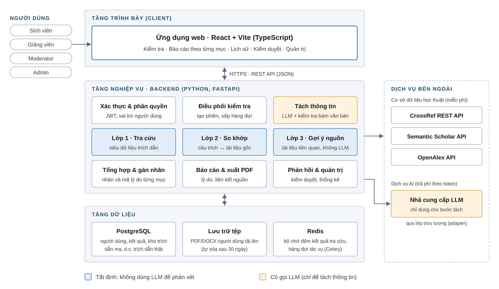
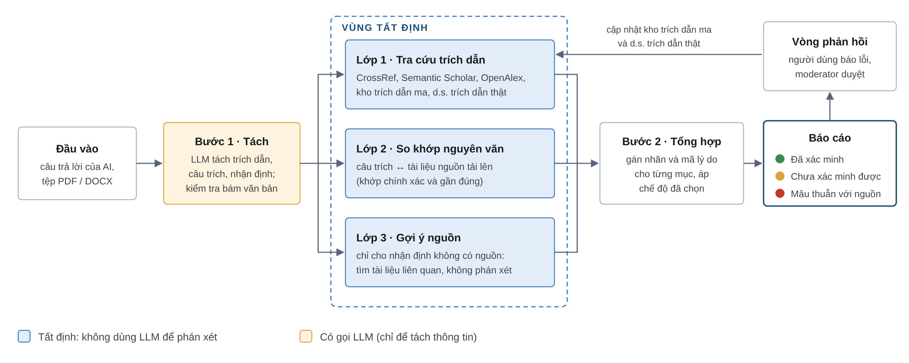
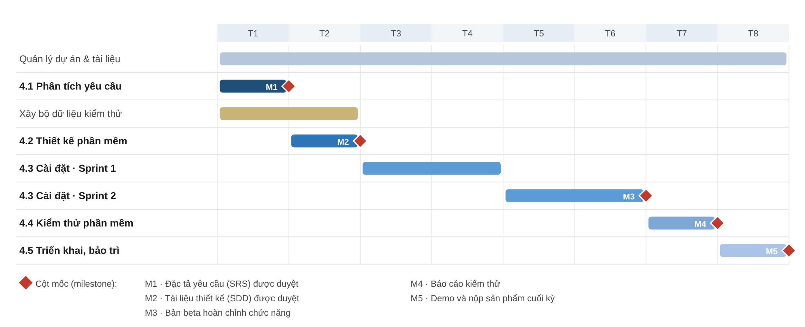

# VeriCite – Project Proposal

**Hệ thống phát hiện và kiểm chứng ảo giác AI trong nội dung học thuật**

Nhập môn Công nghệ phần mềm · Trường ĐH Khoa học Tự nhiên – ĐHQG TP.HCM · Khoa CNTT · Bộ môn Công nghệ phần mềm

| | |
|---|---|
| Lớp | 24_3 |
| Nhóm | Nhóm 04 |
| Giảng viên hướng dẫn | ThS. Ngô Ngọc Đăng Khoa |
| Thành viên | 24120115 – Lê Tấn Phát; 24120091 – Lâm Duy Minh; 24120089 – Tạ Quang Mạnh; 24120070 – Vương Hữu Khang |

Thành phố Hồ Chí Minh, tháng 10 năm 2026

## Mục lục

- Các nội dung chính
- 1 Bảng đánh giá thành viên
- 2 Phát biểu bài toán sơ lược (2.1 Bối cảnh · 2.2 Hạn chế của các giải pháp hiện có · 2.3 Phát biểu bài toán · 2.4 Môi trường hoạt động · 2.5 Ràng buộc thiết kế và triển khai)
- 3 Giải pháp đề xuất (3.1 Phần mềm · 3.2 Phần cứng)
- 4 Kế hoạch phát triển (4.1 – 4.5)
- 5 Kế hoạch nhân sự & chi phí (5.1 Cơ cấu nhân sự · 5.2 Chi phí dự kiến)
- Phụ lục A – Phân tích yêu cầu sơ bộ (A.1 – A.16)
- Tài liệu tham khảo

---

## Các nội dung chính

Mô hình ngôn ngữ lớn (LLM – Large Language Model) đang được dùng rộng rãi trong học tập và nghiên cứu, nhưng vẫn thường xuyên tạo ra nội dung trôi chảy, tự tin mà sai sự thật hoặc không có căn cứ. Hiện tượng này được gọi là **ảo giác** (hallucination). Trong môi trường học thuật, dạng ảo giác gây hại nhiều nhất là tài liệu tham khảo bịa đặt và câu trích dẫn sai lệch so với văn bản gốc.

Tài liệu này đề xuất **VeriCite**, một ứng dụng web giúp sinh viên và giảng viên phát hiện, giải thích và cảnh báo ảo giác trong nội dung học thuật do AI sinh ra. Khác với các công cụ dùng chính AI để kiểm tra AI, VeriCite theo nguyên tắc *LLM chỉ tách thông tin, nguồn tất định mới xác minh*: trích dẫn được đối chiếu với cơ sở dữ liệu học thuật, câu trích được so khớp với văn bản gốc, còn nhận định không có nguồn được đánh dấu rõ và kèm tài liệu gợi ý để người dùng tự kiểm, không để AI tự phán xét đúng sai.

Theo biểu mẫu Project Proposal, tài liệu gồm năm phần: bảng đánh giá thành viên (mục 1); phát biểu bài toán sơ lược, gồm bối cảnh, môi trường hoạt động và ràng buộc kỹ thuật (mục 2); giải pháp đề xuất về chức năng, kiến trúc và phần cứng (mục 3); kế hoạch phát triển 8 tuần (mục 4); và kế hoạch nhân sự, chi phí (mục 5). Phụ lục A trình bày phân tích yêu cầu sơ bộ của ý tưởng: stakeholder, phạm vi, yêu cầu chức năng và phi chức năng có tiêu chí kiểm chứng, scenario, test case, rủi ro, kế hoạch khảo sát và ma trận truy vết.

**Bảng 1.** *Tóm tắt dự án*

|                               |                                                                                                       |
|-------------------------------|-------------------------------------------------------------------------------------------------------|
| **Tên dự án**                 | VeriCite – Hệ thống phát hiện và kiểm chứng ảo giác AI trong nội dung học thuật                       |
| **Loại sản phẩm**             | Ứng dụng web (client–server), giao diện tiếng Việt                                                    |
| **Người dùng**                | Sinh viên, giảng viên, moderator (người kiểm duyệt), quản trị viên                                    |
| **Điểm khác biệt**            | Xác minh tất định dựa trên nguồn; đánh giá theo từng nhận định; kho trích dẫn ma tích lũy từ phản hồi |
| **Thời gian**                 | 8 tuần, 5 giai đoạn, 5 cột mốc                                                                       |
| **Nhân sự**                   | 4 thành viên, khoảng 320 giờ công                                                                     |
| **Chi phí tiền mặt ước tính** | Khoảng 1 triệu đồng (hạ tầng, tên miền, API LLM)                                                    |

## 1 Bảng đánh giá thành viên

Bảng 2 ghi nhận mức đóng góp của từng thành viên cho tài liệu Project Proposal. Mức đóng góp của mỗi người tối đa 100%; vai trò cụ thể được trình bày tại mục 5.1.

**Bảng 2.** *Bảng đánh giá thành viên*

| **MSSV** | **Họ tên**      | **% đóng góp (tối đa 100%)** | **Chữ ký** |
|----------|-----------------|------------------------------|------------|
| 24120115 | Lê Tấn Phát     | 100%                         |            |
| 24120091 | Lâm Duy Minh    | 100%                         |            |
| 24120089 | Tạ Quang Mạnh   | 100%                         |            |
| 24120070 | Vương Hữu Khang | 100%                         |            |

## 2 Phát biểu bài toán sơ lược

### 2.1 Bối cảnh

Các trợ lý AI như ChatGPT, Gemini hay Claude đã trở thành công cụ quen thuộc của sinh viên khi tìm tài liệu, tóm tắt và viết báo cáo. Tuy nhiên, LLM sinh văn bản bằng cách dự đoán chuỗi từ có xác suất cao, không phải bằng cách tra cứu sự thật. Vì vậy mô hình có thể tạo ra nội dung sai sự thật (*factuality hallucination*) hoặc không trung thành với tài liệu được cung cấp (*faithfulness hallucination*)[^1]. Bảng 3 tổng hợp một số số liệu gần đây.

**Bảng 3.** *Một số số liệu về ảo giác của LLM*

| **Nguồn**                      | **Phạm vi khảo sát**                         | **Kết quả chính**                                                                                                            |
|--------------------------------|----------------------------------------------|------------------------------------------------------------------------------------------------------------------------------|
| Vectara Leaderboard (2026)[^2] | Tóm tắt hơn 7.700 bài viết                   | Ba mô hình tốt nhất sai 1,8–3,3%, tệ nhất khoảng 24%; mô hình suy luận (reasoning model) o3-pro sai tới 23,3% |
| Walters & Wilder (2023)[^3]    | 636 trích dẫn do ChatGPT tạo cho 84 bài viết | 55% trích dẫn của GPT-3.5 và 18% của GPT-4 bị bịa hoàn toàn; 24–43% trích dẫn có thật vẫn sai chi tiết                       |
| Magesh và cộng sự (2025)[^4]   | Công cụ AI pháp lý thương mại đã dùng RAG    | Lexis+ AI sai khoảng 17%, Westlaw AI khoảng 33% số truy vấn                                                                  |
| GPTZero (2026)[^5]             | 4.841 bài được chấp nhận tại NeurIPS 2025    | 100 trích dẫn bịa trong hơn 50 bài, dù đã qua phản biện (peer review)                                                        |
| Charlotin (2026)[^6]           | Hồ sơ nộp tòa án Mỹ có án lệ do AI bịa       | 1.240 vụ; tăng từ 11 vụ năm 2023 lên 524 vụ năm 2025 và 668 vụ trong 7 tháng đầu 2026                                        |

Hai nguồn của Magesh và Charlotin thuộc lĩnh vực pháp lý (ngoài phạm vi kiểm chứng của VeriCite), nhưng được giữ lại vì chúng cho thấy hai điều áp dụng chung cho mọi văn bản học thuật: kể cả công cụ thương mại đã dùng RAG vẫn bịa nguồn, và hậu quả của trích dẫn bịa đang tăng nhanh. Ngoài ra, hai điểm trong các số liệu trên đặc biệt đáng chú ý. Thứ nhất, chỉ 2% bài báo bịa gắn với một tạp chí không tồn tại[^7]: phần lớn trích dẫn giả mượn tên tạp chí, nhà xuất bản có thật, nên rất khó phát hiện bằng mắt. Thứ hai, OpenAI chỉ ra rằng cách huấn luyện và chấm điểm hiện nay thưởng cho việc đoán thay vì thừa nhận không biết[^8]. Do đó, ảo giác khó biến mất chỉ nhờ mô hình mạnh hơn, và người dùng cần một lớp kiểm chứng độc lập nằm ngoài mô hình.

### 2.2 Hạn chế của các giải pháp hiện có

Các kỹ thuật giảm ảo giác hiện nay đều có giá trị nhưng chỉ giải quyết một phần vấn đề (Bảng 4).

**Bảng 4.** *Các giải pháp hiện có và hạn chế*

| **Giải pháp**                        | **Cơ chế**                                         | **Hạn chế chính**                                                                  |
|--------------------------------------|----------------------------------------------------|------------------------------------------------------------------------------------|
| Huấn luyện lại mô hình (RLHF)        | Dạy mô hình từ chối khi không chắc chắn            | Chỉ nhà phát triển mô hình làm được; người dùng không kiểm soát                    |
| RAG (Retrieval-Augmented Generation) | Mô hình trả lời dựa trên tài liệu được truy xuất   | Vẫn sai 17–33% trong nghiên cứu Stanford[^9]; có nguồn nhưng trích sai             |
| Kỹ thuật viết prompt                 | Yêu cầu trích nguồn, cho phép trả lời “không biết” | Phụ thuộc vào việc mô hình tuân thủ; nguồn trích ra cũng có thể bịa                |
| Chain-of-Verification[^10]           | Mô hình tự đặt câu hỏi kiểm tra rồi sửa            | Vẫn là AI tự chấm AI, dễ lặp lại lỗi cũ                                            |
| Semantic entropy[^11]                | Hỏi nhiều lần, đo độ nhất quán ngữ nghĩa           | Tốn khoảng 10 lần chi phí; không bắt được lỗi sai nhất quán                        |
| Công cụ kiểm tra thương mại          | Agent AI tìm trích dẫn không có trên mạng          | Nhà cung cấp vẫn khuyến nghị người dùng xác nhận lại[^12]; ít giải thích sai ở đâu |

Tổng hợp lại, các giải pháp hiện có mắc ba điểm yếu chung: (1) **dùng AI để kiểm tra AI**, nên bộ kiểm tra cũng có thể ảo giác; (2) **kết quả thiếu chi tiết**: kỹ thuật phía mô hình chỉ cho một đánh giá chung, còn công cụ kiểm tra trích dẫn thương mại tuy gắn cờ từng trích dẫn nhưng ít chỉ ra trường nào sai, giá trị đúng là gì, và không xét câu trích hay nhận định không có nguồn; (3) **không tích lũy tri thức**, cùng một trích dẫn giả bị kiểm tra lại từ đầu mỗi lần xuất hiện.

### 2.3 Phát biểu bài toán

Nhóm đề xuất xây dựng **VeriCite**, ứng dụng web cho phép người dùng đưa vào một trong ba loại dữ liệu: đoạn văn bản do AI sinh ra, danh mục tài liệu tham khảo, hoặc tệp báo cáo PDF/DOCX; kèm theo tùy chọn là tài liệu nguồn mà văn bản đã trích dẫn. Hệ thống tách văn bản thành từng trích dẫn, câu trích và nhận định, kiểm chứng từng mục, rồi trả về báo cáo trong đó mỗi mục mang một trong ba nhãn *Đã xác minh*, *Chưa xác minh được* hoặc *Mâu thuẫn với nguồn*, kèm lý do và liên kết đến nguồn đối chiếu.

Các nghiệp vụ chính của hệ thống gồm:

1.  **Kiểm tra trích dẫn:** xác định tài liệu tham khảo có tồn tại không và các trường tác giả, năm, tiêu đề, tạp chí, DOI có khớp bản gốc không.

2.  **So khớp câu trích:** kiểm tra câu được trích có thật sự nằm trong tài liệu nguồn người dùng tải lên.

3.  **Đánh dấu nhận định không có nguồn:** cảnh báo và gợi ý tài liệu liên quan để người dùng tự kiểm, không khẳng định đúng sai.

4.  **Báo cáo và lưu trữ:** hiển thị kết quả theo từng nhận định, xuất PDF, lưu lịch sử.

5.  **Phản hồi và kiểm duyệt:** người dùng báo kết quả sai, moderator duyệt và cập nhật kho trích dẫn ma cùng danh sách trích dẫn thật đã xác nhận.

6.  **Quản trị:** quản lý tài khoản, hạn mức sử dụng và chi phí gọi API.

Hệ thống hướng tới ba mục tiêu đo được trên bộ dữ liệu kiểm thử 120 trích dẫn (mục 4.1): phát hiện ít nhất 90% trích dẫn bịa; báo nhầm trích dẫn thật thành bịa không quá 5%; và kiểm tra 20 trích dẫn trong không quá 30 giây. Trong 60 trích dẫn thật có ít nhất 12 mục là sách, giáo trình hoặc tài liệu tiếng Việt, để tỷ lệ báo nhầm phản ánh đúng môi trường sử dụng thực tế chứ không chỉ các bài báo có sẵn trên CrossRef. Phiên bản đầu không huấn luyện mô hình riêng, không kiểm chứng tin tức hay thông tin y tế, và không kiểm tra hình ảnh, bảng số liệu.

### 2.4 Môi trường hoạt động

- **Phía người dùng:** trình duyệt web hỗ trợ HTML5 và ES2020 (hai phiên bản gần nhất của Chrome, Edge, Firefox, Safari); giao diện responsive cho máy tính, máy tính bảng và điện thoại (trên điện thoại ưu tiên dán văn bản và xem báo cáo); cần kết nối Internet.

- **Phía máy chủ:** hệ điều hành Linux (Ubuntu Server 24.04 LTS), ứng dụng chạy trong container Docker; giao tiếp qua HTTPS (TLS 1.2 trở lên); máy chủ cần truy cập Internet để gọi dịch vụ bên ngoài.

- **Dịch vụ bên ngoài:** CrossRef, Semantic Scholar và OpenAlex (cơ sở dữ liệu học thuật mở) và một nhà cung cấp LLM qua API.

### 2.5 Ràng buộc thiết kế và triển khai

Bảng 5 nêu các lựa chọn công nghệ và quy chuẩn mà nhóm cam kết tuân theo.

**Bảng 5.** *Ràng buộc thiết kế và triển khai*

| **Hạng mục**             | **Lựa chọn**                                                                                       | **Lý do**                                                                                                                           |
|--------------------------|----------------------------------------------------------------------------------------------------|-------------------------------------------------------------------------------------------------------------------------------------|
| **Giao diện (frontend)** | React, TypeScript, Vite (ứng dụng trang đơn, SPA), Tailwind CSS                                    | Ứng dụng nằm sau đăng nhập nên không cần render phía máy chủ; bản build tĩnh do Nginx phục vụ, không tốn thêm tiến trình Node trên VPS 4 GB; TypeScript giảm lỗi kiểu dữ liệu |
| **Máy chủ (backend)**    | Python 3.12, FastAPI                                                                               | Python mạnh về xử lý văn bản (PyMuPDF, python-docx, RapidFuzz) và có SDK của các nhà cung cấp LLM; FastAPI tự sinh tài liệu OpenAPI |
| **Cơ sở dữ liệu**        | PostgreSQL 16                                                                                      | CSDL quan hệ ổn định; kiểu JSONB lưu kết quả kiểm tra linh hoạt; có tìm kiếm toàn văn                                               |
| **Bộ đệm, hàng đợi**     | Redis và hàng đợi tác vụ (Celery)                                                                  | Kiểm tra dài chạy nền; Celery có sẵn cơ chế thử lại có giãn cách và giới hạn tốc độ gọi theo tác vụ (cần cho NFR-08); lưu đệm kết quả tra cứu để không vượt giới hạn gọi API |
| **Gọi LLM**              | Qua lớp trừu tượng (adapter), đầu ra JSON có cấu trúc kèm vị trí ký tự; mọi giá trị tách ra được kiểm tra bám văn bản gốc | Đổi nhà cung cấp hoặc mô hình mà không sửa nghiệp vụ; chặn trường hợp LLM sửa hoặc bịa giá trị ngay ở bước tách |
| **Triển khai**           | Docker Compose trên VPS; CI bằng GitHub Actions                                                    | Môi trường phát triển và demo đồng nhất; tự động chạy kiểm thử                                                                      |
| **Quy trình, tài liệu**  | Mô hình lai, cài đặt theo Scrum (sprint 2 tuần); UML 2.5; đặc tả yêu cầu theo ISO/IEC/IEEE 29148 | Phù hợp nhóm nhỏ, thời gian ngắn; tài liệu theo chuẩn môn học                                                                       |
| **Bảo mật**              | OWASP Top 10; băm mật khẩu bằng Argon2; tuân thủ điều khoản sử dụng API                            | Bảo vệ tài khoản và tài liệu người dùng tải lên                                                                                     |

## 3 Giải pháp đề xuất

VeriCite được xây dựng trên một nguyên tắc: **LLM chỉ làm việc nó làm tốt là tách thông tin từ văn bản; việc xác minh ưu tiên các nguồn tất định**, tức cùng đầu vào luôn cho cùng kết quả và không thể tự bịa. Mục 3.1 trình bày chức năng và kiến trúc phần mềm; mục 3.2 trình bày yêu cầu phần cứng.

### 3.1 Phần mềm

#### 3.1.1 Danh sách các chức năng phần mềm

Bảng 6 dùng câu chuyện người dùng (user story) để lý giải sự cần thiết của từng chức năng. Cột *Loại* phân biệt yêu cầu chức năng (CN) và phi chức năng (PCN).

**Bảng 6.** *Danh sách chức năng theo câu chuyện người dùng*

| **\#** | **Nhu cầu**                                                                             | **Yêu cầu**                          | **Loại** |
|--------|-----------------------------------------------------------------------------------------|--------------------------------------|----------|
| 1      | Là khách, tôi muốn thử kiểm tra vài trích dẫn trước khi đăng ký                         | Kiểm tra dùng thử                    | CN       |
| 2      | Là người dùng mới, tôi muốn tạo tài khoản bằng email                                    | Đăng ký, đăng nhập                   | CN       |
| 3      | Là sinh viên, tôi muốn biết tài liệu tham khảo do AI đưa ra có tồn tại thật không       | Kiểm tra trích dẫn                   | CN       |
| 4      | Là sinh viên, tôi muốn biết tác giả, năm, tạp chí của trích dẫn có khớp bản gốc không   | Đối chiếu chi tiết trích dẫn         | CN       |
| 5      | Là sinh viên, tôi muốn biết câu AI trích từ giáo trình của tôi có đúng nguyên văn không | So khớp câu trích với tài liệu nguồn | CN       |
| 6      | Là người dùng, tôi muốn biết nhận định nào đã có căn cứ, nhận định nào chưa và vì sao   | Đánh giá theo từng nhận định         | CN       |
| 7      | Là người dùng, tôi muốn chọn mức độ nghiêm ngặt khi kiểm tra                            | Chọn chế độ rủi ro                   | CN       |
| 8      | Là người dùng, tôi muốn tải báo cáo kiểm tra để đính kèm bài nộp                        | Xuất báo cáo PDF                     | CN       |
| 9      | Là người dùng đã đăng ký, tôi muốn xem lại các lần kiểm tra trước                       | Lịch sử kiểm tra                     | CN       |
| 10     | Là giảng viên, tôi muốn kiểm tra danh mục tham khảo của nhiều bài nộp cùng lúc          | Kiểm tra hàng loạt                   | CN       |
| 11     | Là người dùng, tôi muốn báo một kết quả sai để hệ thống sửa                             | Báo lỗi kết quả                      | CN       |
| 12     | Là moderator, tôi muốn duyệt các báo lỗi trước khi cập nhật kho dữ liệu                 | Kiểm duyệt, quản lý kho trích dẫn ma | CN       |
| 13     | Là quản trị viên, tôi muốn quản lý tài khoản và hạn mức sử dụng                         | Quản lý người dùng                   | CN       |
| 14     | Là quản trị viên, tôi muốn theo dõi số lượt kiểm tra và chi phí API                     | Thống kê, giám sát chi phí           | CN       |
| 15     | Là người dùng, tôi muốn kiểm tra 20 trích dẫn xong trong vòng 30 giây                   | Xử lý nhanh                          | PCN      |
| 16     | Là người dùng, tôi muốn tài liệu tải lên không bị người khác xem                        | Bảo mật dữ liệu                      | PCN      |
| 17     | Là người dùng đã đăng ký, tôi muốn mật khẩu của tôi không thể dễ dàng dò được           | Bảo vệ mật khẩu                      | PCN      |
| 18     | Là người dùng, tôi muốn mỗi nhãn đều có lý do và liên kết để tự kiểm tra lại            | Minh bạch kết quả                    | PCN      |
| 19     | Là người dùng, tôi muốn giao diện tiếng Việt, dễ dùng                                   | Tiện dụng                            | PCN      |

Các quy định nghiệp vụ liên quan được liệt kê trong Bảng 7. Các ngưỡng số là giá trị khởi điểm và sẽ được hiệu chỉnh ở giai đoạn thiết kế dựa trên bộ dữ liệu kiểm thử.

**Bảng 7.** *Quy định liên quan*

| **Mã**   | **Quy định**                                                                                                                                                               | **Áp dụng cho** |
|----------|----------------------------------------------------------------------------------------------------------------------------------------------------------------------------|-----------------|
| **QĐ1**  | Khách được kiểm tra tối đa 3 lượt mỗi ngày, mỗi lượt không quá 5 trích dẫn                                                                                                 | \#1             |
| **QĐ2**  | Mỗi lượt kiểm tra: văn bản không quá 10.000 từ và 50 trích dẫn; tệp PDF, DOCX hoặc TXT không quá 10 MB                                                                     | \#3–#6          |
| **QĐ3**  | Kiểm tra hàng loạt tối đa 30 tệp mỗi lượt                                                                                                                                  | \#10            |
| **QĐ4**  | Nhãn *Đã xác minh* chỉ gán khi khớp nguồn tất định (CSDL học thuật, tài liệu nguồn tải lên) hoặc khớp danh sách trích dẫn thật đã được moderator xác nhận kèm bằng chứng; *Mâu thuẫn với nguồn* khi nguồn tồn tại nhưng có trường sai, câu trích không khớp, hoặc trích dẫn trùng kho trích dẫn ma; còn lại là *Chưa xác minh được*. Mỗi nhãn kèm mã lý do; báo cáo xếp mục theo mức cảnh báo, trong đó "không tìm thấy ở nguồn nào" thuộc mức cảnh báo cao | \#6             |
| **QĐ5**  | Lớp 3 (gợi ý nguồn) không bao giờ gán nhãn *Đã xác minh*; tài liệu gợi ý chỉ để người dùng tự kiểm, không phải bằng chứng                                                 | \#6             |
| **QĐ6**  | So khớp gần đúng: độ tương đồng từ 90% trở lên là khớp; từ 70% đến dưới 90% là khớp một phần                                                                               | \#5             |
| **QĐ7**  | Không chế độ nào được ẩn mục khỏi báo cáo hay bản xuất. Chế độ *Học thuật nghiêm ngặt* nâng ngưỡng khớp câu trích lên 95% và đưa mọi mục khác *Đã xác minh* lên đầu báo cáo thành danh sách cần xử lý | \#7, \#8        |
| **QĐ8**  | Tài liệu tải lên tự động xóa sau 30 ngày; người dùng có thể xóa ngay                                                                                                       | \#16            |
| **QĐ9**  | Mật khẩu ít nhất 8 ký tự và không nằm trong danh sách mật khẩu phổ biến hoặc đã bị lộ (theo hướng dẫn NIST SP 800-63B, không ép tổ hợp chữ, số, ký tự đặc biệt), lưu dạng băm; khóa đăng nhập 15 phút sau 5 lần nhập sai | \#17            |
| **QĐ10** | Báo lỗi chỉ được đưa vào kho trích dẫn ma hoặc danh sách trích dẫn thật đã xác nhận sau khi moderator duyệt; xác nhận một trích dẫn thật phải kèm bằng chứng (liên kết thư viện, ảnh trang bản quyền) | \#11, \#12      |

#### 3.1.2 Kiến trúc tổng thể phần mềm

VeriCite theo kiến trúc client–server ba tầng (Hình 1). **Tầng trình bày** là ứng dụng web giao tiếp với máy chủ qua REST API. **Tầng nghiệp vụ** gồm các mô-đun độc lập: xác thực, điều phối kiểm tra, ba lớp kiểm chứng, tổng hợp, báo cáo, phản hồi và quản trị. Các lượt kiểm tra dài được đưa vào hàng đợi để chạy nền, giúp giao diện không bị treo. **Tầng dữ liệu** lưu thông tin người dùng, kết quả kiểm tra, kho trích dẫn ma, danh sách trích dẫn thật đã xác nhận và tệp tải lên. Các dịch vụ bên ngoài được gọi qua lớp trừu tượng để có thể thay thế khi cần.

**Hình 1.** *Kiến trúc tổng thể của VeriCite*

Luồng xử lý một lượt kiểm tra được mô tả trong Hình 2.

**Hình 2.** *Luồng kiểm chứng nhiều lớp*

1.  **Bước 1 – Tách thông tin:** DOI được lấy trước bằng biểu thức chính quy (regex). LLM đọc văn bản và trả về danh sách trích dẫn, câu trích và nhận định dưới dạng JSON có cấu trúc, mỗi giá trị kèm vị trí ký tự trong văn bản gốc; với nhận định, LLM trả thêm vài từ khóa tìm kiếm. Hệ thống **kiểm tra bám văn bản**: mọi giá trị tách ra phải trùng nguyên văn với đoạn tại vị trí đã khai báo, nếu không thì gọi lại, và vẫn sai thì báo lỗi thay vì dùng giá trị đó. Ở bước này LLM không đưa ra bất kỳ phán xét đúng sai nào.

2.  **Lớp 1 – Tra cứu trích dẫn:** chuẩn hóa từng trích dẫn, tính dấu vân tay (tiêu đề chuẩn hóa, họ tác giả đầu, năm) để tra kho trích dẫn ma và danh sách trích dẫn thật đã xác nhận, sau đó tra DOI hoặc tiêu đề trên CrossRef, Semantic Scholar, OpenAlex và so sánh từng trường thông tin.

3.  **Lớp 2 – So khớp nguyên văn:** tìm câu trích trong tài liệu nguồn bằng khớp chính xác, sau đó khớp gần đúng (fuzzy matching) để chấp nhận khác biệt nhỏ về dấu câu, khoảng trắng.

4.  **Lớp 3 – Gợi ý nguồn:** chỉ áp dụng cho nhận định không có nguồn để đối chiếu; hệ thống dùng từ khóa đã tách để tìm tối đa 5 tài liệu liên quan trên OpenAlex và Semantic Scholar, hiển thị kèm cảnh báo "chưa có nguồn đối chiếu". Lớp này không gọi LLM và không phán xét đúng sai.

5.  **Bước 2 – Tổng hợp:** gán nhãn và mã lý do cho từng mục theo QĐ4 và QĐ5, áp dụng chế độ người dùng đã chọn (QĐ7), sinh báo cáo kèm lý do và liên kết nguồn.

6.  **Vòng phản hồi:** báo lỗi của người dùng sau khi được moderator duyệt sẽ cập nhật kho trích dẫn ma (trích dẫn đã xác nhận là bịa) hoặc danh sách trích dẫn thật đã xác nhận (thường là sách, giáo trình tiếng Việt không có trên CSDL mở), giúp Lớp 1 nhận diện ngay ở những lần kiểm tra sau.

Thiết kế này khắc phục trực tiếp ba điểm yếu nêu tại mục 2.2. Sau bước tách, không lớp nào dùng LLM để phán xét, và chính bước tách cũng bị ràng buộc bằng kiểm tra bám văn bản, nên bộ kiểm tra không thể tự ảo giác. Kết quả được trả về theo từng mục, nêu rõ trường nào sai và giá trị đúng. Kho trích dẫn ma và danh sách trích dẫn thật đã xác nhận giúp hệ thống tích lũy tri thức qua thời gian. Đặc biệt, danh sách trích dẫn thật giúp giảm dần số mục *Chưa xác minh được* với giáo trình dùng chung trong một lớp, là chỗ CSDL mở phủ kém nhất. Vì chỉ bước tách gọi LLM, chi phí mỗi lượt kiểm tra gần như cố định và dễ dự trù.

### 3.2 Phần cứng

Hệ thống không tự huấn luyện hay chạy mô hình AI trên máy chủ riêng; mọi xử lý LLM được thực hiện qua API. Vì vậy hệ thống không cần GPU, và yêu cầu phần cứng ở mức máy chủ web thông thường (Bảng 8).

**Bảng 8.** *Yêu cầu phần cứng*

| **Thành phần**                         | **Cấu hình đề xuất**                                                  | **Ghi chú**                                                                                |
|----------------------------------------|-----------------------------------------------------------------------|--------------------------------------------------------------------------------------------|
| **Máy chủ ứng dụng (môi trường demo)** | VPS 2 vCPU, 4 GB RAM, 40 GB SSD, Ubuntu Server 24.04 LTS              | Chạy Nginx (phục vụ frontend tĩnh), backend, Celery worker, PostgreSQL và Redis bằng Docker Compose, mỗi container có giới hạn RAM; đủ cho quy mô một lớp học. Nếu kiểm thử tải (TC-19) cho thấy thiếu RAM thì nâng lên 8 GB, chi phí tăng khoảng 150.000 đồng/tháng, nằm trong khoản dự phòng 20% |
| **Sao lưu**                            | Ổ lưu trữ ngoài hoặc dịch vụ lưu trữ đối tượng, khoảng 20 GB          | Sao lưu CSDL hằng ngày, giữ 7 bản gần nhất                                                 |
| **Máy người dùng**                     | Máy tính, máy tính bảng hoặc điện thoại có trình duyệt hiện đại; Internet ổn định | Không cần cài đặt phần mềm                                                     |
| **Máy phát triển**                     | Laptop của thành viên, RAM từ 8 GB, chạy được Docker                  | Dùng cho lập trình và kiểm thử cục bộ                                                      |

## 4 Kế hoạch phát triển

Dự án kéo dài 8 tuần, theo mô hình lai: phân tích và thiết kế làm tuần tự, mỗi giai đoạn 1 tuần; cài đặt lặp qua hai sprint, mỗi sprint 2 tuần; kiểm thử 1 tuần và triển khai 1 tuần. Hình 3 thể hiện năm giai đoạn theo biểu mẫu cùng năm cột mốc (milestone); mỗi cột mốc là một thành phẩm cần được duyệt trước khi chuyển giai đoạn. Hoạt động quản lý dự án và cập nhật tài liệu diễn ra liên tục trong suốt 8 tuần.

Để vừa với 8 tuần, kế hoạch dựa trên ba nguyên tắc. (1) Phụ lục A đã là bản phân tích sơ bộ, nên tuần phân tích chỉ cần kiểm nghiệm và hiệu chỉnh, không phải phân tích từ đầu. (2) Một số việc được chạy chồng lên nhau: bộ dữ liệu kiểm thử được xây trong tuần 1–2 song song với phân tích và thiết kế; hệ thống được triển khai lên VPS ngay từ cuối Sprint 1 để tuần cuối chỉ còn hoàn thiện. (3) Mỗi sprint ưu tiên theo MoSCoW (mục A.9): yêu cầu *Must* được làm trước trong sprint, sau đó đến *Should* và *Could*.

**Hình 3.** *Tiến độ dự kiến theo tuần (T1–T8)*

### 4.1 Phân tích yêu cầu

**Thời gian:** tuần 1. Kết thúc tại cột mốc M1.

**Hoạt động chính**

- Phỏng vấn trực tiếp 3 sinh viên và 1 giảng viên theo kế hoạch phỏng vấn (mỗi buổi 30 phút); mở khảo sát trực tuyến với ít nhất 20 sinh viên về thói quen dùng AI và kiểm tra trích dẫn, tổng hợp kết quả vào đầu tuần 2.

- Kiểm nghiệm các scenario và yêu cầu ở Phụ lục A với kết quả phỏng vấn; chốt các câu hỏi mở ảnh hưởng tới quy tắc lõi (Q-03, Q-06, Q-07).

- Bắt đầu xây dựng bộ dữ liệu kiểm thử 120 trích dẫn (60 thật, trong đó ít nhất 12 mục là sách, giáo trình hoặc tài liệu tiếng Việt; 60 bịa) lấy từ câu trả lời AI thực tế. Mỗi trích dẫn được hai thành viên gán nhãn độc lập bằng cách tra bản gốc; mục bất đồng được thảo luận và ghi lý do. Bộ dữ liệu hoàn tất tại M2.

**Thành phẩm**

- Biên bản phỏng vấn.

- Tài liệu đặc tả yêu cầu phần mềm (SRS) gồm sơ đồ use case, đặc tả use case và yêu cầu phi chức năng, phát triển từ bản phân tích sơ bộ ở Phụ lục A.

### 4.2 Thiết kế phần mềm

**Thời gian:** tuần 2. Kết thúc tại cột mốc M2. Thiết kế chi tiết của các chức năng Sprint 2 (kiểm tra hàng loạt, kiểm duyệt, quản trị) được hoàn thiện ở đầu Sprint 2.

**Hoạt động chính**

- Thiết kế kiến trúc chi tiết, cơ sở dữ liệu (sơ đồ ERD), đặc tả API theo chuẩn OpenAPI.

- Vẽ sơ đồ lớp và sơ đồ tuần tự cho luồng kiểm tra; wireframe các màn hình chính và thử với 3 sinh viên.

- Thiết kế thuật toán chuẩn hóa trích dẫn, dấu vân tay trích dẫn, so khớp và mã lý do; thiết kế prompt, schema JSON và quy tắc kiểm tra bám văn bản cho bước tách.

**Thành phẩm**

- Tài liệu thiết kế phần mềm (SDD), đặc tả OpenAPI và wireframe.

- Báo cáo khảo sát; bộ dữ liệu 120 trích dẫn đã gán nhãn.

- Kế hoạch kiểm thử sơ bộ.

### 4.3 Cài đặt (implement) phần mềm

**Thời gian:** tuần 3 đến tuần 6, chia thành hai sprint, mỗi sprint 2 tuần. Kết thúc tại cột mốc M3.

**Hoạt động chính**

- **Sprint 1 (T3–T4) – luồng kiểm tra cốt lõi:** dựng hạ tầng và CI; đăng ký, đăng nhập; nhập văn bản và tệp; bước tách thông tin kèm kiểm tra bám văn bản; Lớp 1; Lớp 2; tổng hợp, gán nhãn và trang báo cáo theo từng mục; dùng thử cho khách. Cuối sprint triển khai bản đầu lên VPS và chạy thử trên bộ dữ liệu kiểm thử.

- **Sprint 2 (T5–T6) – hoàn thiện và khác biệt:** Lớp 3; chế độ rủi ro; xuất PDF; lịch sử kiểm tra; kiểm tra hàng loạt; báo lỗi, kiểm duyệt, kho trích dẫn ma và danh sách trích dẫn thật; quản lý người dùng và hạn mức; thống kê lượt kiểm tra và chi phí API.

- Kiểm thử đơn vị được viết song song với mã nguồn trong từng sprint; mỗi sprint kết thúc bằng buổi demo nội bộ.

**Thành phẩm**

- Mã nguồn trên GitHub, bản build sau mỗi sprint.

- Bản beta hoàn chỉnh chức năng.

### 4.4 Kiểm thử phần mềm

**Thời gian:** tuần 7. Kết thúc tại cột mốc M4.

**Hoạt động chính**

- Kiểm thử đơn vị (độ phủ từ 70% với các mô-đun kiểm chứng) và kiểm thử tích hợp, trong đó các API bên ngoài được giả lập (mock).

- Kiểm thử hệ thống theo test case xây dựng từ SRS; đánh giá độ chính xác trên bộ dữ liệu 120 trích dẫn theo hai chỉ số: tỷ lệ phát hiện và tỷ lệ báo nhầm.

- Kiểm thử hiệu năng (20 trích dẫn trong 30 giây) và kiểm thử bảo mật cơ bản theo OWASP Top 10.

- Kiểm thử chấp nhận (UAT) với ít nhất 10 sinh viên, mỗi người khoảng 15 phút.

**Thành phẩm**

- Bộ test case và báo cáo kiểm thử.

- Danh sách lỗi và trạng thái khắc phục.

### 4.5 Triển khai, bảo trì

**Thời gian:** tuần 8. Kết thúc tại cột mốc M5.

**Hoạt động chính**

- Cập nhật bản cuối lên VPS (đã triển khai từ cuối Sprint 1); cấu hình tên miền và HTTPS.

- Sửa các lỗi còn tồn từ M4; viết hướng dẫn sử dụng và hướng dẫn cài đặt; chuẩn bị demo.

- Kế hoạch bảo trì: theo dõi nhật ký lỗi, cập nhật khi API bên ngoài thay đổi, sao lưu CSDL hằng ngày, xử lý báo lỗi tồn đọng. Sau khi môn học kết thúc, mã nguồn và hướng dẫn cài đặt được công khai trên GitHub để có thể triển khai lại; việc duy trì máy chủ demo do nhóm quyết định sau buổi bảo vệ.

**Thành phẩm**

- Hệ thống chạy trên môi trường demo.

- Tài liệu hướng dẫn, báo cáo tổng kết và slide trình bày.

## 5 Kế hoạch nhân sự & chi phí

### 5.1 Cơ cấu nhân sự

Nhóm gồm 4 thành viên, mỗi người đảm nhận một vai trò chính và hỗ trợ ở các giai đoạn khác (Bảng 9). Mỗi thành viên dự kiến dành khoảng 10 giờ mỗi tuần, tương đương 80 giờ cho cả dự án.

**Bảng 9.** *Vai trò và trách nhiệm*

| **Thành viên**  | **Vai trò chính**                          | **Trách nhiệm**                                                                   |
|-----------------|--------------------------------------------|-----------------------------------------------------------------------------------|
| Lê Tấn Phát     | Trưởng nhóm (PM), phân tích nghiệp vụ (BA) | Lập kế hoạch, điều phối; phỏng vấn, khảo sát; viết SRS; quản lý rủi ro và tiến độ |
| Lâm Duy Minh    | Lập trình backend, pipeline kiểm chứng     | API, cơ sở dữ liệu; bước tách, Lớp 1 và Lớp 3; tích hợp dịch vụ bên ngoài         |
| Tạ Quang Mạnh   | Lập trình frontend, thiết kế UI/UX         | Wireframe, mockup Figma; giao diện web; trang báo cáo và xuất PDF                 |
| Vương Hữu Khang | Kiểm thử (QA), DevOps, Lớp 2               | Kế hoạch và test case; bộ dữ liệu kiểm thử; Lớp 2 (trích xuất PDF/DOCX, so khớp nguyên văn); CI/CD, triển khai; tài liệu hướng dẫn |

Bảng 10 phân bổ trách nhiệm theo giai đoạn: **C** là người chịu trách nhiệm chính, **H** là người hỗ trợ.

**Bảng 10.** *Phân bổ nhân sự theo giai đoạn*

| **Giai đoạn**           | **Lê Tấn Phát** | **Lâm Duy Minh** | **Tạ Quang Mạnh** | **Vương Hữu Khang** |
|-------------------------|-----------------|------------------|-------------------|---------------------|
| 4.1 Phân tích yêu cầu   | C               | H                | H                 | H                   |
| 4.2 Thiết kế phần mềm   | H               | C                | C                 | H                   |
| 4.3 Cài đặt phần mềm    | H               | C                | C                 | H                   |
| 4.4 Kiểm thử phần mềm   | H               | H                | H                 | C                   |
| 4.5 Triển khai, bảo trì | H               | H                | H                 | C                   |

### 5.2 Chi phí dự kiến

Chi phí được chia làm hai phần: chi phí tiền mặt thực tế để vận hành dự án trong 8 tuần (Bảng 11), và chi phí nhân lực quy đổi để tham khảo quy mô dự án (Bảng 12). Các mức giá là ước tính tại thời điểm lập đề xuất, quy đổi theo giả định 1 USD ≈ 26.000 đồng, và sẽ được cập nhật khi triển khai.

**Bảng 11.** *Chi phí tiền mặt dự kiến*

| **Khoản mục**      | **Cách tính**                                                          | **Thành tiền (đồng)** |
|--------------------|------------------------------------------------------------------------|-----------------------|
| Máy chủ VPS        | 2 vCPU, 4 GB RAM; khoảng 150.000 đồng/tháng × 2 tháng                  | 300.000               |
| Tên miền           | Đăng ký 1 năm                                                          | 300.000               |
| API LLM            | Ngân sách trần 10 USD cho phát triển và kiểm thử                       | 260.000               |
| API học thuật      | CrossRef, Semantic Scholar, OpenAlex: miễn phí                         | 0                     |
| Công cụ phát triển | GitHub, Figma Education, Jira Free, Docker: gói miễn phí hoặc giáo dục | 0                     |
| Dự phòng           | 20% các khoản trên (đủ nâng VPS lên 8 GB trong 1 tháng nếu cần)       | 172.000               |
| **Tổng cộng**      |                                                                        | **1.032.000**         |

Ngân sách API LLM được ước tính như sau: bước tách thông tin dùng khoảng 10.000 token cho mỗi lượt kiểm tra, 500 lượt trong giai đoạn phát triển và kiểm thử tương đương khoảng 5 triệu token. Ngân sách trần 10 USD đủ cho 5 triệu token kể cả khi đơn giá trung bình lên tới 2 USD cho mỗi triệu token, mức cao hơn đơn giá thường gặp của các mô hình cỡ nhỏ. Lớp 3 chỉ gọi API học thuật miễn phí, không gọi LLM, nên không phát sinh chi phí LLM. Lượt gọi lại do kiểm tra bám văn bản thất bại được tính vào khoản dư này và được theo dõi qua FR-17.

**Bảng 12.** *Chi phí nhân lực quy đổi (tham khảo)*

| **Vai trò**                  | **Giờ công** | **Đơn giá (đồng/giờ)** | **Thành tiền (đồng)** |
|------------------------------|--------------|------------------------|-----------------------|
| PM, phân tích nghiệp vụ      | 80           | 50.000                 | 4.000.000             |
| Backend, pipeline kiểm chứng | 80           | 50.000                 | 4.000.000             |
| Frontend, UI/UX              | 80           | 50.000                 | 4.000.000             |
| Kiểm thử, DevOps, Lớp 2      | 80           | 50.000                 | 4.000.000             |
| **Tổng cộng**                | **320**      |                        | **16.000.000**        |

Đơn giá nhân lực được giả định ở mức thực tập sinh và không phát sinh chi trả thực tế. Như vậy, tổng chi phí quy đổi của dự án vào khoảng 17 triệu đồng, trong đó chi phí tiền mặt thực tế khoảng 1 triệu đồng.

---

## Phụ lục A – Phân tích yêu cầu sơ bộ

### A.1 Giới thiệu

**Mục đích.** Phụ lục này chi tiết hóa ý tưởng VeriCite ở mục 2 và mục 3 thành các yêu cầu có thể kiểm chứng: vấn đề, phạm vi, stakeholder, nhu cầu, yêu cầu chức năng và phi chức năng, scenario, test case và ma trận truy vết. Đây là bản phân tích sơ bộ, làm đầu vào cho giai đoạn phân tích yêu cầu (mục 4.1) và sẽ được hoàn thiện thành SRS sau khi khảo sát người dùng.

**Đối tượng đọc.** Giảng viên hướng dẫn (duyệt phạm vi, trả lời câu hỏi mở), nhóm phát triển và người kiểm thử.

**Căn cứ.** Bối cảnh và số liệu ở mục 2; câu chuyện người dùng #1–#19 (Bảng 6) và quy định QĐ1–QĐ10 (Bảng 7) ở mục 3.1.1; kiến trúc ở mục 3.1.2. Nhóm chưa khảo sát người dùng thật (dự kiến tuần 1), nên các thông tin chưa có căn cứ được ghi thành giả định (ASM) hoặc câu hỏi mở (Q) ở mục A.7.

**Quy ước mã.** STK: stakeholder; N: nhu cầu; FR (Functional Requirement): yêu cầu chức năng; NFR (Non-Functional Requirement): yêu cầu phi chức năng; SC: scenario; TC: test case; ASM: giả định; Q: câu hỏi mở; R: rủi ro. Ký hiệu #n chỉ câu chuyện người dùng thứ n ở Bảng 6; QĐn chỉ quy định ở Bảng 7.

### A.2 Vấn đề và mục tiêu

**Hiện trạng.** Khi chưa có công cụ chuyên dụng, người dùng kiểm tra nội dung do AI sinh ra như sau:

- Sinh viên muốn biết một tài liệu tham khảo có thật hay không phải chép từng tiêu đề sang Google Scholar hoặc trang của nhà xuất bản, rồi so từng trường tác giả, năm, tạp chí bằng mắt.
- Trích dẫn bịa thường mượn tên tạp chí, nhà xuất bản có thật (chỉ 2% bài báo bịa gắn với tạp chí không tồn tại, mục 2.1), nên đọc qua rất khó phát hiện.
- Câu mà AI nói là "trích nguyên văn" từ giáo trình phải được dò lại thủ công trong tài liệu gốc.
- Giảng viên nhận nhiều bài nộp, mỗi bài hàng chục tài liệu tham khảo, nên không thể kiểm từng mục; trích dẫn bịa lọt qua cả quy trình phản biện (100 trích dẫn bịa trong bài được chấp nhận tại NeurIPS 2025, Bảng 3).
- Các công cụ hiện có dùng AI để kiểm tra AI, ít chỉ ra trường nào sai và giá trị đúng là gì, và không tích lũy tri thức (mục 2.2).

**Mục tiêu.**

- Người dùng biết từng trích dẫn có tồn tại và đúng chi tiết hay không mà không phải tra cứu thủ công.
- Người dùng biết câu trích có đúng nguyên văn tài liệu nguồn hay không.
- Mỗi kết quả chỉ rõ nhận định nào có vấn đề, vì sao, kèm liên kết nguồn để người dùng tự kiểm tra lại.
- Giảng viên kiểm tra được nhiều bài nộp trong một lượt.
- Trích dẫn bịa đã được xác nhận được nhận diện ngay ở các lần kiểm tra sau.

**Chỉ tiêu đo được** (mục 2.3, đo trên bộ dữ liệu 120 trích dẫn): phát hiện ít nhất 90% trích dẫn bịa; báo nhầm trích dẫn thật không quá 5%; kiểm tra 20 trích dẫn trong không quá 30 giây. **Giá trị mong đợi:** giảm thời gian kiểm tra thủ công của sinh viên và giảng viên; mức giảm cụ thể chờ khảo sát (Q-01, Q-12).

### A.3 Phạm vi

**Bảng A.1.** *Phạm vi phiên bản đầu*

| Trong phạm vi | Ngoài phạm vi |
|---|---|
| 1. Tài khoản, phân quyền theo vai; dùng thử cho khách | 1. Huấn luyện hoặc tinh chỉnh mô hình riêng |
| 2. Nhập văn bản, danh mục tham khảo, tệp PDF/DOCX/TXT; tải tài liệu nguồn | 2. Kiểm chứng tin tức, thông tin y tế, pháp lý |
| 3. Tách trích dẫn, câu trích, nhận định bằng LLM | 3. Kiểm tra hình ảnh, bảng số liệu, công thức |
| 4. Kiểm chứng ba lớp: tra cứu trích dẫn, so khớp nguyên văn, gợi ý nguồn cho nhận định không có nguồn | 4. Xác định văn bản có do AI viết hay không; kiểm tra đạo văn |
| 5. Gán nhãn, báo cáo theo từng nhận định, chế độ rủi ro, xuất PDF, lịch sử | 5. Tự động sửa văn bản hoặc đề xuất trích dẫn thay thế |
| 6. Kiểm tra hàng loạt cho giảng viên | 6. Tự tải toàn văn bài báo từ Internet (ASM-07) |
| 7. Báo lỗi, kiểm duyệt, kho trích dẫn ma và danh sách trích dẫn thật đã xác nhận | 7. Đánh giá đoạn diễn giải có đúng ý nguồn hay không (ASM-08) |
| 8. Quản trị người dùng, hạn mức, thống kê chi phí API | 8. Nhận dạng ký tự (OCR) cho tài liệu scan (ASM-06); tích hợp hệ thống quản lý học tập (LMS) |

### A.4 Thuật ngữ

**Bảng A.2.** *Thuật ngữ*

| Thuật ngữ | Định nghĩa |
|---|---|
| **Trích dẫn** | Một mục tài liệu tham khảo (tác giả, năm, tiêu đề, nơi đăng, DOI) hoặc lời dẫn trong văn bản trỏ tới mục đó |
| **Câu trích** | Đoạn văn được trình bày là nguyên văn của một tài liệu nguồn |
| **Nhận định** | Một mệnh đề đơn (atomic claim) có thể đúng hoặc sai trong văn bản; câu ghép chứa nhiều ý được tách thành nhiều nhận định; có thể có hoặc không gắn trích dẫn |
| **Mục** | Đơn vị được kiểm chứng và gán nhãn: một trích dẫn, một câu trích hoặc một nhận định |
| **Trích dẫn ma** | Trích dẫn không tồn tại trên thực tế (fabricated citation) |
| **Kho trích dẫn ma** | Danh sách trích dẫn ma đã được moderator xác nhận; Lớp 1 tra kho này theo dấu vân tay trước khi gọi dịch vụ bên ngoài |
| **Danh sách trích dẫn thật đã xác nhận** | Trích dẫn có thật nhưng không có trên CSDL mở (thường là sách, giáo trình tiếng Việt), đã được moderator xác nhận kèm bằng chứng |
| **Dấu vân tay trích dẫn** | Khóa so khớp gồm tiêu đề đã chuẩn hóa (bỏ dấu câu, chữ hoa, từ nối), họ tác giả đầu và năm; dùng để nhận diện cùng một trích dẫn dù được viết khác nhau |
| **Kiểm tra bám văn bản** | Quy tắc mọi giá trị LLM tách ra phải trùng nguyên văn với đoạn văn bản gốc tại vị trí LLM khai báo |
| **Nguồn tất định** | Nguồn cho cùng kết quả với cùng đầu vào và không tự sinh nội dung: CSDL học thuật, tài liệu người dùng tải lên |
| **Lượt kiểm tra** | Một lần người dùng gửi nội dung để kiểm tra; lượt hàng loạt gồm nhiều tệp |
| **Nhãn** | Kết quả của một mục: *Đã xác minh*, *Chưa xác minh được*, *Mâu thuẫn với nguồn* (QĐ4) |
| **Chế độ rủi ro** | Mức nghiêm ngặt người dùng chọn trước khi kiểm tra, quyết định ngưỡng so khớp và thứ tự trình bày kết quả; không chế độ nào ẩn mục (QĐ7) |
| **Khớp gần đúng** | So khớp cho phép khác biệt nhỏ (dấu câu, khoảng trắng); đo bằng độ tương đồng (QĐ6) |
| **Mã lý do** | Mã đi kèm nhãn, nêu căn cứ cụ thể (ví dụ: sai năm, không tìm thấy ở nguồn nào, không tra cứu được, trùng kho trích dẫn ma) và quyết định mức cảnh báo |
| **Tài liệu gợi ý** | Kết quả của Lớp 3: tối đa 5 tài liệu liên quan tìm trên CSDL học thuật để người dùng tự kiểm một nhận định không có nguồn; không phải bằng chứng |
| **Hạn mức** | Giới hạn số lượt và số trích dẫn mà một vai hoặc tài khoản được dùng |

**Bảng A.3.** *Từ viết tắt*

| Viết tắt | Ý nghĩa |
|---|---|
| **LLM** | Large Language Model – mô hình ngôn ngữ lớn |
| **DOI** | Digital Object Identifier – mã định danh số của tài liệu |
| **API** | Application Programming Interface – giao diện lập trình ứng dụng |
| **CSDL** | Cơ sở dữ liệu |
| **SRS** | Software Requirements Specification – đặc tả yêu cầu phần mềm |
| **UAT** | User Acceptance Testing – kiểm thử chấp nhận người dùng |
| **STK / N** | Stakeholder / Nhu cầu |
| **FR / NFR** | Yêu cầu chức năng / phi chức năng |
| **SC / TC** | Scenario / Test case |
| **ASM / Q / R** | Giả định / Câu hỏi mở / Rủi ro |

### A.5 Stakeholder

**Bảng A.4.** *Stakeholder*

| ID | Stakeholder | Vai trò | Nhu cầu | Ảnh hưởng |
|---|---|---|---|---|
| **STK-01** | Giảng viên hướng dẫn đồ án | Duyệt phạm vi, nghiệm thu | Sản phẩm đúng phạm vi, tài liệu theo chuẩn môn học | Cao |
| **STK-02** | Sinh viên | Người dùng chính | Biết trích dẫn và câu trích do AI đưa ra có đúng không trước khi nộp bài | Cao |
| **STK-03** | Giảng viên (người dùng) | Kiểm tra bài nộp | Kiểm tra nhanh danh mục tham khảo của nhiều bài | Cao |
| **STK-04** | Khách | Dùng thử | Thử vài trích dẫn trước khi đăng ký | Thấp |
| **STK-05** | Moderator | Duyệt báo lỗi, quản lý kho trích dẫn ma | Chỉ dữ liệu đã kiểm chứng mới vào kho | Trung bình |
| **STK-06** | Quản trị viên | Vận hành hệ thống | Kiểm soát tài khoản, hạn mức, chi phí API | Trung bình |
| **STK-07** | CSDL học thuật mở (CrossRef, Semantic Scholar, OpenAlex) | Nguồn đối chiếu tất định | Được gọi đúng điều khoản và giới hạn tốc độ | Cao |
| **STK-08** | Nhà cung cấp LLM | Tách thông tin | Gọi qua API, tính phí theo token | Trung bình |

### A.6 Môi trường hoạt động
- Ứng dụng web trên trình duyệt hỗ trợ HTML5, ES2020; giao diện tiếng Việt, responsive cho máy tính, máy tính bảng và điện thoại (mục 2.4, ASM-01).
- Máy chủ Linux chạy Docker Compose trên VPS 2 vCPU, 4 GB RAM; quy mô một lớp học (mục 3.2, ASM-11).
- Hệ thống ngoài: CrossRef, Semantic Scholar, OpenAlex (ASM-03); một nhà cung cấp LLM qua API, đầu ra JSON có cấu trúc (ASM-04).
- Người dùng cần Internet; không cài đặt phần mềm.

### A.7 Giả định và câu hỏi mở

**Bảng A.5.** *Giả định*

| ID | Nội dung | Cần ai xác nhận |
|---|---|---|
| **ASM-01** | Giao diện tiếng Việt; nội dung được kiểm tra có thể là tiếng Việt hoặc tiếng Anh | STK-01, STK-02 |
| **ASM-02** | Trích dẫn không tìm thấy trên CSDL mở (thường gặp với sách, luận văn, tài liệu tiếng Việt) được gán *Chưa xác minh được*; hệ thống không bao giờ kết luận trích dẫn là bịa chỉ vì không tìm thấy | STK-01 |
| **ASM-03** | CrossRef, Semantic Scholar, OpenAlex miễn phí và đủ hạn mức cho quy mô một lớp học khi có lưu đệm | STK-07 |
| **ASM-04** | Nhà cung cấp LLM hỗ trợ đầu ra JSON theo schema và trả được vị trí ký tự của giá trị tách ra | STK-08 |
| **ASM-05** | Trước mắt hỗ trợ các kiểu trích dẫn APA, IEEE, Harvard, MLA | STK-02, STK-03 |
| **ASM-06** | Tệp PDF có lớp văn bản; tài liệu scan không được hỗ trợ ở phiên bản đầu | STK-02 |
| **ASM-07** | Lớp 2 chỉ dùng tài liệu nguồn do người dùng tải lên; người dùng chịu trách nhiệm về quyền sử dụng tài liệu đó, và tài liệu chỉ dùng cho lượt kiểm tra của chính họ | STK-01 |
| **ASM-08** | Lớp 2 chỉ kiểm câu trích nguyên văn; với đoạn diễn giải có gắn trích dẫn, hệ thống chỉ kiểm trích dẫn đó (Lớp 1), không đánh giá nội dung diễn giải | STK-01, STK-02 |
| **ASM-09** | Tài khoản mới mặc định là sinh viên; vai giảng viên và moderator do quản trị viên cấp sau khi xác minh thủ công | STK-01 |
| **ASM-10** | Ngưỡng hạn mức QĐ1–QĐ3 và ngưỡng so khớp QĐ6 là giá trị khởi điểm, hiệu chỉnh ở giai đoạn thiết kế | STK-01 |
| **ASM-11** | Tối đa 30 người dùng đồng thời | STK-01 |
| **ASM-12** | Sẵn sàng 99% trong thời gian vận hành thử; bảo trì có báo trước | STK-01 |
| **ASM-13** | Sao lưu CSDL hằng ngày, giữ 7 bản gần nhất; chấp nhận mất tối đa 24 giờ dữ liệu | STK-01 |
| **ASM-14** | Kho trích dẫn ma chỉ lưu thông tin mô tả trích dẫn, không lưu văn bản của người dùng | STK-01, STK-05 |
| **ASM-15** | Văn bản của người dùng được gửi tới nhà cung cấp LLM để tách thông tin; người dùng được thông báo trước khi kiểm tra | STK-01, STK-02 |
| **ASM-16** | Ngân sách API LLM trần 10 USD cho cả dự án (Bảng 11), kèm giới hạn chi tiêu đặt trên trang quản lý của nhà cung cấp | STK-01 |
| **ASM-17** | Moderator do giảng viên hướng dẫn chỉ định trong nhóm hoặc trợ giảng; mỗi xác nhận trích dẫn thật cần ít nhất một bằng chứng có thể kiểm lại | STK-01, STK-05 |

Các câu hỏi mở dưới đây sẽ được làm rõ trong giai đoạn phân tích yêu cầu (mục 4.1) qua phỏng vấn 3 sinh viên, 1 giảng viên, khảo sát trực tuyến ít nhất 20 sinh viên và thử wireframe. Do giai đoạn phân tích chỉ có 1 tuần, câu hỏi nào chưa được trả lời tại M1 sẽ giữ giá trị trong giả định tương ứng và được xử lý như một mục trong backlog của sprint.

**Bảng A.6.** *Câu hỏi mở*

| ID | Câu hỏi | Hỏi ai | Ảnh hưởng | Cách làm rõ |
|---|---|---|---|---|
| **Q-01** | Hiện sinh viên, giảng viên kiểm tra trích dẫn bằng cách nào và mất bao lâu cho một bài? | STK-02, STK-03 | Mục A.2 | Phỏng vấn, khảo sát |
| **Q-02** | Kiểu trích dẫn nào phổ biến nhất trong bài nộp? Có cần hỗ trợ trích dẫn tiếng Việt ngay từ đầu? | STK-02, STK-03 | FR-04, ASM-05 | Khảo sát; phân tích bài nộp mẫu |
| **Q-03** | Trích dẫn có thật nhưng sai một trường (ví dụ sai năm) nên gán *Mâu thuẫn với nguồn* hay chỉ cảnh báo? Trường nào là quan trọng? | STK-02, STK-03 | FR-06, FR-07, QĐ4 | Phỏng vấn giảng viên; thử wireframe |
| **Q-04** | Ngoài *Học thuật nghiêm ngặt*, cần những chế độ rủi ro nào và chúng khác nhau ra sao? | STK-02, STK-03 | FR-10, QĐ7 | Phỏng vấn |
| **Q-05** | Giảng viên cần kết quả kiểm tra hàng loạt ở dạng nào: tổng hợp theo bài, theo sinh viên hay tệp CSV? | STK-03 | FR-13 | Phỏng vấn giảng viên |
| **Q-06** | Người dùng có chấp nhận việc văn bản được gửi tới nhà cung cấp LLM bên ngoài không? Cần cơ chế đồng ý nào? | STK-01, STK-02, STK-03 | FR-03, NFR-05, ASM-15 | Khảo sát |
| **Q-07** | Ai đảm nhận vai moderator? Tiêu chí để chấp nhận một báo lỗi là gì? | STK-01, STK-05 | FR-15, QĐ10 | Phỏng vấn giảng viên hướng dẫn |
| **Q-08** | Báo cáo PDF có cần mã kiểm tra và dấu thời gian để giảng viên xác thực báo cáo không bị chỉnh sửa? | STK-03 | FR-11 | Phỏng vấn giảng viên |
| **Q-09** | Hạn mức cho tài khoản sinh viên và giảng viên là bao nhiêu? | STK-01, STK-06 | FR-16, QĐ1–QĐ3 | Phỏng vấn; ước tính chi phí |
| **Q-10** | Báo cáo và lịch sử được giữ bao lâu sau khi tệp gốc bị xóa theo QĐ8? | STK-01, STK-02 | FR-12, NFR-05 | Phỏng vấn |
| **Q-11** | Thời gian chờ chấp nhận được cho một lượt kiểm tra hàng loạt 30 tệp là bao lâu? | STK-03 | FR-13, NFR-01 | Phỏng vấn giảng viên |
| **Q-12** | Ngoài độ chính xác, đo hiệu quả hệ thống bằng chỉ số nào (thời gian tiết kiệm, mức hài lòng)? | STK-01 | Mục A.2 | Phỏng vấn; UAT |

### A.8 Nhu cầu

**Bảng A.7.** *Nhu cầu của stakeholder*

| ID | Nhu cầu | Stakeholder | Câu chuyện |
|---|---|---|---|
| **N-01** | Biết tài liệu tham khảo có tồn tại và đúng chi tiết | STK-02, STK-03 | #3, #4 |
| **N-02** | Biết câu trích có đúng nguyên văn tài liệu nguồn | STK-02 | #5 |
| **N-03** | Biết nhận định nào cần sửa và vì sao | STK-02, STK-03 | #6, #7, #18 |
| **N-04** | Kiểm tra nhiều bài nộp cùng lúc | STK-03 | #10 |
| **N-05** | Lưu và xuất bằng chứng kiểm tra | STK-02, STK-03 | #8, #9 |
| **N-06** | Kết quả sai được sửa và hệ thống tích lũy tri thức | STK-02, STK-05 | #11, #12 |
| **N-07** | Dùng thử trước khi đăng ký | STK-04 | #1 |
| **N-08** | Kiểm soát tài khoản, hạn mức, chi phí | STK-01, STK-06 | #2, #13, #14 |
| **N-09** | Hệ thống nhanh, an toàn, dễ dùng | STK-02, STK-03 | #15–#17, #19 |

### A.9 Yêu cầu chức năng

Bảng A.8 tóm tắt 17 yêu cầu chức năng, ánh xạ tới câu chuyện người dùng và sprint ở mục 4.3. Độ ưu tiên theo MoSCoW: *Must* (bắt buộc), *Should* (nên có), *Could* (có thể có). Mỗi yêu cầu sau đó được đặc tả theo mẫu: bối cảnh và hành vi bắt buộc (Mô tả), căn cứ (Lý do) và cách kiểm chứng (Tiêu chí kiểm chứng).

**Bảng A.8.** *Danh sách yêu cầu chức năng*

| ID | Yêu cầu | Câu chuyện, QĐ | Ưu tiên | Sprint |
|---|---|---|---|---|
| **FR-01** | Đăng ký, đăng nhập, phân quyền theo vai | #2, #17, QĐ9 | Must | S1 |
| **FR-02** | Kiểm tra dùng thử cho khách | #1, QĐ1 | Should | S1 |
| **FR-03** | Nhập dữ liệu kiểm tra và tài liệu nguồn | #3–#5, QĐ2 | Must | S1 |
| **FR-04** | Tách trích dẫn, câu trích, nhận định | #3–#6 | Must | S1 |
| **FR-05** | Xác minh sự tồn tại của trích dẫn | #3 | Must | S1 |
| **FR-06** | Đối chiếu chi tiết trường của trích dẫn | #4 | Must | S1 |
| **FR-07** | So khớp câu trích với tài liệu nguồn | #5, QĐ6 | Must | S1 |
| **FR-08** | Đánh dấu nhận định không có nguồn và gợi ý tài liệu (Lớp 3) | #6, QĐ5 | Should | S2 |
| **FR-09** | Gán nhãn và báo cáo theo từng nhận định | #6, #18, QĐ4 | Must | S1 |
| **FR-10** | Chọn chế độ rủi ro | #7, QĐ7 | Should | S2 |
| **FR-11** | Xuất báo cáo PDF | #8, QĐ7 | Must | S2 |
| **FR-12** | Lịch sử kiểm tra | #9, QĐ8 | Must | S2 |
| **FR-13** | Kiểm tra hàng loạt | #10, QĐ3 | Should | S2 |
| **FR-14** | Báo lỗi kết quả | #11 | Should | S2 |
| **FR-15** | Kiểm duyệt và quản lý kho trích dẫn ma | #12, QĐ10 | Should | S2 |
| **FR-16** | Quản lý người dùng và hạn mức | #13 | Should | S2 |
| **FR-17** | Thống kê lượt kiểm tra và chi phí API | #14 | Could | S2 |

#### FR-01 · Đăng ký, đăng nhập, phân quyền theo vai

<table>
<colgroup><col width="12%"><col width="18%"><col width="32%"><col width="12%"><col width="26%"></colgroup>
<thead><tr><th>ID</th><th>Loại</th><th>Nguồn</th><th>Ưu tiên</th><th>Câu chuyện, QĐ</th></tr></thead>
<tbody>
<tr><td><b>FR-01</b></td><td>Chức năng</td><td>STK-02, STK-03, STK-06</td><td>Must</td><td>#2, #17, QĐ9</td></tr>
<tr><td colspan="5"><b>Mô tả:</b> Trong bối cảnh hệ thống có nhiều vai với quyền khác nhau, hệ thống phải cho người dùng đăng ký bằng email và mật khẩu, đăng nhập, đăng xuất, và chỉ cho mỗi vai (sinh viên, giảng viên, moderator, quản trị viên) dùng các chức năng được cấp. Tài khoản mới mặc định là sinh viên; vai giảng viên và moderator do quản trị viên cấp (ASM-09). Mật khẩu theo QĐ9.</td></tr>
<tr><td colspan="5"><b>Lý do:</b> Lịch sử và tài liệu tải lên là dữ liệu riêng; kiểm tra hàng loạt, kiểm duyệt và quản trị chỉ dành cho một số vai.</td></tr>
<tr><td colspan="5"><b>Tiêu chí kiểm chứng:</b> Đăng ký với mật khẩu không đạt QĐ9 bị từ chối kèm lý do; nhập sai mật khẩu 5 lần thì tài khoản bị khóa đăng nhập 15 phút; tài khoản sinh viên gọi chức năng kiểm tra hàng loạt hoặc kiểm duyệt bị từ chối, kể cả khi gọi thẳng API (NFR-05).</td></tr>
</tbody>
</table>

#### FR-02 · Kiểm tra dùng thử cho khách

<table>
<colgroup><col width="12%"><col width="18%"><col width="32%"><col width="12%"><col width="26%"></colgroup>
<thead><tr><th>ID</th><th>Loại</th><th>Nguồn</th><th>Ưu tiên</th><th>Câu chuyện, QĐ</th></tr></thead>
<tbody>
<tr><td><b>FR-02</b></td><td>Chức năng</td><td>STK-04</td><td>Should</td><td>#1, QĐ1</td></tr>
<tr><td colspan="5"><b>Mô tả:</b> Trong bối cảnh người dùng mới muốn thử trước khi đăng ký, hệ thống phải cho khách chưa đăng nhập kiểm tra danh mục tham khảo, tối đa 5 trích dẫn mỗi lượt và 3 lượt mỗi ngày (QĐ1). Kết quả chỉ hiển thị trên màn hình, không lưu lịch sử, không xuất PDF; hết lượt thì hệ thống mời đăng ký. Cách nhận diện khách (địa chỉ IP, cookie) quyết định ở giai đoạn thiết kế.</td></tr>
<tr><td colspan="5"><b>Lý do:</b> Giảm rào cản dùng thử; giới hạn lượt để kiểm soát chi phí API.</td></tr>
<tr><td colspan="5"><b>Tiêu chí kiểm chứng:</b> Lượt có 6 trích dẫn bị từ chối kèm yêu cầu rút gọn; lượt thứ 4 trong ngày bị từ chối kèm lời mời đăng ký; màn hình kết quả của khách không có chức năng xuất PDF và lịch sử.</td></tr>
</tbody>
</table>

#### FR-03 · Nhập dữ liệu kiểm tra và tài liệu nguồn

<table>
<colgroup><col width="12%"><col width="18%"><col width="32%"><col width="12%"><col width="26%"></colgroup>
<thead><tr><th>ID</th><th>Loại</th><th>Nguồn</th><th>Ưu tiên</th><th>Câu chuyện, QĐ</th></tr></thead>
<tbody>
<tr><td><b>FR-03</b></td><td>Chức năng</td><td>STK-02, STK-03</td><td>Must</td><td>#3–#5, QĐ2</td></tr>
<tr><td colspan="5"><b>Mô tả:</b> Trong bối cảnh nội dung cần kiểm tra có nhiều dạng, hệ thống phải cho người dùng dán văn bản, dán danh mục tham khảo hoặc tải tệp PDF, DOCX, TXT, kèm tùy chọn tải một hoặc nhiều tài liệu nguồn để so khớp câu trích. Hệ thống kiểm tra giới hạn QĐ2 trước khi bắt đầu và thông báo rằng văn bản sẽ được gửi tới dịch vụ LLM bên ngoài để tách thông tin (ASM-15, Q-06).</td></tr>
<tr><td colspan="5"><b>Lý do:</b> Sinh viên có thể kiểm tra câu trả lời AI vừa nhận hoặc bản báo cáo hoàn chỉnh; câu trích chỉ kiểm được khi có tài liệu gốc.</td></tr>
<tr><td colspan="5"><b>Tiêu chí kiểm chứng:</b> Tệp 11 MB, văn bản 10.001 từ hoặc tệp sai định dạng (ví dụ .png) bị từ chối với thông báo nêu đúng giới hạn bị vượt; tệp hợp lệ được trích xuất văn bản và tạo một lượt kiểm tra; PDF không có lớp văn bản được báo "không đọc được nội dung" (ASM-06).</td></tr>
</tbody>
</table>

#### FR-04 · Tách trích dẫn, câu trích, nhận định

<table>
<colgroup><col width="12%"><col width="18%"><col width="32%"><col width="12%"><col width="26%"></colgroup>
<thead><tr><th>ID</th><th>Loại</th><th>Nguồn</th><th>Ưu tiên</th><th>Câu chuyện, QĐ</th></tr></thead>
<tbody>
<tr><td><b>FR-04</b></td><td>Chức năng</td><td>Nguyên tắc thiết kế (mục 3), STK-02</td><td>Must</td><td>#3–#6</td></tr>
<tr><td colspan="5"><b>Mô tả:</b> Trong bối cảnh văn bản tự do chứa lẫn trích dẫn, câu trích và nhận định, hệ thống phải lấy DOI bằng biểu thức chính quy, sau đó dùng LLM tách văn bản thành danh sách mục theo schema JSON cố định: trích dẫn (tác giả, năm, tiêu đề, nơi đăng, DOI nếu có), câu trích (kèm trích dẫn đi kèm, nếu có) và nhận định (kèm vài từ khóa tìm kiếm), mỗi giá trị kèm vị trí ký tự trong văn bản gốc. Hệ thống kiểm tra bám văn bản: giá trị nào không trùng nguyên văn với đoạn tại vị trí khai báo thì bị loại và yêu cầu tách lại. Bước tách không đưa ra phán xét đúng sai. Đầu ra sai schema hoặc không qua kiểm tra bám văn bản được gọi lại theo số lần cấu hình; vẫn sai thì lượt kiểm tra báo lỗi, không đoán.</td></tr>
<tr><td colspan="5"><b>Lý do:</b> Ba lớp kiểm chứng cần đầu vào có cấu trúc; giới hạn LLM ở việc tách thông tin là nguyên tắc cốt lõi của VeriCite (mục 3). Nếu LLM tự sửa một trường (ví dụ chép sai năm) thì các lớp sau sẽ báo lỗi cho một trích dẫn vốn đúng; kiểm tra bám văn bản chặn đúng loại lỗi này bằng một phép so sánh chuỗi tất định.</td></tr>
<tr><td colspan="5"><b>Tiêu chí kiểm chứng:</b> Với 30 đoạn văn mẫu đã gán nhãn tay, ít nhất 95% trích dẫn được tách đúng (ngưỡng tạm, hiệu chỉnh ở thiết kế); 100% đầu ra được lưu đều hợp lệ theo schema; 100% giá trị được lưu trùng nguyên văn với văn bản gốc tại vị trí khai báo; với đầu ra giả lập có một trường bị sửa (năm 2023 thành 2021), giá trị đó bị loại và không đi tiếp vào Lớp 1.</td></tr>
</tbody>
</table>

#### FR-05 · Xác minh sự tồn tại của trích dẫn

<table>
<colgroup><col width="12%"><col width="18%"><col width="32%"><col width="12%"><col width="26%"></colgroup>
<thead><tr><th>ID</th><th>Loại</th><th>Nguồn</th><th>Ưu tiên</th><th>Câu chuyện, QĐ</th></tr></thead>
<tbody>
<tr><td><b>FR-05</b></td><td>Chức năng</td><td>STK-02, STK-03, số liệu Bảng 3</td><td>Must</td><td>#3</td></tr>
<tr><td colspan="5"><b>Mô tả:</b> Trong bối cảnh 18–55% trích dẫn do ChatGPT tạo bị bịa (Bảng 3), hệ thống phải xác định từng trích dẫn có tồn tại hay không: chuẩn hóa trích dẫn, tính dấu vân tay để tra kho trích dẫn ma và danh sách trích dẫn thật đã xác nhận, sau đó tra theo DOI (nếu có) hoặc tiêu đề trên CrossRef, Semantic Scholar, OpenAlex. Không tìm thấy ở nguồn nào: nhãn <i>Chưa xác minh được</i>, mã lý do "không tìm thấy" ở mức cảnh báo cao, lý do nêu các nguồn đã tra (ASM-02). Trùng kho trích dẫn ma: <i>Mâu thuẫn với nguồn</i> kèm cảnh báo "đã được xác nhận là trích dẫn bịa", không gọi dịch vụ ngoài. Trùng danh sách trích dẫn thật đã xác nhận: <i>Đã xác minh</i> kèm liên kết bằng chứng của moderator. DOI trỏ tới một bài khác: <i>Mâu thuẫn với nguồn</i>.</td></tr>
<tr><td colspan="5"><b>Lý do:</b> Phần lớn trích dẫn bịa mượn tên thật nên khó phát hiện bằng mắt; tra cứu tất định không thể tự bịa kết quả.</td></tr>
<tr><td colspan="5"><b>Tiêu chí kiểm chứng:</b> Trên bộ 120 trích dẫn: ít nhất 90% trích dẫn bịa không được gán <i>Đã xác minh</i>; không quá 5% trích dẫn thật bị gán khác <i>Đã xác minh</i> (NFR-02); trích dẫn có trong kho trích dẫn ma được nhận diện kể cả khi viết khác chữ hoa, dấu câu hoặc thứ tự trường, mà nhật ký không có lệnh gọi dịch vụ ngoài cho trích dẫn đó.</td></tr>
</tbody>
</table>

#### FR-06 · Đối chiếu chi tiết trường của trích dẫn

<table>
<colgroup><col width="12%"><col width="18%"><col width="32%"><col width="12%"><col width="26%"></colgroup>
<thead><tr><th>ID</th><th>Loại</th><th>Nguồn</th><th>Ưu tiên</th><th>Câu chuyện, QĐ</th></tr></thead>
<tbody>
<tr><td><b>FR-06</b></td><td>Chức năng</td><td>STK-02, số liệu Bảng 3</td><td>Must</td><td>#4</td></tr>
<tr><td colspan="5"><b>Mô tả:</b> Trong bối cảnh 24–43% trích dẫn có thật vẫn sai chi tiết (Bảng 3), với trích dẫn tìm thấy bản gốc, hệ thống phải so từng trường tác giả, năm, tiêu đề, nơi đăng, DOI với bản ghi gốc và chỉ ra trường nào lệch cùng giá trị đúng. Có trường lệch thì gán <i>Mâu thuẫn với nguồn</i> (QĐ4). Các khác biệt trình bày (tên viết tắt, chữ hoa, dấu câu) không bị coi là lệch; trường nào là quan trọng: Q-03.</td></tr>
<tr><td colspan="5"><b>Lý do:</b> Trích dẫn đúng tên bài nhưng sai năm, sai tạp chí vẫn là lỗi học thuật; người dùng cần biết phải sửa trường nào.</td></tr>
<tr><td colspan="5"><b>Tiêu chí kiểm chứng:</b> Trích dẫn thật bị sửa năm xuất bản: nhãn <i>Mâu thuẫn với nguồn</i>, báo cáo nêu trường "năm" và giá trị trong bản gốc; cùng trích dẫn nhưng tên tác giả viết tắt ("W. H. Walters" so với "William H. Walters"): nhãn <i>Đã xác minh</i>.</td></tr>
</tbody>
</table>

#### FR-07 · So khớp câu trích với tài liệu nguồn

<table>
<colgroup><col width="12%"><col width="18%"><col width="32%"><col width="12%"><col width="26%"></colgroup>
<thead><tr><th>ID</th><th>Loại</th><th>Nguồn</th><th>Ưu tiên</th><th>Câu chuyện, QĐ</th></tr></thead>
<tbody>
<tr><td><b>FR-07</b></td><td>Chức năng</td><td>STK-02, mục 2.1 (faithfulness hallucination)</td><td>Must</td><td>#5, QĐ6</td></tr>
<tr><td colspan="5"><b>Mô tả:</b> Trong bối cảnh câu mà AI gọi là trích nguyên văn có thể không có trong tài liệu gốc, khi người dùng tải tài liệu nguồn, hệ thống phải tìm từng câu trích trong tài liệu đó: khớp chính xác trước, sau đó khớp gần đúng theo QĐ6; trả về đoạn khớp nhất, độ tương đồng và vị trí (trang hoặc đoạn). Khớp từ 90% (95% ở chế độ <i>Học thuật nghiêm ngặt</i>, QĐ7): <i>Đã xác minh</i>; khớp một phần (70% đến dưới 90%) hoặc không tìm thấy: <i>Mâu thuẫn với nguồn</i> kèm đoạn gốc gần nhất. Mọi khớp gần đúng dưới 100% đều tô sáng các từ khác biệt. Không có tài liệu nguồn: nội dung câu trích được gán <i>Chưa xác minh được</i>.</td></tr>
<tr><td colspan="5"><b>Lý do:</b> Sinh viên cần biết câu AI trích từ giáo trình có đúng nguyên văn không trước khi đưa vào bài.</td></tr>
<tr><td colspan="5"><b>Tiêu chí kiểm chứng:</b> Câu chép đúng nhưng khác dấu câu, khoảng trắng: <i>Đã xác minh</i> kèm số trang; câu không có trong tài liệu: <i>Mâu thuẫn với nguồn</i>; câu bị đổi một từ: báo cáo tô sáng đúng từ bị đổi.</td></tr>
</tbody>
</table>

#### FR-08 · Đánh dấu nhận định không có nguồn và gợi ý tài liệu (Lớp 3)

<table>
<colgroup><col width="12%"><col width="18%"><col width="32%"><col width="12%"><col width="26%"></colgroup>
<thead><tr><th>ID</th><th>Loại</th><th>Nguồn</th><th>Ưu tiên</th><th>Câu chuyện, QĐ</th></tr></thead>
<tbody>
<tr><td><b>FR-08</b></td><td>Chức năng</td><td>STK-02, STK-03</td><td>Should</td><td>#6, QĐ5</td></tr>
<tr><td colspan="5"><b>Mô tả:</b> Trong bối cảnh văn bản có nhận định không gắn trích dẫn và không có tài liệu nguồn, hệ thống phải gán nhãn <i>Chưa xác minh được</i> kèm cảnh báo "chưa có nguồn đối chiếu", và dùng từ khóa đã tách ở FR-04 để tìm tối đa 5 tài liệu liên quan trên OpenAlex và Semantic Scholar, hiển thị tiêu đề, năm, liên kết để người dùng tự kiểm. Theo QĐ5, tài liệu gợi ý không bao giờ làm nhãn đổi thành <i>Đã xác minh</i>. Lớp 3 không gọi LLM và chỉ chạy cho mục không kiểm được bằng Lớp 1, 2 (NFR-10). Không tìm được tài liệu nào thì vẫn hiển thị cảnh báo.</td></tr>
<tr><td colspan="5"><b>Lý do:</b> Phần không có nguồn vẫn cần tín hiệu cảnh báo và một điểm xuất phát để tự kiểm. Phương án đo độ nhất quán (semantic entropy) đã bị loại vì nó đo độ không chắc chắn của chính mô hình VeriCite, không phải độ đúng của nhận định do một AI khác viết, lại tốn chi phí gọi LLM nhiều lần.</td></tr>
<tr><td colspan="5"><b>Tiêu chí kiểm chứng:</b> Không mục nào qua Lớp 3 mang nhãn <i>Đã xác minh</i>; mục đã kiểm được ở Lớp 1 hoặc Lớp 2 không phát sinh lệnh gọi Lớp 3 (kiểm qua nhật ký); nhật ký không có lệnh gọi LLM từ Lớp 3; mỗi kết quả Lớp 3 hiển thị câu cảnh báo và tối đa 5 tài liệu gợi ý có liên kết mở được.</td></tr>
</tbody>
</table>

#### FR-09 · Gán nhãn và báo cáo theo từng nhận định

<table>
<colgroup><col width="12%"><col width="18%"><col width="32%"><col width="12%"><col width="26%"></colgroup>
<thead><tr><th>ID</th><th>Loại</th><th>Nguồn</th><th>Ưu tiên</th><th>Câu chuyện, QĐ</th></tr></thead>
<tbody>
<tr><td><b>FR-09</b></td><td>Chức năng</td><td>STK-02, STK-03, mục 2.2</td><td>Must</td><td>#6, #18, QĐ4</td></tr>
<tr><td colspan="5"><b>Mô tả:</b> Trong bối cảnh công cụ hiện có trả kết quả gộp cho cả văn bản, hệ thống phải tổng hợp kết quả các lớp, gán đúng một nhãn và một mã lý do cho mỗi mục theo QĐ4, QĐ5 và hiển thị báo cáo: văn bản gốc với từng mục được tô màu theo nhãn; danh sách mục xếp theo mức cảnh báo (cao trước); mỗi mục có lý do, lớp đã kiểm, liên kết tới bản ghi nguồn hoặc đoạn khớp trong tài liệu nguồn; phần tóm tắt đếm số mục theo nhãn.</td></tr>
<tr><td colspan="5"><b>Lý do:</b> Người dùng cần biết chính xác chỗ nào cần sửa và tự kiểm tra lại được.</td></tr>
<tr><td colspan="5"><b>Tiêu chí kiểm chứng:</b> Mỗi mục có đúng một nhãn; mọi mục <i>Đã xác minh</i> có ít nhất một liên kết nguồn hoặc đoạn khớp; bấm vào một mục trong văn bản mở đúng chi tiết của mục đó; tổng số đếm ở phần tóm tắt bằng số mục.</td></tr>
</tbody>
</table>

#### FR-10 · Chọn chế độ rủi ro

<table>
<colgroup><col width="12%"><col width="18%"><col width="32%"><col width="12%"><col width="26%"></colgroup>
<thead><tr><th>ID</th><th>Loại</th><th>Nguồn</th><th>Ưu tiên</th><th>Câu chuyện, QĐ</th></tr></thead>
<tbody>
<tr><td><b>FR-10</b></td><td>Chức năng</td><td>STK-02, STK-03</td><td>Should</td><td>#7, QĐ7</td></tr>
<tr><td colspan="5"><b>Mô tả:</b> Trong bối cảnh mức chấp nhận rủi ro khác nhau theo mục đích sử dụng, hệ thống phải cho người dùng chọn chế độ trước khi kiểm tra, tối thiểu gồm <i>Thông thường</i> và <i>Học thuật nghiêm ngặt</i>; chế độ được lưu cùng lượt kiểm tra và ghi trên báo cáo. Ở chế độ <i>Học thuật nghiêm ngặt</i>, ngưỡng khớp câu trích nâng lên 95% và mọi mục khác <i>Đã xác minh</i> được đưa lên đầu báo cáo thành danh sách cần xử lý; không chế độ nào ẩn mục khỏi báo cáo hay bản xuất (QĐ7). Các chế độ khác: Q-04.</td></tr>
<tr><td colspan="5"><b>Lý do:</b> Bài nộp học thuật cần chặt hơn việc đọc tham khảo thông thường. Bản PDF được đính kèm bài nộp làm bằng chứng, nên nếu ẩn mục chưa xác minh thì báo cáo trông "sạch" hơn thực tế và đánh lừa giảng viên; vì vậy chế độ nghiêm ngặt phải làm nổi bật chứ không che các mục đó.</td></tr>
<tr><td colspan="5"><b>Tiêu chí kiểm chứng:</b> Cùng một văn bản, bản xuất ở hai chế độ có cùng số mục; ở chế độ <i>Học thuật nghiêm ngặt</i>, câu trích khớp 92% mang nhãn <i>Mâu thuẫn với nguồn</i> và mọi mục khác <i>Đã xác minh</i> nằm ở đầu báo cáo; chế độ hiển thị trong báo cáo, bản PDF và lịch sử.</td></tr>
</tbody>
</table>

#### FR-11 · Xuất báo cáo PDF

<table>
<colgroup><col width="12%"><col width="18%"><col width="32%"><col width="12%"><col width="26%"></colgroup>
<thead><tr><th>ID</th><th>Loại</th><th>Nguồn</th><th>Ưu tiên</th><th>Câu chuyện, QĐ</th></tr></thead>
<tbody>
<tr><td><b>FR-11</b></td><td>Chức năng</td><td>STK-02, STK-03</td><td>Must</td><td>#8, QĐ7</td></tr>
<tr><td colspan="5"><b>Mô tả:</b> Trong bối cảnh sinh viên cần đính kèm bằng chứng kiểm tra vào bài nộp, hệ thống phải cho người dùng đã đăng nhập xuất báo cáo PDF gồm thông tin lượt kiểm tra (thời điểm, chế độ, mã lượt), tóm tắt theo nhãn và danh sách mục với nhãn, lý do, liên kết nguồn. Cơ chế xác thực báo cáo: Q-08.</td></tr>
<tr><td colspan="5"><b>Lý do:</b> Báo cáo trên màn hình không đính kèm được vào bài nộp.</td></tr>
<tr><td colspan="5"><b>Tiêu chí kiểm chứng:</b> Số mục và nhãn trong PDF khớp màn hình báo cáo; liên kết nguồn trong PDF mở được; tiếng Việt hiển thị đúng dấu.</td></tr>
</tbody>
</table>

#### FR-12 · Lịch sử kiểm tra

<table>
<colgroup><col width="12%"><col width="18%"><col width="32%"><col width="12%"><col width="26%"></colgroup>
<thead><tr><th>ID</th><th>Loại</th><th>Nguồn</th><th>Ưu tiên</th><th>Câu chuyện, QĐ</th></tr></thead>
<tbody>
<tr><td><b>FR-12</b></td><td>Chức năng</td><td>STK-02, STK-03</td><td>Must</td><td>#9, QĐ8</td></tr>
<tr><td colspan="5"><b>Mô tả:</b> Trong bối cảnh người dùng cần xem lại kết quả cũ, hệ thống phải lưu mỗi lượt kiểm tra của người dùng đã đăng nhập, cho xem danh sách (thời điểm, tên tệp hoặc đoạn đầu văn bản, chế độ, số mục theo nhãn), mở lại báo cáo và xóa một lượt. Tệp tải lên tự động xóa sau 30 ngày hoặc khi người dùng xóa (QĐ8); thời hạn giữ báo cáo: Q-10.</td></tr>
<tr><td colspan="5"><b>Lý do:</b> Sinh viên sửa bài qua nhiều lần và cần so kết quả; tệp tải lên là dữ liệu riêng không nên giữ vô thời hạn.</td></tr>
<tr><td colspan="5"><b>Tiêu chí kiểm chứng:</b> Người dùng A không thấy lịch sử của B; sau khi xóa một lượt, tệp và báo cáo của lượt đó không truy cập được, kể cả qua đường dẫn trực tiếp; tệp quá 30 ngày bị xóa ở lần chạy dọn dẹp kế tiếp.</td></tr>
</tbody>
</table>

#### FR-13 · Kiểm tra hàng loạt

<table>
<colgroup><col width="12%"><col width="18%"><col width="32%"><col width="12%"><col width="26%"></colgroup>
<thead><tr><th>ID</th><th>Loại</th><th>Nguồn</th><th>Ưu tiên</th><th>Câu chuyện, QĐ</th></tr></thead>
<tbody>
<tr><td><b>FR-13</b></td><td>Chức năng</td><td>STK-03</td><td>Should</td><td>#10, QĐ3</td></tr>
<tr><td colspan="5"><b>Mô tả:</b> Trong bối cảnh giảng viên nhận nhiều bài nộp, hệ thống phải cho tài khoản giảng viên tải tối đa 30 tệp trong một lượt (QĐ3), xử lý nền qua hàng đợi, hiển thị tiến độ và trả về bảng tổng hợp theo từng tệp (số mục theo nhãn) có liên kết tới báo cáo chi tiết. Một tệp lỗi không làm dừng các tệp còn lại. Dạng kết quả tổng hợp: Q-05; thời gian chờ chấp nhận được: Q-11.</td></tr>
<tr><td colspan="5"><b>Lý do:</b> Kiểm từng bài một không khả thi với số lượng bài nộp của một lớp.</td></tr>
<tr><td colspan="5"><b>Tiêu chí kiểm chứng:</b> Lượt 31 tệp bị từ chối; lượt 30 tệp có 1 tệp hỏng cho 29 báo cáo và 1 tệp được đánh dấu lỗi kèm lý do; đóng trình duyệt rồi mở lại vẫn thấy tiến độ và kết quả.</td></tr>
</tbody>
</table>

#### FR-14 · Báo lỗi kết quả

<table>
<colgroup><col width="12%"><col width="18%"><col width="32%"><col width="12%"><col width="26%"></colgroup>
<thead><tr><th>ID</th><th>Loại</th><th>Nguồn</th><th>Ưu tiên</th><th>Câu chuyện, QĐ</th></tr></thead>
<tbody>
<tr><td><b>FR-14</b></td><td>Chức năng</td><td>STK-02, STK-03</td><td>Should</td><td>#11</td></tr>
<tr><td colspan="5"><b>Mô tả:</b> Trong bối cảnh kết quả tự động có thể sai, hệ thống phải cho người dùng đã đăng nhập báo một mục là sai: chọn loại lỗi (nhãn sai, nguồn đối chiếu sai, khác), ghi chú và liên kết bằng chứng nếu có. Báo lỗi vào hàng chờ ở trạng thái "chờ duyệt" và không làm thay đổi kết quả hay kho trích dẫn ma cho đến khi được duyệt (QĐ10). Người báo được thông báo khi có quyết định.</td></tr>
<tr><td colspan="5"><b>Lý do:</b> Người dùng là nguồn phát hiện lỗi nhanh nhất; vòng phản hồi là một trong ba điểm khác biệt của VeriCite (mục 3.1.2).</td></tr>
<tr><td colspan="5"><b>Tiêu chí kiểm chứng:</b> Sau khi gửi, báo lỗi xuất hiện ở hàng chờ của moderator với đủ thông tin; kết quả gốc và kho trích dẫn ma không đổi; cùng một người không báo được một mục hai lần.</td></tr>
</tbody>
</table>

#### FR-15 · Kiểm duyệt và quản lý kho trích dẫn ma

<table>
<colgroup><col width="12%"><col width="18%"><col width="32%"><col width="12%"><col width="26%"></colgroup>
<thead><tr><th>ID</th><th>Loại</th><th>Nguồn</th><th>Ưu tiên</th><th>Câu chuyện, QĐ</th></tr></thead>
<tbody>
<tr><td><b>FR-15</b></td><td>Chức năng</td><td>STK-05</td><td>Should</td><td>#12, QĐ10</td></tr>
<tr><td colspan="5"><b>Mô tả:</b> Trong bối cảnh báo lỗi có thể sai hoặc ác ý, hệ thống phải cho moderator xem hàng chờ, xem mục bị báo cùng bằng chứng và bản ghi nguồn đã khớp, rồi chấp nhận hoặc từ chối kèm lý do. Chấp nhận báo lỗi "trích dẫn là bịa": trích dẫn được thêm vào kho trích dẫn ma. Chấp nhận báo lỗi "trích dẫn có thật bị gán sai": trích dẫn được gỡ khỏi kho trích dẫn ma nếu đang có, và nếu nó không có trên CSDL mở thì được thêm vào danh sách trích dẫn thật đã xác nhận kèm bằng chứng (QĐ10). Moderator xem, sửa, gỡ được mục trong kho và danh sách; mọi thay đổi ghi nhật ký (người, thời điểm, lý do). Ai làm moderator: Q-07.</td></tr>
<tr><td colspan="5"><b>Lý do:</b> Kho trích dẫn ma chỉ có giá trị khi dữ liệu trong đó đáng tin. Danh sách trích dẫn thật giải quyết đúng chỗ yếu nhất của Lớp 1 là giáo trình tiếng Việt dùng chung trong một lớp: chỉ cần xác nhận một lần.</td></tr>
<tr><td colspan="5"><b>Tiêu chí kiểm chứng:</b> Báo lỗi được chấp nhận: lượt kiểm tra mới chứa cùng trích dẫn được nhận diện từ kho (SC-04); báo lỗi bị từ chối: kho không đổi; mọi thay đổi kho có bản ghi nhật ký; trích dẫn thật được xác nhận kèm bằng chứng thì lượt kiểm tra sau mang nhãn <i>Đã xác minh</i> kèm liên kết bằng chứng (TC-25).</td></tr>
</tbody>
</table>

#### FR-16 · Quản lý người dùng và hạn mức

<table>
<colgroup><col width="12%"><col width="18%"><col width="32%"><col width="12%"><col width="26%"></colgroup>
<thead><tr><th>ID</th><th>Loại</th><th>Nguồn</th><th>Ưu tiên</th><th>Câu chuyện, QĐ</th></tr></thead>
<tbody>
<tr><td><b>FR-16</b></td><td>Chức năng</td><td>STK-06</td><td>Should</td><td>#13</td></tr>
<tr><td colspan="5"><b>Mô tả:</b> Trong bối cảnh ngân sách API có hạn (ASM-16), hệ thống phải cho quản trị viên tìm, xem, khóa và mở khóa tài khoản, cấp hoặc thu hồi vai giảng viên, moderator, và đặt hạn mức (số lượt mỗi ngày, số trích dẫn mỗi lượt) theo vai hoặc từng tài khoản. Hết hạn mức thì người dùng được báo và lượt kiểm tra không được tạo; lượt bị lỗi do hệ thống không bị trừ hạn mức. Giá trị hạn mức: Q-09.</td></tr>
<tr><td colspan="5"><b>Lý do:</b> Ngăn lạm dụng và giữ chi phí trong ngân sách.</td></tr>
<tr><td colspan="5"><b>Tiêu chí kiểm chứng:</b> Tài khoản bị khóa không đăng nhập được; đổi hạn mức có hiệu lực từ lượt kế tiếp; người dùng vượt hạn mức nhận thông báo, không có lượt nào được tạo và không phát sinh lệnh gọi API.</td></tr>
</tbody>
</table>

#### FR-17 · Thống kê lượt kiểm tra và chi phí API

<table>
<colgroup><col width="12%"><col width="18%"><col width="32%"><col width="12%"><col width="26%"></colgroup>
<thead><tr><th>ID</th><th>Loại</th><th>Nguồn</th><th>Ưu tiên</th><th>Câu chuyện, QĐ</th></tr></thead>
<tbody>
<tr><td><b>FR-17</b></td><td>Chức năng</td><td>STK-06</td><td>Could</td><td>#14</td></tr>
<tr><td colspan="5"><b>Mô tả:</b> Trong bối cảnh chi phí LLM tính theo token, hệ thống phải cho quản trị viên xem theo ngày, tuần: số lượt kiểm tra, số mục theo nhãn, số token LLM, chi phí ước tính so với ngân sách trần, số lần gọi từng CSDL học thuật và tỷ lệ lỗi; cảnh báo khi chi phí đạt 80% ngân sách.</td></tr>
<tr><td colspan="5"><b>Lý do:</b> Phát hiện sớm chi phí bất thường và dịch vụ ngoài hoạt động kém.</td></tr>
<tr><td colspan="5"><b>Tiêu chí kiểm chứng:</b> Số liệu khớp nhật ký gọi API trong cùng khoảng thời gian; khi chi phí đạt 80% ngân sách thì cảnh báo hiển thị.</td></tr>
</tbody>
</table>

### A.10 Yêu cầu phi chức năng

**Bảng A.9.** *Danh sách yêu cầu phi chức năng*

| ID | Yêu cầu | Nhóm | Ưu tiên | Câu chuyện, QĐ |
|---|---|---|---|---|
| **NFR-01** | Thời gian xử lý | Hiệu năng | Must | #15 |
| **NFR-02** | Độ chính xác phát hiện | Chất lượng | Must | #3, #4 |
| **NFR-03** | Chịu tải đồng thời | Hiệu năng | Should | #15 |
| **NFR-04** | Bảo mật truyền tải và mật khẩu | Bảo mật | Must | #17, QĐ9 |
| **NFR-05** | Bảo vệ tài liệu và kiểm soát truy cập | Bảo mật | Must | #16, QĐ8 |
| **NFR-06** | Minh bạch kết quả | Truy vết | Must | #18 |
| **NFR-07** | Tính tái lập của lớp tất định | Độ tin cậy | Must | — |
| **NFR-08** | Chịu lỗi dịch vụ bên ngoài | Độ tin cậy | Must | — |
| **NFR-09** | Dễ dùng | Khả dụng | Should | #19 |
| **NFR-10** | Kiểm soát chi phí API | Chi phí | Should | #14 |
| **NFR-11** | Sao lưu và khôi phục | Lưu trữ | Should | — |

#### NFR-01 · Thời gian xử lý

<table>
<colgroup><col width="12%"><col width="18%"><col width="32%"><col width="12%"><col width="26%"></colgroup>
<thead><tr><th>ID</th><th>Loại</th><th>Nguồn</th><th>Ưu tiên</th><th>Câu chuyện, QĐ</th></tr></thead>
<tbody>
<tr><td><b>NFR-01</b></td><td>Phi chức năng – Hiệu năng</td><td>STK-02, mục 2.3</td><td>Must</td><td>#15</td></tr>
<tr><td colspan="5"><b>Mô tả:</b> Trong bối cảnh người dùng chờ kết quả trên màn hình, một lượt kiểm tra 20 trích dẫn (không gồm Lớp 3) phải hoàn tất trong không quá 30 giây; trong lúc chờ, trang hiển thị tiến độ.</td></tr>
<tr><td colspan="5"><b>Lý do:</b> Chỉ tiêu cam kết ở mục 2.3; chờ lâu thì người dùng quay về tra cứu thủ công.</td></tr>
<tr><td colspan="5"><b>Tiêu chí kiểm chứng:</b> Chạy 20 lượt, mỗi lượt 20 trích dẫn từ bộ dữ liệu, lưu đệm trống: ít nhất 19/20 lượt hoàn tất trong 30 giây.</td></tr>
</tbody>
</table>

#### NFR-02 · Độ chính xác phát hiện

<table>
<colgroup><col width="12%"><col width="18%"><col width="32%"><col width="12%"><col width="26%"></colgroup>
<thead><tr><th>ID</th><th>Loại</th><th>Nguồn</th><th>Ưu tiên</th><th>Câu chuyện, QĐ</th></tr></thead>
<tbody>
<tr><td><b>NFR-02</b></td><td>Phi chức năng – Chất lượng</td><td>Mục 2.3, N-01</td><td>Must</td><td>#3, #4</td></tr>
<tr><td colspan="5"><b>Mô tả:</b> Trên bộ dữ liệu 120 trích dẫn (60 thật, 60 bịa), hệ thống phải phát hiện ít nhất 90% trích dẫn bịa (không gán <i>Đã xác minh</i>) và gán sai không quá 5% trích dẫn thật (gán khác <i>Đã xác minh</i>).</td></tr>
<tr><td colspan="5"><b>Lý do:</b> Hai chỉ số đối nghịch: bắt nhiều mà báo nhầm nhiều thì người dùng mất niềm tin vào hệ thống.</td></tr>
<tr><td colspan="5"><b>Tiêu chí kiểm chứng:</b> Chạy toàn bộ bộ dữ liệu cuối mỗi sprint và báo cáo hai chỉ số; đạt cả hai ngưỡng tại cột mốc M4.</td></tr>
</tbody>
</table>

#### NFR-03 · Chịu tải đồng thời

<table>
<colgroup><col width="12%"><col width="18%"><col width="32%"><col width="12%"><col width="26%"></colgroup>
<thead><tr><th>ID</th><th>Loại</th><th>Nguồn</th><th>Ưu tiên</th><th>Câu chuyện, QĐ</th></tr></thead>
<tbody>
<tr><td><b>NFR-03</b></td><td>Phi chức năng – Hiệu năng</td><td>ASM-11</td><td>Should</td><td>#15</td></tr>
<tr><td colspan="5"><b>Mô tả:</b> Hệ thống phải phục vụ 30 người dùng đồng thời không phát sinh lỗi; lượt kiểm tra dài chạy nền nên giao diện vẫn phản hồi.</td></tr>
<tr><td colspan="5"><b>Lý do:</b> Một lớp học có thể cùng dùng trước hạn nộp bài.</td></tr>
<tr><td colspan="5"><b>Tiêu chí kiểm chứng:</b> Kiểm thử tải 30 phiên đồng thời trong 10 phút: tỷ lệ lỗi 0%, ít nhất 95% yêu cầu giao diện phản hồi trong 3 giây.</td></tr>
</tbody>
</table>

#### NFR-04 · Bảo mật truyền tải và mật khẩu

<table>
<colgroup><col width="12%"><col width="18%"><col width="32%"><col width="12%"><col width="26%"></colgroup>
<thead><tr><th>ID</th><th>Loại</th><th>Nguồn</th><th>Ưu tiên</th><th>Câu chuyện, QĐ</th></tr></thead>
<tbody>
<tr><td><b>NFR-04</b></td><td>Phi chức năng – Bảo mật</td><td>STK-02, mục 2.5</td><td>Must</td><td>#17, QĐ9</td></tr>
<tr><td colspan="5"><b>Mô tả:</b> Hệ thống phải dùng HTTPS (TLS 1.2 trở lên) cho mọi kết nối và chỉ lưu mật khẩu dạng băm Argon2 có salt; khóa đăng nhập 15 phút sau 5 lần sai (QĐ9).</td></tr>
<tr><td colspan="5"><b>Lý do:</b> Bảo vệ tài khoản người dùng theo OWASP Top 10.</td></tr>
<tr><td colspan="5"><b>Tiêu chí kiểm chứng:</b> Truy cập http:// bị chuyển sang https://; CSDL không có mật khẩu ở dạng đọc được; hai tài khoản cùng mật khẩu có giá trị băm khác nhau.</td></tr>
</tbody>
</table>

#### NFR-05 · Bảo vệ tài liệu và kiểm soát truy cập

<table>
<colgroup><col width="12%"><col width="18%"><col width="32%"><col width="12%"><col width="26%"></colgroup>
<thead><tr><th>ID</th><th>Loại</th><th>Nguồn</th><th>Ưu tiên</th><th>Câu chuyện, QĐ</th></tr></thead>
<tbody>
<tr><td><b>NFR-05</b></td><td>Phi chức năng – Bảo mật</td><td>STK-02, STK-03</td><td>Must</td><td>#16, QĐ8</td></tr>
<tr><td colspan="5"><b>Mô tả:</b> Hệ thống phải kiểm tra quyền ở phía máy chủ cho mọi yêu cầu tới lượt kiểm tra, tệp và báo cáo; tệp tải lên lưu ngoài thư mục công khai và chỉ truy cập qua đường dẫn có kiểm quyền; ghi nhật ký mọi truy cập bị từ chối. Văn bản gửi tới nhà cung cấp LLM không kèm thông tin tài khoản (ASM-15).</td></tr>
<tr><td colspan="5"><b>Lý do:</b> Bài làm chưa nộp và tài liệu học tập là dữ liệu riêng; chặn quyền chỉ ở giao diện thì vẫn lấy được dữ liệu bằng cách gọi thẳng API.</td></tr>
<tr><td colspan="5"><b>Tiêu chí kiểm chứng:</b> Tài khoản A gọi thẳng API lấy tệp hoặc báo cáo của B: bị từ chối, không trả dữ liệu, có bản ghi nhật ký; rà soát nhật ký gọi LLM không thấy email hay tên người dùng.</td></tr>
</tbody>
</table>

#### NFR-06 · Minh bạch kết quả

<table>
<colgroup><col width="12%"><col width="18%"><col width="32%"><col width="12%"><col width="26%"></colgroup>
<thead><tr><th>ID</th><th>Loại</th><th>Nguồn</th><th>Ưu tiên</th><th>Câu chuyện, QĐ</th></tr></thead>
<tbody>
<tr><td><b>NFR-06</b></td><td>Phi chức năng – Truy vết</td><td>STK-02, STK-03</td><td>Must</td><td>#18</td></tr>
<tr><td colspan="5"><b>Mô tả:</b> Mỗi nhãn phải có lý do bằng tiếng Việt, lớp đã kiểm và liên kết nguồn hoặc đoạn khớp; mỗi lượt lưu kèm phiên bản mô hình, phiên bản prompt và thời điểm tra cứu để giải thích lại kết quả về sau.</td></tr>
<tr><td colspan="5"><b>Lý do:</b> Người dùng chỉ tin kết quả khi tự kiểm tra lại được; nhóm cần tái hiện kết quả khi xử lý báo lỗi.</td></tr>
<tr><td colspan="5"><b>Tiêu chí kiểm chứng:</b> Chọn ngẫu nhiên 50 mục: 100% có lý do và lớp kiểm; 100% mục <i>Đã xác minh</i> có liên kết mở được; mỗi lượt có đủ thông tin phiên bản.</td></tr>
</tbody>
</table>

#### NFR-07 · Tính tái lập của lớp tất định

<table>
<colgroup><col width="12%"><col width="18%"><col width="32%"><col width="12%"><col width="26%"></colgroup>
<thead><tr><th>ID</th><th>Loại</th><th>Nguồn</th><th>Ưu tiên</th><th>Câu chuyện, QĐ</th></tr></thead>
<tbody>
<tr><td><b>NFR-07</b></td><td>Phi chức năng – Độ tin cậy</td><td>Nguyên tắc thiết kế (mục 3)</td><td>Must</td><td>—</td></tr>
<tr><td colspan="5"><b>Mô tả:</b> Với cùng đầu vào đã tách và cùng dữ liệu nguồn, Lớp 1, Lớp 2 và Lớp 3 phải cho cùng kết quả; ba lớp này không gọi LLM.</td></tr>
<tr><td colspan="5"><b>Lý do:</b> Đây là điểm khác biệt chính so với cách dùng AI để kiểm tra AI (mục 2.2).</td></tr>
<tr><td colspan="5"><b>Tiêu chí kiểm chứng:</b> Chạy cùng bộ 50 trích dẫn 3 lần với lưu đệm cố định: kết quả Lớp 1, 2, 3 giống hệt nhau; nhật ký không có lệnh gọi LLM từ Lớp 1, 2, 3.</td></tr>
</tbody>
</table>

#### NFR-08 · Chịu lỗi dịch vụ bên ngoài

<table>
<colgroup><col width="12%"><col width="18%"><col width="32%"><col width="12%"><col width="26%"></colgroup>
<thead><tr><th>ID</th><th>Loại</th><th>Nguồn</th><th>Ưu tiên</th><th>Câu chuyện, QĐ</th></tr></thead>
<tbody>
<tr><td><b>NFR-08</b></td><td>Phi chức năng – Độ tin cậy</td><td>ASM-03, STK-07, STK-08</td><td>Must</td><td>—</td></tr>
<tr><td colspan="5"><b>Mô tả:</b> Khi CSDL học thuật lỗi, quá giới hạn tốc độ hoặc hết thời gian chờ, hệ thống phải thử lại có giãn cách, sau đó gán <i>Chưa xác minh được</i> với lý do "không tra cứu được", không bao giờ suy ra trích dẫn là bịa. Khi LLM lỗi, lượt kiểm tra chuyển sang trạng thái lỗi, không tạo kết quả dở dang.</td></tr>
<tr><td colspan="5"><b>Lý do:</b> Lỗi mạng mà bị hiểu thành trích dẫn bịa sẽ làm hỏng chỉ số báo nhầm và niềm tin của người dùng.</td></tr>
<tr><td colspan="5"><b>Tiêu chí kiểm chứng:</b> Giả lập CrossRef trả lỗi 503: trích dẫn liên quan có lý do "không tra cứu được"; giả lập LLM hết thời gian chờ: lượt ở trạng thái lỗi, không mục nào được gán nhãn.</td></tr>
</tbody>
</table>

#### NFR-09 · Dễ dùng

<table>
<colgroup><col width="12%"><col width="18%"><col width="32%"><col width="12%"><col width="26%"></colgroup>
<thead><tr><th>ID</th><th>Loại</th><th>Nguồn</th><th>Ưu tiên</th><th>Câu chuyện, QĐ</th></tr></thead>
<tbody>
<tr><td><b>NFR-09</b></td><td>Phi chức năng – Khả dụng</td><td>STK-02</td><td>Should</td><td>#19</td></tr>
<tr><td colspan="5"><b>Mô tả:</b> Giao diện tiếng Việt, responsive cho máy tính, máy tính bảng và điện thoại (chiều rộng từ 360 px); người dùng mới hoàn tất một lượt kiểm tra và đọc được báo cáo mà không cần hướng dẫn; hiển thị đúng trên hai phiên bản gần nhất của Chrome, Edge, Firefox, Safari.</td></tr>
<tr><td colspan="5"><b>Lý do:</b> Công cụ khó dùng thì sinh viên quay về tra cứu thủ công.</td></tr>
<tr><td colspan="5"><b>Tiêu chí kiểm chứng:</b> UAT với 10 sinh viên chưa dùng VeriCite: ít nhất 8/10 tự hoàn tất kiểm tra một danh mục và đọc báo cáo trong 5 phút, không cần trợ giúp.</td></tr>
</tbody>
</table>

#### NFR-10 · Kiểm soát chi phí API

<table>
<colgroup><col width="12%"><col width="18%"><col width="32%"><col width="12%"><col width="26%"></colgroup>
<thead><tr><th>ID</th><th>Loại</th><th>Nguồn</th><th>Ưu tiên</th><th>Câu chuyện, QĐ</th></tr></thead>
<tbody>
<tr><td><b>NFR-10</b></td><td>Phi chức năng – Chi phí</td><td>ASM-16, Bảng 11</td><td>Should</td><td>#14</td></tr>
<tr><td colspan="5"><b>Mô tả:</b> Hệ thống phải lưu đệm kết quả tra cứu; chỉ bước tách được gọi LLM, Lớp 3 chỉ chạy cho mục cần thiết; tổng chi phí LLM trong giai đoạn phát triển và kiểm thử không vượt 10 USD; giới hạn chi tiêu được đặt cứng trên trang quản lý của nhà cung cấp để chặn vượt ngân sách.</td></tr>
<tr><td colspan="5"><b>Lý do:</b> Ngân sách tiền mặt của dự án chỉ khoảng 1 triệu đồng (mục 5.2).</td></tr>
<tr><td colspan="5"><b>Tiêu chí kiểm chứng:</b> Thống kê ở FR-17 tại M4 không vượt 10 USD; kiểm lại cùng một trích dẫn lần thứ hai không phát sinh lệnh gọi CSDL ngoài.</td></tr>
</tbody>
</table>

#### NFR-11 · Sao lưu và khôi phục

<table>
<colgroup><col width="12%"><col width="18%"><col width="32%"><col width="12%"><col width="26%"></colgroup>
<thead><tr><th>ID</th><th>Loại</th><th>Nguồn</th><th>Ưu tiên</th><th>Câu chuyện, QĐ</th></tr></thead>
<tbody>
<tr><td><b>NFR-11</b></td><td>Phi chức năng – Lưu trữ</td><td>ASM-13, Bảng 8</td><td>Should</td><td>—</td></tr>
<tr><td colspan="5"><b>Mô tả:</b> Hệ thống phải sao lưu CSDL hằng ngày, giữ 7 bản gần nhất và khôi phục được bản gần nhất; lượng dữ liệu mất tối đa 24 giờ.</td></tr>
<tr><td colspan="5"><b>Lý do:</b> Mất CSDL thì mất lịch sử của người dùng và kho trích dẫn ma đã tích lũy.</td></tr>
<tr><td colspan="5"><b>Tiêu chí kiểm chứng:</b> Khôi phục thử bản sao lưu vào môi trường kiểm thử: dữ liệu khớp thời điểm sao lưu; nhật ký sao lưu có bản ghi cho 7 ngày liên tiếp.</td></tr>
</tbody>
</table>

### A.11 Scenario

#### SC-01 · Sinh viên kiểm tra danh mục tham khảo do AI tạo

- **Tác nhân chính:** Sinh viên · **Tiền điều kiện:** Sinh viên đã đăng nhập (FR-01) và còn hạn mức (FR-16) · **Kích hoạt:** Sinh viên chọn "Kiểm tra mới"
- **Luồng chính:**
  1. Sinh viên dán danh mục tham khảo hoặc tải tệp, chọn chế độ rủi ro (FR-03, FR-10).
  2. Hệ thống kiểm tra giới hạn QĐ2 và hạn mức, hiển thị thông báo văn bản sẽ được gửi tới dịch vụ LLM.
  3. Sinh viên bấm "Kiểm tra".
  4. Hệ thống tách danh sách trích dẫn (FR-04) và hiển thị tiến độ.
  5. Hệ thống tra từng trích dẫn trong kho trích dẫn ma và các CSDL học thuật (FR-05), đối chiếu từng trường (FR-06).
  6. Hệ thống gán nhãn, hiển thị báo cáo theo từng trích dẫn (FR-09) và lưu vào lịch sử (FR-12).
  7. Sinh viên xem lý do, mở liên kết nguồn và xuất PDF (FR-11).
- **Luồng thay thế, ngoại lệ:**
  - *2a. Vượt QĐ2 hoặc hết hạn mức:* hệ thống từ chối, nêu giới hạn bị vượt; không tạo lượt.
  - *4a. LLM lỗi, trả sai schema hoặc không qua kiểm tra bám văn bản sau số lần thử:* lượt ở trạng thái lỗi, không gán nhãn, không trừ hạn mức (NFR-08).
  - *5a. Không tìm thấy trích dẫn ở nguồn nào:* *Chưa xác minh được*, lý do nêu các nguồn đã tra (ASM-02).
  - *5b. Trích dẫn có thật nhưng sai năm:* *Mâu thuẫn với nguồn*, nêu trường "năm" và giá trị đúng (FR-06).
  - *5c. Trích dẫn trùng kho trích dẫn ma:* *Mâu thuẫn với nguồn* kèm cảnh báo "đã được xác nhận là trích dẫn bịa", không gọi dịch vụ ngoài.
  - *5e. Trích dẫn trùng danh sách trích dẫn thật đã xác nhận:* *Đã xác minh* kèm liên kết bằng chứng của moderator.
  - *5d. CSDL ngoài không phản hồi:* *Chưa xác minh được*, lý do "không tra cứu được" (NFR-08).
- **Hậu điều kiện:** Thành công: một lượt được lưu trong lịch sử, mỗi trích dẫn có đúng một nhãn. Thất bại: không có lượt nào, hoặc lượt ở trạng thái lỗi và hạn mức không bị trừ.
- **Yêu cầu liên quan:** FR-03, FR-04, FR-05, FR-06, FR-09, FR-10, FR-11, FR-12, FR-16, NFR-01, NFR-07, NFR-08

#### SC-02 · Sinh viên so khớp câu trích với giáo trình

- **Tác nhân chính:** Sinh viên · **Tiền điều kiện:** Sinh viên đã đăng nhập; có đoạn văn do AI viết chứa câu trích từ giáo trình và tệp PDF giáo trình · **Kích hoạt:** Sinh viên chọn "Kiểm tra mới"
- **Luồng chính:**
  1. Sinh viên dán đoạn văn và tải tệp giáo trình làm tài liệu nguồn (FR-03).
  2. Hệ thống tách câu trích, trích dẫn và nhận định (FR-04).
  3. Hệ thống tìm từng câu trích trong tài liệu nguồn: khớp chính xác, rồi khớp gần đúng (FR-07).
  4. Với nhận định không có nguồn, hệ thống chạy Lớp 3 để tìm tài liệu gợi ý (FR-08).
  5. Hệ thống hiển thị báo cáo (FR-09): câu khớp từ 90% mang nhãn *Đã xác minh* kèm số trang; nhận định qua Lớp 3 mang nhãn *Chưa xác minh được* kèm cảnh báo và tài liệu gợi ý.
- **Luồng thay thế, ngoại lệ:**
  - *1a. Tệp nguồn là PDF scan:* hệ thống báo không đọc được nội dung (ASM-06); các câu trích mang nhãn *Chưa xác minh được*.
  - *3a. Khớp một phần (70% đến dưới 90%):* *Mâu thuẫn với nguồn*, đánh dấu "khớp một phần", tô sáng các từ khác biệt.
  - *3b. Không tìm thấy (dưới 70%):* *Mâu thuẫn với nguồn* kèm đoạn gốc gần nhất.
  - *5a. Chế độ Học thuật nghiêm ngặt:* ngưỡng khớp là 95%; các mục khác *Đã xác minh* được đưa lên đầu báo cáo và bản xuất, không mục nào bị ẩn (QĐ7).
- **Hậu điều kiện:** Mỗi câu trích có một nhãn và vị trí đoạn khớp (nếu có); không mục nào từ Lớp 3 mang nhãn *Đã xác minh*.
- **Yêu cầu liên quan:** FR-03, FR-04, FR-07, FR-08, FR-09, FR-10, NFR-06

#### SC-03 · Giảng viên kiểm tra hàng loạt bài nộp

- **Tác nhân chính:** Giảng viên · **Tiền điều kiện:** Tài khoản có vai giảng viên (FR-01, ASM-09) · **Kích hoạt:** Giảng viên chọn "Kiểm tra hàng loạt"
- **Luồng chính:**
  1. Giảng viên tải lên các tệp bài nộp (tối đa 30 tệp, QĐ3).
  2. Hệ thống kiểm tra giới hạn và hạn mức cho cả lượt, tạo lượt hàng loạt và đưa từng tệp vào hàng đợi (FR-13).
  3. Hệ thống xử lý từng tệp theo SC-01 bước 4–6 và hiển thị tiến độ.
  4. Giảng viên rời trang và quay lại sau.
  5. Hệ thống hiển thị bảng tổng hợp theo tệp; giảng viên mở báo cáo chi tiết của các tệp có mục *Chưa xác minh được* hoặc *Mâu thuẫn với nguồn*.
  6. Giảng viên xuất PDF cho từng bài cần trao đổi với sinh viên (FR-11).
- **Luồng thay thế, ngoại lệ:**
  - *1a. Tài khoản không có vai giảng viên:* hệ thống từ chối (FR-01, NFR-05).
  - *2a. Hơn 30 tệp hoặc không đủ hạn mức cho cả lượt:* hệ thống từ chối và nêu lý do.
  - *3a. Một tệp hỏng hoặc không đọc được:* tệp được đánh dấu lỗi kèm lý do; các tệp khác tiếp tục.
- **Hậu điều kiện:** Mỗi tệp hợp lệ có một báo cáo; tệp lỗi có lý do.
- **Yêu cầu liên quan:** FR-01, FR-11, FR-13, FR-16, NFR-03, NFR-05

#### SC-04 · Báo lỗi và cập nhật kho trích dẫn ma

- **Tác nhân chính:** Sinh viên, moderator · **Tiền điều kiện:** Báo cáo của sinh viên có trích dẫn T là bịa nhưng bị gán nhầm *Đã xác minh* do khớp với một bài có tiêu đề gần giống · **Kích hoạt:** Sinh viên phát hiện kết quả sai khi mở liên kết nguồn
- **Luồng chính:**
  1. Sinh viên chọn mục T, chọn "Báo kết quả sai", loại "nhãn sai", ghi chú và dán liên kết bằng chứng (FR-14).
  2. Hệ thống lưu báo lỗi ở trạng thái "chờ duyệt"; kết quả gốc không đổi.
  3. Moderator mở hàng chờ, xem mục T, bằng chứng và bản ghi nguồn đã khớp (FR-15).
  4. Moderator chấp nhận, xác nhận T là trích dẫn bịa.
  5. Hệ thống thêm T vào kho trích dẫn ma, ghi nhật ký và thông báo cho sinh viên.
  6. Ở lần kiểm tra sau của bất kỳ người dùng nào có T, hệ thống nhận diện T từ kho (SC-01, bước 5c).
- **Luồng thay thế, ngoại lệ:**
  - *1a. Sinh viên đã báo mục này trước đó:* hệ thống thông báo đã có báo lỗi.
  - *4a. Moderator từ chối kèm lý do:* kho không đổi; sinh viên nhận lý do.
  - *4b. Báo lỗi loại "trích dẫn thật bị gán sai" được chấp nhận:* trích dẫn được gỡ khỏi kho nếu đang có; nếu không có trên CSDL mở, trích dẫn được thêm vào danh sách trích dẫn thật đã xác nhận kèm bằng chứng (SC-01, bước 5e).
- **Hậu điều kiện:** Kho trích dẫn ma và danh sách trích dẫn thật chỉ thay đổi qua quyết định của moderator; mọi thay đổi có nhật ký.
- **Yêu cầu liên quan:** FR-05, FR-14, FR-15, NFR-06

#### SC-05 · Khách dùng thử

- **Tác nhân chính:** Khách · **Tiền điều kiện:** Khách chưa đăng nhập, chưa dùng hết 3 lượt trong ngày · **Kích hoạt:** Khách mở trang chủ và chọn "Dùng thử"
- **Luồng chính:**
  1. Khách dán tối đa 5 trích dẫn (QĐ1).
  2. Hệ thống kiểm tra theo SC-01 bước 4–6 nhưng không lưu lịch sử (FR-02).
  3. Khách xem kết quả trên màn hình.
- **Luồng thay thế, ngoại lệ:**
  - *1a. Hơn 5 trích dẫn:* hệ thống từ chối, yêu cầu rút gọn hoặc đăng ký.
  - *1b. Đã dùng hết 3 lượt trong ngày:* hệ thống từ chối và mời đăng ký.
  - *3a. Khách muốn xuất PDF:* hệ thống mời đăng ký (FR-01).
- **Hậu điều kiện:** Không có dữ liệu của khách được lưu ngoài bộ đếm lượt.
- **Yêu cầu liên quan:** FR-01, FR-02

### A.12 Test scenarios

**Bảng A.10.** *Test scenarios*

| ID | Yêu cầu | Scenario | Tiền điều kiện | Bước / dữ liệu vào | Kết quả mong đợi |
|---|---|---|---|---|---|
| **TC-01** | FR-01, NFR-04 | — | Chưa có tài khoản | Đăng ký với mật khẩu "1234567" (7 ký tự), "12345678" (có trong danh sách phổ biến), rồi "mua-thu-o-ha-noi"; đăng nhập sai 5 lần | Hai lần đầu bị từ chối, nêu đúng lý do theo QĐ9; lần 3 tạo tài khoản vai sinh viên; sau 5 lần sai, khóa đăng nhập 15 phút |
| **TC-02** | FR-02 | SC-05 | Khách chưa dùng lượt nào trong ngày | Gửi 6 trích dẫn; gửi 3 lượt 5 trích dẫn; gửi lượt thứ 4 | Lượt 6 trích dẫn bị từ chối; 3 lượt có kết quả, không lưu lịch sử; lượt 4 bị từ chối kèm lời mời đăng ký |
| **TC-03** | FR-03 | SC-01 (2a) | Sinh viên đã đăng nhập | Tải PDF 11 MB; tệp .png; văn bản 10.001 từ; DOCX 2 MB hợp lệ | 3 trường hợp đầu bị từ chối, thông báo đúng giới hạn; DOCX hợp lệ tạo lượt kiểm tra |
| **TC-04** | FR-04 | SC-01 | 30 đoạn văn mẫu đã gán nhãn tay | Chạy bước tách cho 30 đoạn | Ít nhất 95% trích dẫn tách đúng; 100% đầu ra hợp lệ schema; 100% giá trị trùng nguyên văn tại vị trí khai báo; đầu ra giả lập bị sửa năm bị loại; không mục nào mang phán xét đúng sai |
| **TC-05** | FR-05, NFR-02 | SC-01 (5a) | Bộ 120 trích dẫn (60 thật, 60 bịa); kho trích dẫn ma trống | Kiểm tra toàn bộ | Ít nhất 54 trích dẫn bịa không mang nhãn *Đã xác minh*; tối đa 3 trích dẫn thật bị gán khác *Đã xác minh* |
| **TC-06** | FR-06 | SC-01 (5b) | Trích dẫn thật Walters & Wilder (2023) | Sửa năm thành 2021; viết tên tác giả đầy đủ thay cho viết tắt | Bản sai năm: *Mâu thuẫn với nguồn*, nêu trường năm, giá trị đúng 2023; bản tên đầy đủ: *Đã xác minh* |
| **TC-07** | FR-07 | SC-02 | PDF giáo trình có lớp văn bản; câu X nằm ở trang 12 | Câu trích: (1) X khác dấu câu; (2) X đổi một từ; (3) câu không có trong tệp | (1) *Đã xác minh*, trang 12; (2) từ bị đổi được tô sáng, nhãn theo QĐ6; (3) *Mâu thuẫn với nguồn* |
| **TC-08** | FR-08 | SC-02 | Văn bản có 10 nhận định không nguồn và 5 câu trích có tài liệu nguồn | Kiểm tra | 10 nhận định qua Lớp 3, nhãn *Chưa xác minh được* kèm cảnh báo và tối đa 5 tài liệu gợi ý; 5 câu trích không gọi Lớp 3; không có lệnh gọi LLM từ Lớp 3 |
| **TC-09** | FR-09, NFR-06 | SC-01 | Một lượt có đủ ba loại nhãn | Mở báo cáo; bấm từng mục; chọn ngẫu nhiên 50 mục | Mỗi mục đúng một nhãn; tóm tắt cộng đúng; 100% có lý do và lớp kiểm; liên kết của mục *Đã xác minh* mở được |
| **TC-10** | FR-10, FR-11 | SC-02 (5a) | Lượt có mục *Chưa xác minh được* và một câu trích khớp 92% | Xuất PDF ở chế độ Thông thường; kiểm tra lại ở chế độ Học thuật nghiêm ngặt và xuất | PDF 1 đủ mục, khớp màn hình, đúng dấu tiếng Việt, câu khớp 92% là *Đã xác minh*; PDF 2 có cùng số mục, câu khớp 92% là *Mâu thuẫn với nguồn*, các mục khác *Đã xác minh* ở đầu; chế độ ghi trên PDF |
| **TC-11** | FR-12, NFR-05 | — | Sinh viên A có 2 lượt, sinh viên B có 1 lượt | A xóa 1 lượt; A gọi thẳng API lấy báo cáo của B và của lượt đã xóa | A chỉ thấy lượt của mình; cả hai yêu cầu bị từ chối, có bản ghi nhật ký |
| **TC-12** | FR-12 | — | Một tệp tải lên 31 ngày tuổi, một tệp 29 ngày tuổi | Chạy tác vụ dọn dẹp | Tệp 31 ngày bị xóa; tệp 29 ngày còn nguyên |
| **TC-13** | FR-13 | SC-03 | Tài khoản giảng viên | Tải 31 tệp; tải 30 tệp có 1 tệp hỏng; đóng rồi mở lại trình duyệt | 31 tệp bị từ chối; 29 báo cáo và 1 tệp lỗi có lý do; tiến độ, kết quả vẫn còn khi mở lại |
| **TC-14** | FR-13, FR-01 | SC-03 (1a) | Tài khoản sinh viên | Gọi kiểm tra hàng loạt qua giao diện và qua API | Cả hai bị từ chối |
| **TC-15** | FR-14, FR-15 | SC-04 | Trích dẫn bịa T bị gán nhầm *Đã xác minh*; tài khoản moderator | Sinh viên báo lỗi T; moderator chấp nhận; sinh viên khác kiểm tra văn bản có T | Trước khi duyệt kho không đổi; sau khi duyệt T có trong kho, có nhật ký; lần kiểm tra mới nhận diện T từ kho, không gọi dịch vụ ngoài cho T |
| **TC-16** | FR-15 | SC-04 (4a) | Một báo lỗi đang chờ duyệt | Moderator từ chối kèm lý do | Kho không đổi; người báo nhận được lý do |
| **TC-17** | FR-16 | — | Quản trị viên; sinh viên S có hạn mức 2 lượt/ngày, đã dùng 1 | Khóa tài khoản C; giảm hạn mức của S còn 1; S gửi lượt mới | C không đăng nhập được; lượt của S bị từ chối, không phát sinh lệnh gọi API |
| **TC-18** | FR-17, NFR-10 | — | Đã có 100 lượt trong tuần | Mở thống kê; đặt ngân sách thử để chi phí đạt 80%; kiểm lại một trích dẫn đã kiểm | Số lượt, token khớp nhật ký; cảnh báo hiển thị; lần kiểm lại không gọi CSDL ngoài |
| **TC-19** | NFR-01, NFR-03 | — | Lưu đệm trống; 30 tài khoản thử | 20 lượt × 20 trích dẫn; sau đó 30 phiên đồng thời trong 10 phút | Ít nhất 19/20 lượt trong 30 giây; tỷ lệ lỗi 0%, ít nhất 95% yêu cầu giao diện trong 3 giây |
| **TC-20** | NFR-04 | — | Môi trường kiểm thử | Truy cập http://; tạo 2 tài khoản cùng mật khẩu; xem bảng tài khoản | Chuyển sang HTTPS; không có mật khẩu đọc được; hai giá trị băm khác nhau |
| **TC-21** | NFR-07 | — | Bộ 50 trích dẫn; lưu đệm cố định | Chạy kiểm tra 3 lần | Kết quả Lớp 1, 2, 3 giống hệt; không có lệnh gọi LLM từ Lớp 1, 2, 3 |
| **TC-22** | NFR-08 | SC-01 (4a, 5d) | Giả lập CrossRef trả lỗi 503; giả lập LLM hết thời gian chờ | Chạy kiểm tra cho từng giả lập | Trích dẫn liên quan: *Chưa xác minh được*, lý do "không tra cứu được"; lượt có LLM lỗi ở trạng thái lỗi, không mục nào có nhãn |
| **TC-23** | NFR-09 | — | 10 sinh viên chưa dùng VeriCite | UAT: tự kiểm tra một danh mục và đọc báo cáo | Ít nhất 8/10 hoàn tất trong 5 phút không cần trợ giúp |
| **TC-24** | NFR-11 | — | Có bản sao lưu cuối ngày D | Tạo thêm lượt ngày D+1; khôi phục bản D vào môi trường kiểm thử | Dữ liệu khớp ngày D; nhật ký sao lưu đủ 7 ngày |
| **TC-25** | FR-05, FR-15 | SC-04 (4b) | Giáo trình tiếng Việt G không có trên CSDL mở; tài khoản moderator | Kiểm tra văn bản có G; báo lỗi "trích dẫn thật bị gán sai" kèm liên kết thư viện; moderator chấp nhận; kiểm tra lại G với chữ hoa và dấu câu khác | Lần 1: *Chưa xác minh được*, mã lý do "không tìm thấy"; sau duyệt: G có trong danh sách trích dẫn thật kèm bằng chứng, có nhật ký; lần kiểm tra lại: *Đã xác minh* kèm liên kết bằng chứng |

### A.13 Rủi ro chính

**Bảng A.11.** *Rủi ro chính và hướng xử lý*

| # | Rủi ro | Ảnh hưởng tới | Hướng xử lý | Q liên quan |
|---|---|---|---|---|
| **R-01** | CSDL mở phủ kém sách, luận văn, tài liệu tiếng Việt nên nhiều mục *Chưa xác minh được*; người dùng có thể hiểu nhầm là bịa | FR-05, NFR-02 | ASM-02; lý do ghi rõ "không tìm thấy" khác "đã xác nhận bịa"; giải thích nhãn ngay trên báo cáo | Q-02 |
| **R-02** | Khớp gần đúng chấp nhận câu bị đổi một từ quan trọng (số liệu, phủ định) | FR-07 | Tô sáng khác biệt; hiệu chỉnh QĐ6 trên bộ dữ liệu; xem xét kiểm riêng số và từ phủ định ở thiết kế | Q-03 |
| **R-03** | LLM tách sót hoặc tách sai trích dẫn, khiến trích dẫn bịa không được kiểm hoặc trích dẫn đúng bị báo sai | FR-04 | Kiểm schema; kiểm tra bám văn bản loại giá trị bị sửa; DOI lấy bằng regex; đo tỷ lệ tách đúng (TC-04); cho người dùng xem danh sách mục đã tách | — |
| **R-04** | CSDL học thuật giới hạn tốc độ hoặc thay đổi API | FR-05, NFR-01, NFR-08 | Lưu đệm; thử lại có giãn cách; gọi qua lớp trừu tượng để thay nguồn | — |
| **R-05** | Báo lỗi sai hoặc cố ý làm bẩn kho trích dẫn ma hay danh sách trích dẫn thật | FR-14, FR-15 | QĐ10; bằng chứng bắt buộc khi xác nhận trích dẫn thật; nhật ký thay đổi; moderator gỡ được mục (ASM-17) | Q-07 |
| **R-06** | Văn bản, tài liệu của người dùng được gửi tới nhà cung cấp LLM bên ngoài | FR-03, NFR-05 | Thông báo trước khi kiểm tra; không gửi thông tin tài khoản; xóa tệp theo QĐ8 | Q-06 |
| **R-07** | Chi phí LLM vượt ngân sách do văn bản dài hoặc gọi lại nhiều lần khi tách | FR-04, NFR-10 | Chỉ bước tách gọi LLM; giới hạn QĐ2 và số lần gọi lại; hạn mức; cảnh báo khi đạt 80% ngân sách | Q-09 |
| **R-08** | Thành viên vắng mặt hoặc quá tải trong mùa thi giữa kỳ, làm trễ sprint | Mục 4.3 | Mỗi mô-đun có một người chính và một người hỗ trợ (Bảng 10); trong sprint làm yêu cầu *Must* trước theo MoSCoW | — |
| **R-09** | Nhà cung cấp LLM đổi giá, đổi mô hình hoặc ngừng hỗ trợ đầu ra JSON | FR-04, NFR-10 | Gọi qua adapter; lưu phiên bản mô hình và prompt (NFR-06); chạy lại TC-04 khi đổi mô hình | — |
| **R-10** | Thời lượng chỉ 8 tuần: giai đoạn phân tích 1 tuần chưa đủ để chốt mọi yêu cầu, sprint không có thời gian bù khi trễ | Mục 4, mọi FR | Phụ lục A làm sẵn bản phân tích; câu hỏi chưa chốt giữ giá trị trong giả định; xây bộ dữ liệu song song với phân tích, thiết kế; triển khai lên VPS từ cuối Sprint 1; demo nội bộ cuối mỗi sprint để phát hiện trễ sớm | Q-03, Q-04 |

### A.14 Ma trận truy vết

**Bảng A.12.** *Ma trận truy vết*

| Nhu cầu | Stakeholder | Câu chuyện | Yêu cầu | Scenario | Test case |
|---|---|---|---|---|---|
| **N-01** | STK-02, STK-03 | #3, #4 | FR-03, FR-04, FR-05, FR-06, NFR-02, NFR-07, NFR-08 | SC-01 | TC-03, TC-04, TC-05, TC-06, TC-21, TC-22 |
| **N-02** | STK-02 | #5 | FR-03, FR-04, FR-07 | SC-02 | TC-03, TC-04, TC-07 |
| **N-03** | STK-02, STK-03 | #6, #7, #18 | FR-08, FR-09, FR-10, NFR-06 | SC-01, SC-02 | TC-08, TC-09, TC-10 |
| **N-04** | STK-03 | #10 | FR-13 | SC-03 | TC-13, TC-14 |
| **N-05** | STK-02, STK-03 | #8, #9 | FR-11, FR-12 | SC-01, SC-03 | TC-10, TC-11, TC-12 |
| **N-06** | STK-02, STK-05 | #11, #12 | FR-14, FR-15 | SC-04 | TC-15, TC-16, TC-25 |
| **N-07** | STK-04 | #1 | FR-02 | SC-05 | TC-02 |
| **N-08** | STK-01, STK-06 | #2, #13, #14 | FR-01, FR-16, FR-17, NFR-10 | SC-01, SC-03 | TC-01, TC-14, TC-17, TC-18 |
| **N-09** | STK-02, STK-03 | #15–#17, #19 | NFR-01, NFR-03, NFR-04, NFR-05, NFR-09, NFR-11 | — | TC-11, TC-19, TC-20, TC-23, TC-24 |

**Kiểm tra độ phủ:** mọi FR-01…FR-17 và NFR-01…NFR-11 đều xuất hiện trong ma trận và có ít nhất một test case; mọi TC-01…TC-25 đều gắn mã yêu cầu; mọi câu chuyện người dùng #1–#19 ở Bảng 6 đều được truy vết tới ít nhất một nhu cầu.

### A.15 Kế hoạch khảo sát và bộ câu hỏi

Bảng A.13 cụ thể hóa hoạt động khảo sát ở mục 4.1; Bảng A.14 là bộ câu hỏi, mỗi câu trỏ về câu hỏi mở ở Bảng A.6 để kết quả khảo sát cập nhật trực tiếp vào yêu cầu.

**Bảng A.13.** *Kế hoạch thu thập yêu cầu*

| Kỹ thuật | Mục tiêu | Đối tượng | Thời gian | Thành phẩm |
|---|---|---|---|---|
| **Phỏng vấn bán cấu trúc** | Làm rõ cách kiểm tra trích dẫn hiện nay, nhu cầu báo cáo, quy tắc gán nhãn | 3 sinh viên, 1 giảng viên; giảng viên hướng dẫn (Q-07, Q-12) | Tuần 1, mỗi buổi 30 phút | Biên bản phỏng vấn; cập nhật Q-01…Q-12 |
| **Khảo sát trực tuyến** | Định lượng thói quen dùng AI, kiểu trích dẫn, mức chấp nhận gửi văn bản tới LLM | Ít nhất 20 sinh viên | Mở đầu tuần 1, tổng hợp đầu tuần 2 | Báo cáo khảo sát |
| **Phân tích tài liệu** | Thu thập trích dẫn thật và bịa từ câu trả lời AI; xem bài nộp mẫu | Nhóm phát triển | Tuần 1–2 | Bộ dữ liệu 120 trích dẫn |
| **Thử wireframe** | Kiểm nghiệm cách trình bày nhãn, lý do, báo cáo | 3 sinh viên | Tuần 2, cùng lúc thiết kế giao diện | Ghi nhận phản hồi; sửa yêu cầu |

**Bảng A.14.** *Bộ câu hỏi khảo sát*

| Mã | Câu hỏi | Đối tượng | Trả lời cho |
|---|---|---|---|
| **KS-01** | Bạn dùng trợ lý AI cho những việc học tập nào? Bạn có từng gặp tài liệu tham khảo AI đưa ra mà không tìm thấy? | Sinh viên | Mục A.2 |
| **KS-02** | Khi nghi ngờ một trích dẫn, bạn kiểm tra bằng cách nào và mất khoảng bao lâu cho một bài? | SV, GV | Q-01 |
| **KS-03** | Bài của bạn (hoặc bài thầy cô chấm) thường dùng kiểu trích dẫn nào? Tỷ lệ tài liệu tiếng Việt khoảng bao nhiêu? | SV, GV | Q-02 |
| **KS-04** | Một trích dẫn có thật nhưng sai năm hoặc sai tạp chí: thầy cô xem là lỗi nặng hay chỉ cần nhắc? Trường nào quan trọng nhất? | GV | Q-03 |
| **KS-05** | Bạn muốn có những mức kiểm tra nào (nhanh, thông thường, nghiêm ngặt)? Khác nhau ở điểm gì? | SV, GV | Q-04 |
| **KS-06** | Khi kiểm tra cả lớp, thầy cô muốn xem kết quả tổng hợp theo bài, theo sinh viên hay tải tệp CSV? Chờ tối đa bao lâu là chấp nhận được? | GV | Q-05, Q-11 |
| **KS-07** | Bạn có đồng ý để văn bản được gửi tới một dịch vụ AI bên ngoài để tách trích dẫn không? Cần thông báo hay xin đồng ý thế nào? | SV, GV | Q-06 |
| **KS-08** | Ai nên duyệt các báo lỗi kết quả? Cần bằng chứng gì để chấp nhận một trích dẫn là bịa? | GVHD | Q-07 |
| **KS-09** | Báo cáo PDF đính kèm bài nộp cần những thông tin gì để thầy cô tin là không bị chỉnh sửa? | GV | Q-08 |
| **KS-10** | Mỗi tuần bạn cần kiểm tra khoảng bao nhiêu lượt, mỗi lượt bao nhiêu trích dẫn? | SV, GV | Q-09 |
| **KS-11** | Bạn muốn giữ lịch sử và báo cáo kiểm tra trong bao lâu? | SV | Q-10 |
| **KS-12** | Dựa vào điều gì để thầy cô đánh giá công cụ này là hữu ích? | GVHD, GV | Q-12 |

### A.16 Rà soát chất lượng yêu cầu

Bảng A.15 ghi lại kết quả rà soát bản phân tích theo sáu tiêu chí: đúng đắn, đầy đủ, nhất quán, khả thi, rõ ràng, đo lường được. Các vấn đề đã xử lý ngay trong phụ lục này; vấn đề còn phụ thuộc stakeholder được chuyển thành câu hỏi mở.

**Bảng A.15.** *Kết quả rà soát*

| ID | Vị trí | Vấn đề | Tiêu chí | Xử lý |
|---|---|---|---|---|
| **RV-01** | FR-05, QĐ4 | Trích dẫn không tồn tại không có nhãn riêng; theo QĐ4 chỉ được gán *Chưa xác minh được*, dễ bị hiểu là "không chắc" thay vì "bịa" | Rõ ràng | Giữ QĐ4; phân biệt bằng lý do và cảnh báo kho trích dẫn ma (FR-05); đưa vào R-01, Q-03 |
| **RV-02** | FR-07, QĐ6 | Ngưỡng 90% có thể chấp nhận câu bị đổi một từ quan trọng | Đúng đắn | Bắt buộc tô sáng khác biệt; thêm R-02; TC-07 trường hợp (2) |
| **RV-03** | FR-04 | Bước tách bằng LLM chưa có tiêu chí đo, trong khi mọi lớp phía sau phụ thuộc vào nó | Đo lường được | Thêm ngưỡng tạm 95% trên 30 đoạn mẫu (TC-04) và R-03 |
| **RV-04** | NFR | Lỗi dịch vụ ngoài có thể bị hiểu nhầm là trích dẫn bịa, làm sai chỉ số báo nhầm | Đầy đủ | Thêm NFR-08 và TC-22 |
| **RV-05** | Mục 2.3, mục 3 | Nguyên tắc "LLM chỉ tách, nguồn tất định xác minh" chưa thành yêu cầu kiểm thử được | Đầy đủ | Thêm NFR-07 và TC-21 |
| **RV-06** | FR-16 | Chưa rõ lượt bị lỗi do hệ thống có trừ hạn mức không | Rõ ràng | Quy định không trừ (FR-16, SC-01 4a) |
| **RV-07** | FR-03 | Gửi văn bản người dùng tới LLM bên ngoài chưa được nêu trong phạm vi bảo mật | Đúng đắn | Thêm ASM-15, NFR-05, R-06; hỏi lại qua Q-06 |
| **RV-08** | NFR-10 | Ngân sách LLM phụ thuộc số lần gọi Lớp 3 chưa xác định | Khả thi | Lớp 3 không còn gọi LLM (RV-12); chỉ bước tách tốn token; cảnh báo 80% (FR-17); theo dõi từ sprint 1 |
| **RV-09** | Phạm vi | Đoạn diễn giải có gắn trích dẫn chưa rõ được kiểm thế nào | Nhất quán | Thêm ASM-08 và mục ngoài phạm vi số 7 |
| **RV-10** | Ma trận | Cần bảo đảm mọi câu chuyện #1–#19 và mọi yêu cầu đều có test case | Đầy đủ | Kiểm tra độ phủ ở mục A.14 |
| **RV-11** | QĐ7, FR-10 | Chế độ nghiêm ngặt ẩn mục chưa xác minh khỏi bản xuất, khiến báo cáo đính kèm bài nộp trông sạch hơn thực tế | Đúng đắn | Đổi QĐ7: không chế độ nào ẩn mục; chế độ nghiêm ngặt nâng ngưỡng và đưa mục cần xử lý lên đầu; sửa TC-10 |
| **RV-12** | FR-08, mục 3.1.2 | Semantic entropy đo độ không chắc chắn của mô hình VeriCite chứ không đo độ đúng của nhận định do AI khác viết; lại trái nguyên tắc không để AI phán xét | Đúng đắn | Thay Lớp 3 bằng gợi ý nguồn qua CSDL học thuật, không gọi LLM; sửa QĐ5, FR-08, TC-08, NFR-07 |
| **RV-13** | FR-04 | Bước tách bằng LLM có thể tự sửa giá trị, làm Lớp 1 báo sai cho trích dẫn đúng | Đúng đắn | Thêm kiểm tra bám văn bản và DOI bằng regex; sửa TC-04, R-03 |
| **RV-14** | QĐ4, FR-05 | Trích dẫn trùng kho trích dẫn ma chỉ được gán nhãn yếu hơn trích dẫn thật sai năm | Nhất quán | Trùng kho trích dẫn ma gán *Mâu thuẫn với nguồn*; thêm mã lý do và mức cảnh báo |
| **RV-15** | FR-05, R-01 | Giáo trình tiếng Việt luôn ở trạng thái *Chưa xác minh được*, kho trích dẫn ma không giúp được vì trích dẫn bịa hiếm khi lặp lại nguyên văn | Khả thi | Thêm danh sách trích dẫn thật đã xác nhận và so khớp bằng dấu vân tay; thêm TC-25, ASM-17 |
| **RV-16** | Mục 4 | Kế hoạch 15 tuần không khớp thời lượng thực tế 8 tuần của đồ án | Khả thi | Lập lại kế hoạch 8 tuần: phân tích và thiết kế mỗi giai đoạn 1 tuần, 2 sprint × 2 tuần, kiểm thử 1 tuần, triển khai 1 tuần; chạy song song bộ dữ liệu với phân tích, thiết kế; thêm R-10 |
| **RV-17** | QĐ9 | Quy tắc bắt buộc có cả chữ và số vẫn chấp nhận mật khẩu dễ đoán như "abc12345" | Đúng đắn | Đổi sang độ dài tối thiểu và chặn mật khẩu phổ biến, đã lộ (NIST SP 800-63B); sửa TC-01 |
| **RV-18** | Mục 2.5, 3.2 | Next.js cần thêm một tiến trình Node trên VPS 4 GB trong khi ứng dụng nằm sau đăng nhập, không cần render phía máy chủ | Khả thi | Đổi sang React + Vite build tĩnh do Nginx phục vụ; cập nhật Hình 1, Bảng 8 |

---

## Tài liệu tham khảo

[^1]: L. Huang và cộng sự, “A Survey on Hallucination in Large Language Models: Principles, Taxonomy, Challenges, and Open Questions”, arXiv:2311.05232, 2023. https://arxiv.org/abs/2311.05232

[^2]: Vectara, “Hallucination Leaderboard”, cập nhật 11/05/2026. https://github.com/vectara/hallucination-leaderboard

[^3]: W. H. Walters, E. I. Wilder, “Fabrication and errors in the bibliographic citations generated by ChatGPT”, Scientific Reports, 13:14045, 2023. https://pmc.ncbi.nlm.nih.gov/articles/PMC10484980/

[^4]: V. Magesh và cộng sự, “Hallucination-Free? Assessing the Reliability of Leading AI Legal Research Tools”, Journal of Empirical Legal Studies, 2025. https://dho.stanford.edu/wp-content/uploads/Legal_RAG_Hallucinations.pdf

[^5]: GPTZero, “Hallucinated citations in NeurIPS 2025 accepted papers”, 21/01/2026. https://gptzero.me/news/neurips/

[^6]: Cơ sở dữ liệu AI Hallucination Cases của D. Charlotin, số liệu đến 27/07/2026, theo Maryland State Bar Association. https://www.msba.org/site/content/News-and-Publications/News/General-News/Confronting_the_Hard%20Numbers_Behind_Lawyers_AI_and_Phantom_Precedents.aspx

[^7]: Xem chú thích 3.

[^8]: A. T. Kalai và cộng sự (OpenAI), “Why Language Models Hallucinate”, 2025. https://openai.com/index/why-language-models-hallucinate/

[^9]: Xem chú thích 4.

[^10]: S. Dhuliawala và cộng sự, “Chain-of-Verification Reduces Hallucination in Large Language Models”, arXiv:2309.11495, 2023.

[^11]: S. Farquhar, J. Kossen, L. Kuhn, Y. Gal, “Detecting hallucinations in large language models using semantic entropy”, Nature, 2024. https://oatml.cs.ox.ac.uk/blog/2024/06/19/detecting_hallucinations_2024.html

[^12]: Xem chú thích 5.

