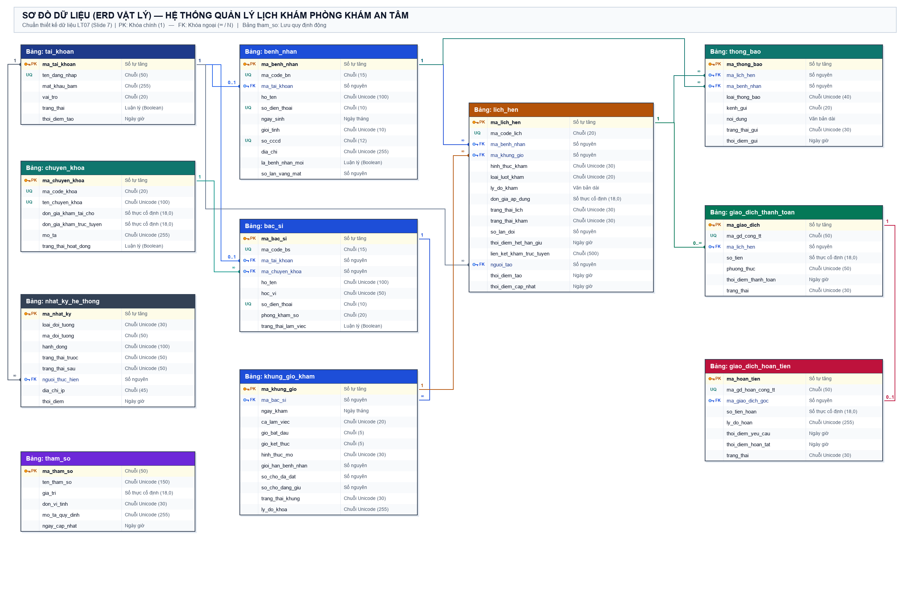
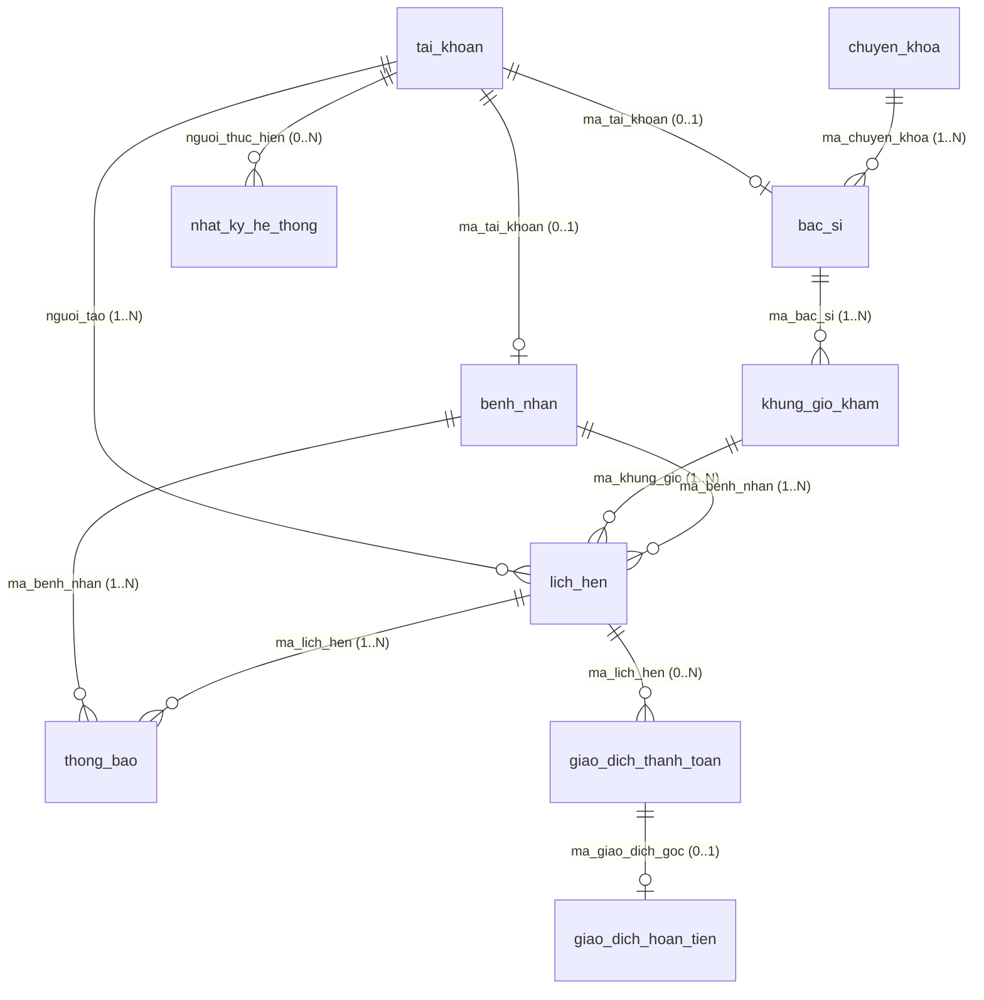

# BÀI TẬP TUẦN 08 · THIẾT KẾ DỮ LIỆU (LT07)
## PHẦN VIỆC THÀNH VIÊN 1: HỆ THỐNG QUẢN LÝ LỊCH KHÁM PHÒNG KHÁM AN TÂM

- **Môn học:** Nhập môn Công nghệ Phần mềm (Lớp 24_3)
- **Nhóm:** Nhóm 04
- **Người thực hiện (Thành viên 1):** Lâm Duy Minh — MSSV: `24120091`
- **Tài liệu căn cứ:**
  1. Bài giảng *Thiết kế phần mềm (`LT07-Design.pdf`)* — Thầy Ngô Ngọc Đăng Khoa (Slide 2–9).
  2. Tài liệu *Mini-SRS v1.2 — Hệ thống quản lý lịch khám Phòng khám An Tâm (`BT04_Nhom04_MiniSRS.md`)* đã tích hợp yêu cầu thay đổi `CR-01` (Khám trực tuyến, thanh toán trước và hoàn tiền).
  3. Bản *Phân công & Quy ước Thiết kế Dữ liệu & UI/UX Level 4* của Nhóm 04.

---

## BƯỚC 1: XÁC ĐỊNH THÀNH PHẦN DỮ LIỆU

### 1.1. Lựa chọn hệ thống lưu trữ dữ liệu (Theo Slide 4 – LT07)

Theo bài giảng *Thiết kế phần mềm (LT07, Slide 4)*, có hai phương án tổ chức hệ thống lưu trữ dữ liệu là **Tập tin (File system)** và **Cơ sở dữ liệu (CSDL - Database)**. Nhóm quyết định lựa chọn **Hệ quản trị Cơ sở dữ liệu quan hệ (RDBMS)** làm đơn vị lưu trữ cho hệ thống Phòng khám An Tâm vì các lý do nghiệp vụ và kỹ thuật sau:

1. **Khắc phục triệt để bất cập "ghi sổ phân tán" của hiện trạng (`N-01`, `N-02`, `FR-03`):** Phòng khám có 06 bác sĩ, 02 nhân viên tiếp nhận mỗi ca và 80–120 lượt khám/ngày, cùng lượng bệnh nhân tự đặt lịch từ xa. Nếu lưu trữ bằng tập tin rời rạc, việc kiểm soát truy cập đồng thời (tối thiểu 50 người dùng cùng lúc theo `NFR-02`) sẽ dẫn đến xung đột ghi (race condition) khi hai bệnh nhân cùng đặt vào một chỗ trống cuối cùng. Hệ quản trị CSDL cung cấp cơ chế khóa giao dịch (*Transaction & Row-level Locking*) tuân thủ ACID, đảm bảo tại một thời điểm chỉ một yêu cầu giữ chỗ thành công.
2. **Bảo toàn tính toàn vẹn cho giao dịch tài chính (`CR-01`, `FR-15`..`FR-19`, `NFR-08`):** Khi tích hợp khám trực tuyến có thu tiền trước và hoàn tiền tự động khi bác sĩ nghỉ đột xuất, CSDL đảm bảo các ràng buộc khóa ngoại (`FOREIGN KEY`), ràng buộc duy nhất (`UNIQUE`) và ràng buộc miền giá trị (`CHECK`), ngăn chặn tuyệt đối việc trừ tiền trùng hoặc hoàn tiền hai lần cho cùng một giao dịch.
3. **Hỗ trợ phân quyền truy cập tập trung, lưu vết và sao lưu (`NFR-04`, `NFR-06`, `NFR-09`):** CSDL hỗ trợ phân quyền theo vai trò (RBAC), lưu nhật ký kiểm toán (*Audit log*) chỉ cho phép thêm mới (`INSERT-only`), và tự động sao lưu định kỳ hằng ngày với khả năng khôi phục bản sao lưu trong phạm vi 24 giờ. Mặc dù hệ quản trị CSDL phức tạp hơn so với tổ chức tập tin thuần túy, tính hiệu quả và an toàn dữ liệu y tế – tài chính là yếu tố bắt buộc.

---

### 1.2. Danh sách các thành phần dữ liệu (Bảng dữ liệu)

Đối chiếu toàn bộ các yêu cầu chức năng (`FR-01` đến `FR-19`), yêu cầu phi chức năng (`NFR-01` đến `NFR-09`), các giả định (`ASM-01` đến `ASM-17`) và quy tắc tách bảng danh mục động / bảng tham số, hệ thống gồm **11 thành phần dữ liệu (bảng)** đặt tên theo chuẩn `snake_case`:

| STT | Tên bảng (`snake_case`) | Phân loại | Ý nghĩa & Vai trò lưu trữ | Truy vết yêu cầu |
| :-: | :--- | :--- | :--- | :--- |
| 1 | `tai_khoan` | Hệ thống | Quản lý thông tin đăng nhập (mật khẩu băm có salt) và phân quyền theo 4 vai trò (Quản lý, Bác sĩ, Tiếp nhận, Bệnh nhân). | `FR-13`, `NFR-03`, `NFR-04` |
| 2 | `chuyen_khoa` | Danh mục | Lưu danh mục các chuyên khoa của phòng khám và đơn giá khám chuẩn (tại phòng khám / trực tuyến), tách rời để không viết cứng vào bảng bác sĩ. | `FR-01`, `FR-12`, `FR-15`, `Q-10` |
| 3 | `benh_nhan` | Nghiệp vụ | Lưu hồ sơ hành chính của bệnh nhân, số điện thoại định danh, cờ đánh dấu bệnh nhân mới và thống kê số lần vắng mặt. | `FR-07`, `FR-09`, `FR-14`, `ASM-10`, `ASM-11` |
| 4 | `bac_si` | Nghiệp vụ | Lưu thông tin bác sĩ, học vị, phòng khám phụ trách và liên kết với chuyên khoa, tài khoản đăng nhập. | `FR-01`, `FR-02`, `FR-09`, `FR-11`, `FR-12` |
| 5 | `khung_gio_kham` | Nghiệp vụ | Quản lý lịch làm việc của từng bác sĩ theo ngày, ca, khung giờ, hình thức mở, giới hạn bệnh nhân, số chỗ đã đặt và số chỗ đang giữ. | `FR-02`, `FR-03`, `FR-11`, `FR-12`, `FR-16` |
| 6 | `lich_hen` | Nghiệp vụ | Lưu thông tin lượt đặt lịch khám (tại phòng khám / trực tuyến, hẹn trước / khám gấp), trạng thái lịch, trạng thái khám và số lần đổi lịch. | `FR-01`, `FR-04`..`FR-11`, `FR-14`..`FR-16` |
| 7 | `giao_dich_thanh_toan` | Giao dịch | Lưu thông tin thanh toán trước qua cổng thanh toán cho các lịch khám trực tuyến (không lưu số thẻ/mật khẩu). | `FR-15`, `FR-19`, `NFR-07`, `NFR-08` |
| 8 | `giao_dich_hoan_tien` | Giao dịch | Lưu yêu cầu và kết quả hoàn tiền khi bác sĩ hủy lịch trực tuyến đã thanh toán (chống hoàn trùng qua khóa duy nhất). | `FR-17`, `FR-18`, `FR-19`, `NFR-08`, `ASM-05` |
| 9 | `thong_bao` | Nghiệp vụ | Lưu lịch sử gửi thông báo (SMS/Email/Zalo) cho bệnh nhân khi đặt, đổi, hủy lịch, hoàn tiền và theo dõi các thông báo gửi lỗi. | `FR-04`, `FR-18`, `SC-04 (4a)` |
| 10 | `nhat_ky_he_thong` | Hệ thống | Lưu vết mọi thay đổi trạng thái của lịch hẹn, giao dịch và các lần từ chối truy cập trái phép (chỉ thêm, không sửa/xóa). | `FR-08`, `FR-10`, `NFR-04`, `NFR-09` |
| 11 | `tham_so` | Quy định | Lưu trữ tập trung mọi quy định dạng con số (thời lượng khung giờ, số BN tối đa mặc định, thời gian giữ chỗ, hạn đổi/hủy...) để thay đổi động. | `ASM-02`, `ASM-12`, `Q-01`, `Q-03`, `Q-04`, `Q-11` |

---

## BƯỚC 2: VẼ SƠ ĐỒ DỮ LIỆU

### 2.1. Sơ đồ dữ liệu chuẩn Slide 7 – LT07

- **Tệp ảnh sơ đồ (PNG nền trắng):** `BT08_Nhom04_TV1_SoDoDuLieu_PhongKhamAnTam.png`
- **Tệp nguồn chỉnh sửa (Draw.io):** `BT08_Nhom04_TV1_SoDoDuLieu_PhongKhamAnTam.drawio`

### 2.2. Tóm tắt quan hệ khóa chính – khóa ngoại (1–N & 1–1)

- **`tai_khoan` (1) — (0..1) `benh_nhan`:** Một tài khoản bệnh nhân gắn với tối đa một hồ sơ bệnh nhân; ngược lại, bệnh nhân đặt lịch qua điện thoại nhờ nhân viên tiếp nhận (`ASM-03`) có thể chưa cần tạo tài khoản (`ma_tai_khoan` cho phép `NULL`).
- **`tai_khoan` (1) — (0..1) `bac_si`:** Mỗi bác sĩ có một tài khoản riêng để xem danh sách khám trong ca của mình (`FR-09`, `FR-13`).
- **`chuyen_khoa` (1) — (N) `bac_si`:** Một chuyên khoa có nhiều bác sĩ phụ trách; mỗi bác sĩ thuộc một chuyên khoa chính.
- **`bac_si` (1) — (N) `khung_gio_kham`:** Một bác sĩ có nhiều khung giờ làm việc theo ngày và ca (`FR-12`).
- **`khung_gio_kham` (1) — (N) `lich_hen`:** Một khung giờ nhận nhiều lịch hẹn nhưng tổng số lịch hiệu lực cộng số chỗ đang giữ không vượt quá `gioi_han_benh_nhan` (`FR-03`).
- **`benh_nhan` (1) — (N) `lich_hen`:** Một bệnh nhân có thể đặt nhiều lịch khám qua các ngày/chuyên khoa khác nhau (`FR-01`, `FR-14`).
- **`lich_hen` (1) — (0..N) `giao_dich_thanh_toan`:** Lịch tại phòng khám không phát sinh giao dịch thanh toán trước (`0`); lịch trực tuyến có thể có lần thanh toán thất bại trước khi có tối đa 01 giao dịch `Thành công` (`FR-15`, `NFR-08`).
- **`giao_dich_thanh_toan` (1) — (0..1) `giao_dich_hoan_tien`:** Mỗi giao dịch thanh toán thành công chỉ được hoàn tối đa **01 lần duy nhất** khi bác sĩ hủy lịch (`FR-17`, `NFR-08`).
- **`lich_hen` (1) — (N) `thong_bao`:** Một lịch hẹn phát sinh các thông báo khi xác nhận đặt mới, đổi lịch, hoặc hủy lịch/hoàn tiền (`FR-04`, `FR-18`).

---

## BƯỚC 3: ĐẶC TẢ THÀNH PHẦN DỮ LIỆU

> [!IMPORTANT]
> **Giải trình thiết kế các trường tính toán / dẫn xuất & lưu giá lịch sử (Theo yêu cầu Mục 5 của Người 1):**
> 1. **Trường `don_gia_ap_dung` trong bảng `lich_hen` (CÓ LƯU CỨNG):** Mặc dù bảng `chuyen_khoa` đã lưu `don_gia_kham_tai_cho` và `don_gia_kham_truc_tuyen`, bảng `lich_hen` vẫn lưu trường `don_gia_ap_dung` tại thời điểm đặt lịch vì giá khám của phòng khám có thể thay đổi theo thời gian. Nếu không lưu lại đơn giá lúc đặt, các lịch hẹn cũ và đối soát hoàn tiền sẽ bị sai lệch khi Quản lý cập nhật bảng giá mới.
> 2. **Trường `so_cho_da_dat` và `so_cho_dang_giu` trong bảng `khung_gio_kham` (CÓ LƯU SẴN):** Về mặt lý thuyết có thể tính bằng lệnh `COUNT(*)` trên bảng `lich_hen`. Tuy nhiên, để đáp ứng yêu cầu hiệu năng `NFR-01` (phản hồi $\le 3$ giây) và `NFR-02` (50 người dùng đồng thời kiểm tra chỗ trống và khóa dòng chống đặt trùng `FR-03`), việc lưu trực tiếp 2 bộ đếm này ngay trên dòng `khung_gio_kham` giúp hệ quản trị CSDL kiểm tra ràng buộc `so_cho_da_dat + so_cho_dang_giu <= gioi_han_benh_nhan` tức thời trong 1 câu lệnh `UPDATE` nguyên tử (Atomic).
> 3. **Trường `so_lan_vang_mat` trong bảng `benh_nhan` (CÓ LƯU SẴN):** Được cập nhật tăng thêm 1 mỗi khi lượt khám chuyển sang trạng thái `Vắng mặt`, giúp màn hình Tiếp nhận / Đặt lịch hộ (Level 4) hiển thị ngay cảnh báo cho nhân viên mà không phải quét toàn bộ lịch sử lịch hẹn.
>
> **Ghi chú kỹ thuật về `UNIQUE` trên cột cho phép `NULL`:** Trong SQL Server, ràng buộc `UNIQUE` thông thường chỉ chấp nhận một giá trị `NULL`. Vì vậy các cột vừa `UNIQUE` vừa cho phép `NULL` (`benh_nhan.ma_tai_khoan`, `benh_nhan.so_cccd`, `giao_dich_hoan_tien.ma_gd_hoan_cong_tt`) được hiện thực bằng chỉ mục duy nhất có lọc `CREATE UNIQUE INDEX ... WHERE <cột> IS NOT NULL`, để nhiều bệnh nhân chưa có tài khoản/CCCD vẫn lưu được.

---

### Bảng 1: `tai_khoan`
*Phục vụ: `FR-13`, `NFR-03`, `NFR-04`*

| Field | Kiểu dữ liệu | Ràng buộc | Mô tả |
| :--- | :--- | :--- | :--- |
| `ma_tai_khoan` | Số tự tăng | `PK`, `NOT NULL` | Khóa chính tự sinh định danh tài khoản |
| `ten_dang_nhap` | Chuỗi (50) | `UNIQUE`, `NOT NULL` | Số điện thoại (với bệnh nhân) hoặc mã nhân viên/bác sĩ đăng nhập |
| `mat_khau_bam` | Chuỗi (255) | `NOT NULL` | Chuỗi mật khẩu đã băm kèm salt bằng thuật toán bcrypt (`NFR-03`) |
| `vai_tro` | Chuỗi (20) | `NOT NULL`, `CHECK IN ('quan_ly', 'bac_si', 'tiep_nhan', 'benh_nhan')` | Vai trò phân quyền truy cập dữ liệu phía máy chủ (`FR-13`, `NFR-04`) |
| `trang_thai` | Luận lý (Boolean) | `NOT NULL`, `DEFAULT 1` | Trạng thái tài khoản: `1` (Đang hoạt động), `0` (Đã khóa) |
| `thoi_diem_tao` | Ngày giờ | `NOT NULL`, `DEFAULT CURRENT_TIMESTAMP` | Thời điểm tạo tài khoản trên hệ thống |

---

### Bảng 2: `chuyen_khoa`
*Phục vụ: `FR-01`, `FR-12`, `FR-15`, `Q-10`*

| Field | Kiểu dữ liệu | Ràng buộc | Mô tả |
| :--- | :--- | :--- | :--- |
| `ma_chuyen_khoa` | Số tự tăng | `PK`, `NOT NULL` | Khóa chính tự sinh định danh chuyên khoa |
| `ma_code_khoa` | Chuỗi (20) | `UNIQUE`, `NOT NULL` | Mã nghiệp vụ chuyên khoa (VD: `'NOI'`, `'NHI'`, `'TMH'`, `'TIM'`, `'DL'`, `'SAN'`) |
| `ten_chuyen_khoa` | Chuỗi Unicode (100) | `UNIQUE`, `NOT NULL` | Tên chuyên khoa hiển thị trên giao diện (VD: `Nội tổng quát`, `Nhi khoa`) |
| `don_gia_kham_tai_cho` | Số thực cố định (18,0) | `NOT NULL`, `CHECK >= 0` | Phí khám tiêu chuẩn tại phòng khám (VNĐ) |
| `don_gia_kham_truc_tuyen` | Số thực cố định (18,0) | `NOT NULL`, `CHECK > 0` | Phí khám trực tuyến thu trước khi xác nhận lịch (`FR-15`, `Q-10`) |
| `mo_ta` | Chuỗi Unicode (255) | `NULL` | Mô tả phạm vi tư vấn và khám của chuyên khoa |
| `trang_thai_hoat_dong` | Luận lý (Boolean) | `NOT NULL`, `DEFAULT 1` | `1` (Đang mở nhận đặt lịch), `0` (Tạm ngưng) |

---

### Bảng 3: `benh_nhan`
*Phục vụ: `FR-07`, `FR-09`, `FR-14`, `ASM-10`, `ASM-11`, `Q-04`, `Q-05`*

| Field | Kiểu dữ liệu | Ràng buộc | Mô tả |
| :--- | :--- | :--- | :--- |
| `ma_benh_nhan` | Số tự tăng | `PK`, `NOT NULL` | Khóa chính tự sinh định danh hồ sơ bệnh nhân |
| `ma_code_bn` | Chuỗi (15) | `UNIQUE`, `NOT NULL` | Mã nghiệp vụ bệnh nhân có định dạng `BN0001` |
| `ma_tai_khoan` | Số nguyên | `FK -> tai_khoan(ma_tai_khoan)`, `UNIQUE` (khi khác `NULL`), `NULL` | Tài khoản liên kết (Cho phép `NULL` khi bệnh nhân chỉ gọi điện đặt lịch qua tiếp nhận - `ASM-03`); hiện thực bằng chỉ mục duy nhất có lọc `UX_benh_nhan_tai_khoan` |
| `ho_ten` | Chuỗi Unicode (100) | `NOT NULL` | Họ và tên đầy đủ của bệnh nhân (`FR-07`) |
| `so_dien_thoai` | Chuỗi (10) | `UNIQUE`, `NOT NULL`, `CHECK (LEN = 10, bắt đầu bằng '0')` | Số điện thoại liên lạc, dùng để nhận diện bệnh nhân cũ (`Q-05`), xác thực (`ASM-11`) và nhận thông báo (` mục 1.12.2`) |
| `ngay_sinh` | Ngày tháng | `NOT NULL`, `CHECK (< Ngày hiện tại)` | Ngày tháng năm sinh của bệnh nhân (hiển thị `d/M/yyyy`) |
| `gioi_tinh` | Chuỗi Unicode (10) | `NOT NULL`, `CHECK IN (N'Nam', N'Nữ', N'Khác')` | Giới tính hành chính của bệnh nhân |
| `so_cccd` | Chuỗi (12) | `UNIQUE` (khi khác `NULL`), `NULL` | Số Căn cước công dân (12 chữ số, không bắt buộc khi mới đặt qua điện thoại); hiện thực bằng chỉ mục duy nhất có lọc `UX_benh_nhan_cccd` |
| `dia_chi` | Chuỗi Unicode (255) | `NULL` | Địa chỉ cư trú của bệnh nhân |
| `la_benh_nhan_moi` | Luận lý (Boolean) | `NOT NULL`, `DEFAULT 1` | `1` nếu chưa từng hoàn thành lượt khám nào tại phòng khám (giúp Bác sĩ biết cần chuẩn bị hồ sơ mới theo `FR-09`); chuyển về `0` sau lần khám hoàn thành đầu tiên |
| `so_lan_vang_mat` | Số nguyên | `NOT NULL`, `DEFAULT 0`, `CHECK >= 0` | Tổng số lần đặt lịch nhưng không đến khám (`No-show`), dùng để cảnh báo trên màn hình Level 4 (`Q-04`, `Q-EX02`) |

---

### Bảng 4: `bac_si`
*Phục vụ: `FR-01`, `FR-02`, `FR-09`, `FR-11`, `FR-12`*

| Field | Kiểu dữ liệu | Ràng buộc | Mô tả |
| :--- | :--- | :--- | :--- |
| `ma_bac_si` | Số tự tăng | `PK`, `NOT NULL` | Khóa chính tự sinh định danh bác sĩ |
| `ma_code_bs` | Chuỗi (15) | `UNIQUE`, `NOT NULL` | Mã nghiệp vụ bác sĩ có định dạng `BS001` (Phòng khám hiện có 06 bác sĩ) |
| `ma_tai_khoan` | Số nguyên | `FK -> tai_khoan(ma_tai_khoan)`, `UNIQUE`, `NOT NULL` | Tài khoản đăng nhập của bác sĩ (`FR-13`) |
| `ma_chuyen_khoa` | Số nguyên | `FK -> chuyen_khoa(ma_chuyen_khoa)`, `NOT NULL` | Chuyên khoa mà bác sĩ phụ trách (`FR-01`, `FR-12`) |
| `ho_ten` | Chuỗi Unicode (100) | `NOT NULL` | Họ và tên bác sĩ |
| `hoc_vi` | Chuỗi Unicode (50) | `NULL` | Học hàm, học vị chuyên môn (VD: `ThS.BS`, `BS.CKI`, `BS.CKII`) |
| `so_dien_thoai` | Chuỗi (10) | `UNIQUE`, `NOT NULL` | Số điện thoại liên hệ nội bộ |
| `phong_kham_so` | Chuỗi (20) | `NOT NULL` | Số phòng khám cố định tại phòng khám (VD: `'P.101'`, `'P.102'`) |
| `trang_thai_lam_viec` | Luận lý (Boolean) | `NOT NULL`, `DEFAULT 1` | `1` (Đang công tác), `0` (Tạm nghỉ dài hạn) |

---

### Bảng 5: `khung_gio_kham`
*Phục vụ: `FR-02`, `FR-03`, `FR-11`, `FR-12`, `FR-16`, `ASM-02`, `ASM-12`*

| Field | Kiểu dữ liệu | Ràng buộc | Mô tả |
| :--- | :--- | :--- | :--- |
| `ma_khung_gio` | Số tự tăng | `PK`, `NOT NULL` | Khóa chính tự sinh định danh khung giờ khám |
| `ma_bac_si` | Số nguyên | `FK -> bac_si(ma_bac_si)`, `NOT NULL` | Bác sĩ phụ trách khung giờ khám này |
| `ngay_kham` | Ngày tháng | `NOT NULL` | Ngày làm việc (định dạng `d/M/yyyy`) |
| `ca_lam_viec` | Chuỗi Unicode (20) | `NOT NULL`, `CHECK IN (N'Ca sáng', N'Ca chiều')` | Buổi làm việc trong ngày (`FR-09`, `FR-12`) |
| `gio_bat_dau` | Chuỗi (5) | `NOT NULL`, `UNIQUE(ma_bac_si, ngay_kham, gio_bat_dau)` | Giờ bắt đầu khung khám dạng `HH:mm` (VD: `'08:00'`, mỗi khung mặc định 20 phút theo `ASM-12`) |
| `gio_ket_thuc` | Chuỗi (5) | `NOT NULL`, `CHECK (gio_ket_thuc > gio_bat_dau)` | Giờ kết thúc khung khám dạng `HH:mm` (VD: `'08:20'`) |
| `hinh_thuc_mo` | Chuỗi Unicode (30) | `NOT NULL`, `CHECK IN (N'Tại phòng khám', N'Trực tuyến', N'Cả hai')` | Hình thức khám được phép đặt trong khung giờ này (`FR-12`, `mục 1.12.2`) |
| `gioi_han_benh_nhan` | Số nguyên | `NOT NULL`, `CHECK > 0` | Số bệnh nhân tối đa nhận trong khung giờ (mặc định lấy từ `tham_so`, cho phép cấu hình riêng theo `ASM-02`) |
| `so_cho_da_dat` | Số nguyên | `NOT NULL`, `DEFAULT 0`, `CHECK >= 0` | Số lịch hẹn đang ở trạng thái `Đã xác nhận` trong khung (`FR-03`) |
| `so_cho_dang_giu` | Số nguyên | `NOT NULL`, `DEFAULT 0`, `CHECK >= 0`, `CHECK (so_cho_da_dat + so_cho_dang_giu <= gioi_han_benh_nhan)` | Số chỗ đang tạm giữ chờ thanh toán trực tuyến (`FR-16`, `mục 1.12.2`) |
| `trang_thai_khung` | Chuỗi Unicode (30) | `NOT NULL`, `DEFAULT N'Khả dụng'`, `CHECK IN (N'Khả dụng', N'Đã khóa', N'Bác sĩ nghỉ')` | Trạng thái mở/khóa của khung giờ (chuyển sang `Bác sĩ nghỉ` khi xử lý `FR-11`) |
| `ly_do_khoa` | Chuỗi Unicode (255) | `NULL` | Lý do khóa khung hoặc ghi chú bác sĩ báo nghỉ đột xuất (`FR-11`) |

---

### Bảng 6: `lich_hen`
*Phục vụ: `FR-01`, `FR-04`..`FR-11`, `FR-14`, `FR-15`, `FR-16`, `mục 1.12.2`*

| Field | Kiểu dữ liệu | Ràng buộc | Mô tả |
| :--- | :--- | :--- | :--- |
| `ma_lich_hen` | Số tự tăng | `PK`, `NOT NULL` | Khóa chính tự sinh |
| `ma_code_lich` | Chuỗi (20) | `UNIQUE`, `NOT NULL` | Mã lịch hẹn nghiệp vụ gửi cho bệnh nhân (Định dạng `LH20261006-001` - `FR-04`) |
| `ma_benh_nhan` | Số nguyên | `FK -> benh_nhan(ma_benh_nhan)`, `NOT NULL` | Bệnh nhân đặt khám |
| `ma_khung_gio` | Số nguyên | `FK -> khung_gio_kham(ma_khung_gio)`, `NOT NULL` | Khung giờ khám được đặt |
| `hinh_thuc_kham` | Chuỗi Unicode (30) | `NOT NULL`, `CHECK IN (N'Tại phòng khám', N'Trực tuyến')` | Hình thức khám bệnh nhân chọn (`FR-01`, `CR-01`) |
| `loai_luot_kham` | Chuỗi Unicode (20) | `NOT NULL`, `DEFAULT N'Hẹn trước'`, `CHECK IN (N'Hẹn trước', N'Khám gấp')` | Phân biệt lịch đặt hẹn thông thường và ca khám gấp chèn lịch tại quầy (`Q-04`) |
| `ly_do_kham` | Văn bản dài | `NULL` | Mô tả triệu chứng / nhu cầu khám sơ bộ để bác sĩ chuẩn bị hồ sơ (`FR-09`, `Q-05`) |
| `don_gia_ap_dung` | Số thực cố định (18,0) | `NOT NULL`, `CHECK >= 0` | Lưu cứng mức phí khám tại thời điểm đặt lịch (phục vụ thanh toán `FR-15` và giữ lịch sử giá) |
| `trang_thai_lich` | Chuỗi Unicode (30) | `NOT NULL`, `CHECK IN (N'Chờ thanh toán', N'Đã xác nhận', N'Bệnh nhân hủy', N'Bác sĩ hủy', N'Hết hạn giữ chỗ')` | Trạng thái của lịch hẹn (`mục 1.12.2`, `FR-01`, `FR-06`, `FR-11`, `FR-16`) |
| `trang_thai_kham` | Chuỗi Unicode (30) | `NOT NULL`, `DEFAULT N'Chưa đến'`, `CHECK IN (N'Chưa đến', N'Đã đến', N'Đến trễ', N'Đang khám', N'Hoàn thành', N'Vắng mặt')` | Trạng thái tiếp nhận và khám thực tế trong ca (`FR-10`, `Q-04`) |
| `so_lan_doi` | Số nguyên | `NOT NULL`, `DEFAULT 0`, `CHECK >= 0` | Số lần lịch hẹn này đã được đổi (kiểm tra với tham số `SO_LAN_DOI_TOI_DA` theo `Q-03`) |
| `thoi_diem_het_han_giu` | Ngày giờ | `NULL` | Thời điểm hết hạn giữ chỗ chờ thanh toán trực tuyến (`FR-16`; `NULL` nếu khám tại phòng khám) |
| `lien_ket_kham_truc_tuyen` | Chuỗi (500) | `NULL` | Đường dẫn phòng gọi video trực tuyến gửi kèm thông báo xác nhận (`Q-09`) |
| `nguoi_tao` | Số nguyên | `FK -> tai_khoan(ma_tai_khoan)`, `NOT NULL` | Tài khoản tạo lịch (ghi nhận bệnh nhân tự đặt hoặc nhân viên tiếp nhận đặt hộ theo `FR-08`) |
| `thoi_diem_tao` | Ngày giờ | `NOT NULL`, `DEFAULT CURRENT_TIMESTAMP` | Thời điểm khởi tạo yêu cầu đặt lịch (`FR-08`) |
| `thoi_diem_cap_nhat` | Ngày giờ | `NOT NULL`, `DEFAULT CURRENT_TIMESTAMP` | Thời điểm cập nhật trạng thái gần nhất |

---

### Bảng 7: `giao_dich_thanh_toan`
*Phục vụ: `FR-15`, `FR-19`, `NFR-07`, `NFR-08`, `ASM-17`*

| Field | Kiểu dữ liệu | Ràng buộc | Mô tả |
| :--- | :--- | :--- | :--- |
| `ma_giao_dich` | Số tự tăng | `PK`, `NOT NULL` | Khóa chính tự sinh |
| `ma_gd_cong_tt` | Chuỗi (50) | `UNIQUE`, `NOT NULL` | Mã tham chiếu giao dịch do Cổng thanh toán trả về (Duy nhất để chống ghi nhận trùng theo `NFR-07`, `NFR-08`) |
| `ma_lich_hen` | Số nguyên | `FK -> lich_hen(ma_lich_hen)`, `NOT NULL` | Lịch hẹn khám trực tuyến được thanh toán (`mục 1.12.2`) |
| `so_tien` | Số thực cố định (18,0) | `NOT NULL`, `CHECK > 0` | Số tiền thanh toán (VNĐ) (`FR-15`) |
| `phuong_thuc` | Chuỗi Unicode (50) | `NOT NULL`, `CHECK IN (N'Chuyển khoản QR', N'Ví điện tử', N'Thẻ nội địa', N'Thẻ quốc tế')` | Phương thức thanh toán (Tuyệt đối không lưu số thẻ hay mật khẩu thanh toán theo `NFR-07`) |
| `thoi_diem_thanh_toan` | Ngày giờ | `NOT NULL`, `DEFAULT CURRENT_TIMESTAMP` | Thời điểm cổng thanh toán xử lý giao dịch (`mục 1.12.2`) |
| `trang_thai` | Chuỗi Unicode (30) | `NOT NULL`, `CHECK IN (N'Đang chờ', N'Thành công', N'Thất bại', N'Chờ chính sách')` | Trạng thái giao dịch (`Chờ chính sách` khi bệnh nhân tự hủy lịch trực tuyến đã trả tiền theo `FR-06`, `ASM-17`) |

---

### Bảng 8: `giao_dich_hoan_tien`
*Phục vụ: `FR-17`, `FR-18`, `FR-19`, `NFR-08`, `ASM-05`*

| Field | Kiểu dữ liệu | Ràng buộc | Mô tả |
| :--- | :--- | :--- | :--- |
| `ma_hoan_tien` | Số tự tăng | `PK`, `NOT NULL` | Khóa chính tự sinh |
| `ma_gd_hoan_cong_tt` | Chuỗi (50) | `UNIQUE` (khi khác `NULL`), `NULL` | Mã giao dịch hoàn tiền do Cổng thanh toán cấp (`NULL` khi đang chờ cổng xử lý); hiện thực bằng chỉ mục duy nhất có lọc `UX_gd_hoan_ma_cong` |
| `ma_giao_dich_goc` | Số nguyên | `FK -> giao_dich_thanh_toan(ma_giao_dich)`, `UNIQUE`, `NOT NULL` | Giao dịch thanh toán gốc cần hoàn (Ràng buộc `UNIQUE` đảm bảo mỗi giao dịch chỉ được hoàn tối đa 1 lần theo `NFR-08`) |
| `so_tien_hoan` | Số thực cố định (18,0) | `NOT NULL`, `CHECK > 0` | Số tiền hoàn trả (Bằng 100% số tiền đã thanh toán theo `ASM-05`, `FR-17`) |
| `ly_do_hoan` | Chuỗi Unicode (255) | `NOT NULL` | Lý do hoàn tiền (VD: `Bác sĩ hủy lịch do nghỉ đột xuất`, `Thanh toán muộn sau khi hết hạn giữ chỗ`) |
| `thoi_diem_yeu_cau` | Ngày giờ | `NOT NULL`, `DEFAULT CURRENT_TIMESTAMP` | Thời điểm hệ thống phát sinh lệnh hoàn tiền |
| `thoi_diem_hoan_tat` | Ngày giờ | `NULL` | Thời điểm nhận kết quả hoàn thành công/lỗi từ cổng thanh toán |
| `trang_thai` | Chuỗi Unicode (30) | `NOT NULL`, `CHECK IN (N'Đang chờ hoàn', N'Hoàn thành công', N'Hoàn lỗi')` | Trạng thái hoàn tiền (`Hoàn lỗi` sẽ được lọc riêng để nhân viên xử lý thủ công theo `FR-19`) |

---

### Bảng 9: `thong_bao`
*Phục vụ: `FR-04`, `FR-18`, `SC-04 (4a)`*

| Field | Kiểu dữ liệu | Ràng buộc | Mô tả |
| :--- | :--- | :--- | :--- |
| `ma_thong_bao` | Số tự tăng | `PK`, `NOT NULL` | Khóa chính tự sinh |
| `ma_lich_hen` | Số nguyên | `FK -> lich_hen(ma_lich_hen)`, `NOT NULL` | Lịch hẹn phát sinh thông báo |
| `ma_benh_nhan` | Số nguyên | `FK -> benh_nhan(ma_benh_nhan)`, `NOT NULL` | Bệnh nhân nhận thông báo |
| `loai_thong_bao` | Chuỗi Unicode (40) | `NOT NULL`, `CHECK IN (N'Xác nhận đặt lịch', N'Xác nhận đổi lịch', N'Hủy lịch bởi bệnh nhân', N'Bác sĩ hủy & Hoàn tiền', N'Nhắc lịch khám')` | Loại sự kiện thông báo (`FR-04`, `FR-18`) |
| `kenh_gui` | Chuỗi (20) | `NOT NULL`, `CHECK IN ('SMS', 'Email', 'Zalo')` | Kênh gửi thông báo (`Q-07`) |
| `noi_dung` | Văn bản dài | `NOT NULL` | Nội dung chi tiết gửi tới bệnh nhân (gồm mã lịch, bác sĩ, ngày giờ, hình thức khám, số tiền và trạng thái hoàn tiền nếu có) |
| `trang_thai_gui` | Chuỗi Unicode (30) | `NOT NULL`, `CHECK IN (N'Đang chờ gửi', N'Đã gửi', N'Gửi lỗi')` | Trạng thái gửi (Nếu `Gửi lỗi`, màn hình `SC-04 (4a)` liệt kê để nhân viên tiếp nhận gọi điện trực tiếp) |
| `thoi_diem_gui` | Ngày giờ | `NOT NULL`, `DEFAULT CURRENT_TIMESTAMP` | Thời điểm hệ thống thực hiện gửi thông báo |

---

### Bảng 10: `nhat_ky_he_thong`
*Phục vụ: `FR-08`, `FR-10`, `NFR-04`, `NFR-09`*

| Field | Kiểu dữ liệu | Ràng buộc | Mô tả |
| :--- | :--- | :--- | :--- |
| `ma_nhat_ky` | Số tự tăng | `PK`, `NOT NULL` | Khóa chính tự sinh |
| `loai_doi_tuong` | Chuỗi Unicode (30) | `NOT NULL`, `CHECK IN (N'Lịch hẹn', N'Giao dịch thanh toán', N'Giao dịch hoàn tiền', N'Khung giờ khám', N'Truy cập trái phép')` | Nhóm đối tượng bị tác động hoặc sự kiện bảo mật (`NFR-04`, `NFR-09`) |
| `ma_doi_tuong` | Chuỗi (50) | `NOT NULL` | Mã định danh của lịch hẹn, giao dịch hoặc đường dẫn API bị từ chối |
| `hanh_dong` | Chuỗi Unicode (100) | `NOT NULL` | Tên thao tác thực hiện (VD: `Đặt lịch mới`, `Đổi trạng thái khám`, `Từ chối truy cập trái quyền`) |
| `trang_thai_truoc` | Chuỗi Unicode (50) | `NULL` | Trạng thái trước khi thay đổi (`NFR-09`) |
| `trang_thai_sau` | Chuỗi Unicode (50) | `NULL` | Trạng thái sau khi thay đổi (`NFR-09`) |
| `nguoi_thuc_hien` | Số nguyên | `FK -> tai_khoan(ma_tai_khoan)`, `NULL` | Tài khoản thực hiện thao tác (`NULL` nếu do tiến trình tự động của Hệ thống thực hiện) |
| `dia_chi_ip` | Chuỗi (45) | `NULL` | Địa chỉ IP của máy khách gửi yêu cầu (phục vụ điều tra bảo mật `NFR-04`) |
| `thoi_diem` | Ngày giờ | `NOT NULL`, `DEFAULT CURRENT_TIMESTAMP` | Thời điểm ghi nhận (Chỉ cho phép thêm `INSERT`, cấm sửa/xóa qua giao diện theo `NFR-09`) |

---

### Bảng 11: `tham_so`
*Phục vụ: Lưu các quy định dạng con số động (`ASM-02`, `ASM-12`, `Q-01`, `Q-03`, `Q-04`, `Q-11`)*

| Field | Kiểu dữ liệu | Ràng buộc | Mô tả |
| :--- | :--- | :--- | :--- |
| `ma_tham_so` | Chuỗi (50) | `PK`, `NOT NULL` | Mã định danh tham số viết hoa có gạch dưới (VD: `'THOI_LUONG_KHUNG_GIO_PHUT'`) |
| `ten_tham_so` | Chuỗi Unicode (150) | `NOT NULL` | Tên hiển thị của tham số quy định trên màn hình cấu hình của Quản lý |
| `gia_tri` | Số thực cố định (18,0) | `NOT NULL`, `CHECK >= 0` | Giá trị số của quy định |
| `don_vi_tinh` | Chuỗi Unicode (30) | `NOT NULL` | Đơn vị tính (VD: `Phút`, `Bệnh nhân`, `Giờ`, `Lần`, `VNĐ`) |
| `mo_ta_quy_dinh` | Chuỗi Unicode (255) | `NOT NULL` | Giải thích ý nghĩa nghiệp vụ và nơi áp dụng tham số |
| `ngay_cap_nhat` | Ngày giờ | `NOT NULL`, `DEFAULT CURRENT_TIMESTAMP` | Thời điểm Quản lý cập nhật giá trị tham số gần nhất |

---

## BƯỚC 4: BẢNG ÁNH XẠ BIỂU MẪU / MÀN HÌNH VÀ QUY ĐỊNH (ĐẦU VIỆC 6)

### 4.1. Bảng ánh xạ "Ô trên Biểu mẫu / Màn hình (UI Level 4) $\rightarrow$ `bảng.field`"

Bảng này là hợp đồng dữ liệu trực tiếp để **Thành viên 3** thiết kế Wireframe và Đặc tả màn hình ở **Level 4** (mọi ô nhập liệu, ô chỉ đọc ở Cải tiến 1, giá trị định sẵn ở Cải tiến 2, lưới dữ liệu ở Cải tiến 3 và thông tin hỗ trợ quyết định ở Cải tiến 4 đều có nguồn dữ liệu rõ ràng):

| Màn hình / Biểu mẫu | Thành phần / Ô thông tin trên màn hình | Loại ô (Level 4) | Nguồn dữ liệu (`bảng.field`) |
| :--- | :--- | :--- | :--- |
| **BM01 · Đặt lịch khám** *(Bệnh nhân tự đặt hoặc NV Tiếp nhận đặt hộ - `FR-01`, `FR-07`, `FR-08`)* | Số điện thoại bệnh nhân | Ô nhập (Gốc) | `benh_nhan.so_dien_thoai` |
| | Mã bệnh nhân, Họ tên, Ngày sinh, Giới tính, Địa chỉ | Tự động điền nếu SĐT cũ (Cải tiến 1) / Nhập mới nếu BN mới | `benh_nhan.ma_code_bn`, `benh_nhan.ho_ten`, `benh_nhan.ngay_sinh`, `benh_nhan.gioi_tinh`, `benh_nhan.dia_chi` |
| | Cảnh báo số lần vắng mặt (`No-show`) & Lịch hẹn sắp tới đang có của BN | Phản hồi nghiệp vụ (Cải tiến 4) | `benh_nhan.so_lan_vang_mat`, `lich_hen.ma_code_lich`, `lich_hen.trang_thai_lich` |
| | Chọn Chuyên khoa | Danh sách thả xuống (Cải tiến 2) | `chuyen_khoa.ma_chuyen_khoa`, `chuyen_khoa.ten_chuyen_khoa` |
| | Chọn Hình thức khám (Tại phòng khám / Trực tuyến) | Nút chọn Radio (Cải tiến 2 - mặc định Tại phòng khám) | `lich_hen.hinh_thuc_kham` |
| | Hiển thị Đơn giá khám tương ứng chuyên khoa & hình thức | Chỉ đọc (Cải tiến 1) | `chuyen_khoa.don_gia_kham_tai_cho` / `chuyen_khoa.don_gia_kham_truc_tuyen` $\rightarrow$ lưu vào `lich_hen.don_gia_ap_dung` |
| | Chọn Bác sĩ (kèm Học vị, Phòng khám số) | Danh sách thả xuống / Thẻ chọn (Cải tiến 1 & 2) | `bac_si.ma_bac_si`, `bac_si.ho_ten`, `bac_si.hoc_vi`, `bac_si.phong_kham_so` |
| | Chọn Ngày khám | Ô chọn ngày (Cải tiến 2 - mặc định Ngày hiện tại) | `khung_gio_kham.ngay_kham` |
| | Lưới Khung giờ khám khả dụng kèm số chỗ còn trống (`gioi_han - da_dat - dang_giu`) | Lưới chọn trực quan (Cải tiến 3 & 4) | `khung_gio_kham.ma_khung_gio`, `khung_gio_kham.gio_bat_dau`, `khung_gio_kham.gio_ket_thuc`, `khung_gio_kham.gioi_han_benh_nhan`, `khung_gio_kham.so_cho_da_dat`, `khung_gio_kham.so_cho_dang_giu` |
| | Lý do khám / Triệu chứng sơ bộ | Ô văn bản (Gốc) | `lich_hen.ly_do_kham` |
| | Loại lượt khám (Hẹn trước / Khám gấp - chỉ hiện cho NV Tiếp nhận) | Nút chọn Radio (Cải tiến 4) | `lich_hen.loai_luot_kham` |
| **BM02 · Thanh toán trước lịch khám trực tuyến** *(`FR-15`, `FR-16`)* | Mã lịch hẹn, Bác sĩ, Chuyên khoa, Ngày giờ khám | Chỉ đọc (Cải tiến 1) | `lich_hen.ma_code_lich`, `bac_si.ho_ten`, `chuyen_khoa.ten_chuyen_khoa`, `khung_gio_kham.ngay_kham`, `khung_gio_kham.gio_bat_dau` |
| | Số tiền phải thanh toán | Chỉ đọc (Cải tiến 1) | `lich_hen.don_gia_ap_dung` $\rightarrow$ `giao_dich_thanh_toan.so_tien` |
| | Đồng hồ đếm ngược thời gian giữ chỗ còn lại | Phản hồi nghiệp vụ (Cải tiến 4) | `lich_hen.thoi_diem_het_han_giu` (tính từ `tham_so['THOI_GIAN_GIU_CHO_PHUT']`) |
| | Phương thức thanh toán (QR, Ví điện tử, Thẻ) | Nút chọn (Cải tiến 2) | `giao_dich_thanh_toan.phuong_thuc` |
| **BM03 · Tiếp nhận & Điều phối lịch khám trong ngày** *(`FR-08`, `FR-10`)* | Bộ lọc Ngày khám, Ca làm việc, Bác sĩ, Từ khóa (Mã lịch / SĐT / Tên BN) | Bộ lọc tra cứu (Cải tiến 2 - mặc định Hôm nay & Ca hiện tại) | `khung_gio_kham.ngay_kham`, `khung_gio_kham.ca_lam_viec`, `bac_si.ma_bac_si`, `lich_hen.ma_code_lich`, `benh_nhan.so_dien_thoai` |
| | Thống kê nhanh đầu ca: Tổng số lịch, Đã đến, Đang khám, Chưa đến, Chỗ trống còn lại trong ca | Thanh chỉ số nghiệp vụ (Cải tiến 4) | Tổng hợp từ `khung_gio_kham` và `lich_hen.trang_thai_kham` |
| | Bảng danh sách lượt khám (Mã lịch, Giờ hẹn, Họ tên, SĐT, Hình thức, Loại lượt, Trạng thái khám) | Lưới thao tác nhiều dòng (Cải tiến 3) | `lich_hen.ma_code_lich`, `khung_gio_kham.gio_bat_dau`, `benh_nhan.ho_ten`, `benh_nhan.so_dien_thoai`, `lich_hen.hinh_thuc_kham`, `lich_hen.loai_luot_kham`, `lich_hen.trang_thai_kham` |
| **BM04 · Danh sách khám theo ca của Bác sĩ** *(`FR-09`, `FR-10`)* | Ngày khám, Ca làm việc, Tên bác sĩ, Phòng khám | Chỉ đọc / Mặc định ca hiện tại (Cải tiến 1 & 2) | `khung_gio_kham.ngay_kham`, `khung_gio_kham.ca_lam_viec`, `bac_si.ho_ten`, `bac_si.phong_kham_so` |
| | Danh sách bệnh nhân xếp theo giờ hẹn: Giờ hẹn, Mã BN, Họ tên, Ngày sinh, Giới tính, Hình thức khám, Lý do khám, Trạng thái | Lưới danh sách (Cải tiến 3) | `khung_gio_kham.gio_bat_dau`, `benh_nhan.ma_code_bn`, `benh_nhan.ho_ten`, `benh_nhan.ngay_sinh`, `lich_hen.hinh_thuc_kham`, `lich_hen.ly_do_kham`, `lich_hen.trang_thai_kham` |
| | Nhãn cảnh báo `"Bệnh nhân mới - Cần chuẩn bị hồ sơ"` & Nhãn `"Khám trực tuyến"` | Phản hồi nghiệp vụ (Cải tiến 4) | `benh_nhan.la_benh_nhan_moi`, `lich_hen.hinh_thuc_kham`, `lich_hen.lien_ket_kham_truc_tuyen` |
| **BM05 · Xử lý Bác sĩ nghỉ đột xuất** *(`FR-11`, `FR-17`, `FR-18`, `SC-04`)* | Chọn Bác sĩ, Ngày nghỉ, Ca nghỉ, Lý do nghỉ | Ô nhập & Dropdown (Gốc & Cải tiến 2) | `khung_gio_kham.ma_bac_si`, `khung_gio_kham.ngay_kham`, `khung_gio_kham.ca_lam_viec`, `khung_gio_kham.ly_do_khoa` |
| | Lưới xem trước các lịch hẹn bị ảnh hưởng trong ca (kèm cột Số tiền cần hoàn cho lịch trực tuyến) | Lưới cảnh báo trước khi xác nhận (Cải tiến 3 & 4) | `lich_hen.ma_code_lich`, `benh_nhan.ho_ten`, `benh_nhan.so_dien_thoai`, `lich_hen.hinh_thuc_kham`, `giao_dich_thanh_toan.so_tien` |
| | Danh sách các bệnh nhân gửi thông báo thất bại (`Gửi lỗi`) và hoàn tiền lỗi (`Hoàn lỗi`) cần gọi điện trực tiếp | Khung xử lý ngoại lệ (Cải tiến 4 - `SC-04 3a-1, 4a`) | `thong_bao.trang_thai_gui`, `giao_dich_hoan_tien.trang_thai`, `benh_nhan.so_dien_thoai` |
| **BM06 · Quản lý lịch làm việc Bác sĩ & Tham số** *(`FR-12`, `ASM-02`)* | Chọn Bác sĩ, Chuyên khoa, Ngày, Ca, Khung giờ, Hình thức mở, Giới hạn BN/khung | Lưới tạo/sửa nhiều khung giờ theo ca (Cải tiến 2 & 3) | `khung_gio_kham.*`, giá trị mặc định lấy từ `tham_so` |
| | Cảnh báo các khung giờ đang có lịch hẹn đã đặt khi Quản lý sửa/khóa khung | Phản hồi nghiệp vụ (Cải tiến 4 - `FR-12`) | `khung_gio_kham.so_cho_da_dat`, `khung_gio_kham.so_cho_dang_giu`, danh sách `lich_hen` liên quan |
| **BM07 · Tra cứu lịch hẹn & Đổi/Hủy lịch** *(`FR-05`, `FR-06`, `FR-14`)* | Tìm theo Mã lịch, Số điện thoại, Họ tên, Trạng thái lịch | Tiêu chuẩn tra cứu không bắt buộc nhập hết (Slide 35 LT07) | `lich_hen.ma_code_lich`, `benh_nhan.so_dien_thoai`, `benh_nhan.ho_ten`, `lich_hen.trang_thai_lich` |
| | Lưới kết quả lịch hẹn kèm Trạng thái thanh toán, Trạng thái hoàn tiền, Số lần đã đổi (`so_lan_doi / tối đa`) | Lưới kết quả & Cảnh báo quy định (Cải tiến 3 & 4) | `lich_hen.*`, `giao_dich_thanh_toan.trang_thai`, `giao_dich_hoan_tien.trang_thai`, `lich_hen.so_lan_doi`, `tham_so['SO_LAN_DOI_TOI_DA']` |
| **BM08 · Theo dõi Giao dịch Thanh toán & Hoàn tiền** *(`FR-19`)* | Lọc theo Từ ngày – Đến ngày, Loại giao dịch, Trạng thái (`Đang chờ`, `Hoàn lỗi`, `Chờ chính sách`) | Bộ lọc tra cứu & Lưới đối soát (Cải tiến 3 & 4) | `giao_dich_thanh_toan.*`, `giao_dich_hoan_tien.*`, `lich_hen.ma_code_lich` |

---

### 4.2. Bảng ánh xạ "Quy định / Yêu cầu nghiệp vụ $\rightarrow$ Ràng buộc CSDL / Bảng `tham_so`"

Bảng này chứng minh mọi quy định nghiệp vụ trong Mini-SRS đều được kiểm soát chặt chẽ ở tầng dữ liệu và **khi phòng khám thay đổi quy định thì chỉ cần cập nhật giá trị trong bảng `tham_so` hoặc bảng danh mục mà không phải sửa cấu trúc bảng**:

| Mã QĐ / Yêu cầu | Nội dung quy định nghiệp vụ | Cách hiện thực trong CSDL (Ràng buộc / Bảng `tham_so`) | Khi thay đổi quy định có cần sửa cấu trúc bảng? |
| :--- | :--- | :--- | :-: |
| **`FR-03` / `ASM-02`** | Số lịch hiệu lực cộng số chỗ đang giữ của một khung giờ không vượt quá giới hạn tối đa do Quản lý cấu hình. | - Cột `khung_gio_kham.gioi_han_benh_nhan` lấy giá trị mặc định từ `tham_so['SO_BN_TOI_DA_MOI_KHUNG']` (mặc định = `3`). - Ràng buộc `CHECK (so_cho_da_dat + so_cho_dang_giu <= gioi_han_benh_nhan)`. | **Không** (Chỉ sửa `tham_so` hoặc cột `gioi_han_benh_nhan`) |
| **`ASM-12` / `Q-01`** | Thời lượng tiêu chuẩn của một khung giờ khám (tạm tính 20 phút/khung). | - Lưu tại `tham_so['THOI_LUONG_KHUNG_GIO_PHUT'] = 20`. Khi tạo ca làm việc mới (`FR-12`), hệ thống đọc tham số này để tự chia các khung giờ (`08:00-08:20`, `08:20-08:40`...). | **Không** (Chỉ cập nhật dòng `THOI_LUONG_KHUNG_GIO_PHUT` trong `tham_so`) |
| **`FR-16` / `Q-11`** | Giữ chỗ cho bệnh nhân trong một khoảng thời gian xác định khi chờ thanh toán trực tuyến; hết hạn tự nhả chỗ. | - Thời gian giữ chỗ lưu tại `tham_so['THOI_GIAN_GIU_CHO_PHUT'] = 10` (phút). - Khi tạo lịch trực tuyến, gán `lich_hen.thoi_diem_het_han_giu = thoi_diem_tao + 10 phút` và tăng `khung_gio_kham.so_cho_dang_giu`. | **Không** (Chỉ cập nhật `tham_so['THOI_GIAN_GIU_CHO_PHUT']`) |
| **`FR-05`, `FR-06` / `Q-03`** | Hạn chót cho phép bệnh nhân tự đổi/hủy lịch trước giờ khám và số lần đổi tối đa cho mỗi lịch hẹn. | - Hạn chót đổi/hủy lưu tại `tham_so['HAN_CHOT_DOI_HUY_GIO'] = 4` (giờ trước `gio_bat_dau`). - Số lần đổi tối đa lưu tại `tham_so['SO_LAN_DOI_TOI_DA'] = 2` (lần), đối chiếu với cột `lich_hen.so_lan_doi`. | **Không** (Chỉ cập nhật 2 dòng trong bảng `tham_so`) |
| **`FR-15` / `Q-10`** | Giá khám trực tuyến và giá khám tại phòng khám có thể thay đổi theo từng chuyên khoa. | - Lưu tại bảng danh mục `chuyen_khoa` (`don_gia_kham_tai_cho`, `don_gia_kham_truc_tuyen`) và tham số mặc định `tham_so['DON_GIA_KHAM_TRUC_TUYEN_MAC_DINH'] = 150000`. - Khi đặt lịch, lưu cứng vào `lich_hen.don_gia_ap_dung`. | **Không** (Chỉ cập nhật giá trên bảng `chuyen_khoa`) |
| **`FR-10` / `Q-04`** | Ngưỡng thời gian đến trễ tối đa trước khi đánh dấu `Đến trễ` / mất lượt và số lần `Vắng mặt` (`No-show`) cần cảnh báo. | - Lưu tại `tham_so['NGUONG_TRE_HEN_TOI_DA_PHUT'] = 15` (phút) và `tham_so['SO_LAN_VANG_MAT_CANH_BAO'] = 2` (lần), đối chiếu với `benh_nhan.so_lan_vang_mat`. | **Không** (Chỉ cập nhật bảng `tham_so`) |
| **`NFR-07`** | Không lưu số thẻ ngân hàng hoặc mật khẩu thanh toán của bệnh nhân. | - Bảng `giao_dich_thanh_toan` chỉ có các cột `ma_gd_cong_tt`, `so_tien`, `phuong_thuc`, `thoi_diem_thanh_toan`, `trang_thai`. Hoàn toàn không có cột lưu thông tin thẻ. | **Không** |
| **`FR-17` / `NFR-08`** | Không trừ tiền trùng và mỗi giao dịch chỉ được hoàn tiền tối đa một lần. | - Cột `giao_dich_thanh_toan.ma_gd_cong_tt` có ràng buộc `UNIQUE`. - Cột `giao_dich_hoan_tien.ma_giao_dich_goc` có ràng buộc `UNIQUE` (1–0..1). | **Không** |
| **`NFR-09`** | Lưu vết mọi thay đổi trạng thái của lịch hẹn và giao dịch; không vai nào sửa/xóa được nhật ký. | - Bảng `nhat_ky_he_thong` lưu đủ `trang_thai_truoc`, `trang_thai_sau`, `nguoi_thuc_hien`, `thoi_diem`; phân quyền CSDL chỉ cấp quyền `INSERT` và `SELECT`, thu hồi quyền `UPDATE`/`DELETE`. | **Không** |

---

## BƯỚC 5: TỰ KIỂM TRA THEO TIÊU CHÍ HOÀN THÀNH (CHECKLIST NGƯỜI 1)

- [x] **100% field có kiểu dữ liệu, chuỗi có độ dài, tiền dùng kiểu số cố định:** Tất cả 11 bảng đều dùng đúng quy ước kiểu dữ liệu (`Số tự tăng`, `Chuỗi (n)`, `Chuỗi Unicode (n)`, `Văn bản dài`, `Ngày tháng`, `Ngày giờ`, `Số nguyên`, `Số thực cố định (18,0)`, `Luận lý (Boolean)`). Không dùng `FLOAT` cho tiền.
- [x] **Mỗi bảng có khóa chính; mọi khóa ngoại ghi rõ bảng tham chiếu và cùng kiểu:** Mọi khóa ngoại (`FK`) đều có kiểu `Số nguyên` khớp với khóa chính `Số tự tăng` (`INT`) của bảng đích.
- [x] **Mọi ô trên mọi biểu mẫu đều truy ra được field nguồn:** Đã lập Bảng ánh xạ 4.1 cho toàn bộ 08 màn hình/biểu mẫu chính ở mức Level 4.
- [x] **Mọi quy định có ràng buộc hoặc tham số tương ứng; đổi quy định không cần sửa cấu trúc bảng:** Đã tách bảng `chuyen_khoa` và bảng `tham_so` (8 tham số quy định), lập Bảng ánh xạ 4.2.
- [x] **Sơ đồ và bảng đặc tả khớp nhau (cùng tên bảng, cùng field):** Sơ đồ `BT08_Nhom04_TV1_SoDoDuLieu_PhongKhamAnTam.png` và `.drawio` được sinh trực tiếp từ đúng 11 bảng và danh sách thuộc tính trong tài liệu này.
- [x] **Có script SQL tạo bảng và 5–10 dòng dữ liệu mẫu mỗi bảng cho Người 3 làm wireframe:** Xem tệp đính kèm `BT08_Nhom04_TV1_CSDL_PhongKhamAnTam.sql`.

