# BÀI TẬP TUẦN 08 · THIẾT KẾ GIAO DIỆN (LT07)
## PHẦN VIỆC NGƯỜI 3: UI/UX PHÒNG KHÁM AN TÂM Ở LEVEL 4

- **Môn học:** Nhập môn Công nghệ Phần mềm (Lớp 24_3)
- **Nhóm:** Nhóm 04
- **Người thực hiện (Người 3):** [Họ tên] — MSSV: `[MSSV]`
- **Tài liệu căn cứ:**
  1. Bài giảng *Thiết kế phần mềm* (`LT07-Design.pdf`): các bước thiết kế UI (slide 13–16), quy tắc màu sắc, thông báo, kiểm tra nhập liệu (slide 17–20), thành phần giao diện (slide 21–25), 4 mức cải tiến (slide 26–34), màn hình tra cứu (slide 35–36), màn hình chính (slide 37–42).
  2. Bài *A UX Guide For Designing Error Pages* (Alana Brajdic, Prototypr): chuẩn cho thông báo lỗi và trang lỗi.
  3. *Mini-SRS v1.2* (`BT04_Nhom04_MiniSRS.md`), đã tích hợp `CR-01` (khám trực tuyến, thanh toán trước, hoàn tiền).
  4. *Thiết kế dữ liệu Phòng khám An Tâm* của Người 1: 11 bảng, bảng ánh xạ biểu mẫu `BM01`–`BM08`, script dữ liệu mẫu.
- **Tệp đính kèm:**
  - `BT08_Nhom04_TV3_Wireframe/wireframe.html`: tệp gốc wireframe của 20 màn hình (mở bằng trình duyệt; thêm `#mh03`... để xem riêng một màn hình).
  - `BT08_Nhom04_TV3_Wireframe/MH01_DangNhap.png` … `MH20_Loi403.png`: ảnh PNG từng màn hình.

> [!IMPORTANT]
> **Ghi chú phạm vi.** Mini-SRS là hệ thống *quản lý lịch khám*: bệnh án, đơn thuốc và hóa đơn thuốc nằm ngoài phạm vi (mục 1.3, `ASM-10`), và dữ liệu của Người 1 không có bảng thuốc hay phiếu khám. Vì vậy mẫu "Phiếu khám bệnh" (thuốc, đơn thuốc) trong file phân công được thay bằng các màn hình nhập liệu thật của hệ thống: Đặt lịch khám, Tiếp nhận trong ngày, Bác sĩ nghỉ đột xuất, Lịch làm việc bác sĩ... Mọi ô trên màn hình dùng đúng tên `bảng.field` của Người 1.
>
> Theo slide 25, các nút xử lý (Đặt lịch, Lưu, Thanh toán...) chỉ được vẽ để thấy vị trí, chưa đặc tả xử lý vì thuộc phần *Thiết kế xử lý*.

---

## BƯỚC 1: LẬP DANH SÁCH MÀN HÌNH

### 1.1. Danh sách màn hình

Ngữ cảnh giao tiếp gồm 4 vai trong `tai_khoan.vai_tro`: **Quản lý** (`quan_ly`), **Bác sĩ** (`bac_si`), **Nhân viên tiếp nhận** (`tiep_nhan`), **Bệnh nhân** (`benh_nhan`). Loại màn hình theo tiêu chí chức năng tin học (slide 41): Hệ thống, Nhập liệu (lưu trữ), Tra cứu, Báo biểu.

| STT | Mã | Màn hình | Loại | Ý nghĩa | Vai sử dụng | Yêu cầu | Biểu mẫu (Người 1) |
| :-: | :-: | :--- | :--- | :--- | :--- | :--- | :-: |
| 1 | MH01 | Đăng nhập | Hệ thống | Xác thực người dùng, xác định vai để mở đúng màn hình chính | Mọi vai | `FR-13`, `NFR-03` | — |
| 2 | MH02 | Màn hình chính | Hệ thống | Gom nhóm chức năng theo nghiệp vụ, chỉ hiện nhóm mà vai được phép; khung "Cần xử lý hôm nay" | Mọi vai | `FR-13` | — |
| 3 | MH03 | Đặt lịch khám | Nhập liệu | Bệnh nhân tự đặt hoặc nhân viên đặt hộ: chọn hình thức, chuyên khoa, bác sĩ, ngày, khung giờ còn chỗ | Bệnh nhân, Tiếp nhận | `FR-01`, `FR-02`, `FR-03`, `FR-04`, `FR-07`, `FR-08` | BM01 |
| 4 | MH04 | Thanh toán lịch khám trực tuyến | Nhập liệu | Hiện số tiền, đếm ngược thời gian giữ chỗ, chọn phương thức thanh toán | Bệnh nhân | `FR-15`, `FR-16`, `NFR-07` | BM02 |
| 5 | MH05 | Tra cứu lịch hẹn | Tra cứu | Tìm lịch theo mã, SĐT, tên, trạng thái, khoảng ngày; xem trạng thái thanh toán, hoàn tiền; mở Đổi/Hủy | Bệnh nhân (lịch của mình), Tiếp nhận, Quản lý | `FR-06`, `FR-08`, `FR-14` | BM07 |
| 6 | MH06 | Đổi lịch hẹn | Nhập liệu | Hộp thoại đổi sang khung giờ hoặc bác sĩ khác còn chỗ, kiểm tra hạn chót và số lần đổi | Bệnh nhân, Tiếp nhận | `FR-05`, `FR-08` | BM07 |
| 7 | MH07 | Tra cứu bệnh nhân | Tra cứu | Tìm hồ sơ bệnh nhân theo tiêu chuẩn không bắt buộc nhập hết (slide 35–36) | Tiếp nhận, Quản lý | `FR-07`, `FR-14` | — |
| 8 | MH08 | Hồ sơ bệnh nhân | Nhập liệu | Thêm, sửa hồ sơ hành chính; xem lịch hẹn của bệnh nhân | Tiếp nhận | `FR-07` | BM01 (phần bệnh nhân) |
| 9 | MH09 | Tiếp nhận trong ngày | Nhập liệu | Lưới lượt khám theo ngày, ca; cập nhật trạng thái khám; theo dõi chỗ trống, việc cần gọi điện | Tiếp nhận, Quản lý | `FR-08`, `FR-10`, `FR-18` | BM03 |
| 10 | MH10 | Danh sách khám theo ca | Tra cứu | Bác sĩ xem bệnh nhân của mình theo ngày, ca, xếp theo giờ hẹn; cập nhật trạng thái lượt của mình | Bác sĩ | `FR-09`, `FR-10` | BM04 |
| 11 | MH11 | Xử lý bác sĩ nghỉ đột xuất | Nhập liệu | Đánh dấu bác sĩ nghỉ theo ngày, ca; xem trước lịch bị ảnh hưởng, số tiền hoàn; danh sách cần gọi điện | Quản lý, Tiếp nhận | `FR-11`, `FR-17`, `FR-18` | BM05 |
| 12 | MH12 | Lịch làm việc bác sĩ | Nhập liệu | Tạo, sửa khung giờ theo ca: hình thức mở, giới hạn bệnh nhân, khóa khung | Quản lý | `FR-12`, `ASM-02` | BM06 |
| 13 | MH13 | Danh mục chuyên khoa | Nhập liệu | Thêm, sửa chuyên khoa và đơn giá khám tại phòng khám / trực tuyến | Quản lý | `FR-15`, `Q-10` | — |
| 14 | MH14 | Tham số quy định | Nhập liệu | Sửa 8 quy định dạng số trong `tham_so` mà không sửa chương trình | Quản lý | `ASM-02`, `ASM-12`, `Q-01`, `Q-03`, `Q-04`, `Q-11` | — |
| 15 | MH15 | Giao dịch thanh toán & hoàn tiền | Tra cứu | Lọc giao dịch theo ngày, loại, trạng thái; lọc nhanh hoàn lỗi, đang chờ, chờ chính sách | Quản lý, Tiếp nhận được cấp quyền | `FR-19`, `NFR-07` | BM08 |
| 16 | MH16 | Nhật ký hệ thống | Tra cứu | Xem lịch sử thay đổi trạng thái và các lần truy cập trái phép; không sửa, không xóa | Quản lý | `NFR-04`, `NFR-09` | — |
| 17 | MH17 | Tài khoản & phân quyền | Nhập liệu | Tạo, sửa, khóa tài khoản và gán vai | Quản lý | `FR-13`, `NFR-04` | — |
| 18 | MH18 | Trang lỗi 404 | Hệ thống | Báo không tìm thấy trang, chỉ đường quay lại, số điện thoại khẩn cấp | Mọi vai | Bài Brajdic | — |
| 19 | MH19 | Trang bảo trì / mất kết nối | Hệ thống | Báo hệ thống bảo trì hoặc thiết bị mất kết nối; dữ liệu đã nhập được giữ | Mọi vai | `NFR-05` | — |
| 20 | MH20 | Trang không có quyền truy cập (403) | Hệ thống | Báo tài khoản không đủ quyền, ghi nhật ký, chỉ người cần liên hệ | Mọi vai | `FR-13`, `NFR-04` | — |

Mini-SRS không có yêu cầu báo biểu riêng, nên danh sách không có màn hình loại Báo biểu. Các số tổng hợp (doanh thu đã thu, đã hoàn) hiện ngay trên MH15.

### 1.2. Truy vết yêu cầu → màn hình

Mọi nghiệp vụ trong Mini-SRS đều có ít nhất một màn hình:

| Yêu cầu | Màn hình | | Yêu cầu | Màn hình |
| :--- | :--- | --- | :--- | :--- |
| `FR-01` Đặt lịch khám | MH03 | | `FR-11` Bác sĩ nghỉ đột xuất | MH11 |
| `FR-02` Xem khung giờ khả dụng | MH03, MH06 | | `FR-12` Lịch làm việc bác sĩ | MH12 |
| `FR-03` Chống đặt trùng | MH03, MH06 (kiểm tra muộn khi lưu) | | `FR-13` Đăng nhập, phân quyền | MH01, MH02, MH17, MH20 |
| `FR-04` Xác nhận, thông báo | MH03, MH04 (thông báo thành công), MH09, MH11 (thông báo gửi lỗi) | | `FR-14` Tra cứu lịch hẹn | MH05, MH07 |
| `FR-05` Đổi lịch | MH06 | | `FR-15` Thanh toán trước | MH04 |
| `FR-06` Bệnh nhân hủy lịch | MH05 | | `FR-16` Giữ chỗ chờ thanh toán | MH03, MH04 |
| `FR-07` Khai thông tin bệnh nhân | MH03, MH08 | | `FR-17` Hoàn tiền khi bác sĩ hủy | MH11, MH15 |
| `FR-08` Nhân viên đặt, đổi, hủy hộ | MH03, MH05, MH06 | | `FR-18` Thông báo hủy, hoàn tiền | MH09, MH11 |
| `FR-09` Danh sách theo ca của bác sĩ | MH10 | | `FR-19` Theo dõi giao dịch | MH15 |
| `FR-10` Cập nhật trạng thái lượt khám | MH09, MH10 | | `NFR-09` Lưu vết | MH16 |

---

## BƯỚC 2: THIẾT KẾ MÀN HÌNH CHÍNH

### 2.1. Danh sách công việc phần mềm hỗ trợ (slide 38, bước 1)

1. Đăng nhập, đăng xuất
2. Đặt lịch khám (tự đặt hoặc đặt hộ)
3. Thanh toán lịch khám trực tuyến
4. Tra cứu lịch hẹn
5. Đổi lịch hẹn
6. Hủy lịch hẹn
7. Tra cứu bệnh nhân
8. Thêm, sửa hồ sơ bệnh nhân
9. Tiếp nhận và cập nhật trạng thái lượt khám trong ngày
10. Xem danh sách khám theo ca (bác sĩ)
11. Xử lý bác sĩ nghỉ đột xuất
12. Lập lịch làm việc bác sĩ
13. Quản lý danh mục chuyên khoa và đơn giá
14. Cập nhật tham số quy định
15. Theo dõi giao dịch thanh toán và hoàn tiền
16. Xem nhật ký hệ thống
17. Quản lý tài khoản và phân quyền

### 2.2. So sánh 3 tiêu chí gom nhóm (slide 38, bước 2)

| Tiêu chí | Các nhóm | Chức năng trong nhóm |
| :--- | :--- | :--- |
| **1. Theo chức năng tin học** | Hệ thống · Lưu trữ · Tra cứu · Báo biểu | Hệ thống: 1, 16, 17 · Lưu trữ: 2, 3, 5, 6, 8, 9, 11, 12, 13, 14 · Tra cứu: 4, 7, 10, 15 · Báo biểu: không có |
| **2. Theo đối tượng** | Bệnh nhân · Lịch hẹn · Bác sĩ · Giao dịch · Hệ thống | Bệnh nhân: 7, 8 · Lịch hẹn: 2, 4, 5, 6, 9 · Bác sĩ: 10, 11, 12 · Giao dịch: 3, 15 · Hệ thống: 1, 13, 14, 16, 17 |
| **3. Theo nghiệp vụ** (chọn) | Đặt lịch · Tiếp nhận · Khám bệnh · Thanh toán · Quản lý lịch & quy định · Hệ thống | Đặt lịch: 2, 3, 4, 5, 6 · Tiếp nhận: 7, 8, 9, 11 · Khám bệnh: 10 · Thanh toán: 15 · Quản lý lịch & quy định: 12, 13, 14 · Hệ thống: 1, 16, 17 |

**Lý do chọn tiêu chí 3 (theo nghiệp vụ):**

1. **Khớp với vai và nơi làm việc.** Mỗi nhóm ứng với một quầy hoặc một người thật trong phòng khám: quầy tiếp nhận, phòng bác sĩ, quản lý. Người dùng không phải biết khái niệm "lưu trữ" hay "tra cứu" mới tìm ra chức năng.
2. **Phân quyền gọn.** Ẩn cả nhóm theo vai là đủ (bảng 2.3), không phải ẩn lẻ từng mục như tiêu chí 1. Tiêu chí 1 trộn chức năng của Quản lý và của Tiếp nhận vào cùng nhóm "Lưu trữ".
3. **Đi theo dòng công việc.** Một ca làm việc đi qua Đặt lịch → Tiếp nhận → Khám bệnh → Thanh toán; menu xếp theo đúng thứ tự đó. Tiêu chí 2 tách "đặt lịch" và "tiếp nhận" ra nhiều nhóm đối tượng (bệnh nhân, lịch hẹn), nhân viên phải nhảy qua lại nhiều nhóm trong một cuộc gọi.

### 2.3. Ma trận nhóm chức năng theo vai

`FR-13` yêu cầu mỗi vai chỉ thấy phần được cấp phép. Ma trận dưới đây là đề xuất theo mô tả `FR-13`, `FR-19`; danh sách quyền chi tiết vẫn chờ phòng khám chốt (`Q-06`).

| Nhóm (tiêu chí 3) | Màn hình | Quản lý | Tiếp nhận | Bác sĩ | Bệnh nhân |
| :--- | :--- | :-: | :-: | :-: | :-: |
| Đặt lịch | MH03, MH04, MH05, MH06 | ✓ | ✓ | — | ✓ (chỉ lịch của mình) |
| Tiếp nhận | MH07, MH08, MH09, MH11 | ✓ | ✓ | — | — |
| Khám bệnh | MH10 | ✓ (xem) | — | ✓ (chỉ lịch của mình) | — |
| Thanh toán | MH15 | ✓ | Khi được cấp quyền | — | — |
| Quản lý lịch & quy định | MH12, MH13, MH14 | ✓ | — | — | — |
| Hệ thống | MH16, MH17 | ✓ | — | — | — |

Với bệnh nhân, nhóm "Đặt lịch" tách thành hai mục menu dễ hiểu hơn: **Đặt lịch** (MH03) và **Lịch hẹn của tôi** (MH05 lọc sẵn theo tài khoản).

### 2.4. Wireframe màn hình chính (MH02)

Nhân viên đăng nhập xong vào thẳng màn hình quen dùng nhất của vai: Tiếp nhận vào MH09, Bác sĩ vào MH10, Bệnh nhân vào MH03. MH02 là trang tổng quan của Quản lý và là trang bấm logo để quay về.

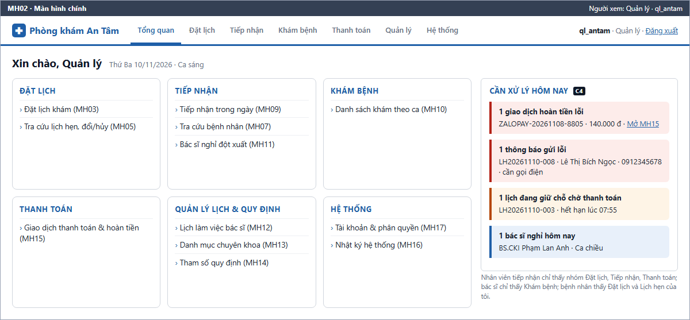

---

## BƯỚC 3: SƠ ĐỒ MÀN HÌNH

Mũi tên hai chiều: đi tới và quay lại được. Mọi màn hình nghiệp vụ đều về được MH02 qua menu; khi lỗi, mọi màn hình có thể chuyển sang MH18, MH19 hoặc MH20.

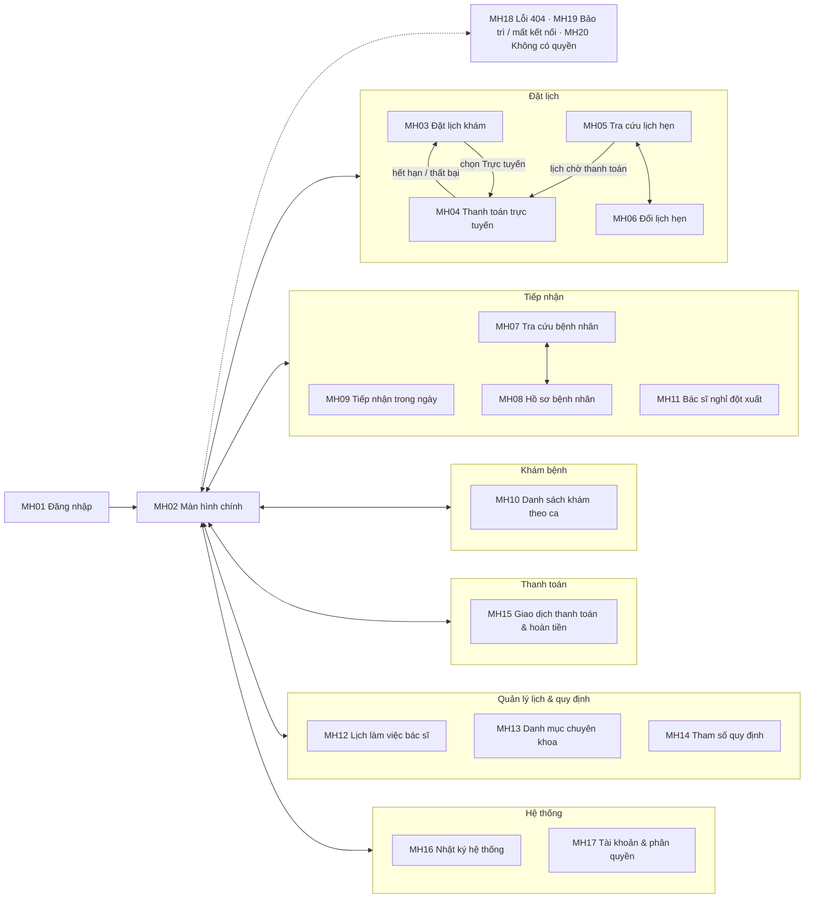

Các mũi tên từ MH02 tới một khung nhóm nghĩa là MH02 mở được (và quay về được từ) mọi màn hình trong nhóm đó, tùy quyền của vai (bảng 2.3). Để sơ đồ dễ đọc, các chuyển tiếp giữa hai nhóm khác nhau được liệt kê riêng:

| Từ | Đến | Khi nào |
| :--- | :--- | :--- |
| MH07 Tra cứu bệnh nhân | MH03 Đặt lịch khám | Bấm "Đặt lịch" trên dòng bệnh nhân; số điện thoại điền sẵn |
| MH09 Tiếp nhận trong ngày | MH03 Đặt lịch khám | Bấm "+ Đặt lịch / Khám gấp" |
| MH09 Tiếp nhận trong ngày | MH05 Tra cứu lịch hẹn | Bấm mã lịch để xem chi tiết, đổi, hủy |
| MH03 Đặt lịch khám | MH08 Hồ sơ bệnh nhân | Sửa thông tin hồ sơ của bệnh nhân cũ |
| MH11 Bác sĩ nghỉ đột xuất | MH15 Giao dịch thanh toán & hoàn tiền | Xử lý thủ công các khoản hoàn lỗi |
| MH12 Lịch làm việc bác sĩ | MH05 Tra cứu lịch hẹn | Xem các lịch bị ảnh hưởng khi sửa, khóa khung |
| MH17 Tài khoản & phân quyền | MH11 Bác sĩ nghỉ đột xuất | Bác sĩ nghỉ cần hủy lịch, hoàn tiền |

---

## BƯỚC 4: QUY ƯỚC GIAO DIỆN

### 4.1. Bảng màu (slide 17)

Dùng 4 màu chức năng cộng thang xám trung tính, giống nhau trên mọi màn hình. Mỗi màu chỉ mang một nghĩa, nên người dùng nhìn màu là biết trạng thái.

| Màu | Mã | Chỉ dùng cho |
| :--- | :--- | :--- |
| Xanh dương (chủ đạo) | `#1F5FA8` | Logo, menu đang chọn, nút chính, khung giờ đang chọn, thông tin trung tính |
| Xanh lá | `#1F7A4D` | Thành công, đã xác nhận, khung giờ còn chỗ, đã hoàn tiền |
| Cam | `#B54708` | Cảnh báo, chờ thanh toán, đang giữ chỗ, đến trễ, chờ chính sách |
| Đỏ | `#B42318` | Lỗi, hết chỗ, đã hủy, hoàn lỗi, gửi lỗi, nút thao tác không hoàn tác được |
| Thang xám | `#1C2430` → `#F2F4F7` | Chữ, viền, nền ô chỉ đọc, dòng đã hủy |

Không dùng màu để truyền nghĩa một mình: mọi trạng thái có thêm chữ ("Hết chỗ", "Hoàn lỗi"), để người mù màu và bản in đen trắng vẫn đọc được.

### 4.2. Quy ước bố trí và thành phần

| Hạng mục | Quy ước |
| :--- | :--- |
| Khung trang | Đầu trang: logo, menu nhóm theo vai, tên tài khoản và vai, nút Đăng xuất. Dưới là đường dẫn (breadcrumb) và tiêu đề màn hình. |
| Ô nhập (slide 21–22) | Nhãn nằm trên ô. Dấu `*` đỏ là bắt buộc. Danh sách cố định ít giá trị (≤ 4) dùng nút chọn radio; danh sách dài dùng ô thả xuống. |
| Ô phản hồi (slide 23) | Ô chỉ đọc (cải tiến 1) có nền xám, viền đứt, không nhận con trỏ. |
| Lưới (cải tiến 3) | Tiêu đề cột cố định; số tiền canh phải, có dấu chấm ngăn nghìn; dòng cảnh báo tô nền cam nhạt, dòng lỗi tô nền đỏ nhạt, dòng đã hủy chữ xám. |
| Định dạng | Ngày `d/M/yyyy` (theo quy ước dữ liệu); giờ `HH:mm`; tiền `150.000 đ`; mã nghiệp vụ hiển thị nguyên dạng (`BN0001`, `LH20261110-001`). |
| Nút | Nút chính màu xanh dương ở bên phải; nút phụ viền xám bên trái nút chính; nút không hoàn tác được (xác nhận bác sĩ nghỉ) màu đỏ và luôn có bước xem trước. |
| Thông báo | Cùng một mẫu khung ở mọi màn hình: tiêu đề in đậm nói chuyện gì, dòng dưới nói vì sao và làm gì tiếp (mục 7). |
| Chú thích wireframe | Nhãn đen `C1`…`C4` trên wireframe đánh dấu cải tiến theo LT07, không thuộc giao diện thật. |

### 4.3. Quy ước kiểm tra nhập liệu (slide 20)

- **Kiểm tra sớm:** ngay khi rời ô hoặc khi chọn, cho các ràng buộc tự nhiên kiểm được tại chỗ: định dạng số điện thoại, CCCD, ngày sinh trước hôm nay, ô bắt buộc, giá trị số ≥ 0, giờ kết thúc sau giờ bắt đầu. Báo bằng viền đỏ và dòng gợi ý ngay dưới ô.
- **Kiểm tra muộn:** khi bấm Lưu/Đặt lịch, cho các ràng buộc cần dữ liệu mới nhất trên máy chủ: khung giờ còn chỗ (`FR-03`, nhiều người đặt cùng lúc), trùng `UNIQUE` (số điện thoại, CCCD), hạn chót đổi/hủy, số lần đổi, quyền truy cập. Báo bằng khung thông báo ở đầu vùng nhập.
- **Phòng bệnh hơn chữa bệnh:** những gì chặn trước được thì không cho chọn (khung hết chỗ không bấm được, nút Đổi mờ khi quá hạn), thay vì để người dùng chọn rồi mới báo lỗi.

---

## BƯỚC 5: WIREFRAME, BẢNG 4 MỨC CẢI TIẾN VÀ ĐẶC TẢ MÀN HÌNH

Mỗi màn hình gồm: wireframe, bảng 4 mức cải tiến (với màn hình nhập liệu), bảng thành phần (STT | Tên | Loại điều khiển | Nguồn dữ liệu | Giá trị mặc định | Ràng buộc kiểm tra) và kịch bản hoạt động. Cột Nguồn dữ liệu dùng đúng `bảng.field` của Người 1. Trong cột Ràng buộc, **[Sớm]** là kiểm tra sớm, **[Muộn]** là kiểm tra muộn.

### MH01 · Đăng nhập

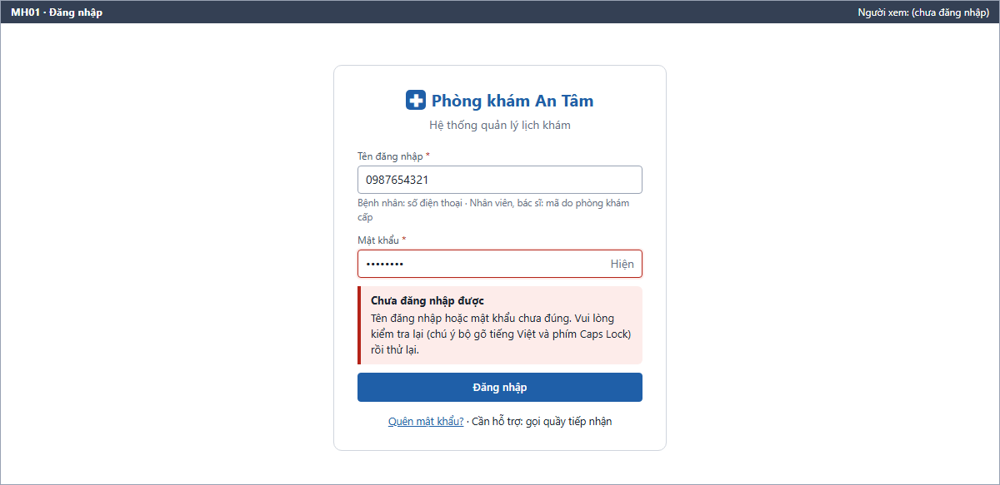

| STT | Tên | Loại điều khiển | Nguồn dữ liệu | Giá trị mặc định | Ràng buộc kiểm tra |
| :-: | :--- | :--- | :--- | :--- | :--- |
| 1 | Tên đăng nhập | Ô nhập | `tai_khoan.ten_dang_nhap` | Trống | [Sớm] bắt buộc, tối đa 50 ký tự |
| 2 | Mật khẩu | Ô nhập ẩn ký tự, nút Hiện | So khớp với `tai_khoan.mat_khau_bam` (bcrypt) | Trống | [Sớm] bắt buộc · [Muộn] sai tên hoặc mật khẩu → TB-17; tài khoản `trang_thai = 0` → TB-18 |
| 3 | Thông báo lỗi | Khung phản hồi | — | Ẩn | Không nói rõ sai tên hay sai mật khẩu, để không lộ tài khoản nào tồn tại |

**Kịch bản:** (1) Người dùng nhập tên đăng nhập và mật khẩu. (2) Bấm Đăng nhập. (3) Đúng: hệ thống đọc `tai_khoan.vai_tro` và mở màn hình đầu của vai (Quản lý → MH02, Tiếp nhận → MH09, Bác sĩ → MH10, Bệnh nhân → MH03). (4) Sai: hiện TB-17, giữ tên đăng nhập, xóa ô mật khẩu.

### MH02 · Màn hình chính

Wireframe ở mục 2.4.

| STT | Tên | Loại điều khiển | Nguồn dữ liệu | Giá trị mặc định | Ràng buộc kiểm tra |
| :-: | :--- | :--- | :--- | :--- | :--- |
| 1 | Menu nhóm chức năng | Thanh menu, ô chức năng | Theo `tai_khoan.vai_tro` (bảng 2.3) | Nhóm của vai | Chỉ hiện nhóm được phép; mở trực tiếp đường dẫn không được phép → MH20 |
| 2 | Cần xử lý hôm nay | Danh sách cảnh báo | `giao_dich_hoan_tien.trang_thai = 'Hoàn lỗi'`, `thong_bao.trang_thai_gui = 'Gửi lỗi'`, `lich_hen.trang_thai_lich = 'Chờ thanh toán'`, `khung_gio_kham.trang_thai_khung = 'Bác sĩ nghỉ'` của hôm nay | Tự tải | Chỉ đọc; bấm từng dòng mở màn hình xử lý |

**Kịch bản:** (1) Mở sau đăng nhập hoặc khi bấm logo. (2) Hệ thống tải số việc cần xử lý. (3) Người dùng chọn chức năng trên menu hoặc bấm một cảnh báo.

### MH03 · Đặt lịch khám (BM01)

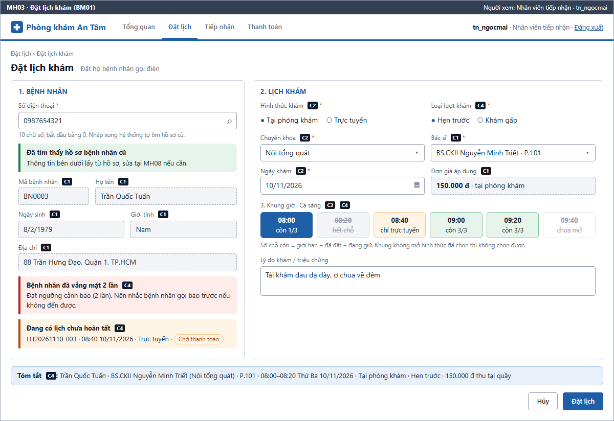

**Bảng 4 mức cải tiến**

| Mức | Bổ sung trên màn hình |
| :--- | :--- |
| Gốc | Số điện thoại, Họ tên, Ngày sinh, Giới tính (bệnh nhân mới); Chuyên khoa, Bác sĩ, Ngày khám, Khung giờ, Hình thức khám, Lý do khám |
| 1 | Nhập số điện thoại cũ thì hiện Mã BN, Họ tên, Ngày sinh, Giới tính, Địa chỉ (chỉ đọc); chọn bác sĩ thì hiện học vị, phòng; chọn chuyên khoa và hình thức thì hiện Đơn giá áp dụng |
| 2 | Ngày khám = ngày hệ thống; Hình thức = Tại phòng khám; Loại lượt = Hẹn trước; Chuyên khoa, Bác sĩ chọn từ danh sách thả xuống (bác sĩ lọc theo chuyên khoa) |
| 3 | Lưới khung giờ cả ca trên một màn hình, mỗi ô có số chỗ còn lại; chọn một ô thay vì gõ giờ |
| 4 | Cảnh báo bệnh nhân đã vắng mặt ≥ ngưỡng `SO_LAN_VANG_MAT_CANH_BAO`; cảnh báo bệnh nhân đang có lịch chưa hoàn tất (tránh đặt trùng); khung hết chỗ, đang giữ, không mở hình thức đã chọn bị khóa sẵn; tùy chọn Khám gấp chỉ hiện cho Tiếp nhận; dòng Tóm tắt trước khi đặt |

**Bảng thành phần**

| STT | Tên | Loại điều khiển | Nguồn dữ liệu | Giá trị mặc định | Ràng buộc kiểm tra |
| :-: | :--- | :--- | :--- | :--- | :--- |
| 1 | Số điện thoại | Ô nhập có tìm kiếm | `benh_nhan.so_dien_thoai` | Bệnh nhân đăng nhập: SĐT của tài khoản; Tiếp nhận: trống | [Sớm] bắt buộc, đúng 10 chữ số, bắt đầu bằng `0` → TB-01 |
| 2 | Mã bệnh nhân | Ô chỉ đọc | `benh_nhan.ma_code_bn` | Tự điền nếu SĐT đã có; trống nếu bệnh nhân mới | — |
| 3 | Họ tên | Ô chỉ đọc (cũ) / Ô nhập (mới) | `benh_nhan.ho_ten` | Tự điền | [Sớm] bệnh nhân mới: bắt buộc, ≤ 100 ký tự |
| 4 | Ngày sinh | Ô chỉ đọc / Ô chọn ngày | `benh_nhan.ngay_sinh` | Tự điền | [Sớm] bệnh nhân mới: bắt buộc, `d/M/yyyy`, trước hôm nay → TB-02 |
| 5 | Giới tính | Ô chỉ đọc / Radio | `benh_nhan.gioi_tinh` | Tự điền; mới: chưa chọn | [Sớm] bệnh nhân mới: bắt buộc, thuộc {Nam, Nữ, Khác} |
| 6 | Địa chỉ | Ô chỉ đọc / Ô nhập | `benh_nhan.dia_chi` | Tự điền | Không bắt buộc, ≤ 255 ký tự |
| 7 | Cảnh báo vắng mặt | Khung cảnh báo | `benh_nhan.so_lan_vang_mat`, `tham_so['SO_LAN_VANG_MAT_CANH_BAO']` | Ẩn | Hiện khi `so_lan_vang_mat ≥` ngưỡng → TB-08; chỉ cảnh báo, không chặn |
| 8 | Lịch chưa hoàn tất | Khung cảnh báo | `lich_hen.ma_code_lich`, `lich_hen.trang_thai_lich` của bệnh nhân với `trang_thai_lich IN ('Chờ thanh toán', 'Đã xác nhận')` và chưa qua ngày | Ẩn | Chỉ cảnh báo |
| 9 | Hình thức khám | Radio | `lich_hen.hinh_thuc_kham` | Tại phòng khám | Bắt buộc |
| 10 | Loại lượt khám | Radio (chỉ vai Tiếp nhận) | `lich_hen.loai_luot_kham` | Hẹn trước | Bệnh nhân luôn là Hẹn trước |
| 11 | Chuyên khoa | Ô thả xuống | `chuyen_khoa.ma_chuyen_khoa`, `ten_chuyen_khoa` với `trang_thai_hoat_dong = 1` | Chuyên khoa đầu danh sách | Bắt buộc |
| 12 | Bác sĩ | Ô thả xuống | `bac_si.ma_bac_si`, `hoc_vi`, `ho_ten`, `phong_kham_so`, lọc theo chuyên khoa, `trang_thai_lam_viec = 1` | Bác sĩ đầu danh sách | Bắt buộc |
| 13 | Ngày khám | Ô chọn ngày | `khung_gio_kham.ngay_kham` | Hôm nay | [Sớm] không trước hôm nay |
| 14 | Đơn giá áp dụng | Ô chỉ đọc | `chuyen_khoa.don_gia_kham_tai_cho` hoặc `don_gia_kham_truc_tuyen` → lưu `lich_hen.don_gia_ap_dung` | Theo chuyên khoa và hình thức | — |
| 15 | Lưới khung giờ | Lưới ô chọn | `khung_gio_kham.ma_khung_gio`, `gio_bat_dau`, `gio_ket_thuc`, `hinh_thuc_mo`, `gioi_han_benh_nhan`, `so_cho_da_dat`, `so_cho_dang_giu`, `trang_thai_khung` | Chưa chọn | [Sớm] khóa ô khi còn 0 chỗ, `trang_thai_khung ≠ 'Khả dụng'` hoặc `hinh_thuc_mo` không gồm hình thức đã chọn · [Muộn] khi đặt, khung phải còn chỗ → nếu vừa hết: TB-03 |
| 16 | Lý do khám | Ô văn bản nhiều dòng | `lich_hen.ly_do_kham` | Trống | Không bắt buộc |
| 17 | Tóm tắt | Khung phản hồi | Ghép từ các ô trên | Cập nhật khi đổi lựa chọn | — |

**Kịch bản:**
1. Nhập số điện thoại. Rời ô: hệ thống tìm `benh_nhan` theo số điện thoại.
   - Tìm thấy: điền ô 2–6 (chỉ đọc), hiện cảnh báo 7–8 nếu có.
   - Không thấy: mở ô 3–6 để nhập; khi đặt lịch thành công sẽ tạo hồ sơ mới (`FR-07`) với `la_benh_nhan_moi = 1`.
2. Chọn hình thức, chuyên khoa, bác sĩ, ngày. Lưới khung giờ và đơn giá tải lại theo lựa chọn.
3. Chọn một khung còn chỗ, nhập lý do khám.
4. Bấm Đặt lịch. Hệ thống kiểm tra muộn.
   - **Tại phòng khám:** lịch ở `Đã xác nhận`, tăng `so_cho_da_dat`, hiện TB-19 kèm mã lịch, gửi thông báo (`FR-04`).
   - **Trực tuyến:** lịch ở `Chờ thanh toán`, tăng `so_cho_dang_giu`, gán `thoi_diem_het_han_giu`, chuyển sang MH04 (`FR-15`, `FR-16`). Nhân viên đặt hộ: hệ thống gửi liên kết thanh toán cho bệnh nhân (`FR-08`).
5. Khung vừa hết chỗ do người khác đặt trước: hiện TB-03, tải lại lưới, giữ nguyên các ô đã nhập.

### MH04 · Thanh toán lịch khám trực tuyến (BM02)

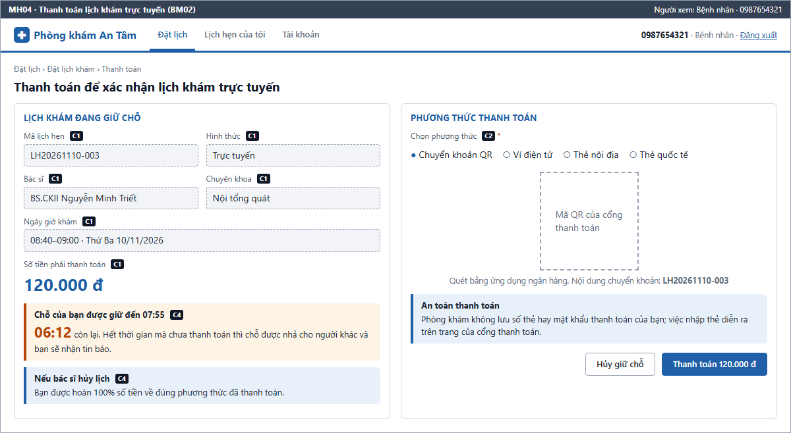

**Bảng 4 mức cải tiến**

| Mức | Bổ sung trên màn hình |
| :--- | :--- |
| Gốc | Mã lịch hẹn, Số tiền, Phương thức thanh toán |
| 1 | Hiện Bác sĩ, Chuyên khoa, Ngày giờ, Hình thức của lịch (chỉ đọc) để bệnh nhân đối chiếu trước khi trả tiền |
| 2 | Phương thức mặc định Chuyển khoản QR; nội dung chuyển khoản điền sẵn bằng mã lịch |
| 3 | Bốn phương thức trên cùng một màn hình, chuyển qua lại không mất thông tin |
| 4 | Đồng hồ đếm ngược thời gian giữ chỗ (`FR-16`); ghi rõ hoàn 100% nếu bác sĩ hủy (`FR-17`, `ASM-05`); ghi rõ phòng khám không lưu số thẻ (`NFR-07`) |

**Bảng thành phần**

| STT | Tên | Loại điều khiển | Nguồn dữ liệu | Giá trị mặc định | Ràng buộc kiểm tra |
| :-: | :--- | :--- | :--- | :--- | :--- |
| 1 | Mã lịch hẹn | Ô chỉ đọc | `lich_hen.ma_code_lich` | Lịch vừa tạo | — |
| 2 | Bác sĩ, Chuyên khoa | Ô chỉ đọc | `bac_si.ho_ten`, `hoc_vi`; `chuyen_khoa.ten_chuyen_khoa` | — | — |
| 3 | Ngày giờ khám, Hình thức | Ô chỉ đọc | `khung_gio_kham.ngay_kham`, `gio_bat_dau`, `gio_ket_thuc`; `lich_hen.hinh_thuc_kham` | — | — |
| 4 | Số tiền | Ô chỉ đọc (chữ lớn) | `lich_hen.don_gia_ap_dung` → `giao_dich_thanh_toan.so_tien` | — | > 0 |
| 5 | Thời gian giữ chỗ còn lại | Đồng hồ đếm ngược | `lich_hen.thoi_diem_het_han_giu` (từ `tham_so['THOI_GIAN_GIU_CHO_PHUT']`) | 10:00 | Về 0 → TB-04, khóa nút Thanh toán |
| 6 | Phương thức thanh toán | Radio | `giao_dich_thanh_toan.phuong_thuc` ∈ {Chuyển khoản QR, Ví điện tử, Thẻ nội địa, Thẻ quốc tế} | Chuyển khoản QR | Bắt buộc |
| 7 | Mã QR / chuyển sang cổng | Vùng hiển thị | Do cổng thanh toán cấp | — | Không có ô nhập số thẻ trên trang phòng khám |

**Kịch bản:**
1. Mở từ MH03 (hoặc MH05 với lịch đang `Chờ thanh toán`); đồng hồ chạy theo `thoi_diem_het_han_giu`.
2. Chọn phương thức, thanh toán trên cổng.
3. Cổng báo thành công: tạo `giao_dich_thanh_toan` ở `Thành công`, lịch sang `Đã xác nhận`, chuyển chỗ từ `so_cho_dang_giu` sang `so_cho_da_dat`, hiện TB-20 và gửi thông báo kèm số tiền (`FR-04`).
4. Cổng báo thất bại: hiện TB-05, cho chọn lại phương thức nếu còn thời gian giữ.
5. Hết thời gian giữ: lịch sang `Hết hạn giữ chỗ`, nhả chỗ, hiện TB-04 với nút Đặt lại (về MH03 giữ nguyên lựa chọn cũ).
6. Bấm Hủy giữ chỗ: hỏi xác nhận, nhả chỗ ngay.

### MH05 · Tra cứu lịch hẹn (BM07)

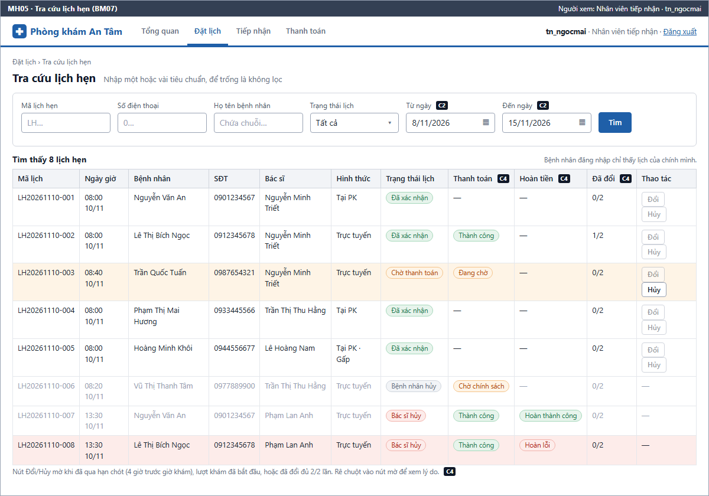

Đây là màn hình tra cứu theo slide 35–36: các tiêu chuẩn không bắt buộc nhập hết, kết quả hiện dạng bảng.

| STT | Tên | Loại điều khiển | Nguồn dữ liệu | Giá trị mặc định | Ràng buộc kiểm tra |
| :-: | :--- | :--- | :--- | :--- | :--- |
| 1 | Mã lịch hẹn | Ô nhập | `lich_hen.ma_code_lich` | Trống | Khớp chính xác |
| 2 | Số điện thoại | Ô nhập | `benh_nhan.so_dien_thoai` | Trống | [Sớm] chỉ nhận chữ số |
| 3 | Họ tên bệnh nhân | Ô nhập | `benh_nhan.ho_ten` | Trống | Tìm chứa chuỗi, không phân biệt hoa thường |
| 4 | Trạng thái lịch | Ô thả xuống | `lich_hen.trang_thai_lich` (5 giá trị + Tất cả) | Tất cả | — |
| 5 | Từ ngày – Đến ngày | 2 ô chọn ngày | `khung_gio_kham.ngay_kham` | Hôm nay − 2 ngày đến hôm nay + 5 ngày | [Sớm] Từ ngày ≤ Đến ngày |
| 6 | Lưới kết quả | Lưới chỉ đọc | `lich_hen.ma_code_lich`, `hinh_thuc_kham`, `loai_luot_kham`, `trang_thai_lich`, `so_lan_doi`; `khung_gio_kham.ngay_kham`, `gio_bat_dau`; `benh_nhan.ho_ten`, `so_dien_thoai`; `bac_si.ho_ten` | — | Bệnh nhân chỉ thấy lịch có `ma_benh_nhan` của mình (`FR-13`) |
| 7 | Thanh toán, Hoàn tiền | Cột nhãn màu | `giao_dich_thanh_toan.trang_thai`, `giao_dich_hoan_tien.trang_thai` | — | `—` khi lịch tại phòng khám |
| 8 | Đã đổi | Cột số | `lich_hen.so_lan_doi` / `tham_so['SO_LAN_DOI_TOI_DA']` | — | — |
| 9 | Đổi / Hủy | Nút trên từng dòng | — | — | Mờ khi: trước giờ khám ít hơn `HAN_CHOT_DOI_HUY_GIO`, `trang_thai_kham ≠ 'Chưa đến'`, lịch đã hủy, hoặc (riêng Đổi) `so_lan_doi ≥ SO_LAN_DOI_TOI_DA`; rê chuột hiện lý do |

**Kịch bản:**
1. Nhập một hoặc vài tiêu chuẩn rồi bấm Tìm (để trống tất cả là liệt kê theo khoảng ngày mặc định).
2. Lưới hiện các lịch khớp, mới nhất trước, kèm số dòng tìm thấy. Không có kết quả: hiện TB-21.
3. Bấm Đổi → mở MH06. Bấm Hủy → hỏi xác nhận TB-22.
4. Hủy thành công: lịch sang `Bệnh nhân hủy`, nhả chỗ, gửi thông báo. Lịch trực tuyến đã thanh toán thì giao dịch sang `Chờ chính sách`, không hoàn tự động (`FR-06`, `ASM-17`).

### MH06 · Đổi lịch hẹn

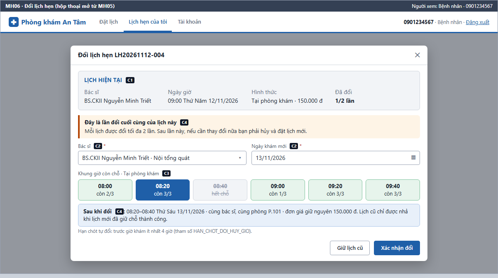

**Bảng 4 mức cải tiến**

| Mức | Bổ sung trên màn hình |
| :--- | :--- |
| Gốc | Mã lịch, Bác sĩ mới, Ngày mới, Giờ mới |
| 1 | Hiện thông tin lịch hiện tại (bác sĩ, ngày giờ, hình thức, đơn giá, số lần đã đổi) để so sánh |
| 2 | Bác sĩ mặc định là bác sĩ hiện tại; ngày mặc định là ngày của lịch hiện tại |
| 3 | Lưới khung giờ còn chỗ của cả ngày |
| 4 | Báo "đây là lần đổi cuối" khi `so_lan_doi = SO_LAN_DOI_TOI_DA − 1`; nhắc hạn chót đổi; dòng "Sau khi đổi" so sánh mới/cũ; ghi rõ lịch cũ chỉ nhả khi lịch mới đã giữ chỗ thành công (`FR-05`) |

| STT | Tên | Loại điều khiển | Nguồn dữ liệu | Giá trị mặc định | Ràng buộc kiểm tra |
| :-: | :--- | :--- | :--- | :--- | :--- |
| 1 | Lịch hiện tại | Khung chỉ đọc | `lich_hen.*`, `khung_gio_kham.*`, `bac_si.ho_ten` | Lịch đang chọn ở MH05 | — |
| 2 | Bác sĩ | Ô thả xuống | `bac_si` cùng chuyên khoa | Bác sĩ hiện tại | Bắt buộc |
| 3 | Ngày khám mới | Ô chọn ngày | `khung_gio_kham.ngay_kham` | Ngày của lịch hiện tại | [Sớm] không trước hôm nay |
| 4 | Lưới khung giờ | Lưới ô chọn | Như MH03 ô 15, lọc theo `lich_hen.hinh_thuc_kham` hiện tại | Chưa chọn | [Sớm] khóa ô hết chỗ · [Muộn] TB-03 nếu vừa hết |
| 5 | Cảnh báo lần đổi cuối | Khung cảnh báo | `lich_hen.so_lan_doi`, `tham_so['SO_LAN_DOI_TOI_DA']` | Ẩn | [Muộn] đã đổi đủ → TB-07 |
| 6 | Hạn chót | Dòng gợi ý | `tham_so['HAN_CHOT_DOI_HUY_GIO']` | — | [Muộn] quá hạn → TB-06 |

**Kịch bản:** (1) Mở từ nút Đổi ở MH05. (2) Chọn bác sĩ, ngày, khung giờ mới. (3) Bấm Xác nhận đổi. (4) Hệ thống giữ chỗ khung mới trước, rồi mới nhả khung cũ, tăng `so_lan_doi`, gửi thông báo `Xác nhận đổi lịch` (`FR-04`). (5) Khung mới vừa hết chỗ: báo TB-03, lịch cũ giữ nguyên.

Lịch trực tuyến đã thanh toán: cách xử lý khoản tiền khi đổi chưa được phòng khám chốt (`Q-12`). Khi có quyết định sẽ bổ sung dòng thông tin thanh toán vào hộp thoại này.

### MH07 · Tra cứu bệnh nhân

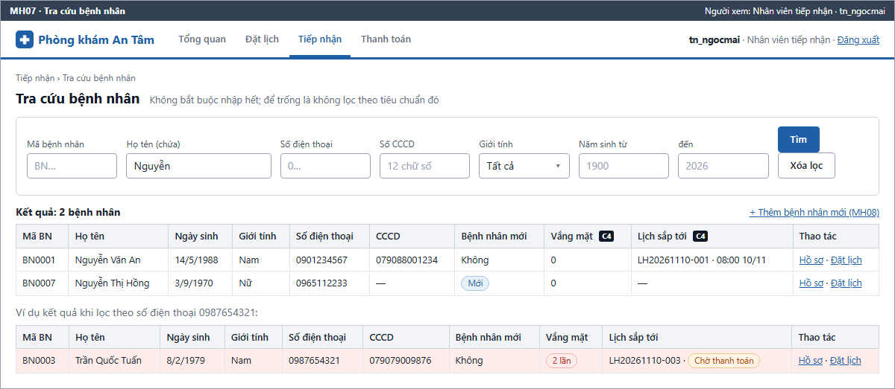

Màn hình tra cứu theo slide 35–36: tiêu chuẩn tra cứu không bắt buộc nhập hết, kết quả dạng bảng.

| STT | Tên | Loại điều khiển | Nguồn dữ liệu | Giá trị mặc định | Ràng buộc kiểm tra |
| :-: | :--- | :--- | :--- | :--- | :--- |
| 1 | Mã bệnh nhân | Ô nhập | `benh_nhan.ma_code_bn` | Trống | Khớp chính xác |
| 2 | Họ tên (chứa) | Ô nhập | `benh_nhan.ho_ten` | Trống | Tìm chứa chuỗi, bỏ qua dấu và hoa thường |
| 3 | Số điện thoại | Ô nhập | `benh_nhan.so_dien_thoai` | Trống | [Sớm] chỉ chữ số; tìm theo đầu số nếu chưa đủ 10 số |
| 4 | Số CCCD | Ô nhập | `benh_nhan.so_cccd` | Trống | [Sớm] chỉ chữ số, tối đa 12 |
| 5 | Giới tính | Ô thả xuống | `benh_nhan.gioi_tinh` | Tất cả | — |
| 6 | Năm sinh từ – đến | 2 ô nhập số | Năm của `benh_nhan.ngay_sinh` | Trống | [Sớm] số 4 chữ số, từ ≤ đến |
| 7 | Lưới kết quả | Lưới chỉ đọc | `benh_nhan.ma_code_bn`, `ho_ten`, `ngay_sinh`, `gioi_tinh`, `so_dien_thoai`, `so_cccd`, `la_benh_nhan_moi`, `so_lan_vang_mat` | — | Dòng có `so_lan_vang_mat ≥ SO_LAN_VANG_MAT_CANH_BAO` tô đỏ |
| 8 | Lịch sắp tới | Cột liên kết | `lich_hen` gần nhất chưa qua của bệnh nhân | — | — |
| 9 | Hồ sơ · Đặt lịch | Liên kết trên dòng | — | — | Mở MH08 hoặc MH03 với số điện thoại điền sẵn |

**Kịch bản:** (1) Nhập ít nhất một tiêu chuẩn, bấm Tìm. (2) Lưới hiện bệnh nhân khớp tất cả tiêu chuẩn đã nhập. Không có: TB-21 kèm liên kết "Thêm bệnh nhân mới". (3) Bấm Hồ sơ hoặc Đặt lịch trên dòng cần thao tác.

### MH08 · Hồ sơ bệnh nhân

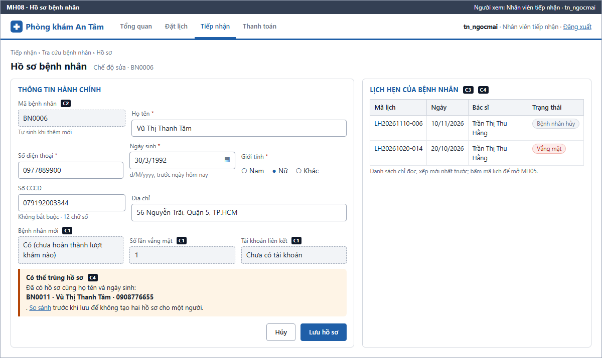

**Bảng 4 mức cải tiến**

| Mức | Bổ sung trên màn hình |
| :--- | :--- |
| Gốc | Họ tên, Số điện thoại, Ngày sinh, Giới tính, CCCD, Địa chỉ |
| 1 | Hiện Bệnh nhân mới, Số lần vắng mặt, Tài khoản liên kết (chỉ đọc) |
| 2 | Mã bệnh nhân tự sinh `BN0007`…; ngày sinh nhập theo `d/M/yyyy` |
| 3 | Lưới lịch hẹn của bệnh nhân ngay trên hồ sơ |
| 4 | Cảnh báo hồ sơ có thể trùng (cùng họ tên và ngày sinh, hoặc cùng CCCD) trước khi lưu, tránh một người có hai hồ sơ (`FR-07`) |

| STT | Tên | Loại điều khiển | Nguồn dữ liệu | Giá trị mặc định | Ràng buộc kiểm tra |
| :-: | :--- | :--- | :--- | :--- | :--- |
| 1 | Mã bệnh nhân | Ô chỉ đọc | `benh_nhan.ma_code_bn` | Tự sinh khi thêm | — |
| 2 | Họ tên | Ô nhập | `benh_nhan.ho_ten` | Trống | [Sớm] bắt buộc, ≤ 100 ký tự |
| 3 | Số điện thoại | Ô nhập | `benh_nhan.so_dien_thoai` | Trống | [Sớm] bắt buộc, 10 chữ số, bắt đầu `0` → TB-01 · [Muộn] không trùng hồ sơ khác (`UNIQUE`) → TB-09 |
| 4 | Ngày sinh | Ô chọn ngày | `benh_nhan.ngay_sinh` | Trống | [Sớm] bắt buộc, trước hôm nay → TB-02 |
| 5 | Giới tính | Radio | `benh_nhan.gioi_tinh` | Chưa chọn | [Sớm] bắt buộc, thuộc {Nam, Nữ, Khác} |
| 6 | Số CCCD | Ô nhập | `benh_nhan.so_cccd` | Trống | [Sớm] không bắt buộc; nếu nhập phải đủ 12 chữ số · [Muộn] không trùng (chỉ mục `UX_benh_nhan_cccd`) → TB-10 |
| 7 | Địa chỉ | Ô nhập | `benh_nhan.dia_chi` | Trống | ≤ 255 ký tự |
| 8 | Bệnh nhân mới · Số lần vắng mặt · Tài khoản | Ô chỉ đọc | `benh_nhan.la_benh_nhan_moi`, `so_lan_vang_mat`, `ma_tai_khoan` → `tai_khoan.ten_dang_nhap` | Mới: Có · 0 · Chưa có | Do hệ thống cập nhật, không sửa tay |
| 9 | Cảnh báo trùng hồ sơ | Khung cảnh báo | Tìm `benh_nhan` cùng `ho_ten` + `ngay_sinh` | Ẩn | Chỉ cảnh báo; người dùng tự quyết định |
| 10 | Lịch hẹn của bệnh nhân | Lưới chỉ đọc | `lich_hen.ma_code_lich`, `khung_gio_kham.ngay_kham`, `bac_si.ho_ten`, `lich_hen.trang_thai_lich`, `trang_thai_kham` | Mới nhất trước | — |

**Kịch bản:** (1) Mở từ MH07 (sửa) hoặc liên kết "Thêm bệnh nhân mới" (thêm). (2) Nhập, sửa thông tin; rời ô Họ tên/Ngày sinh thì hệ thống tìm hồ sơ có thể trùng. (3) Bấm Lưu, hệ thống kiểm tra muộn các ràng buộc `UNIQUE`. (4) Lưu thành công hiện TB-23 và quay về MH07.

### MH09 · Tiếp nhận trong ngày (BM03)

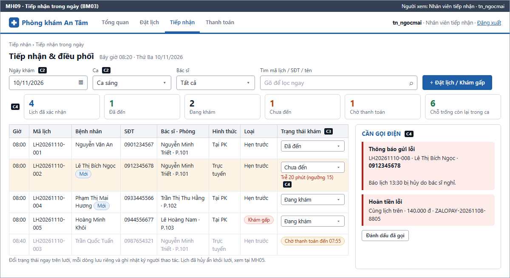

**Bảng 4 mức cải tiến**

| Mức | Bổ sung trên màn hình |
| :--- | :--- |
| Gốc | Mã lịch, Trạng thái khám |
| 1 | Mỗi dòng hiện giờ hẹn, họ tên, SĐT, bác sĩ, phòng, hình thức, loại lượt để nhân viên đối chiếu khi bệnh nhân tới quầy |
| 2 | Ngày = hôm nay; Ca = ca hiện tại theo giờ máy |
| 3 | Lưới cả ca, đổi trạng thái của nhiều bệnh nhân ngay trên lưới, không mở từng lịch |
| 4 | Thanh chỉ số đầu ca (đã xác nhận, đã đến, đang khám, chưa đến, chờ thanh toán, chỗ trống còn lại); cảnh báo đến trễ quá `NGUONG_TRE_HEN_TOI_DA_PHUT`; nhãn "Mới" cho bệnh nhân mới; khung "Cần gọi điện" cho thông báo gửi lỗi và hoàn lỗi (`SC-04` 4a) |

| STT | Tên | Loại điều khiển | Nguồn dữ liệu | Giá trị mặc định | Ràng buộc kiểm tra |
| :-: | :--- | :--- | :--- | :--- | :--- |
| 1 | Ngày khám | Ô chọn ngày | `khung_gio_kham.ngay_kham` | Hôm nay | — |
| 2 | Ca | Ô thả xuống | `khung_gio_kham.ca_lam_viec` | Ca hiện tại | — |
| 3 | Bác sĩ | Ô thả xuống | `bac_si.ma_bac_si` | Tất cả | — |
| 4 | Tìm mã lịch / SĐT / tên | Ô nhập lọc ngay | `lich_hen.ma_code_lich`, `benh_nhan.so_dien_thoai`, `benh_nhan.ho_ten` | Trống | Lọc khi gõ |
| 5 | Thanh chỉ số | 6 ô số | Đếm `lich_hen.trang_thai_kham`, `trang_thai_lich`; chỗ trống = Σ(`gioi_han_benh_nhan − so_cho_da_dat − so_cho_dang_giu`) của các khung `Khả dụng` | Tự tính | Chỉ đọc |
| 6 | Lưới lượt khám | Lưới | `khung_gio_kham.gio_bat_dau`, `lich_hen.ma_code_lich`, `benh_nhan.ho_ten`, `so_dien_thoai`, `la_benh_nhan_moi`, `bac_si.ho_ten`, `phong_kham_so`, `lich_hen.hinh_thuc_kham`, `loai_luot_kham` | Xếp theo giờ | Chỉ lịch `Đã xác nhận` và `Chờ thanh toán` |
| 7 | Trạng thái khám | Ô thả xuống trên dòng | `lich_hen.trang_thai_kham` | Giá trị hiện tại | [Sớm] chỉ cho chuyển hợp lệ: Chưa đến → Đã đến / Đến trễ / Vắng mặt; Đã đến → Đang khám → Hoàn thành · [Muộn] dòng đã bị người khác đổi → TB-24 |
| 8 | Cảnh báo trễ | Dòng gợi ý | `gio_bat_dau` + `tham_so['NGUONG_TRE_HEN_TOI_DA_PHUT']` so với giờ hiện tại | Ẩn | Hiện khi quá ngưỡng mà vẫn `Chưa đến` |
| 9 | Cần gọi điện | Danh sách | `thong_bao.trang_thai_gui = 'Gửi lỗi'`, `giao_dich_hoan_tien.trang_thai = 'Hoàn lỗi'`, `benh_nhan.so_dien_thoai` | Tự tải | — |

**Kịch bản:**
1. Mở đầu ca, lưới tải lịch của ngày và ca hiện tại.
2. Bệnh nhân tới quầy: gõ SĐT hoặc mã lịch vào ô tìm, chọn `Đã đến` (hoặc `Đến trễ`) ở cột trạng thái. Hệ thống lưu ngay dòng đó, ghi `nhat_ky_he_thong` (`FR-10`).
3. Hết ca mà bệnh nhân không tới: chọn `Vắng mặt`; hệ thống tăng `benh_nhan.so_lan_vang_mat`.
4. Bệnh nhân khám gấp hoặc gọi đặt lịch: bấm "+ Đặt lịch / Khám gấp" → MH03.
5. Gọi điện cho bệnh nhân trong khung "Cần gọi điện" rồi bấm "Đánh dấu đã gọi".

### MH10 · Danh sách khám theo ca (BM04)

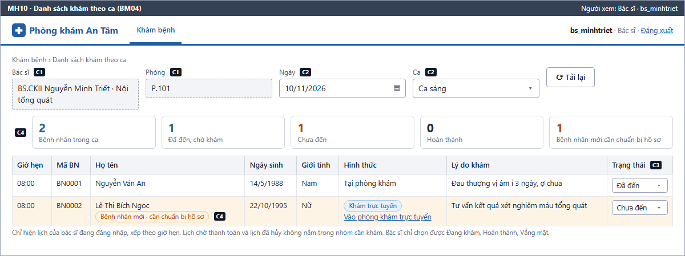

**Bảng 4 mức cải tiến**

| Mức | Bổ sung trên màn hình |
| :--- | :--- |
| Gốc | Ngày, Ca, danh sách bệnh nhân |
| 1 | Hiện tên bác sĩ, chuyên khoa, phòng của tài khoản đang đăng nhập (chỉ đọc) |
| 2 | Ngày = hôm nay, Ca = ca hiện tại |
| 3 | Lưới bệnh nhân cả ca xếp theo giờ hẹn, cập nhật trạng thái ngay trên lưới |
| 4 | Nhãn "Bệnh nhân mới · cần chuẩn bị hồ sơ" (`FR-09`); nhãn "Khám trực tuyến" kèm liên kết vào phòng khám; thanh chỉ số còn bao nhiêu bệnh nhân chờ |

| STT | Tên | Loại điều khiển | Nguồn dữ liệu | Giá trị mặc định | Ràng buộc kiểm tra |
| :-: | :--- | :--- | :--- | :--- | :--- |
| 1 | Bác sĩ, Phòng | Ô chỉ đọc | `bac_si.hoc_vi`, `ho_ten`, `phong_kham_so`, `chuyen_khoa.ten_chuyen_khoa` theo `tai_khoan` đang đăng nhập | — | Bác sĩ chỉ xem lịch của mình (`FR-13`) |
| 2 | Ngày · Ca | Ô chọn ngày · Ô thả xuống | `khung_gio_kham.ngay_kham`, `ca_lam_viec` | Hôm nay · ca hiện tại | — |
| 3 | Thanh chỉ số | 5 ô số | Đếm theo `lich_hen.trang_thai_kham`, `benh_nhan.la_benh_nhan_moi` | Tự tính | — |
| 4 | Lưới bệnh nhân | Lưới | `khung_gio_kham.gio_bat_dau`, `benh_nhan.ma_code_bn`, `ho_ten`, `ngay_sinh`, `gioi_tinh`, `lich_hen.hinh_thuc_kham`, `ly_do_kham` | Xếp theo giờ hẹn | Chỉ lịch `Đã xác nhận`; lịch hủy và chờ thanh toán không hiện (`FR-09`) |
| 5 | Nhãn bệnh nhân mới | Nhãn | `benh_nhan.la_benh_nhan_moi = 1` | — | — |
| 6 | Vào phòng khám trực tuyến | Liên kết | `lich_hen.lien_ket_kham_truc_tuyen` | — | Chỉ hiện với lịch Trực tuyến |
| 7 | Trạng thái | Ô thả xuống | `lich_hen.trang_thai_kham` | Giá trị hiện tại | Bác sĩ chỉ chọn Đang khám, Hoàn thành, Vắng mặt |

**Kịch bản:** (1) Bác sĩ đăng nhập, vào thẳng MH10 của ca hiện tại. (2) Xem trước bệnh nhân mới để chuẩn bị hồ sơ. (3) Gọi bệnh nhân: chọn `Đang khám`; khám xong chọn `Hoàn thành` (hệ thống đặt `la_benh_nhan_moi = 0` ở lần hoàn thành đầu tiên). (4) Bấm Tải lại để thấy lịch đặt, đổi, hủy mới sau đầu ca.

### MH11 · Xử lý bác sĩ nghỉ đột xuất (BM05)

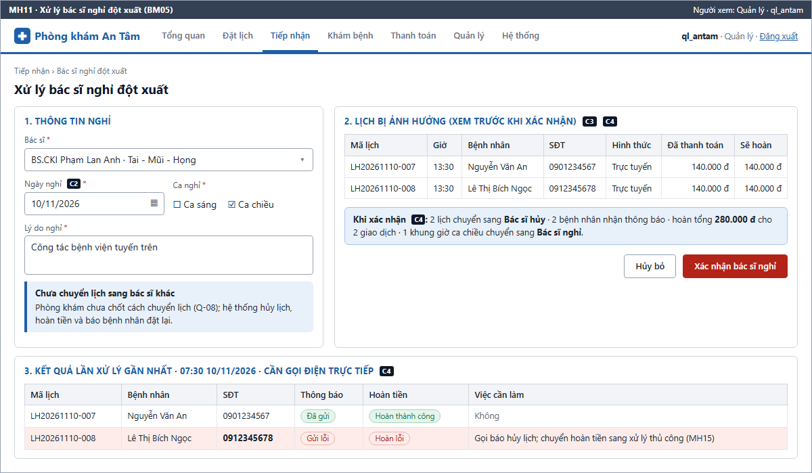

**Bảng 4 mức cải tiến**

| Mức | Bổ sung trên màn hình |
| :--- | :--- |
| Gốc | Bác sĩ, Ngày nghỉ, Ca nghỉ, Lý do |
| 1 | Hiện chuyên khoa của bác sĩ trong ô chọn |
| 2 | Ngày nghỉ = hôm nay; bác sĩ chọn từ danh sách thả xuống |
| 3 | Lưới tất cả lịch bị ảnh hưởng của ca đã chọn, xử lý một lần cho cả ca |
| 4 | Xem trước số lịch sẽ hủy, số bệnh nhân được báo, tổng tiền hoàn trước khi xác nhận; bảng kết quả chỉ ra bệnh nhân gửi thông báo lỗi hoặc hoàn lỗi cần gọi điện (`SC-04` 3a-1, 4a) |

| STT | Tên | Loại điều khiển | Nguồn dữ liệu | Giá trị mặc định | Ràng buộc kiểm tra |
| :-: | :--- | :--- | :--- | :--- | :--- |
| 1 | Bác sĩ | Ô thả xuống | `bac_si.ma_bac_si`, `hoc_vi`, `ho_ten` + `chuyen_khoa.ten_chuyen_khoa` → `khung_gio_kham.ma_bac_si` | Chưa chọn | [Sớm] bắt buộc |
| 2 | Ngày nghỉ | Ô chọn ngày | `khung_gio_kham.ngay_kham` | Hôm nay | [Sớm] không trước hôm nay |
| 3 | Ca nghỉ | Ô đánh dấu (chọn 1 hoặc cả 2) | `khung_gio_kham.ca_lam_viec` | Ca hiện tại | [Sớm] chọn ít nhất 1 ca |
| 4 | Lý do nghỉ | Ô văn bản | `khung_gio_kham.ly_do_khoa` | Trống | [Sớm] bắt buộc, ≤ 255 ký tự |
| 5 | Lưới lịch bị ảnh hưởng | Lưới chỉ đọc | `lich_hen.ma_code_lich`, `khung_gio_kham.gio_bat_dau`, `benh_nhan.ho_ten`, `so_dien_thoai`, `lich_hen.hinh_thuc_kham`, `giao_dich_thanh_toan.so_tien` | Tải khi chọn đủ 1–3 | Lịch `Đã xác nhận` và `Chờ thanh toán` của các khung đã chọn |
| 6 | Tóm tắt khi xác nhận | Khung phản hồi | Đếm từ lưới; tổng `so_tien` của giao dịch `Thành công` | — | — |
| 7 | Kết quả lần xử lý gần nhất | Lưới | `thong_bao.trang_thai_gui`, `giao_dich_hoan_tien.trang_thai`, `benh_nhan.so_dien_thoai` | Tự tải | Dòng `Gửi lỗi` hoặc `Hoàn lỗi` tô đỏ |

**Kịch bản:**
1. Chọn bác sĩ, ngày, ca, nhập lý do. Lưới xem trước tự tải.
2. Bấm "Xác nhận bác sĩ nghỉ" (nút đỏ); hệ thống hỏi lại bằng TB-25 kèm số lịch và tổng tiền.
3. Đồng ý: các khung sang `Bác sĩ nghỉ`, các lịch sang `Bác sĩ hủy`, tạo một `giao_dich_hoan_tien` cho mỗi giao dịch `Thành công` (`UNIQUE ma_giao_dich_goc` chống hoàn hai lần), gửi thông báo `Bác sĩ hủy & Hoàn tiền` (`FR-11`, `FR-17`, `FR-18`).
4. Bảng kết quả liệt kê dòng lỗi; nhân viên gọi điện cho bệnh nhân, mở MH15 để xử lý hoàn lỗi.
5. Không có lịch nào bị ảnh hưởng: TB-26; vẫn khóa khung giờ.

Chuyển lịch sang bác sĩ khác cùng chuyên khoa chưa có trên màn hình vì phòng khám chưa chốt (`Q-08`).

### MH12 · Lịch làm việc bác sĩ (BM06)

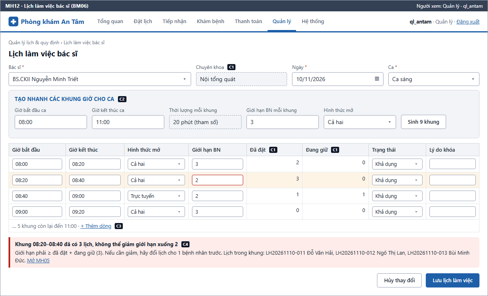

**Bảng 4 mức cải tiến**

| Mức | Bổ sung trên màn hình |
| :--- | :--- |
| Gốc | Bác sĩ, Ngày, Ca, Giờ bắt đầu, Giờ kết thúc, Hình thức mở, Giới hạn bệnh nhân |
| 1 | Hiện chuyên khoa của bác sĩ; hiện số Đã đặt, Đang giữ của từng khung (chỉ đọc) |
| 2 | Thời lượng khung lấy từ `THOI_LUONG_KHUNG_GIO_PHUT`; giới hạn mặc định từ `SO_BN_TOI_DA_MOI_KHUNG`; hình thức mặc định Cả hai |
| 3 | Sinh tự động tất cả khung của ca (08:00–11:00 → 9 khung) và sửa nhiều khung trên một lưới |
| 4 | Khi sửa hoặc khóa khung đã có lịch: cảnh báo kèm danh sách lịch bị ảnh hưởng trước khi áp dụng (`FR-12`); chặn giới hạn nhỏ hơn số chỗ đã dùng |

| STT | Tên | Loại điều khiển | Nguồn dữ liệu | Giá trị mặc định | Ràng buộc kiểm tra |
| :-: | :--- | :--- | :--- | :--- | :--- |
| 1 | Bác sĩ | Ô thả xuống | `khung_gio_kham.ma_bac_si` | Chưa chọn | [Sớm] bắt buộc |
| 2 | Chuyên khoa | Ô chỉ đọc | `bac_si.ma_chuyen_khoa` → `chuyen_khoa.ten_chuyen_khoa` | Theo bác sĩ | — |
| 3 | Ngày · Ca | Ô chọn ngày · Ô thả xuống | `khung_gio_kham.ngay_kham`, `ca_lam_viec` | Ngày mai · Ca sáng | [Sớm] bắt buộc |
| 4 | Giờ bắt đầu / kết thúc ca | Ô nhập `HH:mm` | Dùng để sinh khung | 08:00 / 11:00 (sáng), 13:30 / 16:30 (chiều) | [Sớm] kết thúc > bắt đầu |
| 5 | Thời lượng mỗi khung | Ô chỉ đọc | `tham_so['THOI_LUONG_KHUNG_GIO_PHUT']` | 20 phút | Đổi ở MH14 |
| 6 | Giới hạn BN mỗi khung | Ô nhập số | → `khung_gio_kham.gioi_han_benh_nhan` | `tham_so['SO_BN_TOI_DA_MOI_KHUNG']` = 3 | [Sớm] số nguyên > 0 |
| 7 | Hình thức mở | Ô thả xuống | → `khung_gio_kham.hinh_thuc_mo` | Cả hai | Thuộc {Tại phòng khám, Trực tuyến, Cả hai} |
| 8 | Lưới khung giờ | Lưới sửa được | `khung_gio_kham.gio_bat_dau`, `gio_ket_thuc`, `hinh_thuc_mo`, `gioi_han_benh_nhan`, `so_cho_da_dat`, `so_cho_dang_giu`, `trang_thai_khung`, `ly_do_khoa` | Các khung đã có | [Sớm] `gio_ket_thuc > gio_bat_dau`; `gioi_han_benh_nhan ≥ so_cho_da_dat + so_cho_dang_giu` → TB-11 · [Muộn] trùng giờ bắt đầu của cùng bác sĩ, cùng ngày → TB-12; khóa hoặc đổi hình thức khung đã có lịch → TB-13 |

**Kịch bản:** (1) Chọn bác sĩ, ngày, ca; lưới hiện các khung đã có. (2) Ca chưa có khung: nhập giờ ca, bấm "Sinh N khung". (3) Sửa trên lưới; vi phạm hiện ngay dưới ô. (4) Bấm Lưu: nếu có khung đã có lịch bị khóa hoặc đổi hình thức, hiện TB-13 kèm danh sách lịch; người dùng xác nhận mới áp dụng. (5) Các khung mới xuất hiện ngay ở MH03 (`FR-02`).

### MH13 · Danh mục chuyên khoa

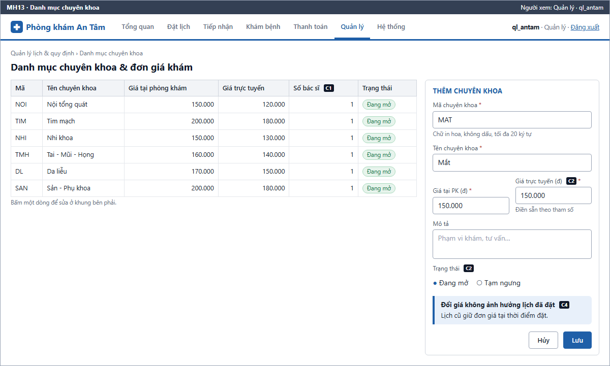

**Bảng 4 mức cải tiến**

| Mức | Bổ sung trên màn hình |
| :--- | :--- |
| Gốc | Mã khoa, Tên chuyên khoa, Giá tại phòng khám, Giá trực tuyến |
| 1 | Hiện số bác sĩ đang thuộc mỗi chuyên khoa (chỉ đọc) |
| 2 | Giá trực tuyến điền sẵn theo `DON_GIA_KHAM_TRUC_TUYEN_MAC_DINH`; trạng thái mặc định Đang mở |
| 3 | Toàn bộ danh mục trên một lưới, sửa dòng nào mở dòng đó ở khung bên phải |
| 4 | Ghi rõ đổi giá không ảnh hưởng lịch đã đặt (vì `lich_hen.don_gia_ap_dung` lưu cứng); cảnh báo khi tạm ngưng chuyên khoa còn bác sĩ và lịch sắp tới |

| STT | Tên | Loại điều khiển | Nguồn dữ liệu | Giá trị mặc định | Ràng buộc kiểm tra |
| :-: | :--- | :--- | :--- | :--- | :--- |
| 1 | Lưới chuyên khoa | Lưới chỉ đọc, bấm để sửa | `chuyen_khoa.*` + đếm `bac_si` theo `ma_chuyen_khoa` | — | — |
| 2 | Mã chuyên khoa | Ô nhập | `chuyen_khoa.ma_code_khoa` | Trống | [Sớm] bắt buộc, in hoa không dấu, ≤ 20 ký tự · [Muộn] không trùng → TB-14 |
| 3 | Tên chuyên khoa | Ô nhập | `chuyen_khoa.ten_chuyen_khoa` | Trống | [Sớm] bắt buộc, ≤ 100 ký tự · [Muộn] không trùng → TB-14 |
| 4 | Giá tại phòng khám | Ô nhập số tiền | `chuyen_khoa.don_gia_kham_tai_cho` | Trống | [Sớm] số nguyên ≥ 0 |
| 5 | Giá trực tuyến | Ô nhập số tiền | `chuyen_khoa.don_gia_kham_truc_tuyen` | `tham_so['DON_GIA_KHAM_TRUC_TUYEN_MAC_DINH']` = 150.000 | [Sớm] số nguyên > 0 |
| 6 | Mô tả | Ô văn bản | `chuyen_khoa.mo_ta` | Trống | ≤ 255 ký tự |
| 7 | Trạng thái | Radio | `chuyen_khoa.trang_thai_hoat_dong` | Đang mở | Chuyển sang Tạm ngưng khi còn lịch sắp tới → TB-15 |

**Kịch bản:** (1) Chọn một dòng để sửa hoặc dùng khung Thêm. (2) Nhập, bấm Lưu; kiểm tra muộn mã và tên trùng. (3) Lưu xong, MH03 dùng giá mới cho lịch đặt sau thời điểm này.

### MH14 · Tham số quy định

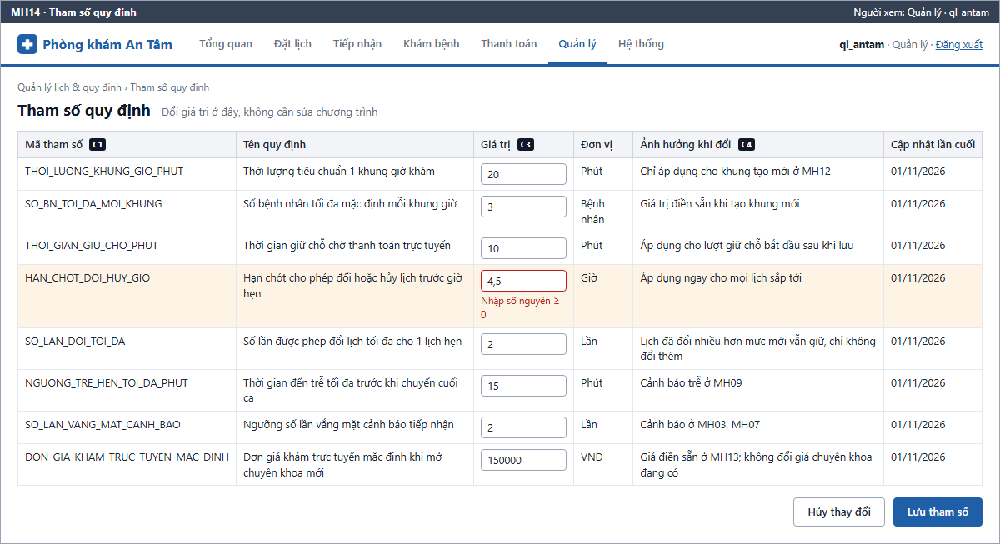

**Bảng 4 mức cải tiến**

| Mức | Bổ sung trên màn hình |
| :--- | :--- |
| Gốc | Mã tham số, Giá trị |
| 1 | Hiện Tên quy định, Đơn vị, Ngày cập nhật lần cuối (chỉ đọc) |
| 2 | Lưới mở ra với giá trị đang áp dụng điền sẵn |
| 3 | Sửa cả 8 tham số trên một lưới, lưu một lần |
| 4 | Cột "Ảnh hưởng khi đổi" nói rõ thay đổi áp dụng cho đâu và từ lúc nào, để Quản lý không đổi nhầm quy định đang chạy |

| STT | Tên | Loại điều khiển | Nguồn dữ liệu | Giá trị mặc định | Ràng buộc kiểm tra |
| :-: | :--- | :--- | :--- | :--- | :--- |
| 1 | Mã tham số | Ô chỉ đọc | `tham_so.ma_tham_so` | — | Không thêm, xóa tham số từ giao diện |
| 2 | Tên quy định · Đơn vị | Ô chỉ đọc | `tham_so.ten_tham_so`, `don_vi_tinh` | — | — |
| 3 | Giá trị | Ô nhập số trên lưới | `tham_so.gia_tri` | Giá trị hiện tại | [Sớm] số nguyên ≥ 0 → TB-16; `THOI_LUONG_KHUNG_GIO_PHUT`, `SO_BN_TOI_DA_MOI_KHUNG`, `THOI_GIAN_GIU_CHO_PHUT`, `DON_GIA_KHAM_TRUC_TUYEN_MAC_DINH` phải > 0 |
| 4 | Ảnh hưởng khi đổi | Ô chỉ đọc | Dựa trên `tham_so.mo_ta_quy_dinh` | — | — |
| 5 | Cập nhật lần cuối | Ô chỉ đọc | `tham_so.ngay_cap_nhat` | — | Tự cập nhật khi lưu |

**Kịch bản:** (1) Sửa giá trị trên lưới, ô sai hiện lỗi ngay. (2) Bấm Lưu tham số, hệ thống hỏi xác nhận TB-27 liệt kê các tham số đã đổi (cũ → mới). (3) Đồng ý: lưu, cập nhật `ngay_cap_nhat`, hiện TB-23.

### MH15 · Giao dịch thanh toán & hoàn tiền (BM08)

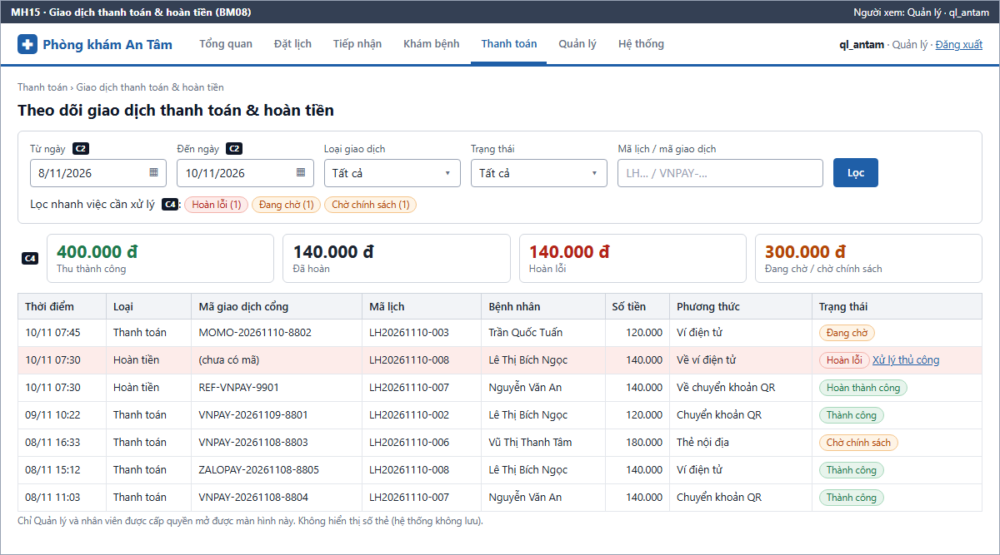

| STT | Tên | Loại điều khiển | Nguồn dữ liệu | Giá trị mặc định | Ràng buộc kiểm tra |
| :-: | :--- | :--- | :--- | :--- | :--- |
| 1 | Từ ngày – Đến ngày | 2 ô chọn ngày | `giao_dich_thanh_toan.thoi_diem_thanh_toan`, `giao_dich_hoan_tien.thoi_diem_yeu_cau` | 2 ngày trước đến hôm nay | [Sớm] Từ ≤ Đến |
| 2 | Loại giao dịch | Ô thả xuống | Thanh toán / Hoàn tiền / Tất cả | Tất cả | — |
| 3 | Trạng thái | Ô thả xuống | `giao_dich_thanh_toan.trang_thai` ∪ `giao_dich_hoan_tien.trang_thai` | Tất cả | — |
| 4 | Mã lịch / mã giao dịch | Ô nhập | `lich_hen.ma_code_lich`, `giao_dich_thanh_toan.ma_gd_cong_tt`, `giao_dich_hoan_tien.ma_gd_hoan_cong_tt` | Trống | — |
| 5 | Lọc nhanh việc cần xử lý | Nút nhãn có số đếm | Đếm `Hoàn lỗi`, `Đang chờ`, `Chờ chính sách` | — | Bấm để lọc ngay (`FR-19`) |
| 6 | Thanh tổng tiền | 4 ô số | Tổng `so_tien` theo trạng thái; tổng `so_tien_hoan` | Tự tính theo bộ lọc | — |
| 7 | Lưới giao dịch | Lưới chỉ đọc | `thoi_diem_*`, loại, `ma_gd_cong_tt` / `ma_gd_hoan_cong_tt`, `lich_hen.ma_code_lich`, `benh_nhan.ho_ten`, `so_tien` / `so_tien_hoan`, `phuong_thuc`, `trang_thai` | Mới nhất trước | Không có cột số thẻ (`NFR-07`); vai không có quyền → MH20 |

**Kịch bản:** (1) Mở màn hình, mặc định thấy giao dịch 3 ngày gần nhất. (2) Bấm nhãn "Hoàn lỗi" để lọc các giao dịch cần xử lý thủ công. (3) Bấm "Xử lý thủ công" trên dòng để ghi nhận cách xử lý (phần xử lý thuộc Thiết kế xử lý).

### MH16 · Nhật ký hệ thống

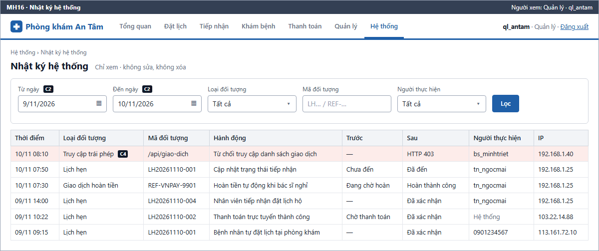

| STT | Tên | Loại điều khiển | Nguồn dữ liệu | Giá trị mặc định | Ràng buộc kiểm tra |
| :-: | :--- | :--- | :--- | :--- | :--- |
| 1 | Từ ngày – Đến ngày | 2 ô chọn ngày | `nhat_ky_he_thong.thoi_diem` | Hôm qua – hôm nay | [Sớm] Từ ≤ Đến |
| 2 | Loại đối tượng | Ô thả xuống | `nhat_ky_he_thong.loai_doi_tuong` (5 giá trị + Tất cả) | Tất cả | — |
| 3 | Mã đối tượng | Ô nhập | `nhat_ky_he_thong.ma_doi_tuong` | Trống | — |
| 4 | Người thực hiện | Ô thả xuống | `nhat_ky_he_thong.nguoi_thuc_hien` → `tai_khoan.ten_dang_nhap`; "Hệ thống" khi `NULL` | Tất cả | — |
| 5 | Lưới nhật ký | Lưới chỉ đọc | `thoi_diem`, `loai_doi_tuong`, `ma_doi_tuong`, `hanh_dong`, `trang_thai_truoc`, `trang_thai_sau`, `nguoi_thuc_hien`, `dia_chi_ip` | Mới nhất trước | Không có nút sửa, xóa (`NFR-09`); dòng `Truy cập trái phép` tô đỏ |

**Kịch bản:** Chọn bộ lọc, bấm Lọc, đọc kết quả. Màn hình không có thao tác thay đổi dữ liệu.

### MH17 · Tài khoản & phân quyền

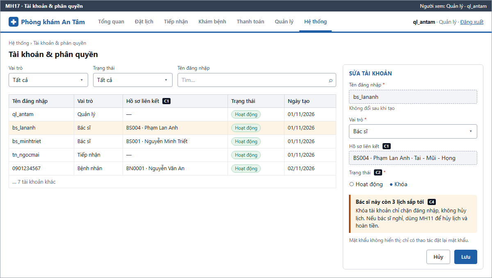

**Bảng 4 mức cải tiến**

| Mức | Bổ sung trên màn hình |
| :--- | :--- |
| Gốc | Tên đăng nhập, Vai trò, Trạng thái |
| 1 | Hiện hồ sơ liên kết (mã và tên bác sĩ hoặc bệnh nhân) của tài khoản |
| 2 | Trạng thái mặc định Hoạt động; tên đăng nhập không sửa được sau khi tạo |
| 3 | Lưới tất cả tài khoản có bộ lọc theo vai và trạng thái |
| 4 | Khi khóa tài khoản bác sĩ còn lịch sắp tới: cảnh báo khóa không hủy lịch và chỉ sang MH11 |

| STT | Tên | Loại điều khiển | Nguồn dữ liệu | Giá trị mặc định | Ràng buộc kiểm tra |
| :-: | :--- | :--- | :--- | :--- | :--- |
| 1 | Lọc vai trò · trạng thái · tên | Ô thả xuống, ô nhập | `tai_khoan.vai_tro`, `trang_thai`, `ten_dang_nhap` | Tất cả | — |
| 2 | Lưới tài khoản | Lưới chỉ đọc | `tai_khoan.*` (trừ `mat_khau_bam`) + `bac_si.ma_code_bs` / `benh_nhan.ma_code_bn` liên kết | — | — |
| 3 | Tên đăng nhập | Ô nhập (thêm) / chỉ đọc (sửa) | `tai_khoan.ten_dang_nhap` | Trống | [Sớm] bắt buộc, ≤ 50 ký tự · [Muộn] không trùng → TB-14 |
| 4 | Vai trò | Ô thả xuống | `tai_khoan.vai_tro` ∈ {quan_ly, bac_si, tiep_nhan, benh_nhan} | Tiếp nhận | Bắt buộc |
| 5 | Hồ sơ liên kết | Ô chỉ đọc | `bac_si.ma_tai_khoan` / `benh_nhan.ma_tai_khoan` | — | — |
| 6 | Trạng thái | Radio | `tai_khoan.trang_thai` | Hoạt động | Khóa tài khoản bác sĩ còn lịch → cảnh báo TB-28 |

**Kịch bản:** (1) Lọc và chọn tài khoản. (2) Đổi vai hoặc trạng thái, bấm Lưu. (3) Mật khẩu không bao giờ hiện; đặt lại mật khẩu là một nút xử lý riêng (thuộc Thiết kế xử lý).

### MH18, MH19, MH20 · Trang lỗi

Xem mục 7.2.

---

## BƯỚC 6: TỰ ĐỐI CHIẾU Ô NHẬP VỚI DỮ LIỆU CỦA NGƯỜI 1

Mọi ô nhập trên 20 màn hình đều có cột Nguồn dữ liệu trỏ tới `bảng.field` trong bảng đặc tả của Người 1, và ràng buộc kiểm tra lấy đúng từ cột Ràng buộc của Người 1:

| Ràng buộc của Người 1 | Kiểm tra trên giao diện | Màn hình |
| :--- | :--- | :--- |
| `benh_nhan.so_dien_thoai`: 10 ký tự, bắt đầu `0`, `UNIQUE` | [Sớm] định dạng · [Muộn] trùng | MH03, MH08 |
| `benh_nhan.ngay_sinh < ngày hiện tại` | [Sớm] ô chọn ngày khóa ngày tương lai | MH03, MH08 |
| `benh_nhan.so_cccd`: 12 chữ số, `UNIQUE` khi khác `NULL` | [Sớm] để trống được, nhập thì đủ 12 số · [Muộn] trùng | MH08 |
| `benh_nhan.gioi_tinh IN (Nam, Nữ, Khác)` | Radio đúng 3 giá trị | MH03, MH08 |
| `so_cho_da_dat + so_cho_dang_giu <= gioi_han_benh_nhan` | [Sớm] khóa khung hết chỗ · [Muộn] kiểm lại khi đặt | MH03, MH06, MH12 |
| `khung_gio_kham.hinh_thuc_mo` | Khung không mở hình thức đã chọn thì không chọn được | MH03, MH06 |
| `UNIQUE(ma_bac_si, ngay_kham, gio_bat_dau)`, `gio_ket_thuc > gio_bat_dau` | [Sớm] giờ · [Muộn] trùng khung | MH12 |
| `lich_hen.so_lan_doi` + `SO_LAN_DOI_TOI_DA`; `HAN_CHOT_DOI_HUY_GIO` | Nút Đổi/Hủy mờ sẵn · [Muộn] kiểm lại | MH05, MH06 |
| `lich_hen.thoi_diem_het_han_giu` + `THOI_GIAN_GIU_CHO_PHUT` | Đồng hồ đếm ngược, khóa thanh toán khi hết | MH04 |
| `giao_dich_thanh_toan.phuong_thuc` (4 giá trị); không lưu số thẻ | Radio 4 giá trị; không có ô nhập thẻ | MH04 |
| `giao_dich_hoan_tien.ma_giao_dich_goc UNIQUE` | Màn hình xem trước chỉ tạo một khoản hoàn cho mỗi giao dịch | MH11 |
| `lich_hen.trang_thai_kham` (6 giá trị) | Ô thả xuống chỉ cho chuyển trạng thái hợp lệ | MH09, MH10 |
| `chuyen_khoa.don_gia_* ≥ 0 / > 0`, `ma_code_khoa`, `ten_chuyen_khoa UNIQUE` | [Sớm] số tiền · [Muộn] trùng | MH13 |
| `tham_so.gia_tri ≥ 0` | [Sớm] số nguyên ≥ 0 | MH14 |
| `nhat_ky_he_thong` chỉ thêm | MH16 không có nút sửa, xóa | MH16 |

---

## BƯỚC 7: BỘ THÔNG BÁO VÀ TRANG LỖI

### 7.1. Bộ thông báo

Mỗi thông báo theo quy tắc slide 18 (nhất quán, lịch sự, cô đọng, kèm gợi ý, ngôn ngữ đại chúng với bệnh nhân) và trả lời đủ 4 câu của bài Brajdic: **Ai gây ra** · **Chuyện gì và vì sao** · **Khi nào khắc phục** · **Người dùng làm gì tiếp**. Thông báo không hiện mã lỗi kỹ thuật cho bệnh nhân.

| Mã | Màn hình · tình huống | Loại · kiểm tra | Nội dung hiển thị | Ai · Vì sao · Khi nào · Làm gì tiếp |
| :-: | :--- | :--- | :--- | :--- |
| TB-01 | MH03, MH08 · số điện thoại sai định dạng | Lỗi · Sớm | **Số điện thoại chưa đúng.** Số điện thoại gồm 10 chữ số và bắt đầu bằng 0, ví dụ 0901234567. | Ai: người nhập gõ thiếu/thừa số Vì sao: hệ thống dùng số này để nhận diện và gửi tin Khi nào: sửa được ngay Làm gì: sửa lại số trong ô |
| TB-02 | MH03, MH08 · ngày sinh không hợp lệ | Lỗi · Sớm | **Ngày sinh chưa hợp lệ.** Ngày sinh phải trước hôm nay, nhập theo dạng ngày/tháng/năm (ví dụ 14/5/1988). | Ai: người nhập Vì sao: ngày ở tương lai hoặc sai định dạng Khi nào: ngay Làm gì: chọn lại ngày trên lịch |
| TB-03 | MH03, MH06 · khung giờ vừa hết chỗ khi bấm Đặt lịch | Lỗi · Muộn | **Khung 08:00 vừa có người đặt hết chỗ.** Bạn chưa bị trừ tiền và thông tin đã nhập vẫn được giữ. Vui lòng chọn khung khác còn chỗ bên dưới. | Ai: người khác đặt trước vài giây, không phải lỗi của bạn Vì sao: khung chỉ nhận tối đa 3 bệnh nhân Khi nào: ngay, lưới đã tải lại Làm gì: chọn khung khác hoặc ngày khác |
| TB-04 | MH04 · hết thời gian giữ chỗ | Cảnh báo · Muộn | **Đã hết 10 phút giữ chỗ.** Lịch 08:40 ngày 10/11/2026 chưa được thanh toán nên chỗ đã được nhả cho người khác. Bạn chưa bị trừ tiền. | Ai: hết thời hạn do phòng khám quy định Vì sao: giữ chỗ quá lâu làm người khác không đặt được Khi nào: đặt lại được ngay nếu khung còn chỗ Làm gì: bấm Đặt lại (giữ nguyên bác sĩ, ngày) |
| TB-05 | MH04 · cổng thanh toán báo thất bại | Lỗi · Muộn | **Thanh toán chưa thành công.** Ngân hàng hoặc ví chưa xác nhận giao dịch, nên lịch chưa được xác nhận và bạn chưa bị trừ tiền. Chỗ vẫn được giữ đến 07:55. | Ai: cổng thanh toán hoặc ngân hàng Vì sao: giao dịch bị từ chối hoặc bị hủy Khi nào: thử lại ngay trong thời gian giữ chỗ Làm gì: thử lại hoặc chọn phương thức khác; nếu tài khoản đã bị trừ, gọi quầy tiếp nhận kèm mã lịch |
| TB-06 | MH05, MH06 · quá hạn chót đổi/hủy | Lỗi · Muộn | **Lịch này không còn tự đổi hoặc hủy được.** Phòng khám chỉ nhận đổi, hủy trước giờ khám ít nhất 4 giờ, để kịp xếp bệnh nhân khác. | Ai: quy định của phòng khám Vì sao: còn chưa tới 4 giờ là đến giờ khám Khi nào: không áp dụng cho lịch này Làm gì: gọi quầy tiếp nhận để được hỗ trợ |
| TB-07 | MH06 · đã đổi đủ số lần | Lỗi · Muộn | **Lịch này đã được đổi 2 lần, là số lần tối đa.** Nếu cần đổi nữa, bạn có thể hủy lịch này và đặt lịch mới. | Ai: quy định của phòng khám Vì sao: mỗi lịch chỉ được đổi tối đa 2 lần Khi nào: không áp dụng cho lịch này Làm gì: hủy rồi đặt lịch mới ở MH03 |
| TB-08 | MH03 · bệnh nhân vắng mặt nhiều lần | Cảnh báo · Sớm | **Bệnh nhân đã vắng mặt 2 lần.** Nên nhắc bệnh nhân gọi báo trước nếu không đến được. Vẫn có thể đặt lịch bình thường. | Ai: lịch sử của bệnh nhân Vì sao: đạt ngưỡng cảnh báo của phòng khám Khi nào: thông tin, không chặn Làm gì: nhắc bệnh nhân, rồi tiếp tục đặt |
| TB-09 | MH08 · số điện thoại đã thuộc hồ sơ khác | Lỗi · Muộn | **Số 0912345678 đã có trong hồ sơ BN0002 · Lê Thị Bích Ngọc.** Mỗi số điện thoại chỉ gắn với một hồ sơ. | Ai: số đã được đăng ký trước Vì sao: số điện thoại dùng để nhận diện bệnh nhân Khi nào: ngay Làm gì: mở hồ sơ BN0002 nếu đúng người, hoặc kiểm tra lại số |
| TB-10 | MH08 · CCCD đã thuộc hồ sơ khác | Lỗi · Muộn | **Số CCCD này đã có trong hồ sơ BN0001.** Có thể bệnh nhân đã có hồ sơ từ trước. | Ai: dữ liệu đã có Vì sao: mỗi CCCD chỉ thuộc một người Khi nào: ngay Làm gì: mở hồ sơ BN0001 để kiểm tra, hoặc để trống ô CCCD |
| TB-11 | MH12 · giới hạn nhỏ hơn số chỗ đã dùng | Lỗi · Sớm | **Không thể giảm giới hạn khung 08:20 xuống 2.** Khung này đã có 3 lịch. Hãy đổi lịch cho bệnh nhân trước rồi mới giảm. | Ai: thao tác sửa của quản lý Vì sao: giảm sẽ làm vượt giới hạn với lịch đã đặt Khi nào: sau khi chuyển bớt lịch Làm gì: mở danh sách lịch của khung |
| TB-12 | MH12 · trùng giờ bắt đầu | Lỗi · Muộn | **Bác sĩ Nguyễn Minh Triết đã có khung 08:00 ngày 10/11/2026.** Một bác sĩ không có hai khung cùng giờ bắt đầu trong một ngày. | Ai: dữ liệu trùng với khung đã có Vì sao: tránh đặt hai lịch chồng nhau Khi nào: ngay Làm gì: sửa giờ hoặc xóa dòng trùng |
| TB-13 | MH12 · khóa/đổi hình thức khung đã có lịch | Xác nhận · Muộn | **Thay đổi này ảnh hưởng 3 lịch đã đặt.** Danh sách: LH20261110-011, -012, -013. Các lịch này không tự hủy; bạn cần báo cho bệnh nhân. Tiếp tục? | Ai: thao tác của quản lý Vì sao: khung đang có bệnh nhân Khi nào: áp dụng khi bấm Tiếp tục Làm gì: Tiếp tục hoặc Quay lại |
| TB-14 | MH13, MH17 · mã hoặc tên trùng | Lỗi · Muộn | **Mã "NOI" đã được dùng cho chuyên khoa Nội tổng quát.** Vui lòng chọn mã khác. | Ai: dữ liệu đã có Vì sao: mã và tên phải duy nhất Khi nào: ngay Làm gì: nhập mã khác |
| TB-15 | MH13 · tạm ngưng chuyên khoa còn lịch | Xác nhận · Muộn | **Chuyên khoa Nội tổng quát còn 1 bác sĩ và 5 lịch sắp tới.** Tạm ngưng chỉ chặn đặt lịch mới; các lịch đã đặt vẫn giữ. Tiếp tục? | Ai: thao tác của quản lý Vì sao: còn lịch đang hiệu lực Khi nào: khi bấm Tiếp tục Làm gì: Tiếp tục hoặc Quay lại |
| TB-16 | MH14 · giá trị tham số không hợp lệ | Lỗi · Sớm | **Giá trị phải là số nguyên từ 0 trở lên.** Ví dụ: 4 (giờ). | Ai: người nhập Vì sao: quy định tính bằng số nguyên Khi nào: ngay Làm gì: sửa giá trị |
| TB-17 | MH01 · sai tên hoặc mật khẩu | Lỗi · Muộn | **Chưa đăng nhập được.** Tên đăng nhập hoặc mật khẩu chưa đúng. Vui lòng kiểm tra lại (chú ý bộ gõ tiếng Việt và phím Caps Lock). | Ai: thông tin nhập chưa khớp Vì sao: bảo vệ tài khoản Khi nào: thử lại ngay Làm gì: nhập lại hoặc bấm Quên mật khẩu |
| TB-18 | MH01 · tài khoản bị khóa | Lỗi · Muộn | **Tài khoản đang tạm khóa.** Vui lòng liên hệ Quản lý phòng khám để mở lại. | Ai: quản lý đã khóa tài khoản Vì sao: tài khoản không còn được phép dùng Khi nào: khi quản lý mở khóa Làm gì: liên hệ quản lý |
| TB-19 | MH03 · đặt lịch tại phòng khám thành công | Thành công | **Đã đặt lịch LH20261110-009.** 08:00 Thứ Ba 10/11/2026 · BS.CKII Nguyễn Minh Triết · P.101. Tin nhắn xác nhận đã được gửi tới 0987654321. | Làm gì tiếp: muốn đổi, hủy thì vào "Lịch hẹn của tôi" trước giờ khám ít nhất 4 giờ |
| TB-20 | MH04 · thanh toán thành công | Thành công | **Đã thanh toán 120.000 đ, lịch LH20261110-003 đã được xác nhận.** Đường dẫn vào phòng khám trực tuyến sẽ được gửi kèm tin xác nhận. | Làm gì tiếp: mở đường dẫn đúng giờ khám |
| TB-21 | MH05, MH07 · không có kết quả | Thông tin | **Không tìm thấy kết quả phù hợp.** Thử bỏ bớt tiêu chuẩn hoặc kiểm tra lại số điện thoại, mã lịch. | Làm gì tiếp: sửa tiêu chuẩn; ở MH07 có liên kết Thêm bệnh nhân mới |
| TB-22 | MH05 · xác nhận hủy lịch | Xác nhận | **Hủy lịch LH20261110-003 lúc 08:40 ngày 10/11/2026?** Chỗ sẽ được nhả cho người khác. Lịch trực tuyến đã thanh toán: khoản tiền chuyển sang "chờ chính sách", chưa được hoàn tự động. | Làm gì tiếp: Hủy lịch hoặc Giữ lịch |
| TB-23 | MH08, MH14 · lưu thành công | Thành công | **Đã lưu thay đổi.** | — |
| TB-24 | MH09 · dòng đã bị người khác cập nhật | Cảnh báo · Muộn | **Lượt khám này vừa được Ngọc Mai cập nhật sang "Đang khám".** Màn hình đã tải lại trạng thái mới nhất. | Ai: người dùng khác cùng lúc Vì sao: tránh ghi đè lẫn nhau Khi nào: ngay Làm gì: kiểm tra lại rồi thao tác tiếp |
| TB-25 | MH11 · xác nhận bác sĩ nghỉ | Xác nhận | **Xác nhận BS.CKI Phạm Lan Anh nghỉ ca chiều 10/11/2026?** 2 lịch sẽ bị hủy, 2 bệnh nhân nhận thông báo, hoàn 280.000 đ. Thao tác này không hoàn tác được. | Làm gì tiếp: Xác nhận hoặc Hủy bỏ |
| TB-26 | MH11 · không có lịch bị ảnh hưởng | Thông tin | **Ca này chưa có lịch nào.** Hệ thống chỉ khóa khung giờ, không cần báo bệnh nhân. | — |
| TB-27 | MH14 · xác nhận đổi tham số | Xác nhận | **Đổi 1 quy định:** Hạn chót đổi/hủy 4 → 6 giờ. Áp dụng ngay cho mọi lịch sắp tới. Tiếp tục? | Làm gì tiếp: Lưu hoặc Quay lại |
| TB-28 | MH17 · khóa tài khoản bác sĩ còn lịch | Cảnh báo | **Bác sĩ này còn 3 lịch sắp tới.** Khóa tài khoản chỉ chặn đăng nhập, không hủy lịch. Nếu bác sĩ nghỉ, dùng màn hình Bác sĩ nghỉ đột xuất. | Làm gì tiếp: Lưu hoặc mở MH11 |

**Ví dụ lỗi nhập liệu bắt buộc "đã đủ số bệnh nhân":** với hệ thống này, giới hạn tính theo từng khung giờ (`gioi_han_benh_nhan`), nên thông báo tương ứng là **TB-03**. Lỗi được chặn từ sớm (khung hết chỗ không bấm được), và chỉ hiện khi hai người cùng đặt chỗ cuối cùng một lúc.

### 7.2. Trang lỗi

Ba trang lỗi dùng chung một bố cục: mã hoặc tên lỗi lớn, tiêu đề nói chuyện gì, đoạn giải thích vì sao và dữ liệu có an toàn không, nút đi tiếp, và **khung khẩn cấp có số điện thoại phòng khám** theo mục *Mitigate for emergency situations* của bài Brajdic. Vì là lĩnh vực y tế, khung khẩn cấp thêm số cấp cứu **115**.

Số hotline phòng khám chưa có trong dữ liệu của Người 1 hay Mini-SRS, nên wireframe để `[số hotline phòng khám]`. Khi có số thật, nên lưu vào cấu hình hệ thống (không viết cứng) để mọi trang lỗi dùng chung.

**MH18 · Trang lỗi 404**

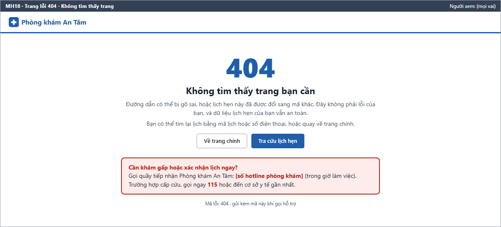

| Câu hỏi | Trả lời trên trang |
| :--- | :--- |
| Ai gây ra? | Đường dẫn gõ sai hoặc lịch đã đổi mã; nói rõ "không phải lỗi của bạn" |
| Chuyện gì, vì sao? | Không tìm thấy trang; dữ liệu lịch hẹn vẫn an toàn |
| Khi nào khắc phục? | Ngay, bằng cách tra cứu lại |
| Làm gì tiếp? | Nút Tra cứu lịch hẹn (chính), Về trang chính; gọi hotline nếu cần gấp, gọi 115 khi cấp cứu |

**MH19 · Trang bảo trì / mất kết nối**

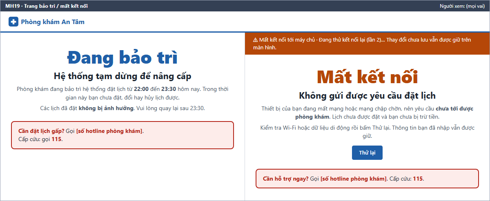

| Câu hỏi | Bảo trì (bên trái) | Mất kết nối (bên phải) |
| :--- | :--- | :--- |
| Ai gây ra? | Phòng khám chủ động bảo trì | Mạng của thiết bị người dùng |
| Chuyện gì, vì sao? | Tạm dừng để nâng cấp; lịch đã đặt không bị ảnh hưởng | Yêu cầu chưa tới được phòng khám; lịch chưa được đặt, chưa bị trừ tiền |
| Khi nào khắc phục? | Ghi rõ giờ kết thúc (23:30) | Tự thử kết nối lại; thanh cảnh báo cam báo lần thử |
| Làm gì tiếp? | Quay lại sau giờ kết thúc; gọi hotline nếu cần đặt gấp | Kiểm tra Wi-Fi, bấm Thử lại; dữ liệu đã nhập được giữ |

**MH20 · Trang không có quyền truy cập (403)**

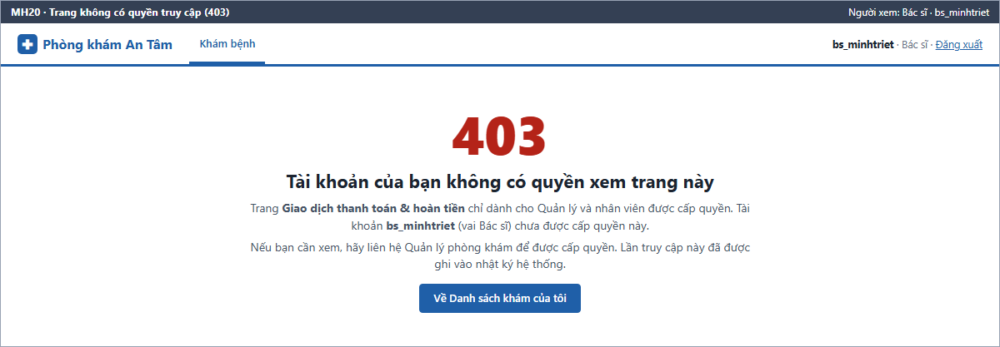

| Câu hỏi | Trả lời trên trang |
| :--- | :--- |
| Ai gây ra? | Tài khoản chưa được cấp quyền cho trang này (nêu tên tài khoản và vai) |
| Chuyện gì, vì sao? | Trang dành cho vai khác (`FR-13`); lần truy cập đã được ghi nhật ký (`NFR-04`) |
| Khi nào khắc phục? | Khi Quản lý cấp quyền |
| Làm gì tiếp? | Nút về màn hình của vai mình; liên hệ Quản lý nếu cần quyền |

---

## BƯỚC 8: TỰ KIỂM TRA THEO TIÊU CHÍ HOÀN THÀNH (CHECKLIST NGƯỜI 3)

- [x] **Mọi nghiệp vụ trong đề có màn hình; mọi màn hình có trong sơ đồ màn hình:** 19 yêu cầu `FR-01`…`FR-19` đều có màn hình (bảng 1.2); 20 màn hình đều có trong sơ đồ ở Bước 3.
- [x] **Mỗi màn hình nhập liệu chỉ ra được cải tiến 1, 2, 3, 4; cải tiến 4 xuất phát từ nghiệp vụ cụ thể:** có bảng 4 mức cho MH03, MH04, MH06, MH08, MH09, MH10, MH11, MH12, MH13, MH14, MH17. Cải tiến 4 gắn với nghiệp vụ thật: bệnh nhân hay vắng mặt, giữ chỗ chờ thanh toán, bác sĩ nghỉ kéo theo hoàn tiền, sửa khung đã có lịch, bệnh nhân mới cần chuẩn bị hồ sơ.
- [x] **Mọi ô nhập có ràng buộc kiểm tra khớp kiểu dữ liệu và quy định của Người 1:** mỗi bảng thành phần có cột Nguồn dữ liệu và Ràng buộc; Bước 6 đối chiếu từng ràng buộc với đặc tả của Người 1.
- [x] **Mỗi thông báo lỗi nói rõ chuyện gì xảy ra và cách xử lý, lịch sự, không chỉ hiện mã lỗi:** 28 thông báo ở mục 7.1 trả lời đủ 4 câu của bài Brajdic; 3 trang lỗi có số điện thoại khẩn cấp.
- [x] **Màu và cách bố trí nhất quán trên mọi màn hình:** cả 20 wireframe dùng chung một tệp CSS với 4 màu chức năng (mục 4.1) và cùng khung trang (mục 4.2).
