# BÀI TẬP TUẦN 08 · THIẾT KẾ DỮ LIỆU & GIAO DIỆN (LT07) — NHÓM 04

- **Môn học:** Nhập môn Công nghệ Phần mềm (Lớp 24_3)
- **Nhóm:** Nhóm 04
- **Nội dung:** Bài giải theo bài giảng `LT07-Design`: *Thiết kế dữ liệu* (xác định thành phần dữ liệu → vẽ sơ đồ dữ liệu → đặc tả thành phần dữ liệu) và *Thiết kế giao diện* level 4 (danh sách màn hình → sơ đồ màn hình → bố trí → đặc tả màn hình).
- **Tài liệu căn cứ:** bài giảng `LT07-Design.pdf`; Mini-SRS v1.2 Phòng khám An Tâm (đã tích hợp `CR-01`); bài *A UX Guide For Designing Error Pages* (Alana Brajdic).

| Phần | Đề tài | Sản phẩm |
| :-: | :--- | :--- |
| 1 | Thiết kế dữ liệu **Phòng khám An Tâm** | 11 bảng · sơ đồ `BT08_Nhom04_TV1_SoDoDuLieu_PhongKhamAnTam.png/.drawio` · script `BT08_Nhom04_TV1_CSDL_PhongKhamAnTam.sql` |
| 2 | Thiết kế dữ liệu **Sàn đấu giá trực tuyến** | 10 bảng · sơ đồ `Thiet-ke-du-lieu-San-Dau-Gia.png/.drawio` · script `Thiet-ke-du-lieu-San-Dau-Gia.sql` |
| 3 | Thiết kế giao diện **Phòng khám An Tâm** level 4 | 20 màn hình · sơ đồ màn hình · wireframe `BT08_Nhom04_TV3_Wireframe/` · 28 thông báo, 3 trang lỗi |

**Mục lục**

- Phần 1 · Thiết kế dữ liệu Phòng khám An Tâm
- Phần 2 · Thiết kế dữ liệu Sàn đấu giá trực tuyến
- Phần 3 · Thiết kế giao diện Phòng khám An Tâm level 4
- Phụ lục A · Script SQL Phòng khám An Tâm
- Phụ lục B · Script SQL Sàn đấu giá trực tuyến

---

## PHẦN 1 · THIẾT KẾ DỮ LIỆU PHÒNG KHÁM AN TÂM

### BƯỚC 1: XÁC ĐỊNH THÀNH PHẦN DỮ LIỆU

#### 1.1. Lựa chọn hệ thống lưu trữ dữ liệu (Theo Slide 4 – LT07)

Theo bài giảng *Thiết kế phần mềm (LT07, Slide 4)*, có hai phương án tổ chức hệ thống lưu trữ dữ liệu là **Tập tin (File system)** và **Cơ sở dữ liệu (CSDL - Database)**. Nhóm quyết định lựa chọn **Hệ quản trị Cơ sở dữ liệu quan hệ (RDBMS)** làm đơn vị lưu trữ cho hệ thống Phòng khám An Tâm vì các lý do nghiệp vụ và kỹ thuật sau:

1. **Khắc phục triệt để bất cập "ghi sổ phân tán" của hiện trạng (`N-01`, `N-02`, `FR-03`):** Phòng khám có 06 bác sĩ, 02 nhân viên tiếp nhận mỗi ca và 80–120 lượt khám/ngày, cùng lượng bệnh nhân tự đặt lịch từ xa. Nếu lưu trữ bằng tập tin rời rạc, việc kiểm soát truy cập đồng thời (tối thiểu 50 người dùng cùng lúc theo `NFR-02`) sẽ dẫn đến xung đột ghi (race condition) khi hai bệnh nhân cùng đặt vào một chỗ trống cuối cùng. Hệ quản trị CSDL cung cấp cơ chế khóa giao dịch (*Transaction & Row-level Locking*) tuân thủ ACID, đảm bảo tại một thời điểm chỉ một yêu cầu giữ chỗ thành công.
2. **Bảo toàn tính toàn vẹn cho giao dịch tài chính (`CR-01`, `FR-15`..`FR-19`, `NFR-08`):** Khi tích hợp khám trực tuyến có thu tiền trước và hoàn tiền tự động khi bác sĩ nghỉ đột xuất, CSDL đảm bảo các ràng buộc khóa ngoại (`FOREIGN KEY`), ràng buộc duy nhất (`UNIQUE`) và ràng buộc miền giá trị (`CHECK`), ngăn chặn tuyệt đối việc trừ tiền trùng hoặc hoàn tiền hai lần cho cùng một giao dịch.
3. **Hỗ trợ phân quyền truy cập tập trung, lưu vết và sao lưu (`NFR-04`, `NFR-06`, `NFR-09`):** CSDL hỗ trợ phân quyền theo vai trò (RBAC), lưu nhật ký kiểm toán (*Audit log*) chỉ cho phép thêm mới (`INSERT-only`), và tự động sao lưu định kỳ hằng ngày với khả năng khôi phục bản sao lưu trong phạm vi 24 giờ. Mặc dù hệ quản trị CSDL phức tạp hơn so với tổ chức tập tin thuần túy, tính hiệu quả và an toàn dữ liệu y tế – tài chính là yếu tố bắt buộc.

---

#### 1.2. Danh sách các thành phần dữ liệu (Bảng dữ liệu)

Đối chiếu toàn bộ các yêu cầu chức năng (`FR-01` đến `FR-19`), yêu cầu phi chức năng (`NFR-01` đến `NFR-09`), các giả định (`ASM-01` đến `ASM-17`) và quy tắc tách bảng danh mục động / bảng tham số, hệ thống gồm **11 thành phần dữ liệu (bảng)** đặt tên theo chuẩn `snake_case`:

| STT | Tên bảng (`snake_case`) | Phân loại | Ý nghĩa & Vai trò lưu trữ | Truy vết yêu cầu |
| :-: | :--- | :--- | :--- | :--- |
| 1 | `tai_khoan` | Hệ thống | Quản lý thông tin đăng nhập (mật khẩu băm có salt) và phân quyền theo 4 vai trò (Quản lý, Bác sĩ, Tiếp nhận, Bệnh nhân). | `FR-13`, `NFR-03`, `NFR-04` |
| 2 | `chuyen_khoa` | Danh mục | Lưu danh mục các chuyên khoa của phòng khám và đơn giá khám chuẩn (tại phòng khám / trực tuyến), tách rời để không viết cứng vào bảng bác sĩ. | `FR-01`, `FR-12`, `FR-15`, `Q-10` |
| 3 | `benh_nhan` | Nghiệp vụ | Lưu hồ sơ hành chính của bệnh nhân, số điện thoại định danh, cờ đánh dấu bệnh nhân mới và thống kê số lần vắng mặt. | `FR-07`, `FR-09`, `FR-14`, `ASM-10`, `ASM-11` |
| 4 | `bac_si` | Nghiệp vụ | Lưu thông tin bác sĩ, học vị, phòng khám phụ trách và liên kết với chuyên khoa, tài khoản đăng nhập. | `FR-01`, `FR-02`, `FR-09`, `FR-11`, `FR-12` |
| 5 | `khung_gio_kham` | Nghiệp vụ | Quản lý lịch làm việc của từng bác sĩ theo ngày, ca, khung giờ, hình thức mở, giới hạn bệnh nhân, số chỗ đã đặt và số chỗ đang giữ. | `FR-02`, `FR-03`, `FR-11`, `FR-12`, `FR-16` |
| 6 | `lich_hen` | Nghiệp vụ | Lưu thông tin lượt đặt lịch khám (tại phòng khám / trực tuyến, hẹn trước / khám gấp), trạng thái lịch, trạng thái khám và số lần đổi lịch. | `FR-01`, `FR-04`..`FR-11`, `FR-14`..`FR-16` |
| 7 | `giao_dich_thanh_toan` | Giao dịch | Lưu thông tin thanh toán trước qua cổng thanh toán cho các lịch khám trực tuyến (không lưu số thẻ/mật khẩu). | `FR-15`, `FR-19`, `NFR-07`, `NFR-08` |
| 8 | `giao_dich_hoan_tien` | Giao dịch | Lưu yêu cầu và kết quả hoàn tiền khi bác sĩ hủy lịch trực tuyến đã thanh toán (chống hoàn trùng qua khóa duy nhất). | `FR-17`, `FR-18`, `FR-19`, `NFR-08`, `ASM-05` |
| 9 | `thong_bao` | Nghiệp vụ | Lưu lịch sử gửi thông báo (SMS/Email/Zalo) cho bệnh nhân khi đặt, đổi, hủy lịch, hoàn tiền và theo dõi các thông báo gửi lỗi. | `FR-04`, `FR-18`, `SC-04 (4a)` |
| 10 | `nhat_ky_he_thong` | Hệ thống | Lưu vết mọi thay đổi trạng thái của lịch hẹn, giao dịch và các lần từ chối truy cập trái phép (chỉ thêm, không sửa/xóa). | `FR-08`, `FR-10`, `NFR-04`, `NFR-09` |
| 11 | `tham_so` | Quy định | Lưu trữ tập trung mọi quy định dạng con số (thời lượng khung giờ, số BN tối đa mặc định, thời gian giữ chỗ, hạn đổi/hủy...) để thay đổi động. | `ASM-02`, `ASM-12`, `Q-01`, `Q-03`, `Q-04`, `Q-11` |

---

### BƯỚC 2: VẼ SƠ ĐỒ DỮ LIỆU

#### 2.1. Sơ đồ dữ liệu chuẩn Slide 7 – LT07

- **Tệp ảnh sơ đồ (PNG nền trắng):** `BT08_Nhom04_TV1_SoDoDuLieu_PhongKhamAnTam.png`
- **Tệp nguồn chỉnh sửa (Draw.io):** `BT08_Nhom04_TV1_SoDoDuLieu_PhongKhamAnTam.drawio`

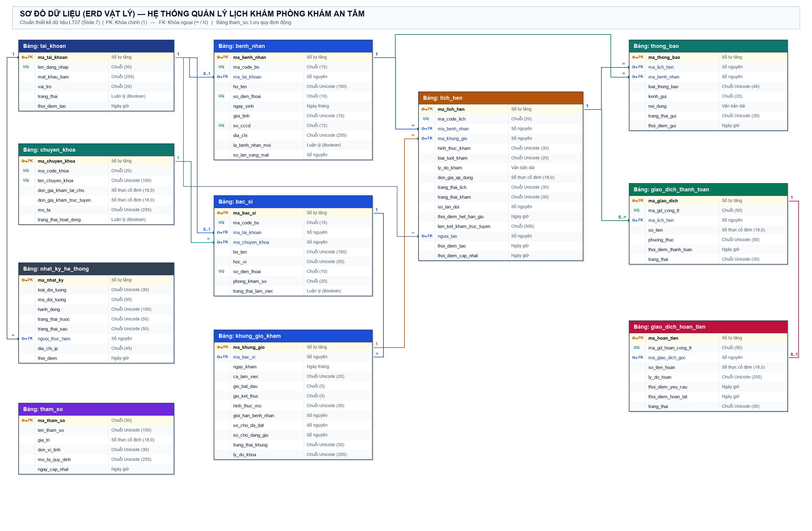

#### 2.2. Tóm tắt quan hệ khóa chính – khóa ngoại (1–N & 1–1)

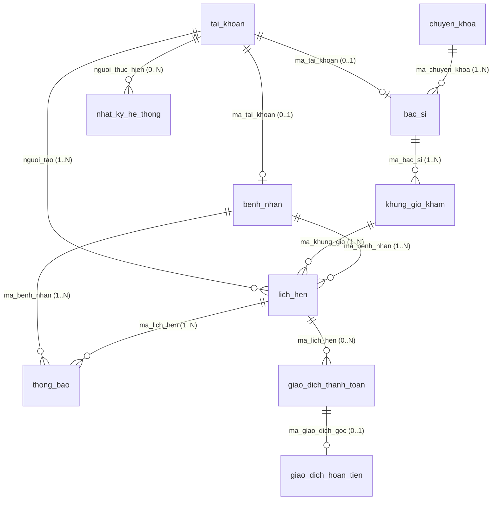

- **`tai_khoan` (1) — (0..1) `benh_nhan`:** Một tài khoản bệnh nhân gắn với tối đa một hồ sơ bệnh nhân; ngược lại, bệnh nhân đặt lịch qua điện thoại nhờ nhân viên tiếp nhận (`ASM-03`) có thể chưa cần tạo tài khoản (`ma_tai_khoan` cho phép `NULL`).
- **`tai_khoan` (1) — (0..1) `bac_si`:** Mỗi bác sĩ có một tài khoản riêng để xem danh sách khám trong ca của mình (`FR-09`, `FR-13`).
- **`chuyen_khoa` (1) — (N) `bac_si`:** Một chuyên khoa có nhiều bác sĩ phụ trách; mỗi bác sĩ thuộc một chuyên khoa chính.
- **`bac_si` (1) — (N) `khung_gio_kham`:** Một bác sĩ có nhiều khung giờ làm việc theo ngày và ca (`FR-12`).
- **`khung_gio_kham` (1) — (N) `lich_hen`:** Một khung giờ nhận nhiều lịch hẹn nhưng tổng số lịch hiệu lực cộng số chỗ đang giữ không vượt quá `gioi_han_benh_nhan` (`FR-03`).
- **`benh_nhan` (1) — (N) `lich_hen`:** Một bệnh nhân có thể đặt nhiều lịch khám qua các ngày/chuyên khoa khác nhau (`FR-01`, `FR-14`).
- **`lich_hen` (1) — (0..N) `giao_dich_thanh_toan`:** Lịch tại phòng khám không phát sinh giao dịch thanh toán trước (`0`); lịch trực tuyến có thể có lần thanh toán thất bại trước khi có tối đa 01 giao dịch `Thành công` (`FR-15`, `NFR-08`).
- **`giao_dich_thanh_toan` (1) — (0..1) `giao_dich_hoan_tien`:** Mỗi giao dịch thanh toán thành công chỉ được hoàn tối đa **01 lần duy nhất** khi bác sĩ hủy lịch (`FR-17`, `NFR-08`).
- **`lich_hen` (1) — (N) `thong_bao`:** Một lịch hẹn phát sinh các thông báo khi xác nhận đặt mới, đổi lịch, hoặc hủy lịch/hoàn tiền (`FR-04`, `FR-18`).

---

### BƯỚC 3: ĐẶC TẢ THÀNH PHẦN DỮ LIỆU

> [!IMPORTANT]
> **Giải trình thiết kế các trường tính toán / dẫn xuất & lưu giá lịch sử:**
> 1. **Trường `don_gia_ap_dung` trong bảng `lich_hen` (CÓ LƯU CỨNG):** Mặc dù bảng `chuyen_khoa` đã lưu `don_gia_kham_tai_cho` và `don_gia_kham_truc_tuyen`, bảng `lich_hen` vẫn lưu trường `don_gia_ap_dung` tại thời điểm đặt lịch vì giá khám của phòng khám có thể thay đổi theo thời gian. Nếu không lưu lại đơn giá lúc đặt, các lịch hẹn cũ và đối soát hoàn tiền sẽ bị sai lệch khi Quản lý cập nhật bảng giá mới.
> 2. **Trường `so_cho_da_dat` và `so_cho_dang_giu` trong bảng `khung_gio_kham` (CÓ LƯU SẴN):** Về mặt lý thuyết có thể tính bằng lệnh `COUNT(*)` trên bảng `lich_hen`. Tuy nhiên, để đáp ứng yêu cầu hiệu năng `NFR-01` (phản hồi ≤ 3 giây) và `NFR-02` (50 người dùng đồng thời kiểm tra chỗ trống và khóa dòng chống đặt trùng `FR-03`), việc lưu trực tiếp 2 bộ đếm này ngay trên dòng `khung_gio_kham` giúp hệ quản trị CSDL kiểm tra ràng buộc `so_cho_da_dat + so_cho_dang_giu <= gioi_han_benh_nhan` tức thời trong 1 câu lệnh `UPDATE` nguyên tử (Atomic).
> 3. **Trường `so_lan_vang_mat` trong bảng `benh_nhan` (CÓ LƯU SẴN):** Được cập nhật tăng thêm 1 mỗi khi lượt khám chuyển sang trạng thái `Vắng mặt`, giúp màn hình Tiếp nhận / Đặt lịch hộ (Level 4) hiển thị ngay cảnh báo cho nhân viên mà không phải quét toàn bộ lịch sử lịch hẹn.
>
> **Ghi chú kỹ thuật về `UNIQUE` trên cột cho phép `NULL`:** Trong SQL Server, ràng buộc `UNIQUE` thông thường chỉ chấp nhận một giá trị `NULL`. Vì vậy các cột vừa `UNIQUE` vừa cho phép `NULL` (`benh_nhan.ma_tai_khoan`, `benh_nhan.so_cccd`, `giao_dich_hoan_tien.ma_gd_hoan_cong_tt`) được hiện thực bằng chỉ mục duy nhất có lọc `CREATE UNIQUE INDEX ... WHERE <cột> IS NOT NULL`, để nhiều bệnh nhân chưa có tài khoản/CCCD vẫn lưu được.

---

#### Bảng 1: `tai_khoan`
*Phục vụ: `FR-13`, `NFR-03`, `NFR-04`*

| Field | Kiểu dữ liệu | Ràng buộc | Mô tả |
| :--- | :--- | :--- | :--- |
| `ma_tai_khoan` | Số tự tăng | `PK`, `NOT NULL` | Khóa chính tự sinh định danh tài khoản |
| `ten_dang_nhap` | Chuỗi (50) | `UNIQUE`, `NOT NULL` | Số điện thoại (với bệnh nhân) hoặc mã nhân viên/bác sĩ đăng nhập |
| `mat_khau_bam` | Chuỗi (255) | `NOT NULL` | Chuỗi mật khẩu đã băm kèm salt bằng thuật toán bcrypt (`NFR-03`) |
| `vai_tro` | Chuỗi (20) | `NOT NULL`, `CHECK IN ('quan_ly', 'bac_si', 'tiep_nhan', 'benh_nhan')` | Vai trò phân quyền truy cập dữ liệu phía máy chủ (`FR-13`, `NFR-04`) |
| `trang_thai` | Luận lý (Boolean) | `NOT NULL`, `DEFAULT 1` | Trạng thái tài khoản: `1` (Đang hoạt động), `0` (Đã khóa) |
| `thoi_diem_tao` | Ngày giờ | `NOT NULL`, `DEFAULT CURRENT_TIMESTAMP` | Thời điểm tạo tài khoản trên hệ thống |

---

#### Bảng 2: `chuyen_khoa`
*Phục vụ: `FR-01`, `FR-12`, `FR-15`, `Q-10`*

| Field | Kiểu dữ liệu | Ràng buộc | Mô tả |
| :--- | :--- | :--- | :--- |
| `ma_chuyen_khoa` | Số tự tăng | `PK`, `NOT NULL` | Khóa chính tự sinh định danh chuyên khoa |
| `ma_code_khoa` | Chuỗi (20) | `UNIQUE`, `NOT NULL` | Mã nghiệp vụ chuyên khoa (VD: `'NOI'`, `'NHI'`, `'TMH'`, `'TIM'`, `'DL'`, `'SAN'`) |
| `ten_chuyen_khoa` | Chuỗi Unicode (100) | `UNIQUE`, `NOT NULL` | Tên chuyên khoa hiển thị trên giao diện (VD: `Nội tổng quát`, `Nhi khoa`) |
| `don_gia_kham_tai_cho` | Số thực cố định (18,0) | `NOT NULL`, `CHECK >= 0` | Phí khám tiêu chuẩn tại phòng khám (VNĐ) |
| `don_gia_kham_truc_tuyen` | Số thực cố định (18,0) | `NOT NULL`, `CHECK > 0` | Phí khám trực tuyến thu trước khi xác nhận lịch (`FR-15`, `Q-10`) |
| `mo_ta` | Chuỗi Unicode (255) | `NULL` | Mô tả phạm vi tư vấn và khám của chuyên khoa |
| `trang_thai_hoat_dong` | Luận lý (Boolean) | `NOT NULL`, `DEFAULT 1` | `1` (Đang mở nhận đặt lịch), `0` (Tạm ngưng) |

---

#### Bảng 3: `benh_nhan`
*Phục vụ: `FR-07`, `FR-09`, `FR-14`, `ASM-10`, `ASM-11`, `Q-04`, `Q-05`*

| Field | Kiểu dữ liệu | Ràng buộc | Mô tả |
| :--- | :--- | :--- | :--- |
| `ma_benh_nhan` | Số tự tăng | `PK`, `NOT NULL` | Khóa chính tự sinh định danh hồ sơ bệnh nhân |
| `ma_code_bn` | Chuỗi (15) | `UNIQUE`, `NOT NULL` | Mã nghiệp vụ bệnh nhân có định dạng `BN0001` |
| `ma_tai_khoan` | Số nguyên | `FK -> tai_khoan(ma_tai_khoan)`, `UNIQUE` (khi khác `NULL`), `NULL` | Tài khoản liên kết (Cho phép `NULL` khi bệnh nhân chỉ gọi điện đặt lịch qua tiếp nhận - `ASM-03`); hiện thực bằng chỉ mục duy nhất có lọc `UX_benh_nhan_tai_khoan` |
| `ho_ten` | Chuỗi Unicode (100) | `NOT NULL` | Họ và tên đầy đủ của bệnh nhân (`FR-07`) |
| `so_dien_thoai` | Chuỗi (10) | `UNIQUE`, `NOT NULL`, `CHECK (LEN = 10, bắt đầu bằng '0')` | Số điện thoại liên lạc, dùng để nhận diện bệnh nhân cũ (`Q-05`), xác thực (`ASM-11`) và nhận thông báo (` mục 1.12.2`) |
| `ngay_sinh` | Ngày tháng | `NOT NULL`, `CHECK (< Ngày hiện tại)` | Ngày tháng năm sinh của bệnh nhân (hiển thị `d/M/yyyy`) |
| `gioi_tinh` | Chuỗi Unicode (10) | `NOT NULL`, `CHECK IN (N'Nam', N'Nữ', N'Khác')` | Giới tính hành chính của bệnh nhân |
| `so_cccd` | Chuỗi (12) | `UNIQUE` (khi khác `NULL`), `NULL` | Số Căn cước công dân (12 chữ số, không bắt buộc khi mới đặt qua điện thoại); hiện thực bằng chỉ mục duy nhất có lọc `UX_benh_nhan_cccd` |
| `dia_chi` | Chuỗi Unicode (255) | `NULL` | Địa chỉ cư trú của bệnh nhân |
| `la_benh_nhan_moi` | Luận lý (Boolean) | `NOT NULL`, `DEFAULT 1` | `1` nếu chưa từng hoàn thành lượt khám nào tại phòng khám (giúp Bác sĩ biết cần chuẩn bị hồ sơ mới theo `FR-09`); chuyển về `0` sau lần khám hoàn thành đầu tiên |
| `so_lan_vang_mat` | Số nguyên | `NOT NULL`, `DEFAULT 0`, `CHECK >= 0` | Tổng số lần đặt lịch nhưng không đến khám (`No-show`), dùng để cảnh báo trên màn hình Level 4 (`Q-04`, `Q-EX02`) |

---

#### Bảng 4: `bac_si`
*Phục vụ: `FR-01`, `FR-02`, `FR-09`, `FR-11`, `FR-12`*

| Field | Kiểu dữ liệu | Ràng buộc | Mô tả |
| :--- | :--- | :--- | :--- |
| `ma_bac_si` | Số tự tăng | `PK`, `NOT NULL` | Khóa chính tự sinh định danh bác sĩ |
| `ma_code_bs` | Chuỗi (15) | `UNIQUE`, `NOT NULL` | Mã nghiệp vụ bác sĩ có định dạng `BS001` (Phòng khám hiện có 06 bác sĩ) |
| `ma_tai_khoan` | Số nguyên | `FK -> tai_khoan(ma_tai_khoan)`, `UNIQUE`, `NOT NULL` | Tài khoản đăng nhập của bác sĩ (`FR-13`) |
| `ma_chuyen_khoa` | Số nguyên | `FK -> chuyen_khoa(ma_chuyen_khoa)`, `NOT NULL` | Chuyên khoa mà bác sĩ phụ trách (`FR-01`, `FR-12`) |
| `ho_ten` | Chuỗi Unicode (100) | `NOT NULL` | Họ và tên bác sĩ |
| `hoc_vi` | Chuỗi Unicode (50) | `NULL` | Học hàm, học vị chuyên môn (VD: `ThS.BS`, `BS.CKI`, `BS.CKII`) |
| `so_dien_thoai` | Chuỗi (10) | `UNIQUE`, `NOT NULL` | Số điện thoại liên hệ nội bộ |
| `phong_kham_so` | Chuỗi (20) | `NOT NULL` | Số phòng khám cố định tại phòng khám (VD: `'P.101'`, `'P.102'`) |
| `trang_thai_lam_viec` | Luận lý (Boolean) | `NOT NULL`, `DEFAULT 1` | `1` (Đang công tác), `0` (Tạm nghỉ dài hạn) |

---

#### Bảng 5: `khung_gio_kham`
*Phục vụ: `FR-02`, `FR-03`, `FR-11`, `FR-12`, `FR-16`, `ASM-02`, `ASM-12`*

| Field | Kiểu dữ liệu | Ràng buộc | Mô tả |
| :--- | :--- | :--- | :--- |
| `ma_khung_gio` | Số tự tăng | `PK`, `NOT NULL` | Khóa chính tự sinh định danh khung giờ khám |
| `ma_bac_si` | Số nguyên | `FK -> bac_si(ma_bac_si)`, `NOT NULL` | Bác sĩ phụ trách khung giờ khám này |
| `ngay_kham` | Ngày tháng | `NOT NULL` | Ngày làm việc (định dạng `d/M/yyyy`) |
| `ca_lam_viec` | Chuỗi Unicode (20) | `NOT NULL`, `CHECK IN (N'Ca sáng', N'Ca chiều')` | Buổi làm việc trong ngày (`FR-09`, `FR-12`) |
| `gio_bat_dau` | Chuỗi (5) | `NOT NULL`, `UNIQUE(ma_bac_si, ngay_kham, gio_bat_dau)` | Giờ bắt đầu khung khám dạng `HH:mm` (VD: `'08:00'`, mỗi khung mặc định 20 phút theo `ASM-12`) |
| `gio_ket_thuc` | Chuỗi (5) | `NOT NULL`, `CHECK (gio_ket_thuc > gio_bat_dau)` | Giờ kết thúc khung khám dạng `HH:mm` (VD: `'08:20'`) |
| `hinh_thuc_mo` | Chuỗi Unicode (30) | `NOT NULL`, `CHECK IN (N'Tại phòng khám', N'Trực tuyến', N'Cả hai')` | Hình thức khám được phép đặt trong khung giờ này (`FR-12`, `mục 1.12.2`) |
| `gioi_han_benh_nhan` | Số nguyên | `NOT NULL`, `CHECK > 0` | Số bệnh nhân tối đa nhận trong khung giờ (mặc định lấy từ `tham_so`, cho phép cấu hình riêng theo `ASM-02`) |
| `so_cho_da_dat` | Số nguyên | `NOT NULL`, `DEFAULT 0`, `CHECK >= 0` | Số lịch hẹn đang ở trạng thái `Đã xác nhận` trong khung (`FR-03`) |
| `so_cho_dang_giu` | Số nguyên | `NOT NULL`, `DEFAULT 0`, `CHECK >= 0`, `CHECK (so_cho_da_dat + so_cho_dang_giu <= gioi_han_benh_nhan)` | Số chỗ đang tạm giữ chờ thanh toán trực tuyến (`FR-16`, `mục 1.12.2`) |
| `trang_thai_khung` | Chuỗi Unicode (30) | `NOT NULL`, `DEFAULT N'Khả dụng'`, `CHECK IN (N'Khả dụng', N'Đã khóa', N'Bác sĩ nghỉ')` | Trạng thái mở/khóa của khung giờ (chuyển sang `Bác sĩ nghỉ` khi xử lý `FR-11`) |
| `ly_do_khoa` | Chuỗi Unicode (255) | `NULL` | Lý do khóa khung hoặc ghi chú bác sĩ báo nghỉ đột xuất (`FR-11`) |

---

#### Bảng 6: `lich_hen`
*Phục vụ: `FR-01`, `FR-04`..`FR-11`, `FR-14`, `FR-15`, `FR-16`, `mục 1.12.2`*

| Field | Kiểu dữ liệu | Ràng buộc | Mô tả |
| :--- | :--- | :--- | :--- |
| `ma_lich_hen` | Số tự tăng | `PK`, `NOT NULL` | Khóa chính tự sinh |
| `ma_code_lich` | Chuỗi (20) | `UNIQUE`, `NOT NULL` | Mã lịch hẹn nghiệp vụ gửi cho bệnh nhân (Định dạng `LH20261006-001` - `FR-04`) |
| `ma_benh_nhan` | Số nguyên | `FK -> benh_nhan(ma_benh_nhan)`, `NOT NULL` | Bệnh nhân đặt khám |
| `ma_khung_gio` | Số nguyên | `FK -> khung_gio_kham(ma_khung_gio)`, `NOT NULL` | Khung giờ khám được đặt |
| `hinh_thuc_kham` | Chuỗi Unicode (30) | `NOT NULL`, `CHECK IN (N'Tại phòng khám', N'Trực tuyến')` | Hình thức khám bệnh nhân chọn (`FR-01`, `CR-01`) |
| `loai_luot_kham` | Chuỗi Unicode (20) | `NOT NULL`, `DEFAULT N'Hẹn trước'`, `CHECK IN (N'Hẹn trước', N'Khám gấp')` | Phân biệt lịch đặt hẹn thông thường và ca khám gấp chèn lịch tại quầy (`Q-04`) |
| `ly_do_kham` | Văn bản dài | `NULL` | Mô tả triệu chứng / nhu cầu khám sơ bộ để bác sĩ chuẩn bị hồ sơ (`FR-09`, `Q-05`) |
| `don_gia_ap_dung` | Số thực cố định (18,0) | `NOT NULL`, `CHECK >= 0` | Lưu cứng mức phí khám tại thời điểm đặt lịch (phục vụ thanh toán `FR-15` và giữ lịch sử giá) |
| `trang_thai_lich` | Chuỗi Unicode (30) | `NOT NULL`, `CHECK IN (N'Chờ thanh toán', N'Đã xác nhận', N'Bệnh nhân hủy', N'Bác sĩ hủy', N'Hết hạn giữ chỗ')` | Trạng thái của lịch hẹn (`mục 1.12.2`, `FR-01`, `FR-06`, `FR-11`, `FR-16`) |
| `trang_thai_kham` | Chuỗi Unicode (30) | `NOT NULL`, `DEFAULT N'Chưa đến'`, `CHECK IN (N'Chưa đến', N'Đã đến', N'Đến trễ', N'Đang khám', N'Hoàn thành', N'Vắng mặt')` | Trạng thái tiếp nhận và khám thực tế trong ca (`FR-10`, `Q-04`) |
| `so_lan_doi` | Số nguyên | `NOT NULL`, `DEFAULT 0`, `CHECK >= 0` | Số lần lịch hẹn này đã được đổi (kiểm tra với tham số `SO_LAN_DOI_TOI_DA` theo `Q-03`) |
| `thoi_diem_het_han_giu` | Ngày giờ | `NULL` | Thời điểm hết hạn giữ chỗ chờ thanh toán trực tuyến (`FR-16`; `NULL` nếu khám tại phòng khám) |
| `lien_ket_kham_truc_tuyen` | Chuỗi (500) | `NULL` | Đường dẫn phòng gọi video trực tuyến gửi kèm thông báo xác nhận (`Q-09`) |
| `nguoi_tao` | Số nguyên | `FK -> tai_khoan(ma_tai_khoan)`, `NOT NULL` | Tài khoản tạo lịch (ghi nhận bệnh nhân tự đặt hoặc nhân viên tiếp nhận đặt hộ theo `FR-08`) |
| `thoi_diem_tao` | Ngày giờ | `NOT NULL`, `DEFAULT CURRENT_TIMESTAMP` | Thời điểm khởi tạo yêu cầu đặt lịch (`FR-08`) |
| `thoi_diem_cap_nhat` | Ngày giờ | `NOT NULL`, `DEFAULT CURRENT_TIMESTAMP` | Thời điểm cập nhật trạng thái gần nhất |

---

#### Bảng 7: `giao_dich_thanh_toan`
*Phục vụ: `FR-15`, `FR-19`, `NFR-07`, `NFR-08`, `ASM-17`*

| Field | Kiểu dữ liệu | Ràng buộc | Mô tả |
| :--- | :--- | :--- | :--- |
| `ma_giao_dich` | Số tự tăng | `PK`, `NOT NULL` | Khóa chính tự sinh |
| `ma_gd_cong_tt` | Chuỗi (50) | `UNIQUE`, `NOT NULL` | Mã tham chiếu giao dịch do Cổng thanh toán trả về (Duy nhất để chống ghi nhận trùng theo `NFR-07`, `NFR-08`) |
| `ma_lich_hen` | Số nguyên | `FK -> lich_hen(ma_lich_hen)`, `NOT NULL` | Lịch hẹn khám trực tuyến được thanh toán (`mục 1.12.2`) |
| `so_tien` | Số thực cố định (18,0) | `NOT NULL`, `CHECK > 0` | Số tiền thanh toán (VNĐ) (`FR-15`) |
| `phuong_thuc` | Chuỗi Unicode (50) | `NOT NULL`, `CHECK IN (N'Chuyển khoản QR', N'Ví điện tử', N'Thẻ nội địa', N'Thẻ quốc tế')` | Phương thức thanh toán (Tuyệt đối không lưu số thẻ hay mật khẩu thanh toán theo `NFR-07`) |
| `thoi_diem_thanh_toan` | Ngày giờ | `NOT NULL`, `DEFAULT CURRENT_TIMESTAMP` | Thời điểm cổng thanh toán xử lý giao dịch (`mục 1.12.2`) |
| `trang_thai` | Chuỗi Unicode (30) | `NOT NULL`, `CHECK IN (N'Đang chờ', N'Thành công', N'Thất bại', N'Chờ chính sách')` | Trạng thái giao dịch (`Chờ chính sách` khi bệnh nhân tự hủy lịch trực tuyến đã trả tiền theo `FR-06`, `ASM-17`) |

---

#### Bảng 8: `giao_dich_hoan_tien`
*Phục vụ: `FR-17`, `FR-18`, `FR-19`, `NFR-08`, `ASM-05`*

| Field | Kiểu dữ liệu | Ràng buộc | Mô tả |
| :--- | :--- | :--- | :--- |
| `ma_hoan_tien` | Số tự tăng | `PK`, `NOT NULL` | Khóa chính tự sinh |
| `ma_gd_hoan_cong_tt` | Chuỗi (50) | `UNIQUE` (khi khác `NULL`), `NULL` | Mã giao dịch hoàn tiền do Cổng thanh toán cấp (`NULL` khi đang chờ cổng xử lý); hiện thực bằng chỉ mục duy nhất có lọc `UX_gd_hoan_ma_cong` |
| `ma_giao_dich_goc` | Số nguyên | `FK -> giao_dich_thanh_toan(ma_giao_dich)`, `UNIQUE`, `NOT NULL` | Giao dịch thanh toán gốc cần hoàn (Ràng buộc `UNIQUE` đảm bảo mỗi giao dịch chỉ được hoàn tối đa 1 lần theo `NFR-08`) |
| `so_tien_hoan` | Số thực cố định (18,0) | `NOT NULL`, `CHECK > 0` | Số tiền hoàn trả (Bằng 100% số tiền đã thanh toán theo `ASM-05`, `FR-17`) |
| `ly_do_hoan` | Chuỗi Unicode (255) | `NOT NULL` | Lý do hoàn tiền (VD: `Bác sĩ hủy lịch do nghỉ đột xuất`, `Thanh toán muộn sau khi hết hạn giữ chỗ`) |
| `thoi_diem_yeu_cau` | Ngày giờ | `NOT NULL`, `DEFAULT CURRENT_TIMESTAMP` | Thời điểm hệ thống phát sinh lệnh hoàn tiền |
| `thoi_diem_hoan_tat` | Ngày giờ | `NULL` | Thời điểm nhận kết quả hoàn thành công/lỗi từ cổng thanh toán |
| `trang_thai` | Chuỗi Unicode (30) | `NOT NULL`, `CHECK IN (N'Đang chờ hoàn', N'Hoàn thành công', N'Hoàn lỗi')` | Trạng thái hoàn tiền (`Hoàn lỗi` sẽ được lọc riêng để nhân viên xử lý thủ công theo `FR-19`) |

---

#### Bảng 9: `thong_bao`
*Phục vụ: `FR-04`, `FR-18`, `SC-04 (4a)`*

| Field | Kiểu dữ liệu | Ràng buộc | Mô tả |
| :--- | :--- | :--- | :--- |
| `ma_thong_bao` | Số tự tăng | `PK`, `NOT NULL` | Khóa chính tự sinh |
| `ma_lich_hen` | Số nguyên | `FK -> lich_hen(ma_lich_hen)`, `NOT NULL` | Lịch hẹn phát sinh thông báo |
| `ma_benh_nhan` | Số nguyên | `FK -> benh_nhan(ma_benh_nhan)`, `NOT NULL` | Bệnh nhân nhận thông báo |
| `loai_thong_bao` | Chuỗi Unicode (40) | `NOT NULL`, `CHECK IN (N'Xác nhận đặt lịch', N'Xác nhận đổi lịch', N'Hủy lịch bởi bệnh nhân', N'Bác sĩ hủy & Hoàn tiền', N'Nhắc lịch khám')` | Loại sự kiện thông báo (`FR-04`, `FR-18`) |
| `kenh_gui` | Chuỗi (20) | `NOT NULL`, `CHECK IN ('SMS', 'Email', 'Zalo')` | Kênh gửi thông báo (`Q-07`) |
| `noi_dung` | Văn bản dài | `NOT NULL` | Nội dung chi tiết gửi tới bệnh nhân (gồm mã lịch, bác sĩ, ngày giờ, hình thức khám, số tiền và trạng thái hoàn tiền nếu có) |
| `trang_thai_gui` | Chuỗi Unicode (30) | `NOT NULL`, `CHECK IN (N'Đang chờ gửi', N'Đã gửi', N'Gửi lỗi')` | Trạng thái gửi (Nếu `Gửi lỗi`, màn hình `SC-04 (4a)` liệt kê để nhân viên tiếp nhận gọi điện trực tiếp) |
| `thoi_diem_gui` | Ngày giờ | `NOT NULL`, `DEFAULT CURRENT_TIMESTAMP` | Thời điểm hệ thống thực hiện gửi thông báo |

---

#### Bảng 10: `nhat_ky_he_thong`
*Phục vụ: `FR-08`, `FR-10`, `NFR-04`, `NFR-09`*

| Field | Kiểu dữ liệu | Ràng buộc | Mô tả |
| :--- | :--- | :--- | :--- |
| `ma_nhat_ky` | Số tự tăng | `PK`, `NOT NULL` | Khóa chính tự sinh |
| `loai_doi_tuong` | Chuỗi Unicode (30) | `NOT NULL`, `CHECK IN (N'Lịch hẹn', N'Giao dịch thanh toán', N'Giao dịch hoàn tiền', N'Khung giờ khám', N'Truy cập trái phép')` | Nhóm đối tượng bị tác động hoặc sự kiện bảo mật (`NFR-04`, `NFR-09`) |
| `ma_doi_tuong` | Chuỗi (50) | `NOT NULL` | Mã định danh của lịch hẹn, giao dịch hoặc đường dẫn API bị từ chối |
| `hanh_dong` | Chuỗi Unicode (100) | `NOT NULL` | Tên thao tác thực hiện (VD: `Đặt lịch mới`, `Đổi trạng thái khám`, `Từ chối truy cập trái quyền`) |
| `trang_thai_truoc` | Chuỗi Unicode (50) | `NULL` | Trạng thái trước khi thay đổi (`NFR-09`) |
| `trang_thai_sau` | Chuỗi Unicode (50) | `NULL` | Trạng thái sau khi thay đổi (`NFR-09`) |
| `nguoi_thuc_hien` | Số nguyên | `FK -> tai_khoan(ma_tai_khoan)`, `NULL` | Tài khoản thực hiện thao tác (`NULL` nếu do tiến trình tự động của Hệ thống thực hiện) |
| `dia_chi_ip` | Chuỗi (45) | `NULL` | Địa chỉ IP của máy khách gửi yêu cầu (phục vụ điều tra bảo mật `NFR-04`) |
| `thoi_diem` | Ngày giờ | `NOT NULL`, `DEFAULT CURRENT_TIMESTAMP` | Thời điểm ghi nhận (Chỉ cho phép thêm `INSERT`, cấm sửa/xóa qua giao diện theo `NFR-09`) |

---

#### Bảng 11: `tham_so`
*Phục vụ: Lưu các quy định dạng con số động (`ASM-02`, `ASM-12`, `Q-01`, `Q-03`, `Q-04`, `Q-11`)*

| Field | Kiểu dữ liệu | Ràng buộc | Mô tả |
| :--- | :--- | :--- | :--- |
| `ma_tham_so` | Chuỗi (50) | `PK`, `NOT NULL` | Mã định danh tham số viết hoa có gạch dưới (VD: `'THOI_LUONG_KHUNG_GIO_PHUT'`) |
| `ten_tham_so` | Chuỗi Unicode (150) | `NOT NULL` | Tên hiển thị của tham số quy định trên màn hình cấu hình của Quản lý |
| `gia_tri` | Số thực cố định (18,0) | `NOT NULL`, `CHECK >= 0` | Giá trị số của quy định |
| `don_vi_tinh` | Chuỗi Unicode (30) | `NOT NULL` | Đơn vị tính (VD: `Phút`, `Bệnh nhân`, `Giờ`, `Lần`, `VNĐ`) |
| `mo_ta_quy_dinh` | Chuỗi Unicode (255) | `NOT NULL` | Giải thích ý nghĩa nghiệp vụ và nơi áp dụng tham số |
| `ngay_cap_nhat` | Ngày giờ | `NOT NULL`, `DEFAULT CURRENT_TIMESTAMP` | Thời điểm Quản lý cập nhật giá trị tham số gần nhất |

---

## PHẦN 2 · THIẾT KẾ DỮ LIỆU SÀN ĐẤU GIÁ TRỰC TUYẾN

### BƯỚC 1: XÁC ĐỊNH THÀNH PHẦN DỮ LIỆU

#### 1.1. Lựa chọn hệ thống lưu trữ dữ liệu (Theo Slide 4 – LT07)

Theo bài giảng *Thiết kế phần mềm (LT07, Slide 4)*, có hai phương án lưu trữ là **Tập tin** và **Cơ sở dữ liệu**. Sàn đấu giá chọn **Hệ quản trị CSDL quan hệ (RDBMS)** (SQL Server / PostgreSQL) vì:

1. **Giao dịch ACID và khóa dòng (`QĐ1`, `QĐ5`):** nhiều người có thể trả giá trong cùng một giây; khóa dòng bảo đảm chỉ một lượt hợp lệ được ghi, không phát sinh giá ảo.
2. **Ràng buộc toàn vẹn:** `PRIMARY KEY`, `FOREIGN KEY`, `UNIQUE`, `CHECK` chặn dữ liệu sai ngay ở tầng lưu trữ (giá âm, đánh giá trùng, trạng thái ngoài miền giá trị).
3. **Chỉ mục và truy vấn SQL:** lọc, sắp xếp nhanh danh sách phiên theo `thoi_gian_ket_thuc`, `gia_hien_tai`, `danh_muc_id`.

---

#### 1.2. Danh sách các thành phần dữ liệu (Bảng dữ liệu)

Hệ thống gồm **10 thành phần dữ liệu (bảng)** đặt tên theo chuẩn `snake_case`. Mã quy định `QĐ1`–`QĐ8` được tóm tắt ở mục *Nội dung bổ sung* cuối phần này.

| STT | Tên bảng (`snake_case`) | Phân loại | Ý nghĩa & Vai trò lưu trữ | Quy định liên quan |
| :-: | :--- | :--- | :--- | :--- |
| 1 | `nguoi_dung` | Hệ thống | Tài khoản thành viên (vừa là người bán vừa là người mua), CCCD, số dư ví, điểm uy tín, trạng thái tài khoản. | `QĐ2`, `QĐ7`, `QĐ8` |
| 2 | `danh_muc` | Danh mục | Danh mục ngành hàng, phân cấp cha – con qua `danh_muc_cha_id`. | — |
| 3 | `san_pham` | Nghiệp vụ | Sản phẩm do người bán đăng: danh mục, tình trạng, phương thức và phí giao hàng. | `QĐ2`, `QĐ7` |
| 4 | `hinh_anh_san_pham` | Nghiệp vụ | Đường dẫn ảnh của sản phẩm, đánh dấu ảnh chính. | — |
| 5 | `phien_dau_gia` | Nghiệp vụ | Phiên đấu giá: giá khởi điểm, bước giá, giá mua ngay, thời gian mở/đóng, gia hạn, đặt cọc, trạng thái, người thắng và giá chốt. | `QĐ1`, `QĐ3`, `QĐ4`, `QĐ6` |
| 6 | `luot_tra_gia` | Nghiệp vụ | Lịch sử từng lần trả giá, thời điểm đến giây, địa chỉ IP. | `QĐ1`, `QĐ3`, `QĐ5` |
| 7 | `theo_doi` | Nghiệp vụ | Danh sách phiên người dùng theo dõi để nhận thông báo biến động giá. | — |
| 8 | `giao_dich_thanh_toan` | Giao dịch | Dòng tiền của phiên: đặt cọc, hoàn cọc, tịch thu cọc, thanh toán hóa đơn, phí sàn. | `QĐ6`, `QĐ7` |
| 9 | `danh_gia` | Nghiệp vụ | Đánh giá uy tín hai chiều giữa người mua và người bán sau giao dịch. | `QĐ8` |
| 10 | `thong_bao` | Nghiệp vụ | Thông báo gửi người dùng: bị vượt giá, trúng đấu giá, phiên sắp kết thúc, hoàn cọc. | `QĐ3`, `QĐ4`, `QĐ6` |

---

### BƯỚC 2: VẼ SƠ ĐỒ DỮ LIỆU

#### 2.1. Sơ đồ dữ liệu chuẩn Slide 7 – LT07

- **Tệp ảnh sơ đồ (PNG nền trắng):** `Thiet-ke-du-lieu-San-Dau-Gia.png`
- **Tệp nguồn chỉnh sửa (Draw.io):** `Thiet-ke-du-lieu-San-Dau-Gia.drawio`

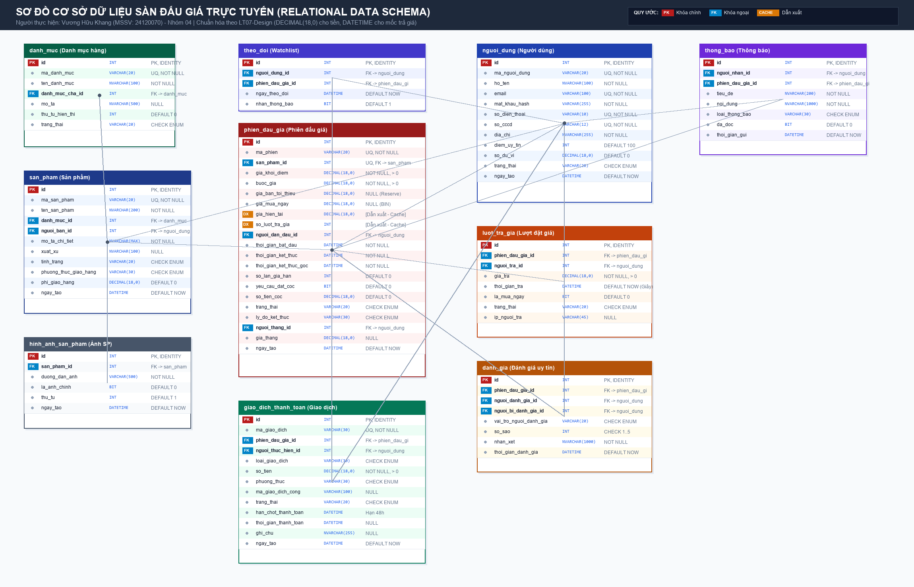

#### 2.2. Tóm tắt quan hệ khóa chính – khóa ngoại (1–N & 1–1)

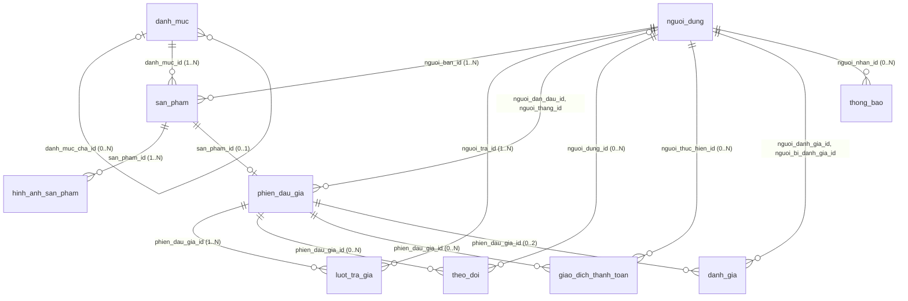

- **`nguoi_dung` (1) — (N) `san_pham` / `luot_tra_gia`:** một thành viên vừa đăng bán nhiều sản phẩm, vừa trả giá nhiều lần ở các phiên khác nhau.
- **`danh_muc` (1) — (N) `san_pham`:** danh mục tự tham chiếu qua `danh_muc_cha_id` để tạo cây phân cấp.
- **`san_pham` (1) — (0..1) `phien_dau_gia`:** `san_pham_id` là `UNIQUE`, mỗi sản phẩm chỉ có một phiên.
- **`phien_dau_gia` (1) — (N) `luot_tra_gia`:** một phiên có nhiều lượt trả giá; phiên tham chiếu `nguoi_dung` qua người dẫn đầu và người thắng.
- **`phien_dau_gia` (1) — (0..N) `giao_dich_thanh_toan`:** nhiều người nộp cọc, hoàn cọc cho người thua, hóa đơn của người thắng.
- **`phien_dau_gia` (1) — (0..2) `danh_gia`:** người mua đánh giá người bán và ngược lại, mỗi bên một lần.
- **`theo_doi`:** bảng trung gian của quan hệ N – N giữa `nguoi_dung` và `phien_dau_gia`.

---

### BƯỚC 3: ĐẶC TẢ THÀNH PHẦN DỮ LIỆU

> [!IMPORTANT]
> **Giải trình các trường dẫn xuất:** bảng `phien_dau_gia` lưu sẵn `gia_hien_tai`, `so_luot_tra_gia`, `nguoi_dan_dau_id`, dù có thể tính lại từ `luot_tra_gia` bằng `MAX` / `COUNT`. Lưu sẵn để trang danh sách phiên đang diễn ra chỉ đọc một bảng, không phải `JOIN` và gom nhóm trên toàn bộ lịch sử trả giá. Để không lệch dữ liệu, mỗi lượt trả giá được ghi trong một giao dịch: khóa dòng phiên, kiểm tra bước giá, thêm `luot_tra_gia` và cập nhật cả 3 trường cùng lúc.

---

#### Bảng 1: `nguoi_dung`
*Lưu trữ thông tin tài khoản người dùng trên hệ thống sàn đấu giá. Phục vụ: `QĐ2`, `QĐ7`, `QĐ8`*

| Field | Kiểu dữ liệu | Ràng buộc | Mô tả |
| :--- | :--- | :--- | :--- |
| `id` | Số tự tăng | `PK`, `NOT NULL` | Khóa chính tự sinh nội bộ |
| `ma_nguoi_dung` | Chuỗi (20) | `UNIQUE`, `NOT NULL` | Mã người dùng hiển thị (Ví dụ: `ND000001`) |
| `ho_ten` | Chuỗi Unicode (100) | `NOT NULL` | Họ và tên đầy đủ |
| `email` | Chuỗi (100) | `UNIQUE`, `NOT NULL` | Địa chỉ email đăng nhập |
| `mat_khau_hash` | Chuỗi (255) | `NOT NULL` | Chuỗi băm mật khẩu bảo mật (Bcrypt/Argon2) |
| `so_dien_thoai` | Chuỗi (10) | `UNIQUE`, `NOT NULL` | Số điện thoại di động (10 chữ số) |
| `so_cccd` | Chuỗi (12) | `UNIQUE`, `NOT NULL` | Số Căn cước công dân định danh cá nhân |
| `dia_chi` | Chuỗi Unicode (255) | `NOT NULL` | Địa chỉ cư trú / giao nhận hàng hóa |
| `diem_uy_tin` | Số nguyên | `NOT NULL`, `DEFAULT 100`, `CHECK >= 0` | Điểm tín nhiệm giao dịch của thành viên |
| `so_du_vi` | Số thực cố định (18,0) | `NOT NULL`, `DEFAULT 0`, `CHECK >= 0` | Số dư khả dụng trong ví sàn đấu giá (VNĐ) |
| `trang_thai` | Chuỗi (20) | `NOT NULL`, `DEFAULT 'HOAT_DONG'`, `CHECK IN ('HOAT_DONG', 'TAM_KHOA', 'BI_KHOA', 'CHUA_KICH_HOAT')` | Trạng thái hoạt động của tài khoản |
| `ngay_tao` | Ngày giờ | `NOT NULL`, `DEFAULT CURRENT_TIMESTAMP` | Thời điểm đăng ký tài khoản |

---

#### Bảng 2: `danh_muc`
*Phân loại ngành hàng, sản phẩm đấu giá (hỗ trợ mô hình phân cấp danh mục cha - con). Phục vụ: phân loại, tìm kiếm sản phẩm*

| Field | Kiểu dữ liệu | Ràng buộc | Mô tả |
| :--- | :--- | :--- | :--- |
| `id` | Số tự tăng | `PK`, `NOT NULL` | Khóa chính danh mục |
| `ma_danh_muc` | Chuỗi (20) | `UNIQUE`, `NOT NULL` | Mã danh mục nghiệp vụ (Ví dụ: `DM_DIENTU`) |
| `ten_danh_muc` | Chuỗi Unicode (100) | `NOT NULL` | Tên danh mục ngành hàng |
| `danh_muc_cha_id` | Số nguyên | `NULL`, `FK -> danh_muc(id)` | Khóa ngoại trỏ đến danh mục cha (đệ quy) |
| `mo_ta` | Chuỗi Unicode (500) | `NULL` | Mô tả tóm tắt danh mục |
| `thu_tu_hien_thi` | Số nguyên | `NOT NULL`, `DEFAULT 0`, `CHECK >= 0` | Thứ tự ưu tiên sắp xếp trên giao diện |
| `trang_thai` | Chuỗi (20) | `NOT NULL`, `DEFAULT 'HOAT_DONG'`, `CHECK IN ('HOAT_DONG', 'TAM_AN')` | Trạng thái hiển thị danh mục |

---

#### Bảng 3: `san_pham`
*Thông tin chi tiết mặt hàng do người bán đăng tải để đưa vào đấu giá. Phục vụ: `QĐ2`, `QĐ7`*

| Field | Kiểu dữ liệu | Ràng buộc | Mô tả |
| :--- | :--- | :--- | :--- |
| `id` | Số tự tăng | `PK`, `NOT NULL` | Khóa chính sản phẩm |
| `ma_san_pham` | Chuỗi (20) | `UNIQUE`, `NOT NULL` | Mã quản lý sản phẩm (Ví dụ: `SP000001`) |
| `ten_san_pham` | Chuỗi Unicode (200) | `NOT NULL` | Tên hiển thị của sản phẩm |
| `danh_muc_id` | Số nguyên | `NOT NULL`, `FK -> danh_muc(id)` | Khóa ngoại tham chiếu danh mục |
| `nguoi_ban_id` | Số nguyên | `NOT NULL`, `FK -> nguoi_dung(id)` | Khóa ngoại người bán sở hữu sản phẩm |
| `mo_ta_chi_tiet` | Văn bản dài | `NOT NULL` | Bài viết mô tả đầy đủ thông số, tính năng |
| `xuat_xu` | Chuỗi Unicode (100) | `NULL` | Xuất xứ sản phẩm / Thương hiệu sản xuất |
| `tinh_trang` | Chuỗi (20) | `NOT NULL`, `CHECK IN ('MOI_100', 'DA_QUA_SU_DUNG', 'LIKE_NEW', 'CO_VAT')` | Tình trạng thực tế của sản phẩm |
| `phuong_thuc_giao_hang` | Chuỗi (30) | `NOT NULL`, `CHECK IN ('CHUYEN_PHAT_NHANH', 'NGUOI_MUA_DEN_LAY', 'MIEN_PHI_GIAO_HANG')` | Phương thức giao nhận hàng hóa |
| `phi_giao_hang` | Số thực cố định (18,0) | `NOT NULL`, `DEFAULT 0`, `CHECK >= 0` | Cước phí chuyển phát ước tính (VNĐ) |
| `ngay_tao` | Ngày giờ | `NOT NULL`, `DEFAULT CURRENT_TIMESTAMP` | Thời điểm người bán tạo bài đăng |

---

#### Bảng 4: `hinh_anh_san_pham`
*Lưu trữ danh sách hình ảnh thực tế của sản phẩm. Phục vụ: hiển thị sản phẩm*

| Field | Kiểu dữ liệu | Ràng buộc | Mô tả |
| :--- | :--- | :--- | :--- |
| `id` | Số tự tăng | `PK`, `NOT NULL` | Khóa chính hình ảnh |
| `san_pham_id` | Số nguyên | `NOT NULL`, `FK -> san_pham(id) ON DELETE CASCADE` | Khóa ngoại trỏ đến sản phẩm |
| `duong_dan_anh` | Chuỗi (500) | `NOT NULL` | Đường dẫn URL file ảnh lưu trên Cloud/CDN |
| `la_anh_chinh` | Luận lý (Boolean) | `NOT NULL`, `DEFAULT 0` | Cờ đánh dấu ảnh đại diện chính của sản phẩm |
| `thu_tu` | Số nguyên | `NOT NULL`, `DEFAULT 1`, `CHECK >= 1` | Thứ tự hiển thị trong bộ sưu tập ảnh |
| `ngay_tao` | Ngày giờ | `NOT NULL`, `DEFAULT CURRENT_TIMESTAMP` | Thời điểm tải ảnh lên |

---

#### Bảng 5: `phien_dau_gia`
*Thực thể trọng tâm chứa thông tin phiên đấu giá, quy tắc tài chính và tiến độ thời gian. Phục vụ: `QĐ1`, `QĐ3`, `QĐ4`, `QĐ6`*

| Field | Kiểu dữ liệu | Ràng buộc | Mô tả |
| :--- | :--- | :--- | :--- |
| `id` | Số tự tăng | `PK`, `NOT NULL` | Khóa chính phiên đấu giá |
| `ma_phien` | Chuỗi (20) | `UNIQUE`, `NOT NULL` | Mã phiên đấu giá hiển thị (Ví dụ: `PDG000001`) |
| `san_pham_id` | Số nguyên | `UNIQUE`, `NOT NULL`, `FK -> san_pham(id)` | Khóa ngoại tham chiếu 1-1 với sản phẩm |
| `gia_khoi_diem` | Số thực cố định (18,0) | `NOT NULL`, `CHECK > 0` | Mức giá bắt đầu phiên đấu giá (VNĐ) |
| `buoc_gia` | Số thực cố định (18,0) | `NOT NULL`, `CHECK > 0` | Bước giá tối thiểu cho mỗi lần trả giá (VNĐ) |
| `gia_ban_toi_thieu` | Số thực cố định (18,0) | `NULL`, `CHECK IS NULL OR >= gia_khoi_diem` | Giá sàn bảo lưu bí mật của người bán (Reserve Price) |
| `gia_mua_ngay` | Số thực cố định (18,0) | `NULL`, `CHECK IS NULL OR > gia_khoi_diem` | Mức giá mua đứt để kết thúc phiên ngay lập tức |
| `gia_hien_tai` | Số thực cố định (18,0) | `NOT NULL`, `CHECK >= gia_khoi_diem` | *Trường dẫn xuất:* Giá cao nhất hiện tại (cache) |
| `so_luot_tra_gia` | Số nguyên | `NOT NULL`, `DEFAULT 0`, `CHECK >= 0` | *Trường dẫn xuất:* Tổng số lượt trả giá đã đặt |
| `nguoi_dan_dau_id` | Số nguyên | `NULL`, `FK -> nguoi_dung(id)` | *Trường dẫn xuất:* Người đang đặt mức giá cao nhất |
| `thoi_gian_bat_dau` | Ngày giờ | `NOT NULL` | Thời điểm chính thức mở phiên trả giá |
| `thoi_gian_ket_thuc` | Ngày giờ | `NOT NULL`, `CHECK > thoi_gian_bat_dau` | Thời điểm kết thúc hiện tại của phiên |
| `thoi_gian_ket_thuc_goc` | Ngày giờ | `NOT NULL` | Thời điểm kết thúc ban đầu (trước khi gia hạn) |
| `so_lan_gia_han` | Số nguyên | `NOT NULL`, `DEFAULT 0`, `CHECK BETWEEN 0 AND 10` | Số lần phiên đã được tự động gia hạn thêm 5 phút |
| `yeu_cau_dat_coc` | Luận lý (Boolean) | `NOT NULL`, `DEFAULT 0` | Yêu cầu người tham gia phải nộp cọc trước hay không |
| `so_tien_coc` | Số thực cố định (18,0) | `NOT NULL`, `DEFAULT 0`, `CHECK >= 0` | Số tiền đặt cọc cần nộp nếu có yêu cầu (VNĐ) |
| `trang_thai` | Chuỗi (20) | `NOT NULL`, `DEFAULT 'CHO_DUYET'`, `CHECK IN ('CHO_DUYET', 'SAP_DIEN_RA', 'DANG_DIEN_RA', 'DA_KET_THUC', 'DA_HUY')` | Trạng thái vòng đời của phiên đấu giá |
| `ly_do_ket_thuc` | Chuỗi (30) | `NULL`, `CHECK IS NULL OR IN ('HET_GIO_CO_NGUOI_THANG', 'HET_GIO_KHONG_DAT_GIA_SAN', 'KHONG_CO_LUOT_TRA_GIA', 'MUA_NGAY', 'NGUOI_BAN_HUY', 'HE_THONG_HUY')` | Lý do phiên chuyển sang kết thúc hoặc hủy |
| `nguoi_thang_id` | Số nguyên | `NULL`, `FK -> nguoi_dung(id)` | Khóa ngoại người chiến thắng phiên đấu giá |
| `gia_thang` | Số thực cố định (18,0) | `NULL`, `CHECK IS NULL OR >= gia_khoi_diem` | Mức giá chốt thắng cuộc chung cuộc (VNĐ) |
| `ngay_tao` | Ngày giờ | `NOT NULL`, `DEFAULT CURRENT_TIMESTAMP` | Thời điểm lập phiên đấu giá trên hệ thống |

---

#### Bảng 6: `luot_tra_gia`
*Lịch sử chi tiết các lần đưa ra giá của người mua. Phục vụ: `QĐ1`, `QĐ3`, `QĐ5`*

| Field | Kiểu dữ liệu | Ràng buộc | Mô tả |
| :--- | :--- | :--- | :--- |
| `id` | Số tự tăng | `PK`, `NOT NULL` | Khóa chính lượt trả giá |
| `phien_dau_gia_id` | Số nguyên | `NOT NULL`, `FK -> phien_dau_gia(id)` | Khóa ngoại tham chiếu phiên đấu giá |
| `nguoi_tra_id` | Số nguyên | `NOT NULL`, `FK -> nguoi_dung(id)` | Khóa ngoại người đặt giá (thành viên mua) |
| `gia_tra` | Số thực cố định (18,0) | `NOT NULL`, `CHECK > 0` | Mức giá người mua đưa ra (VNĐ) |
| `thoi_gian_tra` | Ngày giờ | `NOT NULL`, `DEFAULT CURRENT_TIMESTAMP` | Thời điểm hệ thống ghi nhận lượt ra giá (đến giây) |
| `la_mua_ngay` | Luận lý (Boolean) | `NOT NULL`, `DEFAULT 0` | Cờ đánh dấu lượt ra giá kích hoạt Mua ngay |
| `trang_thai` | Chuỗi (20) | `NOT NULL`, `DEFAULT 'HOP_LE'`, `CHECK IN ('HOP_LE', 'BI_VUOT_GIA', 'THANG_CUOC', 'BI_HUY')` | Trạng thái hiệu lực của lượt trả giá |
| `ip_nguoi_tra` | Chuỗi (45) | `NULL` | Địa chỉ IPv4/IPv6 nhằm kiểm soát gian lận |

---

#### Bảng 7: `theo_doi`
*Quản lý danh sách sản phẩm yêu thích (Watchlist) của người dùng. Phục vụ: thông báo biến động giá*

| Field | Kiểu dữ liệu | Ràng buộc | Mô tả |
| :--- | :--- | :--- | :--- |
| `id` | Số tự tăng | `PK`, `NOT NULL` | Khóa chính theo dõi |
| `nguoi_dung_id` | Số nguyên | `NOT NULL`, `FK -> nguoi_dung(id)` | Khóa ngoại người dùng theo dõi |
| `phien_dau_gia_id` | Số nguyên | `NOT NULL`, `FK -> phien_dau_gia(id)` | Khóa ngoại phiên đấu giá được quan tâm |
| `ngay_theo_doi` | Ngày giờ | `NOT NULL`, `DEFAULT CURRENT_TIMESTAMP` | Thời điểm nhấn theo dõi phiên |
| `nhan_thong_bao` | Luận lý (Boolean) | `NOT NULL`, `DEFAULT 1` | Cờ bật/tắt nhận chuông báo biến động giá |
| *Ràng buộc nhóm* | — | `UNIQUE(nguoi_dung_id, phien_dau_gia_id)` | Mỗi người dùng chỉ theo dõi 1 phiên tối đa 1 lần |

---

#### Bảng 8: `giao_dich_thanh_toan`
*Quản lý các luồng tiền thanh toán (cọc, hoàn cọc, hóa đơn mua hàng trúng đấu giá, phí dịch vụ). Phục vụ: `QĐ6`, `QĐ7`*

| Field | Kiểu dữ liệu | Ràng buộc | Mô tả |
| :--- | :--- | :--- | :--- |
| `id` | Số tự tăng | `PK`, `NOT NULL` | Khóa chính giao dịch |
| `ma_giao_dich` | Chuỗi (30) | `UNIQUE`, `NOT NULL` | Mã giao dịch tài chính hệ thống (Ví dụ: `GD202611080001`) |
| `phien_dau_gia_id` | Số nguyên | `NOT NULL`, `FK -> phien_dau_gia(id)` | Khóa ngoại phiên đấu giá phát sinh giao dịch |
| `nguoi_thuc_hien_id` | Số nguyên | `NOT NULL`, `FK -> nguoi_dung(id)` | Khóa ngoại người chi trả hoặc thụ hưởng |
| `loai_giao_dich` | Chuỗi (30) | `NOT NULL`, `CHECK IN ('DAT_COC', 'HOAN_COC', 'TICH_THU_COC', 'THANH_TOAN_HOA_DON', 'PHI_DANG_SAN_PHAM', 'RUT_TIEN_BAN')` | Bản chất loại giao dịch tài chính |
| `so_tien` | Số thực cố định (18,0) | `NOT NULL`, `CHECK > 0` | Số tiền giao dịch thực tế (VNĐ) |
| `phuong_thuc` | Chuỗi (30) | `NOT NULL`, `CHECK IN ('VI_SAN', 'VNPAY', 'MOMO', 'CHUYEN_KHOAN_NGAN_HANG')` | Phương thức thanh toán được sử dụng |
| `ma_giao_dich_cong` | Chuỗi (100) | `NULL` | Mã tham chiếu đối soát từ cổng thanh toán bên ngoài |
| `trang_thai` | Chuỗi (20) | `NOT NULL`, `DEFAULT 'CHO_XU_LY'`, `CHECK IN ('CHO_XU_LY', 'THANH_CONG', 'THAT_BAI', 'DA_HUY')` | Tình trạng xử lý giao dịch |
| `han_chot_thanh_toan` | Ngày giờ | `NULL` | Mốc hết hạn 48 giờ đối với hóa đơn mua hàng |
| `thoi_gian_thanh_toan` | Ngày giờ | `NULL` | Thời điểm thanh toán thực tế thành công |
| `ghi_chu` | Chuỗi Unicode (255) | `NULL` | Ghi chú giải trình giao dịch |
| `ngay_tao` | Ngày giờ | `NOT NULL`, `DEFAULT CURRENT_TIMESTAMP` | Thời điểm khởi tạo bản ghi giao dịch |

---

#### Bảng 9: `danh_gia`
*Lưu trữ đánh giá uy tín hai chiều sau khi phiên đấu giá hoàn tất. Phục vụ: `QĐ8`*

| Field | Kiểu dữ liệu | Ràng buộc | Mô tả |
| :--- | :--- | :--- | :--- |
| `id` | Số tự tăng | `PK`, `NOT NULL` | Khóa chính bản ghi đánh giá |
| `phien_dau_gia_id` | Số nguyên | `NOT NULL`, `FK -> phien_dau_gia(id)` | Khóa ngoại phiên đấu giá đã kết thúc thành công |
| `nguoi_danh_gia_id` | Số nguyên | `NOT NULL`, `FK -> nguoi_dung(id)` | Khóa ngoại thành viên thực hiện gửi đánh giá |
| `nguoi_bi_danh_gia_id` | Số nguyên | `NOT NULL`, `FK -> nguoi_dung(id)` | Khóa ngoại thành viên được đánh giá |
| `vai_tro_nguoi_danh_gia` | Chuỗi (20) | `NOT NULL`, `CHECK IN ('NGUOI_MUA', 'NGUOI_BAN')` | Vai trò của người gửi nhận xét trong phiên |
| `so_sao` | Số nguyên | `NOT NULL`, `CHECK BETWEEN 1 AND 5` | Số sao đánh giá độ hài lòng (1 đến 5 sao) |
| `nhan_xet` | Chuỗi Unicode (1000) | `NOT NULL` | Nội dung phản hồi, nhận xét cụ thể |
| `thoi_gian_danh_gia` | Ngày giờ | `NOT NULL`, `DEFAULT CURRENT_TIMESTAMP` | Thời điểm gửi đánh giá (chỉ đọc, không cho sửa) |
| *Ràng buộc nhóm* | — | `UNIQUE(phien_dau_gia_id, nguoi_danh_gia_id)` | Mỗi người tham gia chỉ được đánh giá 1 lần duy nhất |

---

#### Bảng 10: `thong_bao`
*Hộp thư thông báo thời gian thực gửi đến người dùng. Phục vụ: `QĐ3`, `QĐ4`, `QĐ6`*

| Field | Kiểu dữ liệu | Ràng buộc | Mô tả |
| :--- | :--- | :--- | :--- |
| `id` | Số tự tăng | `PK`, `NOT NULL` | Khóa chính thông báo |
| `nguoi_nhan_id` | Số nguyên | `NOT NULL`, `FK -> nguoi_dung(id)` | Khóa ngoại người dùng nhận thông báo |
| `phien_dau_gia_id` | Số nguyên | `NULL`, `FK -> phien_dau_gia(id)` | Khóa ngoại phiên đấu giá liên quan (nếu có) |
| `tieu_de` | Chuỗi Unicode (200) | `NOT NULL` | Tiêu đề thông báo ngắn gọn |
| `noi_dung` | Chuỗi Unicode (1000) | `NOT NULL` | Nội dung chi tiết thông báo |
| `loai_thong_bao` | Chuỗi (30) | `NOT NULL`, `CHECK IN ('BI_VUOT_GIA', 'THANG_DAU_GIA', 'PHIEN_SAP_KET_THUC', 'XAC_NHAN_DAT_GIA', 'THANH_TOAN_THANH_CONG', 'HOAN_TIEN_COC', 'PHIEN_BI_HUY')` | Phân loại sự kiện thông báo |
| `da_doc` | Luận lý (Boolean) | `NOT NULL`, `DEFAULT 0` | Cờ trạng thái đã đọc (1) hay chưa đọc (0) |
| `thoi_gian_gui` | Ngày giờ | `NOT NULL`, `DEFAULT CURRENT_TIMESTAMP` | Thời điểm hệ thống gửi thông báo |

---

### NỘI DUNG BỔ SUNG

#### Quy định nghiệp vụ và cách CSDL thực thi

| Mã | Quy định | Thực thi trong CSDL |
| :-: | :--- | :--- |
| `QĐ1` | Giá khởi điểm, bước giá > 0; lượt đầu ≥ giá khởi điểm, lượt sau ≥ giá hiện tại + bước giá | `CHECK` trên `gia_khoi_diem`, `buoc_gia`; kiểm tra `gia_tra` khi ghi `luot_tra_gia` |
| `QĐ2` | Người bán không được trả giá phiên của mình | So sánh `luot_tra_gia.nguoi_tra_id` với `san_pham.nguoi_ban_id` |
| `QĐ3` | Trả giá ≥ giá mua ngay thì phiên kết thúc ngay | `la_mua_ngay = 1`; phiên chuyển `DA_KET_THUC`, `ly_do_ket_thuc = 'MUA_NGAY'` |
| `QĐ4` | Trả giá trong 5 phút cuối thì gia hạn thêm 5 phút, tối đa 10 lần | `thoi_gian_ket_thuc`, `thoi_gian_ket_thuc_goc`, `so_lan_gia_han` (`CHECK BETWEEN 0 AND 10`) |
| `QĐ5` | Ghi nhận đến giây; cùng mức giá thì lượt đến trước hợp lệ | `luot_tra_gia.thoi_gian_tra` kiểu `DATETIME` |
| `QĐ6` | Phiên giá trị cao bắt buộc đặt cọc (mặc định 10% giá khởi điểm); người thua được hoàn cọc trong 24 giờ | `yeu_cau_dat_coc`, `so_tien_coc`; giao dịch loại `DAT_COC`, `HOAN_COC` |
| `QĐ7` | Người thắng thanh toán trong 48 giờ; quá hạn bị tịch thu cọc, trừ điểm uy tín | `han_chot_thanh_toan`, giao dịch loại `TICH_THU_COC`, `nguoi_dung.diem_uy_tin` |
| `QĐ8` | Mỗi bên đánh giá đối phương một lần, 1–5 sao, trong 14 ngày, không sửa | `CHECK (so_sao BETWEEN 1 AND 5)`, `UNIQUE(phien_dau_gia_id, nguoi_danh_gia_id)` |

#### Truy xuất thông tin nghiệp vụ

| Thông tin | Đọc nhanh | Đối soát từ lịch sử |
| :--- | :--- | :--- |
| Giá cao nhất hiện tại | `phien_dau_gia.gia_hien_tai` | `MAX(gia_tra)` trong `luot_tra_gia` của phiên |
| Người đang dẫn đầu | `phien_dau_gia.nguoi_dan_dau_id` | Lượt `HOP_LE` có giá cao nhất, ghi nhận sớm nhất |
| Người thắng và giá thắng | `nguoi_thang_id`, `gia_thang` của phiên `DA_KET_THUC` | — |
| Lịch sử trả giá của một người | `luot_tra_gia` lọc theo `phien_dau_gia_id`, `nguoi_tra_id`, xếp theo `thoi_gian_tra` | — |

#### Dữ liệu mẫu

Phiên `PDG000001` bán MacBook Pro 14 inch M3 Pro: giá khởi điểm 30.000.000 đ, bước giá 500.000 đ, giá mua ngay 42.000.000 đ, cọc 3.000.000 đ. Có 5 lượt trả giá; lượt cuối lúc 09:58:30 rơi vào 5 phút cuối nên phiên được gia hạn đến 10:05:00 (`QĐ4`). `ND000004` thắng với 32.500.000 đ, hai người thua được hoàn cọc, hóa đơn 32.500.000 + 50.000 (vận chuyển) − 3.000.000 (cọc) = 29.550.000 đ. Toàn văn script ở **Phụ lục B**.

---

## PHẦN 3 · THIẾT KẾ GIAO DIỆN PHÒNG KHÁM AN TÂM LEVEL 4

> [!IMPORTANT]
> **Ghi chú phạm vi.** Mini-SRS là hệ thống *quản lý lịch khám*: bệnh án, đơn thuốc và hóa đơn thuốc nằm ngoài phạm vi (mục 1.3, `ASM-10`), và thiết kế dữ liệu ở Phần 1 không có bảng thuốc hay phiếu khám. Vì vậy không thiết kế màn hình phiếu khám bệnh, đơn thuốc; thay vào đó là các màn hình nhập liệu thật của hệ thống: Đặt lịch khám, Tiếp nhận trong ngày, Bác sĩ nghỉ đột xuất, Lịch làm việc bác sĩ... Mọi ô trên màn hình dùng đúng tên `bảng.field` ở Phần 1.
>
> Theo slide 25, các nút xử lý (Đặt lịch, Lưu, Thanh toán...) chỉ được vẽ để thấy vị trí, chưa đặc tả xử lý vì thuộc phần *Thiết kế xử lý*.

---

### BƯỚC 1: LẬP DANH SÁCH MÀN HÌNH

#### 1.1. Danh sách màn hình

Ngữ cảnh giao tiếp gồm 4 vai trong `tai_khoan.vai_tro`: **Quản lý** (`quan_ly`), **Bác sĩ** (`bac_si`), **Nhân viên tiếp nhận** (`tiep_nhan`), **Bệnh nhân** (`benh_nhan`). Loại màn hình theo tiêu chí chức năng tin học (slide 41): Hệ thống, Nhập liệu (lưu trữ), Tra cứu, Báo biểu.

| STT | Mã | Màn hình | Loại | Ý nghĩa | Vai sử dụng | Yêu cầu |
| :-: | :-: | :--- | :--- | :--- | :--- | :--- |
| 1 | MH01 | Đăng nhập | Hệ thống | Xác thực người dùng, xác định vai để mở đúng màn hình chính | Mọi vai | `FR-13`, `NFR-03` |
| 2 | MH02 | Màn hình chính | Hệ thống | Gom nhóm chức năng theo nghiệp vụ, chỉ hiện nhóm mà vai được phép; khung "Cần xử lý hôm nay" | Mọi vai | `FR-13` |
| 3 | MH03 | Đặt lịch khám | Nhập liệu | Bệnh nhân tự đặt hoặc nhân viên đặt hộ: chọn hình thức, chuyên khoa, bác sĩ, ngày, khung giờ còn chỗ | Bệnh nhân, Tiếp nhận | `FR-01`, `FR-02`, `FR-03`, `FR-04`, `FR-07`, `FR-08` |
| 4 | MH04 | Thanh toán lịch khám trực tuyến | Nhập liệu | Hiện số tiền, đếm ngược thời gian giữ chỗ, chọn phương thức thanh toán | Bệnh nhân | `FR-15`, `FR-16`, `NFR-07` |
| 5 | MH05 | Tra cứu lịch hẹn | Tra cứu | Tìm lịch theo mã, SĐT, tên, trạng thái, khoảng ngày; xem trạng thái thanh toán, hoàn tiền; mở Đổi/Hủy | Bệnh nhân (lịch của mình), Tiếp nhận, Quản lý | `FR-06`, `FR-08`, `FR-14` |
| 6 | MH06 | Đổi lịch hẹn | Nhập liệu | Hộp thoại đổi sang khung giờ hoặc bác sĩ khác còn chỗ, kiểm tra hạn chót và số lần đổi | Bệnh nhân, Tiếp nhận | `FR-05`, `FR-08` |
| 7 | MH07 | Tra cứu bệnh nhân | Tra cứu | Tìm hồ sơ bệnh nhân theo tiêu chuẩn không bắt buộc nhập hết (slide 35–36) | Tiếp nhận, Quản lý | `FR-07`, `FR-14` |
| 8 | MH08 | Hồ sơ bệnh nhân | Nhập liệu | Thêm, sửa hồ sơ hành chính; xem lịch hẹn của bệnh nhân | Tiếp nhận | `FR-07` |
| 9 | MH09 | Tiếp nhận trong ngày | Nhập liệu | Lưới lượt khám theo ngày, ca; cập nhật trạng thái khám; theo dõi chỗ trống, việc cần gọi điện | Tiếp nhận, Quản lý | `FR-08`, `FR-10`, `FR-18` |
| 10 | MH10 | Danh sách khám theo ca | Tra cứu | Bác sĩ xem bệnh nhân của mình theo ngày, ca, xếp theo giờ hẹn; cập nhật trạng thái lượt của mình | Bác sĩ | `FR-09`, `FR-10` |
| 11 | MH11 | Xử lý bác sĩ nghỉ đột xuất | Nhập liệu | Đánh dấu bác sĩ nghỉ theo ngày, ca; xem trước lịch bị ảnh hưởng, số tiền hoàn; danh sách cần gọi điện | Quản lý, Tiếp nhận | `FR-11`, `FR-17`, `FR-18` |
| 12 | MH12 | Lịch làm việc bác sĩ | Nhập liệu | Tạo, sửa khung giờ theo ca: hình thức mở, giới hạn bệnh nhân, khóa khung | Quản lý | `FR-12`, `ASM-02` |
| 13 | MH13 | Danh mục chuyên khoa | Nhập liệu | Thêm, sửa chuyên khoa và đơn giá khám tại phòng khám / trực tuyến | Quản lý | `FR-15`, `Q-10` |
| 14 | MH14 | Tham số quy định | Nhập liệu | Sửa 8 quy định dạng số trong `tham_so` mà không sửa chương trình | Quản lý | `ASM-02`, `ASM-12`, `Q-01`, `Q-03`, `Q-04`, `Q-11` |
| 15 | MH15 | Giao dịch thanh toán & hoàn tiền | Tra cứu | Lọc giao dịch theo ngày, loại, trạng thái; lọc nhanh hoàn lỗi, đang chờ, chờ chính sách | Quản lý, Tiếp nhận được cấp quyền | `FR-19`, `NFR-07` |
| 16 | MH16 | Nhật ký hệ thống | Tra cứu | Xem lịch sử thay đổi trạng thái và các lần truy cập trái phép; không sửa, không xóa | Quản lý | `NFR-04`, `NFR-09` |
| 17 | MH17 | Tài khoản & phân quyền | Nhập liệu | Tạo, sửa, khóa tài khoản và gán vai | Quản lý | `FR-13`, `NFR-04` |
| 18 | MH18 | Trang lỗi 404 | Hệ thống | Báo không tìm thấy trang, chỉ đường quay lại, số điện thoại khẩn cấp | Mọi vai | Bài Brajdic |
| 19 | MH19 | Trang bảo trì / mất kết nối | Hệ thống | Báo hệ thống bảo trì hoặc thiết bị mất kết nối; dữ liệu đã nhập được giữ | Mọi vai | `NFR-05` |
| 20 | MH20 | Trang không có quyền truy cập (403) | Hệ thống | Báo tài khoản không đủ quyền, ghi nhật ký, chỉ người cần liên hệ | Mọi vai | `FR-13`, `NFR-04` |

Mini-SRS không có yêu cầu báo biểu riêng, nên danh sách không có màn hình loại Báo biểu. Các số tổng hợp (doanh thu đã thu, đã hoàn) hiện ngay trên MH15.

#### 1.2. Truy vết yêu cầu → màn hình

Mọi nghiệp vụ trong Mini-SRS đều có ít nhất một màn hình:

| Yêu cầu | Màn hình | | Yêu cầu | Màn hình |
| :--- | :--- | --- | :--- | :--- |
| `FR-01` Đặt lịch khám | MH03 | | `FR-11` Bác sĩ nghỉ đột xuất | MH11 |
| `FR-02` Xem khung giờ khả dụng | MH03, MH06 | | `FR-12` Lịch làm việc bác sĩ | MH12 |
| `FR-03` Chống đặt trùng | MH03, MH06 (kiểm tra muộn khi lưu) | | `FR-13` Đăng nhập, phân quyền | MH01, MH02, MH17, MH20 |
| `FR-04` Xác nhận, thông báo | MH03, MH04 (thông báo thành công), MH09, MH11 (thông báo gửi lỗi) | | `FR-14` Tra cứu lịch hẹn | MH05, MH07 |
| `FR-05` Đổi lịch | MH06 | | `FR-15` Thanh toán trước | MH04 |
| `FR-06` Bệnh nhân hủy lịch | MH05 | | `FR-16` Giữ chỗ chờ thanh toán | MH03, MH04 |
| `FR-07` Khai thông tin bệnh nhân | MH03, MH08 | | `FR-17` Hoàn tiền khi bác sĩ hủy | MH11, MH15 |
| `FR-08` Nhân viên đặt, đổi, hủy hộ | MH03, MH05, MH06 | | `FR-18` Thông báo hủy, hoàn tiền | MH09, MH11 |
| `FR-09` Danh sách theo ca của bác sĩ | MH10 | | `FR-19` Theo dõi giao dịch | MH15 |
| `FR-10` Cập nhật trạng thái lượt khám | MH09, MH10 | | `NFR-09` Lưu vết | MH16 |

---

### BƯỚC 2: THIẾT KẾ MÀN HÌNH CHÍNH

#### 2.1. Danh sách công việc phần mềm hỗ trợ (slide 38, bước 1)

1. Đăng nhập, đăng xuất
2. Đặt lịch khám (tự đặt hoặc đặt hộ)
3. Thanh toán lịch khám trực tuyến
4. Tra cứu lịch hẹn
5. Đổi lịch hẹn
6. Hủy lịch hẹn
7. Tra cứu bệnh nhân
8. Thêm, sửa hồ sơ bệnh nhân
9. Tiếp nhận và cập nhật trạng thái lượt khám trong ngày
10. Xem danh sách khám theo ca (bác sĩ)
11. Xử lý bác sĩ nghỉ đột xuất
12. Lập lịch làm việc bác sĩ
13. Quản lý danh mục chuyên khoa và đơn giá
14. Cập nhật tham số quy định
15. Theo dõi giao dịch thanh toán và hoàn tiền
16. Xem nhật ký hệ thống
17. Quản lý tài khoản và phân quyền

#### 2.2. So sánh 3 tiêu chí gom nhóm (slide 38, bước 2)

| Tiêu chí | Các nhóm | Chức năng trong nhóm |
| :--- | :--- | :--- |
| **1. Theo chức năng tin học** | Hệ thống · Lưu trữ · Tra cứu · Báo biểu | Hệ thống: 1, 16, 17 · Lưu trữ: 2, 3, 5, 6, 8, 9, 11, 12, 13, 14 · Tra cứu: 4, 7, 10, 15 · Báo biểu: không có |
| **2. Theo đối tượng** | Bệnh nhân · Lịch hẹn · Bác sĩ · Giao dịch · Hệ thống | Bệnh nhân: 7, 8 · Lịch hẹn: 2, 4, 5, 6, 9 · Bác sĩ: 10, 11, 12 · Giao dịch: 3, 15 · Hệ thống: 1, 13, 14, 16, 17 |
| **3. Theo nghiệp vụ** (chọn) | Đặt lịch · Tiếp nhận · Khám bệnh · Thanh toán · Quản lý lịch & quy định · Hệ thống | Đặt lịch: 2, 3, 4, 5, 6 · Tiếp nhận: 7, 8, 9, 11 · Khám bệnh: 10 · Thanh toán: 15 · Quản lý lịch & quy định: 12, 13, 14 · Hệ thống: 1, 16, 17 |

**Lý do chọn tiêu chí 3 (theo nghiệp vụ):**

1. **Khớp với vai và nơi làm việc.** Mỗi nhóm ứng với một quầy hoặc một người thật trong phòng khám: quầy tiếp nhận, phòng bác sĩ, quản lý. Người dùng không phải biết khái niệm "lưu trữ" hay "tra cứu" mới tìm ra chức năng.
2. **Phân quyền gọn.** Ẩn cả nhóm theo vai là đủ (bảng 2.3), không phải ẩn lẻ từng mục như tiêu chí 1. Tiêu chí 1 trộn chức năng của Quản lý và của Tiếp nhận vào cùng nhóm "Lưu trữ".
3. **Đi theo dòng công việc.** Một ca làm việc đi qua Đặt lịch → Tiếp nhận → Khám bệnh → Thanh toán; menu xếp theo đúng thứ tự đó. Tiêu chí 2 tách "đặt lịch" và "tiếp nhận" ra nhiều nhóm đối tượng (bệnh nhân, lịch hẹn), nhân viên phải nhảy qua lại nhiều nhóm trong một cuộc gọi.

#### 2.3. Ma trận nhóm chức năng theo vai

`FR-13` yêu cầu mỗi vai chỉ thấy phần được cấp phép. Ma trận dưới đây là đề xuất theo mô tả `FR-13`, `FR-19`; danh sách quyền chi tiết vẫn chờ phòng khám chốt (`Q-06`).

| Nhóm (tiêu chí 3) | Màn hình | Quản lý | Tiếp nhận | Bác sĩ | Bệnh nhân |
| :--- | :--- | :-: | :-: | :-: | :-: |
| Đặt lịch | MH03, MH04, MH05, MH06 | ✓ | ✓ | — | ✓ (chỉ lịch của mình) |
| Tiếp nhận | MH07, MH08, MH09, MH11 | ✓ | ✓ | — | — |
| Khám bệnh | MH10 | ✓ (xem) | — | ✓ (chỉ lịch của mình) | — |
| Thanh toán | MH15 | ✓ | Khi được cấp quyền | — | — |
| Quản lý lịch & quy định | MH12, MH13, MH14 | ✓ | — | — | — |
| Hệ thống | MH16, MH17 | ✓ | — | — | — |

Với bệnh nhân, nhóm "Đặt lịch" tách thành hai mục menu dễ hiểu hơn: **Đặt lịch** (MH03) và **Lịch hẹn của tôi** (MH05 lọc sẵn theo tài khoản).

#### 2.4. Wireframe màn hình chính (MH02)

Nhân viên đăng nhập xong vào thẳng màn hình quen dùng nhất của vai: Tiếp nhận vào MH09, Bác sĩ vào MH10, Bệnh nhân vào MH03. MH02 là trang tổng quan của Quản lý và là trang bấm logo để quay về.

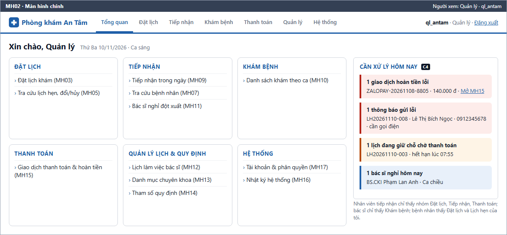

---

### BƯỚC 3: SƠ ĐỒ MÀN HÌNH

Mũi tên hai chiều: đi tới và quay lại được. Mọi màn hình nghiệp vụ đều về được MH02 qua menu; khi lỗi, mọi màn hình có thể chuyển sang MH18, MH19 hoặc MH20.

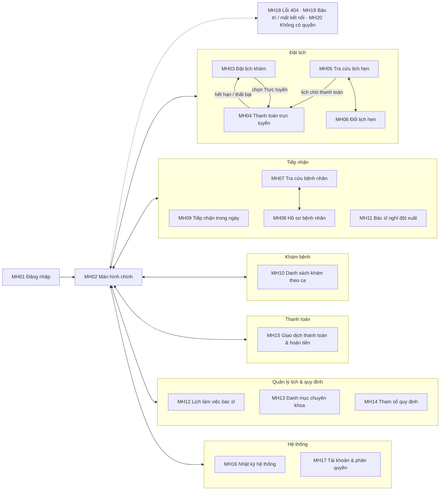

Các mũi tên từ MH02 tới một khung nhóm nghĩa là MH02 mở được (và quay về được từ) mọi màn hình trong nhóm đó, tùy quyền của vai (bảng 2.3). Để sơ đồ dễ đọc, các chuyển tiếp giữa hai nhóm khác nhau được liệt kê riêng:

| Từ | Đến | Khi nào |
| :--- | :--- | :--- |
| MH07 Tra cứu bệnh nhân | MH03 Đặt lịch khám | Bấm "Đặt lịch" trên dòng bệnh nhân; số điện thoại điền sẵn |
| MH09 Tiếp nhận trong ngày | MH03 Đặt lịch khám | Bấm "+ Đặt lịch / Khám gấp" |
| MH09 Tiếp nhận trong ngày | MH05 Tra cứu lịch hẹn | Bấm mã lịch để xem chi tiết, đổi, hủy |
| MH03 Đặt lịch khám | MH08 Hồ sơ bệnh nhân | Sửa thông tin hồ sơ của bệnh nhân cũ |
| MH11 Bác sĩ nghỉ đột xuất | MH15 Giao dịch thanh toán & hoàn tiền | Xử lý thủ công các khoản hoàn lỗi |
| MH12 Lịch làm việc bác sĩ | MH05 Tra cứu lịch hẹn | Xem các lịch bị ảnh hưởng khi sửa, khóa khung |
| MH17 Tài khoản & phân quyền | MH11 Bác sĩ nghỉ đột xuất | Bác sĩ nghỉ cần hủy lịch, hoàn tiền |

---

### BƯỚC 4: QUY ƯỚC GIAO DIỆN

#### 4.1. Bảng màu (slide 17)

Dùng 4 màu chức năng cộng thang xám trung tính, giống nhau trên mọi màn hình. Mỗi màu chỉ mang một nghĩa, nên người dùng nhìn màu là biết trạng thái.

| Màu | Mã | Chỉ dùng cho |
| :--- | :--- | :--- |
| Xanh dương (chủ đạo) | `#1F5FA8` | Logo, menu đang chọn, nút chính, khung giờ đang chọn, thông tin trung tính |
| Xanh lá | `#1F7A4D` | Thành công, đã xác nhận, khung giờ còn chỗ, đã hoàn tiền |
| Cam | `#B54708` | Cảnh báo, chờ thanh toán, đang giữ chỗ, đến trễ, chờ chính sách |
| Đỏ | `#B42318` | Lỗi, hết chỗ, đã hủy, hoàn lỗi, gửi lỗi, nút thao tác không hoàn tác được |
| Thang xám | `#1C2430` → `#F2F4F7` | Chữ, viền, nền ô chỉ đọc, dòng đã hủy |

Không dùng màu để truyền nghĩa một mình: mọi trạng thái có thêm chữ ("Hết chỗ", "Hoàn lỗi"), để người mù màu và bản in đen trắng vẫn đọc được.

#### 4.2. Quy ước bố trí và thành phần

| Hạng mục | Quy ước |
| :--- | :--- |
| Khung trang | Đầu trang: logo, menu nhóm theo vai, tên tài khoản và vai, nút Đăng xuất. Dưới là đường dẫn (breadcrumb) và tiêu đề màn hình. |
| Ô nhập (slide 21–22) | Nhãn nằm trên ô. Dấu `*` đỏ là bắt buộc. Danh sách cố định ít giá trị (≤ 4) dùng nút chọn radio; danh sách dài dùng ô thả xuống. |
| Ô phản hồi (slide 23) | Ô chỉ đọc (cải tiến 1) có nền xám, viền đứt, không nhận con trỏ. |
| Lưới (cải tiến 3) | Tiêu đề cột cố định; số tiền canh phải, có dấu chấm ngăn nghìn; dòng cảnh báo tô nền cam nhạt, dòng lỗi tô nền đỏ nhạt, dòng đã hủy chữ xám. |
| Định dạng | Ngày `d/M/yyyy` (theo quy ước dữ liệu); giờ `HH:mm`; tiền `150.000 đ`; mã nghiệp vụ hiển thị nguyên dạng (`BN0001`, `LH20261110-001`). |
| Nút | Nút chính màu xanh dương ở bên phải; nút phụ viền xám bên trái nút chính; nút không hoàn tác được (xác nhận bác sĩ nghỉ) màu đỏ và luôn có bước xem trước. |
| Thông báo | Cùng một mẫu khung ở mọi màn hình: tiêu đề in đậm nói chuyện gì, dòng dưới nói vì sao và làm gì tiếp (mục 7). |
| Chú thích wireframe | Nhãn đen `C1`…`C4` trên wireframe đánh dấu cải tiến theo LT07, không thuộc giao diện thật. |

#### 4.3. Quy ước kiểm tra nhập liệu (slide 20)

- **Kiểm tra sớm:** ngay khi rời ô hoặc khi chọn, cho các ràng buộc tự nhiên kiểm được tại chỗ: định dạng số điện thoại, CCCD, ngày sinh trước hôm nay, ô bắt buộc, giá trị số ≥ 0, giờ kết thúc sau giờ bắt đầu. Báo bằng viền đỏ và dòng gợi ý ngay dưới ô.
- **Kiểm tra muộn:** khi bấm Lưu/Đặt lịch, cho các ràng buộc cần dữ liệu mới nhất trên máy chủ: khung giờ còn chỗ (`FR-03`, nhiều người đặt cùng lúc), trùng `UNIQUE` (số điện thoại, CCCD), hạn chót đổi/hủy, số lần đổi, quyền truy cập. Báo bằng khung thông báo ở đầu vùng nhập.
- **Phòng bệnh hơn chữa bệnh:** những gì chặn trước được thì không cho chọn (khung hết chỗ không bấm được, nút Đổi mờ khi quá hạn), thay vì để người dùng chọn rồi mới báo lỗi.

---

### BƯỚC 5: WIREFRAME, BẢNG 4 MỨC CẢI TIẾN VÀ ĐẶC TẢ MÀN HÌNH

Mỗi màn hình gồm: wireframe, bảng 4 mức cải tiến (với màn hình nhập liệu), bảng thành phần (STT | Tên | Loại điều khiển | Nguồn dữ liệu | Giá trị mặc định | Ràng buộc kiểm tra) và kịch bản hoạt động. Cột Nguồn dữ liệu dùng đúng `bảng.field` ở Phần 1. Trong cột Ràng buộc, **[Sớm]** là kiểm tra sớm, **[Muộn]** là kiểm tra muộn.

#### MH01 · Đăng nhập

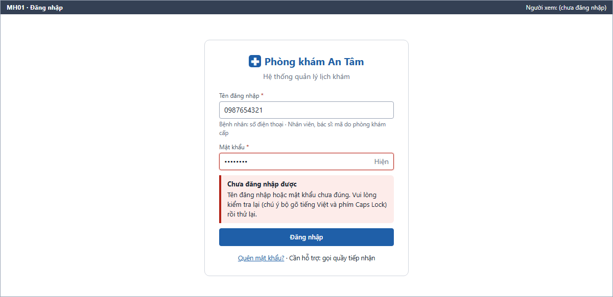

| STT | Tên | Loại điều khiển | Nguồn dữ liệu | Giá trị mặc định | Ràng buộc kiểm tra |
| :-: | :--- | :--- | :--- | :--- | :--- |
| 1 | Tên đăng nhập | Ô nhập | `tai_khoan.ten_dang_nhap` | Trống | [Sớm] bắt buộc, tối đa 50 ký tự |
| 2 | Mật khẩu | Ô nhập ẩn ký tự, nút Hiện | So khớp với `tai_khoan.mat_khau_bam` (bcrypt) | Trống | [Sớm] bắt buộc · [Muộn] sai tên hoặc mật khẩu → TB-17; tài khoản `trang_thai = 0` → TB-18 |
| 3 | Thông báo lỗi | Khung phản hồi | — | Ẩn | Không nói rõ sai tên hay sai mật khẩu, để không lộ tài khoản nào tồn tại |

**Kịch bản:** (1) Người dùng nhập tên đăng nhập và mật khẩu. (2) Bấm Đăng nhập. (3) Đúng: hệ thống đọc `tai_khoan.vai_tro` và mở màn hình đầu của vai (Quản lý → MH02, Tiếp nhận → MH09, Bác sĩ → MH10, Bệnh nhân → MH03). (4) Sai: hiện TB-17, giữ tên đăng nhập, xóa ô mật khẩu.

#### MH02 · Màn hình chính

Wireframe ở mục 2.4.

| STT | Tên | Loại điều khiển | Nguồn dữ liệu | Giá trị mặc định | Ràng buộc kiểm tra |
| :-: | :--- | :--- | :--- | :--- | :--- |
| 1 | Menu nhóm chức năng | Thanh menu, ô chức năng | Theo `tai_khoan.vai_tro` (bảng 2.3) | Nhóm của vai | Chỉ hiện nhóm được phép; mở trực tiếp đường dẫn không được phép → MH20 |
| 2 | Cần xử lý hôm nay | Danh sách cảnh báo | `giao_dich_hoan_tien.trang_thai = 'Hoàn lỗi'`, `thong_bao.trang_thai_gui = 'Gửi lỗi'`, `lich_hen.trang_thai_lich = 'Chờ thanh toán'`, `khung_gio_kham.trang_thai_khung = 'Bác sĩ nghỉ'` của hôm nay | Tự tải | Chỉ đọc; bấm từng dòng mở màn hình xử lý |

**Kịch bản:** (1) Mở sau đăng nhập hoặc khi bấm logo. (2) Hệ thống tải số việc cần xử lý. (3) Người dùng chọn chức năng trên menu hoặc bấm một cảnh báo.

#### MH03 · Đặt lịch khám

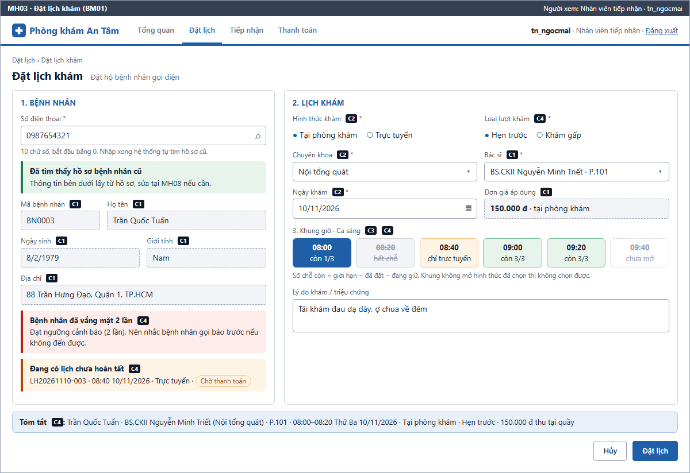

**Bảng 4 mức cải tiến**

| Mức | Bổ sung trên màn hình |
| :--- | :--- |
| Gốc | Số điện thoại, Họ tên, Ngày sinh, Giới tính (bệnh nhân mới); Chuyên khoa, Bác sĩ, Ngày khám, Khung giờ, Hình thức khám, Lý do khám |
| 1 | Nhập số điện thoại cũ thì hiện Mã BN, Họ tên, Ngày sinh, Giới tính, Địa chỉ (chỉ đọc); chọn bác sĩ thì hiện học vị, phòng; chọn chuyên khoa và hình thức thì hiện Đơn giá áp dụng |
| 2 | Ngày khám = ngày hệ thống; Hình thức = Tại phòng khám; Loại lượt = Hẹn trước; Chuyên khoa, Bác sĩ chọn từ danh sách thả xuống (bác sĩ lọc theo chuyên khoa) |
| 3 | Lưới khung giờ cả ca trên một màn hình, mỗi ô có số chỗ còn lại; chọn một ô thay vì gõ giờ |
| 4 | Cảnh báo bệnh nhân đã vắng mặt ≥ ngưỡng `SO_LAN_VANG_MAT_CANH_BAO`; cảnh báo bệnh nhân đang có lịch chưa hoàn tất (tránh đặt trùng); khung hết chỗ, đang giữ, không mở hình thức đã chọn bị khóa sẵn; tùy chọn Khám gấp chỉ hiện cho Tiếp nhận; dòng Tóm tắt trước khi đặt |

**Bảng thành phần**

| STT | Tên | Loại điều khiển | Nguồn dữ liệu | Giá trị mặc định | Ràng buộc kiểm tra |
| :-: | :--- | :--- | :--- | :--- | :--- |
| 1 | Số điện thoại | Ô nhập có tìm kiếm | `benh_nhan.so_dien_thoai` | Bệnh nhân đăng nhập: SĐT của tài khoản; Tiếp nhận: trống | [Sớm] bắt buộc, đúng 10 chữ số, bắt đầu bằng `0` → TB-01 |
| 2 | Mã bệnh nhân | Ô chỉ đọc | `benh_nhan.ma_code_bn` | Tự điền nếu SĐT đã có; trống nếu bệnh nhân mới | — |
| 3 | Họ tên | Ô chỉ đọc (cũ) / Ô nhập (mới) | `benh_nhan.ho_ten` | Tự điền | [Sớm] bệnh nhân mới: bắt buộc, ≤ 100 ký tự |
| 4 | Ngày sinh | Ô chỉ đọc / Ô chọn ngày | `benh_nhan.ngay_sinh` | Tự điền | [Sớm] bệnh nhân mới: bắt buộc, `d/M/yyyy`, trước hôm nay → TB-02 |
| 5 | Giới tính | Ô chỉ đọc / Radio | `benh_nhan.gioi_tinh` | Tự điền; mới: chưa chọn | [Sớm] bệnh nhân mới: bắt buộc, thuộc {Nam, Nữ, Khác} |
| 6 | Địa chỉ | Ô chỉ đọc / Ô nhập | `benh_nhan.dia_chi` | Tự điền | Không bắt buộc, ≤ 255 ký tự |
| 7 | Cảnh báo vắng mặt | Khung cảnh báo | `benh_nhan.so_lan_vang_mat`, `tham_so['SO_LAN_VANG_MAT_CANH_BAO']` | Ẩn | Hiện khi `so_lan_vang_mat ≥` ngưỡng → TB-08; chỉ cảnh báo, không chặn |
| 8 | Lịch chưa hoàn tất | Khung cảnh báo | `lich_hen.ma_code_lich`, `lich_hen.trang_thai_lich` của bệnh nhân với `trang_thai_lich IN ('Chờ thanh toán', 'Đã xác nhận')` và chưa qua ngày | Ẩn | Chỉ cảnh báo |
| 9 | Hình thức khám | Radio | `lich_hen.hinh_thuc_kham` | Tại phòng khám | Bắt buộc |
| 10 | Loại lượt khám | Radio (chỉ vai Tiếp nhận) | `lich_hen.loai_luot_kham` | Hẹn trước | Bệnh nhân luôn là Hẹn trước |
| 11 | Chuyên khoa | Ô thả xuống | `chuyen_khoa.ma_chuyen_khoa`, `ten_chuyen_khoa` với `trang_thai_hoat_dong = 1` | Chuyên khoa đầu danh sách | Bắt buộc |
| 12 | Bác sĩ | Ô thả xuống | `bac_si.ma_bac_si`, `hoc_vi`, `ho_ten`, `phong_kham_so`, lọc theo chuyên khoa, `trang_thai_lam_viec = 1` | Bác sĩ đầu danh sách | Bắt buộc |
| 13 | Ngày khám | Ô chọn ngày | `khung_gio_kham.ngay_kham` | Hôm nay | [Sớm] không trước hôm nay |
| 14 | Đơn giá áp dụng | Ô chỉ đọc | `chuyen_khoa.don_gia_kham_tai_cho` hoặc `don_gia_kham_truc_tuyen` → lưu `lich_hen.don_gia_ap_dung` | Theo chuyên khoa và hình thức | — |
| 15 | Lưới khung giờ | Lưới ô chọn | `khung_gio_kham.ma_khung_gio`, `gio_bat_dau`, `gio_ket_thuc`, `hinh_thuc_mo`, `gioi_han_benh_nhan`, `so_cho_da_dat`, `so_cho_dang_giu`, `trang_thai_khung` | Chưa chọn | [Sớm] khóa ô khi còn 0 chỗ, `trang_thai_khung ≠ 'Khả dụng'` hoặc `hinh_thuc_mo` không gồm hình thức đã chọn · [Muộn] khi đặt, khung phải còn chỗ → nếu vừa hết: TB-03 |
| 16 | Lý do khám | Ô văn bản nhiều dòng | `lich_hen.ly_do_kham` | Trống | Không bắt buộc |
| 17 | Tóm tắt | Khung phản hồi | Ghép từ các ô trên | Cập nhật khi đổi lựa chọn | — |

**Kịch bản:**
1. Nhập số điện thoại. Rời ô: hệ thống tìm `benh_nhan` theo số điện thoại.
   - Tìm thấy: điền ô 2–6 (chỉ đọc), hiện cảnh báo 7–8 nếu có.
   - Không thấy: mở ô 3–6 để nhập; khi đặt lịch thành công sẽ tạo hồ sơ mới (`FR-07`) với `la_benh_nhan_moi = 1`.
2. Chọn hình thức, chuyên khoa, bác sĩ, ngày. Lưới khung giờ và đơn giá tải lại theo lựa chọn.
3. Chọn một khung còn chỗ, nhập lý do khám.
4. Bấm Đặt lịch. Hệ thống kiểm tra muộn.
   - **Tại phòng khám:** lịch ở `Đã xác nhận`, tăng `so_cho_da_dat`, hiện TB-19 kèm mã lịch, gửi thông báo (`FR-04`).
   - **Trực tuyến:** lịch ở `Chờ thanh toán`, tăng `so_cho_dang_giu`, gán `thoi_diem_het_han_giu`, chuyển sang MH04 (`FR-15`, `FR-16`). Nhân viên đặt hộ: hệ thống gửi liên kết thanh toán cho bệnh nhân (`FR-08`).
5. Khung vừa hết chỗ do người khác đặt trước: hiện TB-03, tải lại lưới, giữ nguyên các ô đã nhập.

#### MH04 · Thanh toán lịch khám trực tuyến

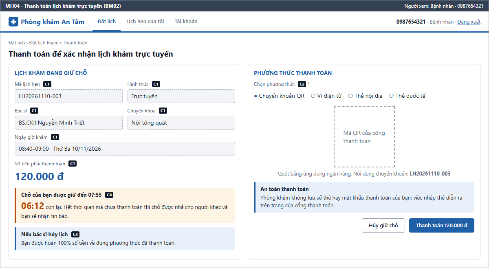

**Bảng 4 mức cải tiến**

| Mức | Bổ sung trên màn hình |
| :--- | :--- |
| Gốc | Mã lịch hẹn, Số tiền, Phương thức thanh toán |
| 1 | Hiện Bác sĩ, Chuyên khoa, Ngày giờ, Hình thức của lịch (chỉ đọc) để bệnh nhân đối chiếu trước khi trả tiền |
| 2 | Phương thức mặc định Chuyển khoản QR; nội dung chuyển khoản điền sẵn bằng mã lịch |
| 3 | Bốn phương thức trên cùng một màn hình, chuyển qua lại không mất thông tin |
| 4 | Đồng hồ đếm ngược thời gian giữ chỗ (`FR-16`); ghi rõ hoàn 100% nếu bác sĩ hủy (`FR-17`, `ASM-05`); ghi rõ phòng khám không lưu số thẻ (`NFR-07`) |

**Bảng thành phần**

| STT | Tên | Loại điều khiển | Nguồn dữ liệu | Giá trị mặc định | Ràng buộc kiểm tra |
| :-: | :--- | :--- | :--- | :--- | :--- |
| 1 | Mã lịch hẹn | Ô chỉ đọc | `lich_hen.ma_code_lich` | Lịch vừa tạo | — |
| 2 | Bác sĩ, Chuyên khoa | Ô chỉ đọc | `bac_si.ho_ten`, `hoc_vi`; `chuyen_khoa.ten_chuyen_khoa` | — | — |
| 3 | Ngày giờ khám, Hình thức | Ô chỉ đọc | `khung_gio_kham.ngay_kham`, `gio_bat_dau`, `gio_ket_thuc`; `lich_hen.hinh_thuc_kham` | — | — |
| 4 | Số tiền | Ô chỉ đọc (chữ lớn) | `lich_hen.don_gia_ap_dung` → `giao_dich_thanh_toan.so_tien` | — | > 0 |
| 5 | Thời gian giữ chỗ còn lại | Đồng hồ đếm ngược | `lich_hen.thoi_diem_het_han_giu` (từ `tham_so['THOI_GIAN_GIU_CHO_PHUT']`) | 10:00 | Về 0 → TB-04, khóa nút Thanh toán |
| 6 | Phương thức thanh toán | Radio | `giao_dich_thanh_toan.phuong_thuc` ∈ {Chuyển khoản QR, Ví điện tử, Thẻ nội địa, Thẻ quốc tế} | Chuyển khoản QR | Bắt buộc |
| 7 | Mã QR / chuyển sang cổng | Vùng hiển thị | Do cổng thanh toán cấp | — | Không có ô nhập số thẻ trên trang phòng khám |

**Kịch bản:**
1. Mở từ MH03 (hoặc MH05 với lịch đang `Chờ thanh toán`); đồng hồ chạy theo `thoi_diem_het_han_giu`.
2. Chọn phương thức, thanh toán trên cổng.
3. Cổng báo thành công: tạo `giao_dich_thanh_toan` ở `Thành công`, lịch sang `Đã xác nhận`, chuyển chỗ từ `so_cho_dang_giu` sang `so_cho_da_dat`, hiện TB-20 và gửi thông báo kèm số tiền (`FR-04`).
4. Cổng báo thất bại: hiện TB-05, cho chọn lại phương thức nếu còn thời gian giữ.
5. Hết thời gian giữ: lịch sang `Hết hạn giữ chỗ`, nhả chỗ, hiện TB-04 với nút Đặt lại (về MH03 giữ nguyên lựa chọn cũ).
6. Bấm Hủy giữ chỗ: hỏi xác nhận, nhả chỗ ngay.

#### MH05 · Tra cứu lịch hẹn

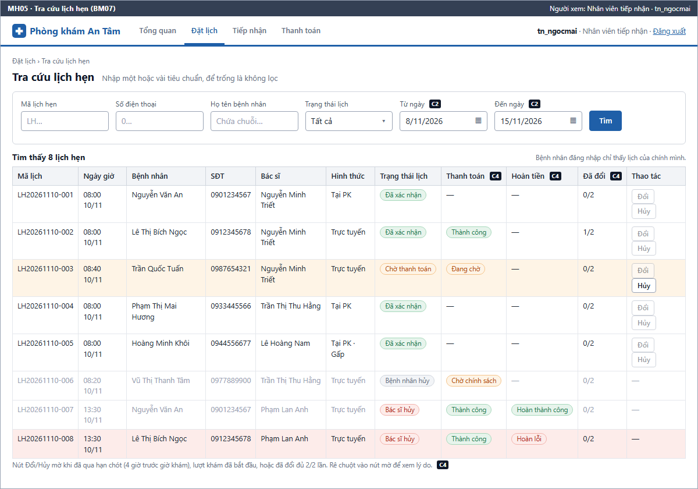

Đây là màn hình tra cứu theo slide 35–36: các tiêu chuẩn không bắt buộc nhập hết, kết quả hiện dạng bảng.

| STT | Tên | Loại điều khiển | Nguồn dữ liệu | Giá trị mặc định | Ràng buộc kiểm tra |
| :-: | :--- | :--- | :--- | :--- | :--- |
| 1 | Mã lịch hẹn | Ô nhập | `lich_hen.ma_code_lich` | Trống | Khớp chính xác |
| 2 | Số điện thoại | Ô nhập | `benh_nhan.so_dien_thoai` | Trống | [Sớm] chỉ nhận chữ số |
| 3 | Họ tên bệnh nhân | Ô nhập | `benh_nhan.ho_ten` | Trống | Tìm chứa chuỗi, không phân biệt hoa thường |
| 4 | Trạng thái lịch | Ô thả xuống | `lich_hen.trang_thai_lich` (5 giá trị + Tất cả) | Tất cả | — |
| 5 | Từ ngày – Đến ngày | 2 ô chọn ngày | `khung_gio_kham.ngay_kham` | Hôm nay − 2 ngày đến hôm nay + 5 ngày | [Sớm] Từ ngày ≤ Đến ngày |
| 6 | Lưới kết quả | Lưới chỉ đọc | `lich_hen.ma_code_lich`, `hinh_thuc_kham`, `loai_luot_kham`, `trang_thai_lich`, `so_lan_doi`; `khung_gio_kham.ngay_kham`, `gio_bat_dau`; `benh_nhan.ho_ten`, `so_dien_thoai`; `bac_si.ho_ten` | — | Bệnh nhân chỉ thấy lịch có `ma_benh_nhan` của mình (`FR-13`) |
| 7 | Thanh toán, Hoàn tiền | Cột nhãn màu | `giao_dich_thanh_toan.trang_thai`, `giao_dich_hoan_tien.trang_thai` | — | `—` khi lịch tại phòng khám |
| 8 | Đã đổi | Cột số | `lich_hen.so_lan_doi` / `tham_so['SO_LAN_DOI_TOI_DA']` | — | — |
| 9 | Đổi / Hủy | Nút trên từng dòng | — | — | Mờ khi: trước giờ khám ít hơn `HAN_CHOT_DOI_HUY_GIO`, `trang_thai_kham ≠ 'Chưa đến'`, lịch đã hủy, hoặc (riêng Đổi) `so_lan_doi ≥ SO_LAN_DOI_TOI_DA`; rê chuột hiện lý do |

**Kịch bản:**
1. Nhập một hoặc vài tiêu chuẩn rồi bấm Tìm (để trống tất cả là liệt kê theo khoảng ngày mặc định).
2. Lưới hiện các lịch khớp, mới nhất trước, kèm số dòng tìm thấy. Không có kết quả: hiện TB-21.
3. Bấm Đổi → mở MH06. Bấm Hủy → hỏi xác nhận TB-22.
4. Hủy thành công: lịch sang `Bệnh nhân hủy`, nhả chỗ, gửi thông báo. Lịch trực tuyến đã thanh toán thì giao dịch sang `Chờ chính sách`, không hoàn tự động (`FR-06`, `ASM-17`).

#### MH06 · Đổi lịch hẹn

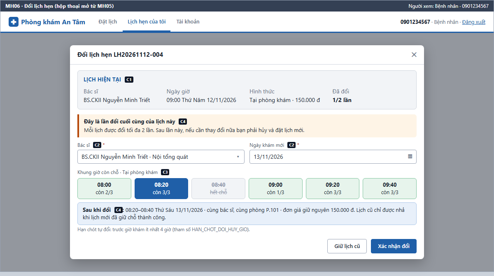

**Bảng 4 mức cải tiến**

| Mức | Bổ sung trên màn hình |
| :--- | :--- |
| Gốc | Mã lịch, Bác sĩ mới, Ngày mới, Giờ mới |
| 1 | Hiện thông tin lịch hiện tại (bác sĩ, ngày giờ, hình thức, đơn giá, số lần đã đổi) để so sánh |
| 2 | Bác sĩ mặc định là bác sĩ hiện tại; ngày mặc định là ngày của lịch hiện tại |
| 3 | Lưới khung giờ còn chỗ của cả ngày |
| 4 | Báo "đây là lần đổi cuối" khi `so_lan_doi = SO_LAN_DOI_TOI_DA − 1`; nhắc hạn chót đổi; dòng "Sau khi đổi" so sánh mới/cũ; ghi rõ lịch cũ chỉ nhả khi lịch mới đã giữ chỗ thành công (`FR-05`) |

| STT | Tên | Loại điều khiển | Nguồn dữ liệu | Giá trị mặc định | Ràng buộc kiểm tra |
| :-: | :--- | :--- | :--- | :--- | :--- |
| 1 | Lịch hiện tại | Khung chỉ đọc | `lich_hen.*`, `khung_gio_kham.*`, `bac_si.ho_ten` | Lịch đang chọn ở MH05 | — |
| 2 | Bác sĩ | Ô thả xuống | `bac_si` cùng chuyên khoa | Bác sĩ hiện tại | Bắt buộc |
| 3 | Ngày khám mới | Ô chọn ngày | `khung_gio_kham.ngay_kham` | Ngày của lịch hiện tại | [Sớm] không trước hôm nay |
| 4 | Lưới khung giờ | Lưới ô chọn | Như MH03 ô 15, lọc theo `lich_hen.hinh_thuc_kham` hiện tại | Chưa chọn | [Sớm] khóa ô hết chỗ · [Muộn] TB-03 nếu vừa hết |
| 5 | Cảnh báo lần đổi cuối | Khung cảnh báo | `lich_hen.so_lan_doi`, `tham_so['SO_LAN_DOI_TOI_DA']` | Ẩn | [Muộn] đã đổi đủ → TB-07 |
| 6 | Hạn chót | Dòng gợi ý | `tham_so['HAN_CHOT_DOI_HUY_GIO']` | — | [Muộn] quá hạn → TB-06 |

**Kịch bản:** (1) Mở từ nút Đổi ở MH05. (2) Chọn bác sĩ, ngày, khung giờ mới. (3) Bấm Xác nhận đổi. (4) Hệ thống giữ chỗ khung mới trước, rồi mới nhả khung cũ, tăng `so_lan_doi`, gửi thông báo `Xác nhận đổi lịch` (`FR-04`). (5) Khung mới vừa hết chỗ: báo TB-03, lịch cũ giữ nguyên.

Lịch trực tuyến đã thanh toán: cách xử lý khoản tiền khi đổi chưa được phòng khám chốt (`Q-12`). Khi có quyết định sẽ bổ sung dòng thông tin thanh toán vào hộp thoại này.

#### MH07 · Tra cứu bệnh nhân

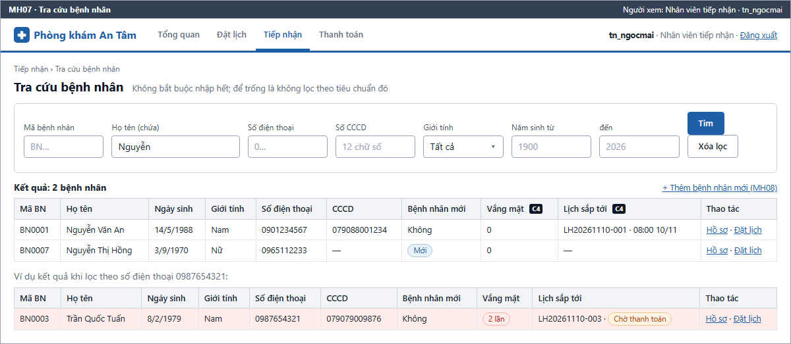

Màn hình tra cứu theo slide 35–36: tiêu chuẩn tra cứu không bắt buộc nhập hết, kết quả dạng bảng.

| STT | Tên | Loại điều khiển | Nguồn dữ liệu | Giá trị mặc định | Ràng buộc kiểm tra |
| :-: | :--- | :--- | :--- | :--- | :--- |
| 1 | Mã bệnh nhân | Ô nhập | `benh_nhan.ma_code_bn` | Trống | Khớp chính xác |
| 2 | Họ tên (chứa) | Ô nhập | `benh_nhan.ho_ten` | Trống | Tìm chứa chuỗi, bỏ qua dấu và hoa thường |
| 3 | Số điện thoại | Ô nhập | `benh_nhan.so_dien_thoai` | Trống | [Sớm] chỉ chữ số; tìm theo đầu số nếu chưa đủ 10 số |
| 4 | Số CCCD | Ô nhập | `benh_nhan.so_cccd` | Trống | [Sớm] chỉ chữ số, tối đa 12 |
| 5 | Giới tính | Ô thả xuống | `benh_nhan.gioi_tinh` | Tất cả | — |
| 6 | Năm sinh từ – đến | 2 ô nhập số | Năm của `benh_nhan.ngay_sinh` | Trống | [Sớm] số 4 chữ số, từ ≤ đến |
| 7 | Lưới kết quả | Lưới chỉ đọc | `benh_nhan.ma_code_bn`, `ho_ten`, `ngay_sinh`, `gioi_tinh`, `so_dien_thoai`, `so_cccd`, `la_benh_nhan_moi`, `so_lan_vang_mat` | — | Dòng có `so_lan_vang_mat ≥ SO_LAN_VANG_MAT_CANH_BAO` tô đỏ |
| 8 | Lịch sắp tới | Cột liên kết | `lich_hen` gần nhất chưa qua của bệnh nhân | — | — |
| 9 | Hồ sơ · Đặt lịch | Liên kết trên dòng | — | — | Mở MH08 hoặc MH03 với số điện thoại điền sẵn |

**Kịch bản:** (1) Nhập ít nhất một tiêu chuẩn, bấm Tìm. (2) Lưới hiện bệnh nhân khớp tất cả tiêu chuẩn đã nhập. Không có: TB-21 kèm liên kết "Thêm bệnh nhân mới". (3) Bấm Hồ sơ hoặc Đặt lịch trên dòng cần thao tác.

#### MH08 · Hồ sơ bệnh nhân

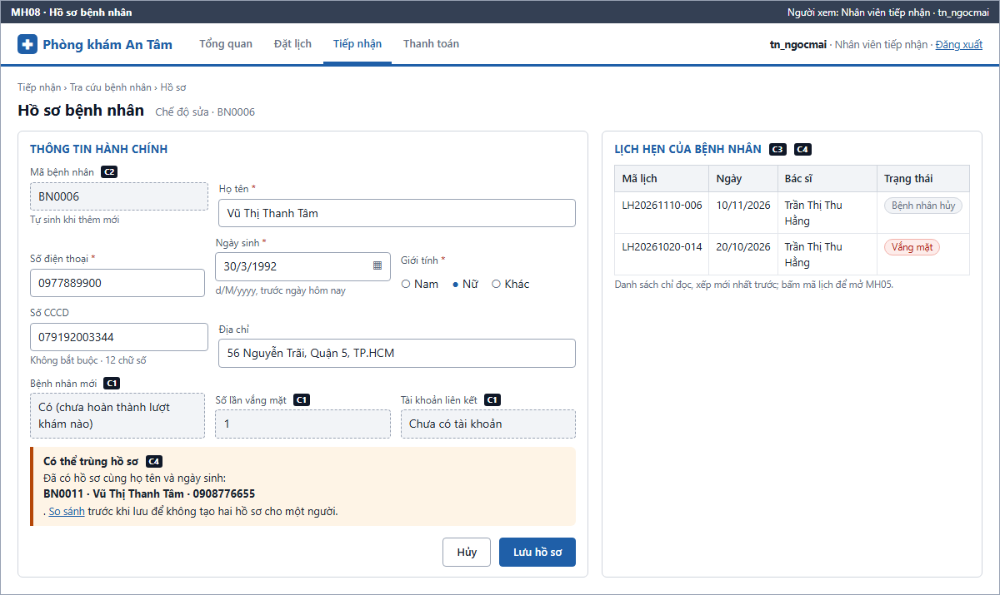

**Bảng 4 mức cải tiến**

| Mức | Bổ sung trên màn hình |
| :--- | :--- |
| Gốc | Họ tên, Số điện thoại, Ngày sinh, Giới tính, CCCD, Địa chỉ |
| 1 | Hiện Bệnh nhân mới, Số lần vắng mặt, Tài khoản liên kết (chỉ đọc) |
| 2 | Mã bệnh nhân tự sinh `BN0007`…; ngày sinh nhập theo `d/M/yyyy` |
| 3 | Lưới lịch hẹn của bệnh nhân ngay trên hồ sơ |
| 4 | Cảnh báo hồ sơ có thể trùng (cùng họ tên và ngày sinh, hoặc cùng CCCD) trước khi lưu, tránh một người có hai hồ sơ (`FR-07`) |

| STT | Tên | Loại điều khiển | Nguồn dữ liệu | Giá trị mặc định | Ràng buộc kiểm tra |
| :-: | :--- | :--- | :--- | :--- | :--- |
| 1 | Mã bệnh nhân | Ô chỉ đọc | `benh_nhan.ma_code_bn` | Tự sinh khi thêm | — |
| 2 | Họ tên | Ô nhập | `benh_nhan.ho_ten` | Trống | [Sớm] bắt buộc, ≤ 100 ký tự |
| 3 | Số điện thoại | Ô nhập | `benh_nhan.so_dien_thoai` | Trống | [Sớm] bắt buộc, 10 chữ số, bắt đầu `0` → TB-01 · [Muộn] không trùng hồ sơ khác (`UNIQUE`) → TB-09 |
| 4 | Ngày sinh | Ô chọn ngày | `benh_nhan.ngay_sinh` | Trống | [Sớm] bắt buộc, trước hôm nay → TB-02 |
| 5 | Giới tính | Radio | `benh_nhan.gioi_tinh` | Chưa chọn | [Sớm] bắt buộc, thuộc {Nam, Nữ, Khác} |
| 6 | Số CCCD | Ô nhập | `benh_nhan.so_cccd` | Trống | [Sớm] không bắt buộc; nếu nhập phải đủ 12 chữ số · [Muộn] không trùng (chỉ mục `UX_benh_nhan_cccd`) → TB-10 |
| 7 | Địa chỉ | Ô nhập | `benh_nhan.dia_chi` | Trống | ≤ 255 ký tự |
| 8 | Bệnh nhân mới · Số lần vắng mặt · Tài khoản | Ô chỉ đọc | `benh_nhan.la_benh_nhan_moi`, `so_lan_vang_mat`, `ma_tai_khoan` → `tai_khoan.ten_dang_nhap` | Mới: Có · 0 · Chưa có | Do hệ thống cập nhật, không sửa tay |
| 9 | Cảnh báo trùng hồ sơ | Khung cảnh báo | Tìm `benh_nhan` cùng `ho_ten` + `ngay_sinh` | Ẩn | Chỉ cảnh báo; người dùng tự quyết định |
| 10 | Lịch hẹn của bệnh nhân | Lưới chỉ đọc | `lich_hen.ma_code_lich`, `khung_gio_kham.ngay_kham`, `bac_si.ho_ten`, `lich_hen.trang_thai_lich`, `trang_thai_kham` | Mới nhất trước | — |

**Kịch bản:** (1) Mở từ MH07 (sửa) hoặc liên kết "Thêm bệnh nhân mới" (thêm). (2) Nhập, sửa thông tin; rời ô Họ tên/Ngày sinh thì hệ thống tìm hồ sơ có thể trùng. (3) Bấm Lưu, hệ thống kiểm tra muộn các ràng buộc `UNIQUE`. (4) Lưu thành công hiện TB-23 và quay về MH07.

#### MH09 · Tiếp nhận trong ngày

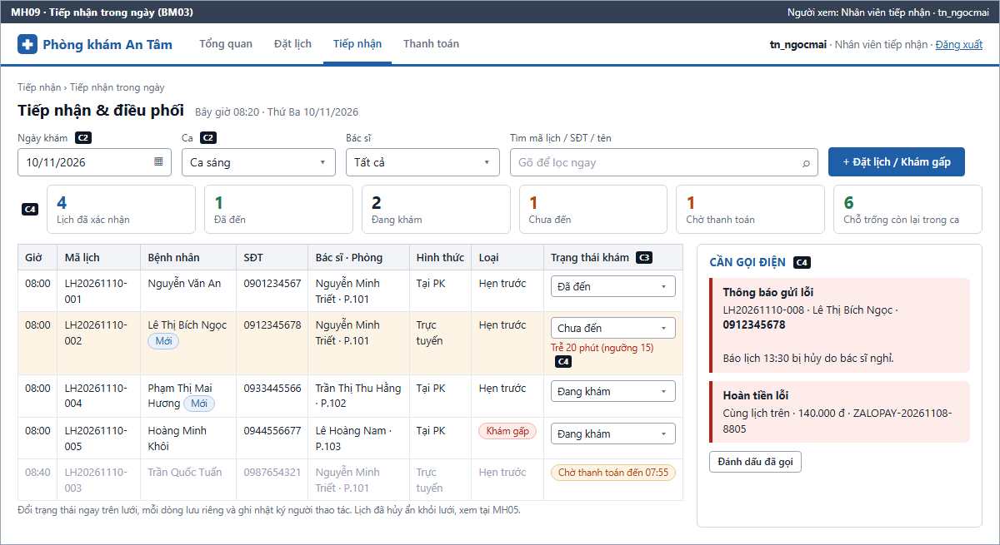

**Bảng 4 mức cải tiến**

| Mức | Bổ sung trên màn hình |
| :--- | :--- |
| Gốc | Mã lịch, Trạng thái khám |
| 1 | Mỗi dòng hiện giờ hẹn, họ tên, SĐT, bác sĩ, phòng, hình thức, loại lượt để nhân viên đối chiếu khi bệnh nhân tới quầy |
| 2 | Ngày = hôm nay; Ca = ca hiện tại theo giờ máy |
| 3 | Lưới cả ca, đổi trạng thái của nhiều bệnh nhân ngay trên lưới, không mở từng lịch |
| 4 | Thanh chỉ số đầu ca (đã xác nhận, đã đến, đang khám, chưa đến, chờ thanh toán, chỗ trống còn lại); cảnh báo đến trễ quá `NGUONG_TRE_HEN_TOI_DA_PHUT`; nhãn "Mới" cho bệnh nhân mới; khung "Cần gọi điện" cho thông báo gửi lỗi và hoàn lỗi (`SC-04` 4a) |

| STT | Tên | Loại điều khiển | Nguồn dữ liệu | Giá trị mặc định | Ràng buộc kiểm tra |
| :-: | :--- | :--- | :--- | :--- | :--- |
| 1 | Ngày khám | Ô chọn ngày | `khung_gio_kham.ngay_kham` | Hôm nay | — |
| 2 | Ca | Ô thả xuống | `khung_gio_kham.ca_lam_viec` | Ca hiện tại | — |
| 3 | Bác sĩ | Ô thả xuống | `bac_si.ma_bac_si` | Tất cả | — |
| 4 | Tìm mã lịch / SĐT / tên | Ô nhập lọc ngay | `lich_hen.ma_code_lich`, `benh_nhan.so_dien_thoai`, `benh_nhan.ho_ten` | Trống | Lọc khi gõ |
| 5 | Thanh chỉ số | 6 ô số | Đếm `lich_hen.trang_thai_kham`, `trang_thai_lich`; chỗ trống = Σ(`gioi_han_benh_nhan − so_cho_da_dat − so_cho_dang_giu`) của các khung `Khả dụng` | Tự tính | Chỉ đọc |
| 6 | Lưới lượt khám | Lưới | `khung_gio_kham.gio_bat_dau`, `lich_hen.ma_code_lich`, `benh_nhan.ho_ten`, `so_dien_thoai`, `la_benh_nhan_moi`, `bac_si.ho_ten`, `phong_kham_so`, `lich_hen.hinh_thuc_kham`, `loai_luot_kham` | Xếp theo giờ | Chỉ lịch `Đã xác nhận` và `Chờ thanh toán` |
| 7 | Trạng thái khám | Ô thả xuống trên dòng | `lich_hen.trang_thai_kham` | Giá trị hiện tại | [Sớm] chỉ cho chuyển hợp lệ: Chưa đến → Đã đến / Đến trễ / Vắng mặt; Đã đến → Đang khám → Hoàn thành · [Muộn] dòng đã bị người khác đổi → TB-24 |
| 8 | Cảnh báo trễ | Dòng gợi ý | `gio_bat_dau` + `tham_so['NGUONG_TRE_HEN_TOI_DA_PHUT']` so với giờ hiện tại | Ẩn | Hiện khi quá ngưỡng mà vẫn `Chưa đến` |
| 9 | Cần gọi điện | Danh sách | `thong_bao.trang_thai_gui = 'Gửi lỗi'`, `giao_dich_hoan_tien.trang_thai = 'Hoàn lỗi'`, `benh_nhan.so_dien_thoai` | Tự tải | — |

**Kịch bản:**
1. Mở đầu ca, lưới tải lịch của ngày và ca hiện tại.
2. Bệnh nhân tới quầy: gõ SĐT hoặc mã lịch vào ô tìm, chọn `Đã đến` (hoặc `Đến trễ`) ở cột trạng thái. Hệ thống lưu ngay dòng đó, ghi `nhat_ky_he_thong` (`FR-10`).
3. Hết ca mà bệnh nhân không tới: chọn `Vắng mặt`; hệ thống tăng `benh_nhan.so_lan_vang_mat`.
4. Bệnh nhân khám gấp hoặc gọi đặt lịch: bấm "+ Đặt lịch / Khám gấp" → MH03.
5. Gọi điện cho bệnh nhân trong khung "Cần gọi điện" rồi bấm "Đánh dấu đã gọi".

#### MH10 · Danh sách khám theo ca

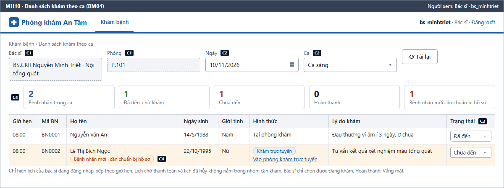

**Bảng 4 mức cải tiến**

| Mức | Bổ sung trên màn hình |
| :--- | :--- |
| Gốc | Ngày, Ca, danh sách bệnh nhân |
| 1 | Hiện tên bác sĩ, chuyên khoa, phòng của tài khoản đang đăng nhập (chỉ đọc) |
| 2 | Ngày = hôm nay, Ca = ca hiện tại |
| 3 | Lưới bệnh nhân cả ca xếp theo giờ hẹn, cập nhật trạng thái ngay trên lưới |
| 4 | Nhãn "Bệnh nhân mới · cần chuẩn bị hồ sơ" (`FR-09`); nhãn "Khám trực tuyến" kèm liên kết vào phòng khám; thanh chỉ số còn bao nhiêu bệnh nhân chờ |

| STT | Tên | Loại điều khiển | Nguồn dữ liệu | Giá trị mặc định | Ràng buộc kiểm tra |
| :-: | :--- | :--- | :--- | :--- | :--- |
| 1 | Bác sĩ, Phòng | Ô chỉ đọc | `bac_si.hoc_vi`, `ho_ten`, `phong_kham_so`, `chuyen_khoa.ten_chuyen_khoa` theo `tai_khoan` đang đăng nhập | — | Bác sĩ chỉ xem lịch của mình (`FR-13`) |
| 2 | Ngày · Ca | Ô chọn ngày · Ô thả xuống | `khung_gio_kham.ngay_kham`, `ca_lam_viec` | Hôm nay · ca hiện tại | — |
| 3 | Thanh chỉ số | 5 ô số | Đếm theo `lich_hen.trang_thai_kham`, `benh_nhan.la_benh_nhan_moi` | Tự tính | — |
| 4 | Lưới bệnh nhân | Lưới | `khung_gio_kham.gio_bat_dau`, `benh_nhan.ma_code_bn`, `ho_ten`, `ngay_sinh`, `gioi_tinh`, `lich_hen.hinh_thuc_kham`, `ly_do_kham` | Xếp theo giờ hẹn | Chỉ lịch `Đã xác nhận`; lịch hủy và chờ thanh toán không hiện (`FR-09`) |
| 5 | Nhãn bệnh nhân mới | Nhãn | `benh_nhan.la_benh_nhan_moi = 1` | — | — |
| 6 | Vào phòng khám trực tuyến | Liên kết | `lich_hen.lien_ket_kham_truc_tuyen` | — | Chỉ hiện với lịch Trực tuyến |
| 7 | Trạng thái | Ô thả xuống | `lich_hen.trang_thai_kham` | Giá trị hiện tại | Bác sĩ chỉ chọn Đang khám, Hoàn thành, Vắng mặt |

**Kịch bản:** (1) Bác sĩ đăng nhập, vào thẳng MH10 của ca hiện tại. (2) Xem trước bệnh nhân mới để chuẩn bị hồ sơ. (3) Gọi bệnh nhân: chọn `Đang khám`; khám xong chọn `Hoàn thành` (hệ thống đặt `la_benh_nhan_moi = 0` ở lần hoàn thành đầu tiên). (4) Bấm Tải lại để thấy lịch đặt, đổi, hủy mới sau đầu ca.

#### MH11 · Xử lý bác sĩ nghỉ đột xuất

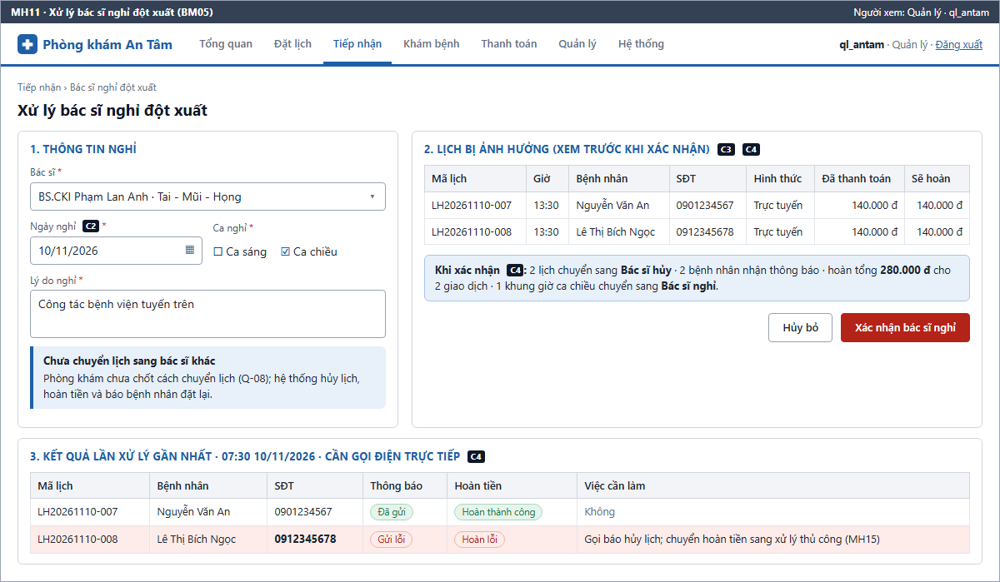

**Bảng 4 mức cải tiến**

| Mức | Bổ sung trên màn hình |
| :--- | :--- |
| Gốc | Bác sĩ, Ngày nghỉ, Ca nghỉ, Lý do |
| 1 | Hiện chuyên khoa của bác sĩ trong ô chọn |
| 2 | Ngày nghỉ = hôm nay; bác sĩ chọn từ danh sách thả xuống |
| 3 | Lưới tất cả lịch bị ảnh hưởng của ca đã chọn, xử lý một lần cho cả ca |
| 4 | Xem trước số lịch sẽ hủy, số bệnh nhân được báo, tổng tiền hoàn trước khi xác nhận; bảng kết quả chỉ ra bệnh nhân gửi thông báo lỗi hoặc hoàn lỗi cần gọi điện (`SC-04` 3a-1, 4a) |

| STT | Tên | Loại điều khiển | Nguồn dữ liệu | Giá trị mặc định | Ràng buộc kiểm tra |
| :-: | :--- | :--- | :--- | :--- | :--- |
| 1 | Bác sĩ | Ô thả xuống | `bac_si.ma_bac_si`, `hoc_vi`, `ho_ten` + `chuyen_khoa.ten_chuyen_khoa` → `khung_gio_kham.ma_bac_si` | Chưa chọn | [Sớm] bắt buộc |
| 2 | Ngày nghỉ | Ô chọn ngày | `khung_gio_kham.ngay_kham` | Hôm nay | [Sớm] không trước hôm nay |
| 3 | Ca nghỉ | Ô đánh dấu (chọn 1 hoặc cả 2) | `khung_gio_kham.ca_lam_viec` | Ca hiện tại | [Sớm] chọn ít nhất 1 ca |
| 4 | Lý do nghỉ | Ô văn bản | `khung_gio_kham.ly_do_khoa` | Trống | [Sớm] bắt buộc, ≤ 255 ký tự |
| 5 | Lưới lịch bị ảnh hưởng | Lưới chỉ đọc | `lich_hen.ma_code_lich`, `khung_gio_kham.gio_bat_dau`, `benh_nhan.ho_ten`, `so_dien_thoai`, `lich_hen.hinh_thuc_kham`, `giao_dich_thanh_toan.so_tien` | Tải khi chọn đủ 1–3 | Lịch `Đã xác nhận` và `Chờ thanh toán` của các khung đã chọn |
| 6 | Tóm tắt khi xác nhận | Khung phản hồi | Đếm từ lưới; tổng `so_tien` của giao dịch `Thành công` | — | — |
| 7 | Kết quả lần xử lý gần nhất | Lưới | `thong_bao.trang_thai_gui`, `giao_dich_hoan_tien.trang_thai`, `benh_nhan.so_dien_thoai` | Tự tải | Dòng `Gửi lỗi` hoặc `Hoàn lỗi` tô đỏ |

**Kịch bản:**
1. Chọn bác sĩ, ngày, ca, nhập lý do. Lưới xem trước tự tải.
2. Bấm "Xác nhận bác sĩ nghỉ" (nút đỏ); hệ thống hỏi lại bằng TB-25 kèm số lịch và tổng tiền.
3. Đồng ý: các khung sang `Bác sĩ nghỉ`, các lịch sang `Bác sĩ hủy`, tạo một `giao_dich_hoan_tien` cho mỗi giao dịch `Thành công` (`UNIQUE ma_giao_dich_goc` chống hoàn hai lần), gửi thông báo `Bác sĩ hủy & Hoàn tiền` (`FR-11`, `FR-17`, `FR-18`).
4. Bảng kết quả liệt kê dòng lỗi; nhân viên gọi điện cho bệnh nhân, mở MH15 để xử lý hoàn lỗi.
5. Không có lịch nào bị ảnh hưởng: TB-26; vẫn khóa khung giờ.

Chuyển lịch sang bác sĩ khác cùng chuyên khoa chưa có trên màn hình vì phòng khám chưa chốt (`Q-08`).

#### MH12 · Lịch làm việc bác sĩ

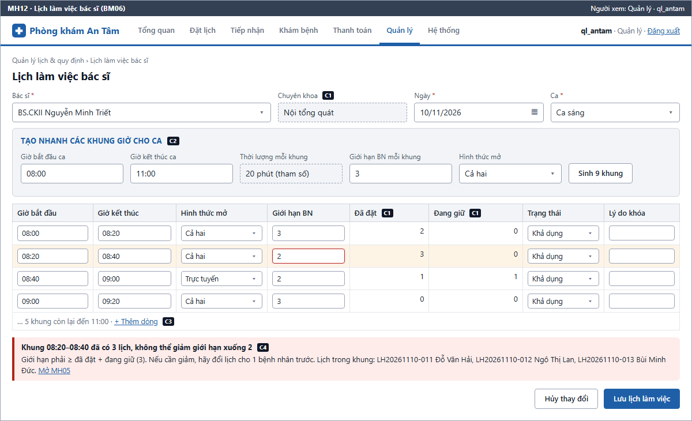

**Bảng 4 mức cải tiến**

| Mức | Bổ sung trên màn hình |
| :--- | :--- |
| Gốc | Bác sĩ, Ngày, Ca, Giờ bắt đầu, Giờ kết thúc, Hình thức mở, Giới hạn bệnh nhân |
| 1 | Hiện chuyên khoa của bác sĩ; hiện số Đã đặt, Đang giữ của từng khung (chỉ đọc) |
| 2 | Thời lượng khung lấy từ `THOI_LUONG_KHUNG_GIO_PHUT`; giới hạn mặc định từ `SO_BN_TOI_DA_MOI_KHUNG`; hình thức mặc định Cả hai |
| 3 | Sinh tự động tất cả khung của ca (08:00–11:00 → 9 khung) và sửa nhiều khung trên một lưới |
| 4 | Khi sửa hoặc khóa khung đã có lịch: cảnh báo kèm danh sách lịch bị ảnh hưởng trước khi áp dụng (`FR-12`); chặn giới hạn nhỏ hơn số chỗ đã dùng |

| STT | Tên | Loại điều khiển | Nguồn dữ liệu | Giá trị mặc định | Ràng buộc kiểm tra |
| :-: | :--- | :--- | :--- | :--- | :--- |
| 1 | Bác sĩ | Ô thả xuống | `khung_gio_kham.ma_bac_si` | Chưa chọn | [Sớm] bắt buộc |
| 2 | Chuyên khoa | Ô chỉ đọc | `bac_si.ma_chuyen_khoa` → `chuyen_khoa.ten_chuyen_khoa` | Theo bác sĩ | — |
| 3 | Ngày · Ca | Ô chọn ngày · Ô thả xuống | `khung_gio_kham.ngay_kham`, `ca_lam_viec` | Ngày mai · Ca sáng | [Sớm] bắt buộc |
| 4 | Giờ bắt đầu / kết thúc ca | Ô nhập `HH:mm` | Dùng để sinh khung | 08:00 / 11:00 (sáng), 13:30 / 16:30 (chiều) | [Sớm] kết thúc > bắt đầu |
| 5 | Thời lượng mỗi khung | Ô chỉ đọc | `tham_so['THOI_LUONG_KHUNG_GIO_PHUT']` | 20 phút | Đổi ở MH14 |
| 6 | Giới hạn BN mỗi khung | Ô nhập số | → `khung_gio_kham.gioi_han_benh_nhan` | `tham_so['SO_BN_TOI_DA_MOI_KHUNG']` = 3 | [Sớm] số nguyên > 0 |
| 7 | Hình thức mở | Ô thả xuống | → `khung_gio_kham.hinh_thuc_mo` | Cả hai | Thuộc {Tại phòng khám, Trực tuyến, Cả hai} |
| 8 | Lưới khung giờ | Lưới sửa được | `khung_gio_kham.gio_bat_dau`, `gio_ket_thuc`, `hinh_thuc_mo`, `gioi_han_benh_nhan`, `so_cho_da_dat`, `so_cho_dang_giu`, `trang_thai_khung`, `ly_do_khoa` | Các khung đã có | [Sớm] `gio_ket_thuc > gio_bat_dau`; `gioi_han_benh_nhan ≥ so_cho_da_dat + so_cho_dang_giu` → TB-11 · [Muộn] trùng giờ bắt đầu của cùng bác sĩ, cùng ngày → TB-12; khóa hoặc đổi hình thức khung đã có lịch → TB-13 |

**Kịch bản:** (1) Chọn bác sĩ, ngày, ca; lưới hiện các khung đã có. (2) Ca chưa có khung: nhập giờ ca, bấm "Sinh N khung". (3) Sửa trên lưới; vi phạm hiện ngay dưới ô. (4) Bấm Lưu: nếu có khung đã có lịch bị khóa hoặc đổi hình thức, hiện TB-13 kèm danh sách lịch; người dùng xác nhận mới áp dụng. (5) Các khung mới xuất hiện ngay ở MH03 (`FR-02`).

#### MH13 · Danh mục chuyên khoa

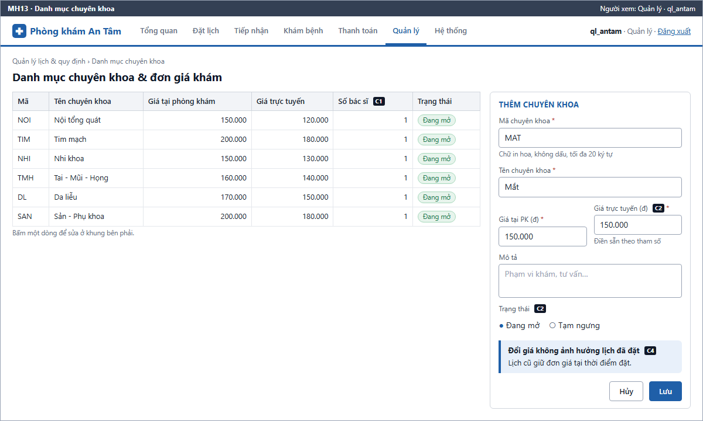

**Bảng 4 mức cải tiến**

| Mức | Bổ sung trên màn hình |
| :--- | :--- |
| Gốc | Mã khoa, Tên chuyên khoa, Giá tại phòng khám, Giá trực tuyến |
| 1 | Hiện số bác sĩ đang thuộc mỗi chuyên khoa (chỉ đọc) |
| 2 | Giá trực tuyến điền sẵn theo `DON_GIA_KHAM_TRUC_TUYEN_MAC_DINH`; trạng thái mặc định Đang mở |
| 3 | Toàn bộ danh mục trên một lưới, sửa dòng nào mở dòng đó ở khung bên phải |
| 4 | Ghi rõ đổi giá không ảnh hưởng lịch đã đặt (vì `lich_hen.don_gia_ap_dung` lưu cứng); cảnh báo khi tạm ngưng chuyên khoa còn bác sĩ và lịch sắp tới |

| STT | Tên | Loại điều khiển | Nguồn dữ liệu | Giá trị mặc định | Ràng buộc kiểm tra |
| :-: | :--- | :--- | :--- | :--- | :--- |
| 1 | Lưới chuyên khoa | Lưới chỉ đọc, bấm để sửa | `chuyen_khoa.*` + đếm `bac_si` theo `ma_chuyen_khoa` | — | — |
| 2 | Mã chuyên khoa | Ô nhập | `chuyen_khoa.ma_code_khoa` | Trống | [Sớm] bắt buộc, in hoa không dấu, ≤ 20 ký tự · [Muộn] không trùng → TB-14 |
| 3 | Tên chuyên khoa | Ô nhập | `chuyen_khoa.ten_chuyen_khoa` | Trống | [Sớm] bắt buộc, ≤ 100 ký tự · [Muộn] không trùng → TB-14 |
| 4 | Giá tại phòng khám | Ô nhập số tiền | `chuyen_khoa.don_gia_kham_tai_cho` | Trống | [Sớm] số nguyên ≥ 0 |
| 5 | Giá trực tuyến | Ô nhập số tiền | `chuyen_khoa.don_gia_kham_truc_tuyen` | `tham_so['DON_GIA_KHAM_TRUC_TUYEN_MAC_DINH']` = 150.000 | [Sớm] số nguyên > 0 |
| 6 | Mô tả | Ô văn bản | `chuyen_khoa.mo_ta` | Trống | ≤ 255 ký tự |
| 7 | Trạng thái | Radio | `chuyen_khoa.trang_thai_hoat_dong` | Đang mở | Chuyển sang Tạm ngưng khi còn lịch sắp tới → TB-15 |

**Kịch bản:** (1) Chọn một dòng để sửa hoặc dùng khung Thêm. (2) Nhập, bấm Lưu; kiểm tra muộn mã và tên trùng. (3) Lưu xong, MH03 dùng giá mới cho lịch đặt sau thời điểm này.

#### MH14 · Tham số quy định

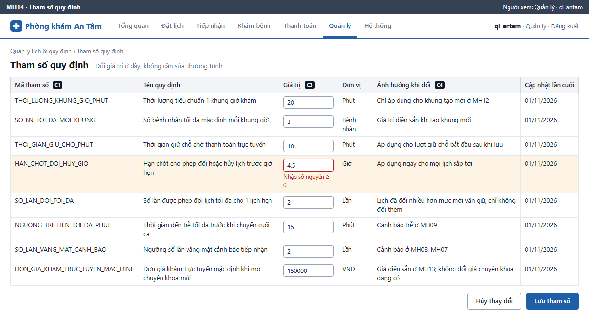

**Bảng 4 mức cải tiến**

| Mức | Bổ sung trên màn hình |
| :--- | :--- |
| Gốc | Mã tham số, Giá trị |
| 1 | Hiện Tên quy định, Đơn vị, Ngày cập nhật lần cuối (chỉ đọc) |
| 2 | Lưới mở ra với giá trị đang áp dụng điền sẵn |
| 3 | Sửa cả 8 tham số trên một lưới, lưu một lần |
| 4 | Cột "Ảnh hưởng khi đổi" nói rõ thay đổi áp dụng cho đâu và từ lúc nào, để Quản lý không đổi nhầm quy định đang chạy |

| STT | Tên | Loại điều khiển | Nguồn dữ liệu | Giá trị mặc định | Ràng buộc kiểm tra |
| :-: | :--- | :--- | :--- | :--- | :--- |
| 1 | Mã tham số | Ô chỉ đọc | `tham_so.ma_tham_so` | — | Không thêm, xóa tham số từ giao diện |
| 2 | Tên quy định · Đơn vị | Ô chỉ đọc | `tham_so.ten_tham_so`, `don_vi_tinh` | — | — |
| 3 | Giá trị | Ô nhập số trên lưới | `tham_so.gia_tri` | Giá trị hiện tại | [Sớm] số nguyên ≥ 0 → TB-16; `THOI_LUONG_KHUNG_GIO_PHUT`, `SO_BN_TOI_DA_MOI_KHUNG`, `THOI_GIAN_GIU_CHO_PHUT`, `DON_GIA_KHAM_TRUC_TUYEN_MAC_DINH` phải > 0 |
| 4 | Ảnh hưởng khi đổi | Ô chỉ đọc | Dựa trên `tham_so.mo_ta_quy_dinh` | — | — |
| 5 | Cập nhật lần cuối | Ô chỉ đọc | `tham_so.ngay_cap_nhat` | — | Tự cập nhật khi lưu |

**Kịch bản:** (1) Sửa giá trị trên lưới, ô sai hiện lỗi ngay. (2) Bấm Lưu tham số, hệ thống hỏi xác nhận TB-27 liệt kê các tham số đã đổi (cũ → mới). (3) Đồng ý: lưu, cập nhật `ngay_cap_nhat`, hiện TB-23.

#### MH15 · Giao dịch thanh toán & hoàn tiền

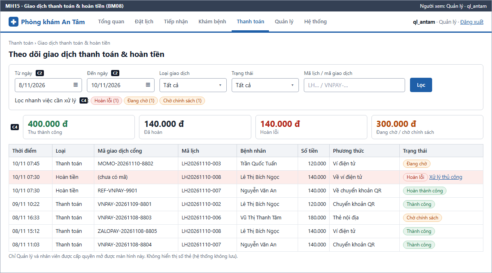

| STT | Tên | Loại điều khiển | Nguồn dữ liệu | Giá trị mặc định | Ràng buộc kiểm tra |
| :-: | :--- | :--- | :--- | :--- | :--- |
| 1 | Từ ngày – Đến ngày | 2 ô chọn ngày | `giao_dich_thanh_toan.thoi_diem_thanh_toan`, `giao_dich_hoan_tien.thoi_diem_yeu_cau` | 2 ngày trước đến hôm nay | [Sớm] Từ ≤ Đến |
| 2 | Loại giao dịch | Ô thả xuống | Thanh toán / Hoàn tiền / Tất cả | Tất cả | — |
| 3 | Trạng thái | Ô thả xuống | `giao_dich_thanh_toan.trang_thai` ∪ `giao_dich_hoan_tien.trang_thai` | Tất cả | — |
| 4 | Mã lịch / mã giao dịch | Ô nhập | `lich_hen.ma_code_lich`, `giao_dich_thanh_toan.ma_gd_cong_tt`, `giao_dich_hoan_tien.ma_gd_hoan_cong_tt` | Trống | — |
| 5 | Lọc nhanh việc cần xử lý | Nút nhãn có số đếm | Đếm `Hoàn lỗi`, `Đang chờ`, `Chờ chính sách` | — | Bấm để lọc ngay (`FR-19`) |
| 6 | Thanh tổng tiền | 4 ô số | Tổng `so_tien` theo trạng thái; tổng `so_tien_hoan` | Tự tính theo bộ lọc | — |
| 7 | Lưới giao dịch | Lưới chỉ đọc | `thoi_diem_*`, loại, `ma_gd_cong_tt` / `ma_gd_hoan_cong_tt`, `lich_hen.ma_code_lich`, `benh_nhan.ho_ten`, `so_tien` / `so_tien_hoan`, `phuong_thuc`, `trang_thai` | Mới nhất trước | Không có cột số thẻ (`NFR-07`); vai không có quyền → MH20 |

**Kịch bản:** (1) Mở màn hình, mặc định thấy giao dịch 3 ngày gần nhất. (2) Bấm nhãn "Hoàn lỗi" để lọc các giao dịch cần xử lý thủ công. (3) Bấm "Xử lý thủ công" trên dòng để ghi nhận cách xử lý (phần xử lý thuộc Thiết kế xử lý).

#### MH16 · Nhật ký hệ thống

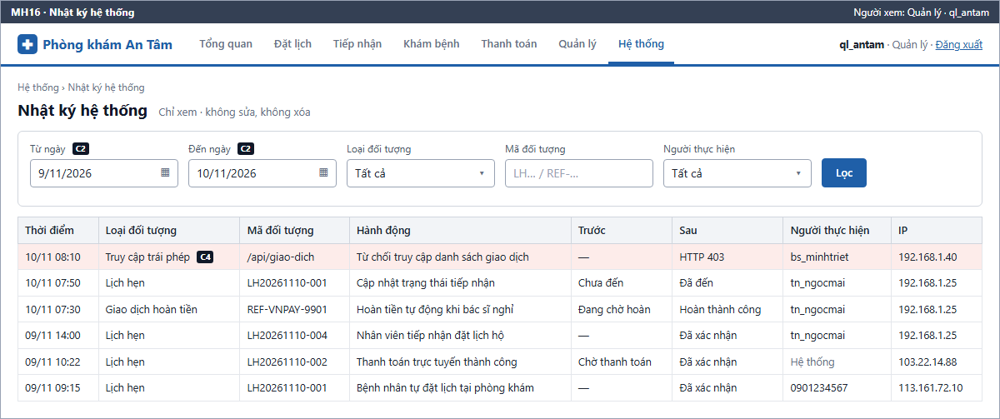

| STT | Tên | Loại điều khiển | Nguồn dữ liệu | Giá trị mặc định | Ràng buộc kiểm tra |
| :-: | :--- | :--- | :--- | :--- | :--- |
| 1 | Từ ngày – Đến ngày | 2 ô chọn ngày | `nhat_ky_he_thong.thoi_diem` | Hôm qua – hôm nay | [Sớm] Từ ≤ Đến |
| 2 | Loại đối tượng | Ô thả xuống | `nhat_ky_he_thong.loai_doi_tuong` (5 giá trị + Tất cả) | Tất cả | — |
| 3 | Mã đối tượng | Ô nhập | `nhat_ky_he_thong.ma_doi_tuong` | Trống | — |
| 4 | Người thực hiện | Ô thả xuống | `nhat_ky_he_thong.nguoi_thuc_hien` → `tai_khoan.ten_dang_nhap`; "Hệ thống" khi `NULL` | Tất cả | — |
| 5 | Lưới nhật ký | Lưới chỉ đọc | `thoi_diem`, `loai_doi_tuong`, `ma_doi_tuong`, `hanh_dong`, `trang_thai_truoc`, `trang_thai_sau`, `nguoi_thuc_hien`, `dia_chi_ip` | Mới nhất trước | Không có nút sửa, xóa (`NFR-09`); dòng `Truy cập trái phép` tô đỏ |

**Kịch bản:** Chọn bộ lọc, bấm Lọc, đọc kết quả. Màn hình không có thao tác thay đổi dữ liệu.

#### MH17 · Tài khoản & phân quyền

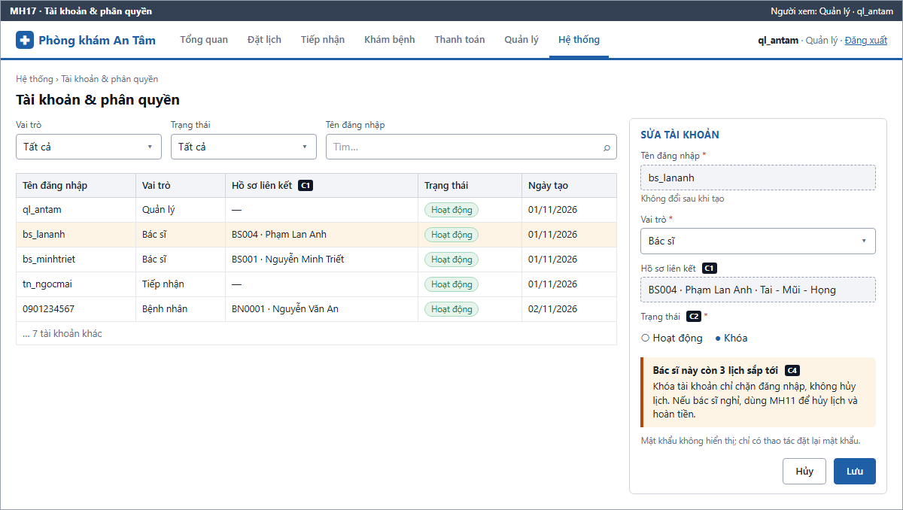

**Bảng 4 mức cải tiến**

| Mức | Bổ sung trên màn hình |
| :--- | :--- |
| Gốc | Tên đăng nhập, Vai trò, Trạng thái |
| 1 | Hiện hồ sơ liên kết (mã và tên bác sĩ hoặc bệnh nhân) của tài khoản |
| 2 | Trạng thái mặc định Hoạt động; tên đăng nhập không sửa được sau khi tạo |
| 3 | Lưới tất cả tài khoản có bộ lọc theo vai và trạng thái |
| 4 | Khi khóa tài khoản bác sĩ còn lịch sắp tới: cảnh báo khóa không hủy lịch và chỉ sang MH11 |

| STT | Tên | Loại điều khiển | Nguồn dữ liệu | Giá trị mặc định | Ràng buộc kiểm tra |
| :-: | :--- | :--- | :--- | :--- | :--- |
| 1 | Lọc vai trò · trạng thái · tên | Ô thả xuống, ô nhập | `tai_khoan.vai_tro`, `trang_thai`, `ten_dang_nhap` | Tất cả | — |
| 2 | Lưới tài khoản | Lưới chỉ đọc | `tai_khoan.*` (trừ `mat_khau_bam`) + `bac_si.ma_code_bs` / `benh_nhan.ma_code_bn` liên kết | — | — |
| 3 | Tên đăng nhập | Ô nhập (thêm) / chỉ đọc (sửa) | `tai_khoan.ten_dang_nhap` | Trống | [Sớm] bắt buộc, ≤ 50 ký tự · [Muộn] không trùng → TB-14 |
| 4 | Vai trò | Ô thả xuống | `tai_khoan.vai_tro` ∈ {quan_ly, bac_si, tiep_nhan, benh_nhan} | Tiếp nhận | Bắt buộc |
| 5 | Hồ sơ liên kết | Ô chỉ đọc | `bac_si.ma_tai_khoan` / `benh_nhan.ma_tai_khoan` | — | — |
| 6 | Trạng thái | Radio | `tai_khoan.trang_thai` | Hoạt động | Khóa tài khoản bác sĩ còn lịch → cảnh báo TB-28 |

**Kịch bản:** (1) Lọc và chọn tài khoản. (2) Đổi vai hoặc trạng thái, bấm Lưu. (3) Mật khẩu không bao giờ hiện; đặt lại mật khẩu là một nút xử lý riêng (thuộc Thiết kế xử lý).

#### MH18, MH19, MH20 · Trang lỗi

Xem mục 7.2.

---

### BƯỚC 6: ĐỐI CHIẾU Ô NHẬP VỚI THIẾT KẾ DỮ LIỆU

Mọi ô nhập trên 20 màn hình đều có cột Nguồn dữ liệu trỏ tới `bảng.field` trong bảng đặc tả ở Phần 1, và ràng buộc kiểm tra lấy đúng từ cột Ràng buộc ở Phần 1:

| Ràng buộc (Phần 1) | Kiểm tra trên giao diện | Màn hình |
| :--- | :--- | :--- |
| `benh_nhan.so_dien_thoai`: 10 ký tự, bắt đầu `0`, `UNIQUE` | [Sớm] định dạng · [Muộn] trùng | MH03, MH08 |
| `benh_nhan.ngay_sinh < ngày hiện tại` | [Sớm] ô chọn ngày khóa ngày tương lai | MH03, MH08 |
| `benh_nhan.so_cccd`: 12 chữ số, `UNIQUE` khi khác `NULL` | [Sớm] để trống được, nhập thì đủ 12 số · [Muộn] trùng | MH08 |
| `benh_nhan.gioi_tinh IN (Nam, Nữ, Khác)` | Radio đúng 3 giá trị | MH03, MH08 |
| `so_cho_da_dat + so_cho_dang_giu <= gioi_han_benh_nhan` | [Sớm] khóa khung hết chỗ · [Muộn] kiểm lại khi đặt | MH03, MH06, MH12 |
| `khung_gio_kham.hinh_thuc_mo` | Khung không mở hình thức đã chọn thì không chọn được | MH03, MH06 |
| `UNIQUE(ma_bac_si, ngay_kham, gio_bat_dau)`, `gio_ket_thuc > gio_bat_dau` | [Sớm] giờ · [Muộn] trùng khung | MH12 |
| `lich_hen.so_lan_doi` + `SO_LAN_DOI_TOI_DA`; `HAN_CHOT_DOI_HUY_GIO` | Nút Đổi/Hủy mờ sẵn · [Muộn] kiểm lại | MH05, MH06 |
| `lich_hen.thoi_diem_het_han_giu` + `THOI_GIAN_GIU_CHO_PHUT` | Đồng hồ đếm ngược, khóa thanh toán khi hết | MH04 |
| `giao_dich_thanh_toan.phuong_thuc` (4 giá trị); không lưu số thẻ | Radio 4 giá trị; không có ô nhập thẻ | MH04 |
| `giao_dich_hoan_tien.ma_giao_dich_goc UNIQUE` | Màn hình xem trước chỉ tạo một khoản hoàn cho mỗi giao dịch | MH11 |
| `lich_hen.trang_thai_kham` (6 giá trị) | Ô thả xuống chỉ cho chuyển trạng thái hợp lệ | MH09, MH10 |
| `chuyen_khoa.don_gia_* ≥ 0 / > 0`, `ma_code_khoa`, `ten_chuyen_khoa UNIQUE` | [Sớm] số tiền · [Muộn] trùng | MH13 |
| `tham_so.gia_tri ≥ 0` | [Sớm] số nguyên ≥ 0 | MH14 |
| `nhat_ky_he_thong` chỉ thêm | MH16 không có nút sửa, xóa | MH16 |

---

### BƯỚC 7: BỘ THÔNG BÁO VÀ TRANG LỖI

#### 7.1. Bộ thông báo

Mỗi thông báo theo quy tắc slide 18 (nhất quán, lịch sự, cô đọng, kèm gợi ý, ngôn ngữ đại chúng với bệnh nhân) và trả lời đủ 4 câu của bài Brajdic: **Ai gây ra** · **Chuyện gì và vì sao** · **Khi nào khắc phục** · **Người dùng làm gì tiếp**. Thông báo không hiện mã lỗi kỹ thuật cho bệnh nhân.

| Mã | Màn hình · tình huống | Loại · kiểm tra | Nội dung hiển thị | Ai · Vì sao · Khi nào · Làm gì tiếp |
| :-: | :--- | :--- | :--- | :--- |
| TB-01 | MH03, MH08 · số điện thoại sai định dạng | Lỗi · Sớm | **Số điện thoại chưa đúng.** Số điện thoại gồm 10 chữ số và bắt đầu bằng 0, ví dụ 0901234567. | Ai: người nhập gõ thiếu/thừa số<br>Vì sao: hệ thống dùng số này để nhận diện và gửi tin<br>Khi nào: sửa được ngay<br>Làm gì: sửa lại số trong ô |
| TB-02 | MH03, MH08 · ngày sinh không hợp lệ | Lỗi · Sớm | **Ngày sinh chưa hợp lệ.** Ngày sinh phải trước hôm nay, nhập theo dạng ngày/tháng/năm (ví dụ 14/5/1988). | Ai: người nhập<br>Vì sao: ngày ở tương lai hoặc sai định dạng<br>Khi nào: ngay<br>Làm gì: chọn lại ngày trên lịch |
| TB-03 | MH03, MH06 · khung giờ vừa hết chỗ khi bấm Đặt lịch | Lỗi · Muộn | **Khung 08:00 vừa có người đặt hết chỗ.** Bạn chưa bị trừ tiền và thông tin đã nhập vẫn được giữ. Vui lòng chọn khung khác còn chỗ bên dưới. | Ai: người khác đặt trước vài giây, không phải lỗi của bạn<br>Vì sao: khung chỉ nhận tối đa 3 bệnh nhân<br>Khi nào: ngay, lưới đã tải lại<br>Làm gì: chọn khung khác hoặc ngày khác |
| TB-04 | MH04 · hết thời gian giữ chỗ | Cảnh báo · Muộn | **Đã hết 10 phút giữ chỗ.** Lịch 08:40 ngày 10/11/2026 chưa được thanh toán nên chỗ đã được nhả cho người khác. Bạn chưa bị trừ tiền. | Ai: hết thời hạn do phòng khám quy định<br>Vì sao: giữ chỗ quá lâu làm người khác không đặt được<br>Khi nào: đặt lại được ngay nếu khung còn chỗ<br>Làm gì: bấm Đặt lại (giữ nguyên bác sĩ, ngày) |
| TB-05 | MH04 · cổng thanh toán báo thất bại | Lỗi · Muộn | **Thanh toán chưa thành công.** Ngân hàng hoặc ví chưa xác nhận giao dịch, nên lịch chưa được xác nhận và bạn chưa bị trừ tiền. Chỗ vẫn được giữ đến 07:55. | Ai: cổng thanh toán hoặc ngân hàng<br>Vì sao: giao dịch bị từ chối hoặc bị hủy<br>Khi nào: thử lại ngay trong thời gian giữ chỗ<br>Làm gì: thử lại hoặc chọn phương thức khác; nếu tài khoản đã bị trừ, gọi quầy tiếp nhận kèm mã lịch |
| TB-06 | MH05, MH06 · quá hạn chót đổi/hủy | Lỗi · Muộn | **Lịch này không còn tự đổi hoặc hủy được.** Phòng khám chỉ nhận đổi, hủy trước giờ khám ít nhất 4 giờ, để kịp xếp bệnh nhân khác. | Ai: quy định của phòng khám<br>Vì sao: còn chưa tới 4 giờ là đến giờ khám<br>Khi nào: không áp dụng cho lịch này<br>Làm gì: gọi quầy tiếp nhận để được hỗ trợ |
| TB-07 | MH06 · đã đổi đủ số lần | Lỗi · Muộn | **Lịch này đã được đổi 2 lần, là số lần tối đa.** Nếu cần đổi nữa, bạn có thể hủy lịch này và đặt lịch mới. | Ai: quy định của phòng khám<br>Vì sao: mỗi lịch chỉ được đổi tối đa 2 lần<br>Khi nào: không áp dụng cho lịch này<br>Làm gì: hủy rồi đặt lịch mới ở MH03 |
| TB-08 | MH03 · bệnh nhân vắng mặt nhiều lần | Cảnh báo · Sớm | **Bệnh nhân đã vắng mặt 2 lần.** Nên nhắc bệnh nhân gọi báo trước nếu không đến được. Vẫn có thể đặt lịch bình thường. | Ai: lịch sử của bệnh nhân<br>Vì sao: đạt ngưỡng cảnh báo của phòng khám<br>Khi nào: thông tin, không chặn<br>Làm gì: nhắc bệnh nhân, rồi tiếp tục đặt |
| TB-09 | MH08 · số điện thoại đã thuộc hồ sơ khác | Lỗi · Muộn | **Số 0912345678 đã có trong hồ sơ BN0002 · Lê Thị Bích Ngọc.** Mỗi số điện thoại chỉ gắn với một hồ sơ. | Ai: số đã được đăng ký trước<br>Vì sao: số điện thoại dùng để nhận diện bệnh nhân<br>Khi nào: ngay<br>Làm gì: mở hồ sơ BN0002 nếu đúng người, hoặc kiểm tra lại số |
| TB-10 | MH08 · CCCD đã thuộc hồ sơ khác | Lỗi · Muộn | **Số CCCD này đã có trong hồ sơ BN0001.** Có thể bệnh nhân đã có hồ sơ từ trước. | Ai: dữ liệu đã có<br>Vì sao: mỗi CCCD chỉ thuộc một người<br>Khi nào: ngay<br>Làm gì: mở hồ sơ BN0001 để kiểm tra, hoặc để trống ô CCCD |
| TB-11 | MH12 · giới hạn nhỏ hơn số chỗ đã dùng | Lỗi · Sớm | **Không thể giảm giới hạn khung 08:20 xuống 2.** Khung này đã có 3 lịch. Hãy đổi lịch cho bệnh nhân trước rồi mới giảm. | Ai: thao tác sửa của quản lý<br>Vì sao: giảm sẽ làm vượt giới hạn với lịch đã đặt<br>Khi nào: sau khi chuyển bớt lịch<br>Làm gì: mở danh sách lịch của khung |
| TB-12 | MH12 · trùng giờ bắt đầu | Lỗi · Muộn | **Bác sĩ Nguyễn Minh Triết đã có khung 08:00 ngày 10/11/2026.** Một bác sĩ không có hai khung cùng giờ bắt đầu trong một ngày. | Ai: dữ liệu trùng với khung đã có<br>Vì sao: tránh đặt hai lịch chồng nhau<br>Khi nào: ngay<br>Làm gì: sửa giờ hoặc xóa dòng trùng |
| TB-13 | MH12 · khóa/đổi hình thức khung đã có lịch | Xác nhận · Muộn | **Thay đổi này ảnh hưởng 3 lịch đã đặt.** Danh sách: LH20261110-011, -012, -013. Các lịch này không tự hủy; bạn cần báo cho bệnh nhân. Tiếp tục? | Ai: thao tác của quản lý<br>Vì sao: khung đang có bệnh nhân<br>Khi nào: áp dụng khi bấm Tiếp tục<br>Làm gì: Tiếp tục hoặc Quay lại |
| TB-14 | MH13, MH17 · mã hoặc tên trùng | Lỗi · Muộn | **Mã "NOI" đã được dùng cho chuyên khoa Nội tổng quát.** Vui lòng chọn mã khác. | Ai: dữ liệu đã có<br>Vì sao: mã và tên phải duy nhất<br>Khi nào: ngay<br>Làm gì: nhập mã khác |
| TB-15 | MH13 · tạm ngưng chuyên khoa còn lịch | Xác nhận · Muộn | **Chuyên khoa Nội tổng quát còn 1 bác sĩ và 5 lịch sắp tới.** Tạm ngưng chỉ chặn đặt lịch mới; các lịch đã đặt vẫn giữ. Tiếp tục? | Ai: thao tác của quản lý<br>Vì sao: còn lịch đang hiệu lực<br>Khi nào: khi bấm Tiếp tục<br>Làm gì: Tiếp tục hoặc Quay lại |
| TB-16 | MH14 · giá trị tham số không hợp lệ | Lỗi · Sớm | **Giá trị phải là số nguyên từ 0 trở lên.** Ví dụ: 4 (giờ). | Ai: người nhập<br>Vì sao: quy định tính bằng số nguyên<br>Khi nào: ngay<br>Làm gì: sửa giá trị |
| TB-17 | MH01 · sai tên hoặc mật khẩu | Lỗi · Muộn | **Chưa đăng nhập được.** Tên đăng nhập hoặc mật khẩu chưa đúng. Vui lòng kiểm tra lại (chú ý bộ gõ tiếng Việt và phím Caps Lock). | Ai: thông tin nhập chưa khớp<br>Vì sao: bảo vệ tài khoản<br>Khi nào: thử lại ngay<br>Làm gì: nhập lại hoặc bấm Quên mật khẩu |
| TB-18 | MH01 · tài khoản bị khóa | Lỗi · Muộn | **Tài khoản đang tạm khóa.** Vui lòng liên hệ Quản lý phòng khám để mở lại. | Ai: quản lý đã khóa tài khoản<br>Vì sao: tài khoản không còn được phép dùng<br>Khi nào: khi quản lý mở khóa<br>Làm gì: liên hệ quản lý |
| TB-19 | MH03 · đặt lịch tại phòng khám thành công | Thành công | **Đã đặt lịch LH20261110-009.** 08:00 Thứ Ba 10/11/2026 · BS.CKII Nguyễn Minh Triết · P.101. Tin nhắn xác nhận đã được gửi tới 0987654321. | Làm gì tiếp: muốn đổi, hủy thì vào "Lịch hẹn của tôi" trước giờ khám ít nhất 4 giờ |
| TB-20 | MH04 · thanh toán thành công | Thành công | **Đã thanh toán 120.000 đ, lịch LH20261110-003 đã được xác nhận.** Đường dẫn vào phòng khám trực tuyến sẽ được gửi kèm tin xác nhận. | Làm gì tiếp: mở đường dẫn đúng giờ khám |
| TB-21 | MH05, MH07 · không có kết quả | Thông tin | **Không tìm thấy kết quả phù hợp.** Thử bỏ bớt tiêu chuẩn hoặc kiểm tra lại số điện thoại, mã lịch. | Làm gì tiếp: sửa tiêu chuẩn; ở MH07 có liên kết Thêm bệnh nhân mới |
| TB-22 | MH05 · xác nhận hủy lịch | Xác nhận | **Hủy lịch LH20261110-003 lúc 08:40 ngày 10/11/2026?** Chỗ sẽ được nhả cho người khác. Lịch trực tuyến đã thanh toán: khoản tiền chuyển sang "chờ chính sách", chưa được hoàn tự động. | Làm gì tiếp: Hủy lịch hoặc Giữ lịch |
| TB-23 | MH08, MH14 · lưu thành công | Thành công | **Đã lưu thay đổi.** | — |
| TB-24 | MH09 · dòng đã bị người khác cập nhật | Cảnh báo · Muộn | **Lượt khám này vừa được Ngọc Mai cập nhật sang "Đang khám".** Màn hình đã tải lại trạng thái mới nhất. | Ai: người dùng khác cùng lúc<br>Vì sao: tránh ghi đè lẫn nhau<br>Khi nào: ngay<br>Làm gì: kiểm tra lại rồi thao tác tiếp |
| TB-25 | MH11 · xác nhận bác sĩ nghỉ | Xác nhận | **Xác nhận BS.CKI Phạm Lan Anh nghỉ ca chiều 10/11/2026?** 2 lịch sẽ bị hủy, 2 bệnh nhân nhận thông báo, hoàn 280.000 đ. Thao tác này không hoàn tác được. | Làm gì tiếp: Xác nhận hoặc Hủy bỏ |
| TB-26 | MH11 · không có lịch bị ảnh hưởng | Thông tin | **Ca này chưa có lịch nào.** Hệ thống chỉ khóa khung giờ, không cần báo bệnh nhân. | — |
| TB-27 | MH14 · xác nhận đổi tham số | Xác nhận | **Đổi 1 quy định:** Hạn chót đổi/hủy 4 → 6 giờ. Áp dụng ngay cho mọi lịch sắp tới. Tiếp tục? | Làm gì tiếp: Lưu hoặc Quay lại |
| TB-28 | MH17 · khóa tài khoản bác sĩ còn lịch | Cảnh báo | **Bác sĩ này còn 3 lịch sắp tới.** Khóa tài khoản chỉ chặn đăng nhập, không hủy lịch. Nếu bác sĩ nghỉ, dùng màn hình Bác sĩ nghỉ đột xuất. | Làm gì tiếp: Lưu hoặc mở MH11 |

**Ví dụ lỗi nhập liệu bắt buộc "đã đủ số bệnh nhân":** với hệ thống này, giới hạn tính theo từng khung giờ (`gioi_han_benh_nhan`), nên thông báo tương ứng là **TB-03**. Lỗi được chặn từ sớm (khung hết chỗ không bấm được), và chỉ hiện khi hai người cùng đặt chỗ cuối cùng một lúc.

#### 7.2. Trang lỗi

Ba trang lỗi dùng chung một bố cục: mã hoặc tên lỗi lớn, tiêu đề nói chuyện gì, đoạn giải thích vì sao và dữ liệu có an toàn không, nút đi tiếp, và **khung khẩn cấp có số điện thoại phòng khám** theo mục *Mitigate for emergency situations* của bài Brajdic. Vì là lĩnh vực y tế, khung khẩn cấp thêm số cấp cứu **115**.

Số hotline phòng khám chưa có trong thiết kế dữ liệu hay Mini-SRS, nên wireframe để `[số hotline phòng khám]`. Khi có số thật, nên lưu vào cấu hình hệ thống (không viết cứng) để mọi trang lỗi dùng chung.

**MH18 · Trang lỗi 404**

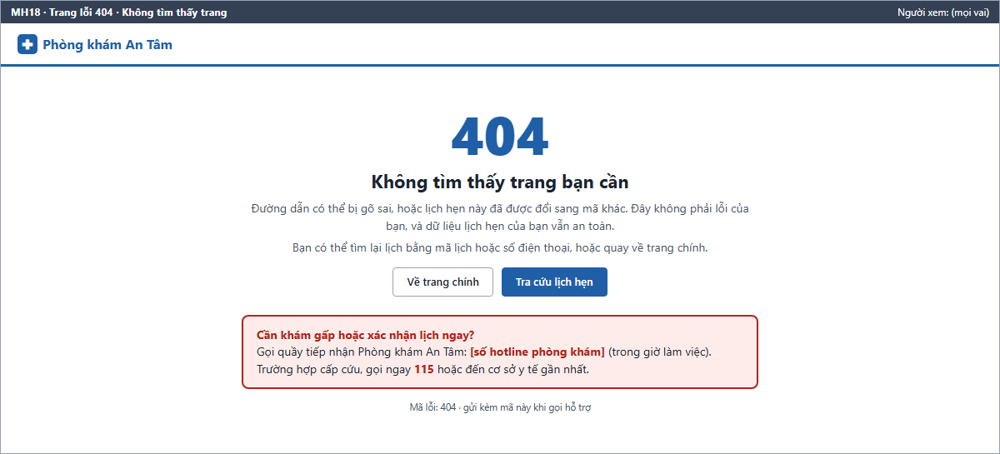

| Câu hỏi | Trả lời trên trang |
| :--- | :--- |
| Ai gây ra? | Đường dẫn gõ sai hoặc lịch đã đổi mã; nói rõ "không phải lỗi của bạn" |
| Chuyện gì, vì sao? | Không tìm thấy trang; dữ liệu lịch hẹn vẫn an toàn |
| Khi nào khắc phục? | Ngay, bằng cách tra cứu lại |
| Làm gì tiếp? | Nút Tra cứu lịch hẹn (chính), Về trang chính; gọi hotline nếu cần gấp, gọi 115 khi cấp cứu |

**MH19 · Trang bảo trì / mất kết nối**

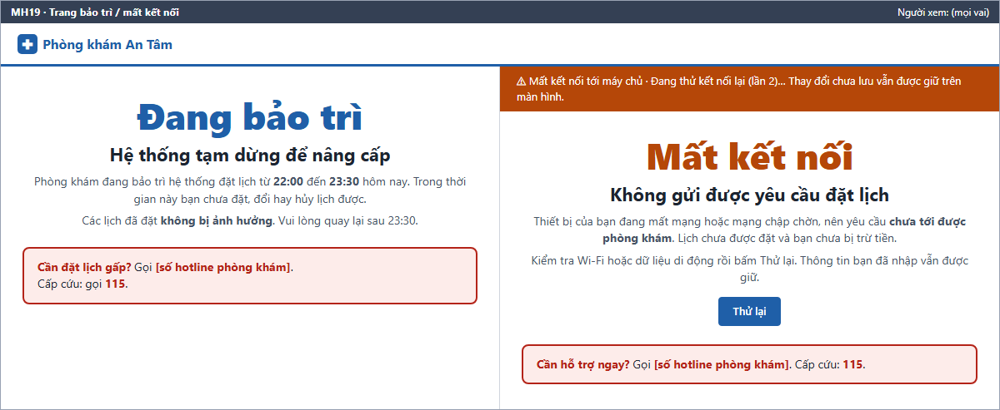

| Câu hỏi | Bảo trì (bên trái) | Mất kết nối (bên phải) |
| :--- | :--- | :--- |
| Ai gây ra? | Phòng khám chủ động bảo trì | Mạng của thiết bị người dùng |
| Chuyện gì, vì sao? | Tạm dừng để nâng cấp; lịch đã đặt không bị ảnh hưởng | Yêu cầu chưa tới được phòng khám; lịch chưa được đặt, chưa bị trừ tiền |
| Khi nào khắc phục? | Ghi rõ giờ kết thúc (23:30) | Tự thử kết nối lại; thanh cảnh báo cam báo lần thử |
| Làm gì tiếp? | Quay lại sau giờ kết thúc; gọi hotline nếu cần đặt gấp | Kiểm tra Wi-Fi, bấm Thử lại; dữ liệu đã nhập được giữ |

**MH20 · Trang không có quyền truy cập (403)**

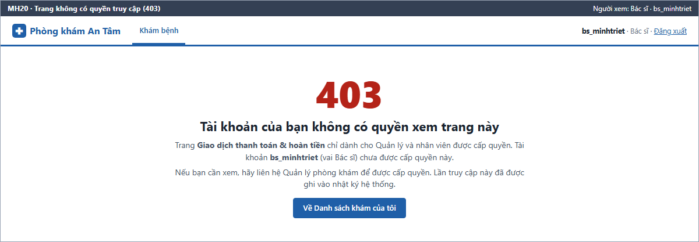

| Câu hỏi | Trả lời trên trang |
| :--- | :--- |
| Ai gây ra? | Tài khoản chưa được cấp quyền cho trang này (nêu tên tài khoản và vai) |
| Chuyện gì, vì sao? | Trang dành cho vai khác (`FR-13`); lần truy cập đã được ghi nhật ký (`NFR-04`) |
| Khi nào khắc phục? | Khi Quản lý cấp quyền |
| Làm gì tiếp? | Nút về màn hình của vai mình; liên hệ Quản lý nếu cần quyền |

---

### BƯỚC 8: TỰ KIỂM TRA THEO TIÊU CHÍ HOÀN THÀNH

- [x] **Mọi nghiệp vụ trong đề có màn hình; mọi màn hình có trong sơ đồ màn hình:** 19 yêu cầu `FR-01`…`FR-19` đều có màn hình (bảng 1.2); 20 màn hình đều có trong sơ đồ ở Bước 3.
- [x] **Mỗi màn hình nhập liệu chỉ ra được cải tiến 1, 2, 3, 4; cải tiến 4 xuất phát từ nghiệp vụ cụ thể:** có bảng 4 mức cho MH03, MH04, MH06, MH08, MH09, MH10, MH11, MH12, MH13, MH14, MH17. Cải tiến 4 gắn với nghiệp vụ thật: bệnh nhân hay vắng mặt, giữ chỗ chờ thanh toán, bác sĩ nghỉ kéo theo hoàn tiền, sửa khung đã có lịch, bệnh nhân mới cần chuẩn bị hồ sơ.
- [x] **Mọi ô nhập có ràng buộc kiểm tra khớp kiểu dữ liệu và quy định ở Phần 1:** mỗi bảng thành phần có cột Nguồn dữ liệu và Ràng buộc; Bước 6 đối chiếu từng ràng buộc với đặc tả ở Phần 1.
- [x] **Mỗi thông báo lỗi nói rõ chuyện gì xảy ra và cách xử lý, lịch sự, không chỉ hiện mã lỗi:** 28 thông báo ở mục 7.1 trả lời đủ 4 câu của bài Brajdic; 3 trang lỗi có số điện thoại khẩn cấp.
- [x] **Màu và cách bố trí nhất quán trên mọi màn hình:** cả 20 wireframe dùng chung một tệp CSS với 4 màu chức năng (mục 4.1) và cùng khung trang (mục 4.2).

---

## PHỤ LỤC A · SCRIPT SQL PHÒNG KHÁM AN TÂM

Tệp nguồn: `BT08_Nhom04_TV1_CSDL_PhongKhamAnTam.sql` — Microsoft SQL Server (T-SQL), gồm DDL 11 bảng và dữ liệu mẫu.

```sql
-- ============================================================================
-- BÀI TẬP TUẦN 08 · THIẾT KẾ DỮ LIỆU (LT07)
-- HỆ THỐNG QUẢN LÝ LỊCH KHÁM PHÒNG KHÁM AN TÂM (MINI-SRS v1.2 + CR-01)
-- Hệ quản trị CSDL mục tiêu: Microsoft SQL Server (T-SQL)
-- ============================================================================

-- Bắt buộc cho chỉ mục duy nhất có lọc (filtered index); SSMS bật sẵn, sqlcmd thì không
SET ANSI_NULLS ON;
SET QUOTED_IDENTIFIER ON;
GO

-- Xóa các bảng theo thứ tự ngược khóa ngoại nếu đã tồn tại
IF OBJECT_ID('nhat_ky_he_thong', 'U') IS NOT NULL DROP TABLE nhat_ky_he_thong;
IF OBJECT_ID('thong_bao', 'U') IS NOT NULL DROP TABLE thong_bao;
IF OBJECT_ID('giao_dich_hoan_tien', 'U') IS NOT NULL DROP TABLE giao_dich_hoan_tien;
IF OBJECT_ID('giao_dich_thanh_toan', 'U') IS NOT NULL DROP TABLE giao_dich_thanh_toan;
IF OBJECT_ID('lich_hen', 'U') IS NOT NULL DROP TABLE lich_hen;
IF OBJECT_ID('khung_gio_kham', 'U') IS NOT NULL DROP TABLE khung_gio_kham;
IF OBJECT_ID('bac_si', 'U') IS NOT NULL DROP TABLE bac_si;
IF OBJECT_ID('benh_nhan', 'U') IS NOT NULL DROP TABLE benh_nhan;
IF OBJECT_ID('chuyen_khoa', 'U') IS NOT NULL DROP TABLE chuyen_khoa;
IF OBJECT_ID('tai_khoan', 'U') IS NOT NULL DROP TABLE tai_khoan;
IF OBJECT_ID('tham_so', 'U') IS NOT NULL DROP TABLE tham_so;
GO

-- ============================================================================
-- 1. BẢNG tai_khoan (Quản lý xác thực & phân quyền RBAC - FR-13, NFR-03, NFR-04)
-- ============================================================================
CREATE TABLE tai_khoan (
    ma_tai_khoan    INT IDENTITY(1,1) NOT NULL,
    ten_dang_nhap   VARCHAR(50)       NOT NULL,
    mat_khau_bam    VARCHAR(255)      NOT NULL,
    vai_tro         VARCHAR(20)       NOT NULL,
    trang_thai      BIT               NOT NULL CONSTRAINT DF_tai_khoan_trang_thai DEFAULT (1),
    thoi_diem_tao   DATETIME          NOT NULL CONSTRAINT DF_tai_khoan_thoi_diem_tao DEFAULT (GETDATE()),

    CONSTRAINT PK_tai_khoan PRIMARY KEY (ma_tai_khoan),
    CONSTRAINT UQ_tai_khoan_ten_dang_nhap UNIQUE (ten_dang_nhap),
    CONSTRAINT CK_tai_khoan_vai_tro CHECK (vai_tro IN ('quan_ly', 'bac_si', 'tiep_nhan', 'benh_nhan'))
);
GO

-- ============================================================================
-- 2. BẢNG chuyen_khoa (Danh mục chuyên khoa & bảng giá chuẩn - FR-01, FR-12, Q-10)
-- ============================================================================
CREATE TABLE chuyen_khoa (
    ma_chuyen_khoa          INT IDENTITY(1,1) NOT NULL,
    ma_code_khoa            VARCHAR(20)       NOT NULL,
    ten_chuyen_khoa         NVARCHAR(100)     NOT NULL,
    don_gia_kham_tai_cho    DECIMAL(18,0)     NOT NULL,
    don_gia_kham_truc_tuyen DECIMAL(18,0)     NOT NULL,
    mo_ta                   NVARCHAR(255)     NULL,
    trang_thai_hoat_dong    BIT               NOT NULL CONSTRAINT DF_chuyen_khoa_trang_thai DEFAULT (1),

    CONSTRAINT PK_chuyen_khoa PRIMARY KEY (ma_chuyen_khoa),
    CONSTRAINT UQ_chuyen_khoa_code UNIQUE (ma_code_khoa),
    CONSTRAINT UQ_chuyen_khoa_ten UNIQUE (ten_chuyen_khoa),
    CONSTRAINT CK_chuyen_khoa_gia_tai_cho CHECK (don_gia_kham_tai_cho >= 0),
    CONSTRAINT CK_chuyen_khoa_gia_truc_tuyen CHECK (don_gia_kham_truc_tuyen > 0)
);
GO

-- ============================================================================
-- 3. BẢNG benh_nhan (Hồ sơ hành chính bệnh nhân - FR-07, FR-09, ASM-10, ASM-11)
-- ============================================================================
CREATE TABLE benh_nhan (
    ma_benh_nhan     INT IDENTITY(1,1) NOT NULL,
    ma_code_bn       VARCHAR(15)       NOT NULL,
    ma_tai_khoan     INT               NULL,
    ho_ten           NVARCHAR(100)     NOT NULL,
    so_dien_thoai    VARCHAR(10)       NOT NULL,
    ngay_sinh        DATE              NOT NULL,
    gioi_tinh        NVARCHAR(10)      NOT NULL,
    so_cccd          VARCHAR(12)       NULL,
    dia_chi          NVARCHAR(255)     NULL,
    la_benh_nhan_moi BIT               NOT NULL CONSTRAINT DF_benh_nhan_moi DEFAULT (1),
    so_lan_vang_mat  INT               NOT NULL CONSTRAINT DF_benh_nhan_vang_mat DEFAULT (0),

    CONSTRAINT PK_benh_nhan PRIMARY KEY (ma_benh_nhan),
    CONSTRAINT UQ_benh_nhan_code UNIQUE (ma_code_bn),
    CONSTRAINT UQ_benh_nhan_sdt UNIQUE (so_dien_thoai),
    CONSTRAINT FK_benh_nhan_tai_khoan FOREIGN KEY (ma_tai_khoan) REFERENCES tai_khoan(ma_tai_khoan),
    CONSTRAINT CK_benh_nhan_sdt CHECK (so_dien_thoai LIKE '0[0-9][0-9][0-9][0-9][0-9][0-9][0-9][0-9][0-9]'),
    CONSTRAINT CK_benh_nhan_ngay_sinh CHECK (ngay_sinh < CAST(GETDATE() AS DATE)),
    CONSTRAINT CK_benh_nhan_gioi_tinh CHECK (gioi_tinh IN (N'Nam', N'Nữ', N'Khác')),
    CONSTRAINT CK_benh_nhan_vang_mat CHECK (so_lan_vang_mat >= 0)
);
GO

-- UNIQUE cho cột cho phép NULL: SQL Server chỉ chấp nhận 1 giá trị NULL trong ràng buộc UNIQUE thông thường,
-- nên dùng chỉ mục duy nhất có lọc (filtered unique index) để nhiều bệnh nhân chưa có tài khoản / CCCD vẫn hợp lệ.
CREATE UNIQUE INDEX UX_benh_nhan_tai_khoan ON benh_nhan(ma_tai_khoan) WHERE ma_tai_khoan IS NOT NULL;
CREATE UNIQUE INDEX UX_benh_nhan_cccd ON benh_nhan(so_cccd) WHERE so_cccd IS NOT NULL;
GO

-- ============================================================================
-- 4. BẢNG bac_si (Thông tin 06 bác sĩ của phòng khám - FR-01, FR-02, FR-12)
-- ============================================================================
CREATE TABLE bac_si (
    ma_bac_si           INT IDENTITY(1,1) NOT NULL,
    ma_code_bs          VARCHAR(15)       NOT NULL,
    ma_tai_khoan        INT               NOT NULL,
    ma_chuyen_khoa      INT               NOT NULL,
    ho_ten              NVARCHAR(100)     NOT NULL,
    hoc_vi              NVARCHAR(50)      NULL,
    so_dien_thoai       VARCHAR(10)       NOT NULL,
    phong_kham_so       VARCHAR(20)       NOT NULL,
    trang_thai_lam_viec BIT               NOT NULL CONSTRAINT DF_bac_si_trang_thai DEFAULT (1),

    CONSTRAINT PK_bac_si PRIMARY KEY (ma_bac_si),
    CONSTRAINT UQ_bac_si_code UNIQUE (ma_code_bs),
    CONSTRAINT UQ_bac_si_tai_khoan UNIQUE (ma_tai_khoan),
    CONSTRAINT UQ_bac_si_sdt UNIQUE (so_dien_thoai),
    CONSTRAINT FK_bac_si_tai_khoan FOREIGN KEY (ma_tai_khoan) REFERENCES tai_khoan(ma_tai_khoan),
    CONSTRAINT FK_bac_si_chuyen_khoa FOREIGN KEY (ma_chuyen_khoa) REFERENCES chuyen_khoa(ma_chuyen_khoa)
);
GO

-- ============================================================================
-- 5. BẢNG khung_gio_kham (Lịch làm việc & giữ chỗ theo khung giờ - FR-02, FR-03, FR-12, FR-16)
-- ============================================================================
CREATE TABLE khung_gio_kham (
    ma_khung_gio       INT IDENTITY(1,1) NOT NULL,
    ma_bac_si          INT               NOT NULL,
    ngay_kham          DATE              NOT NULL,
    ca_lam_viec        NVARCHAR(20)      NOT NULL,
    gio_bat_dau        VARCHAR(5)        NOT NULL,
    gio_ket_thuc       VARCHAR(5)        NOT NULL,
    hinh_thuc_mo       NVARCHAR(30)      NOT NULL,
    gioi_han_benh_nhan INT               NOT NULL,
    so_cho_da_dat      INT               NOT NULL CONSTRAINT DF_khung_gio_da_dat DEFAULT (0),
    so_cho_dang_giu    INT               NOT NULL CONSTRAINT DF_khung_gio_dang_giu DEFAULT (0),
    trang_thai_khung   NVARCHAR(30)      NOT NULL CONSTRAINT DF_khung_gio_trang_thai DEFAULT (N'Khả dụng'),
    ly_do_khoa         NVARCHAR(255)     NULL,

    CONSTRAINT PK_khung_gio_kham PRIMARY KEY (ma_khung_gio),
    CONSTRAINT UQ_khung_gio_bac_si UNIQUE (ma_bac_si, ngay_kham, gio_bat_dau),
    CONSTRAINT FK_khung_gio_bac_si FOREIGN KEY (ma_bac_si) REFERENCES bac_si(ma_bac_si),
    CONSTRAINT CK_khung_gio_ca CHECK (ca_lam_viec IN (N'Ca sáng', N'Ca chiều')),
    CONSTRAINT CK_khung_gio_gio CHECK (gio_ket_thuc > gio_bat_dau), -- So sánh chuỗi 'HH:mm' cùng độ dài cho kết quả đúng thứ tự thời gian
    CONSTRAINT CK_khung_gio_hinh_thuc CHECK (hinh_thuc_mo IN (N'Tại phòng khám', N'Trực tuyến', N'Cả hai')),
    CONSTRAINT CK_khung_gio_gioi_han CHECK (gioi_han_benh_nhan > 0),
    CONSTRAINT CK_khung_gio_so_cho CHECK (so_cho_da_dat >= 0 AND so_cho_dang_giu >= 0 AND (so_cho_da_dat + so_cho_dang_giu <= gioi_han_benh_nhan)),
    CONSTRAINT CK_khung_gio_trang_thai CHECK (trang_thai_khung IN (N'Khả dụng', N'Đã khóa', N'Bác sĩ nghỉ'))
);
GO

-- ============================================================================
-- 6. BẢNG lich_hen (Lượt đặt lịch hẹn khám & trạng thái tiếp nhận - FR-01..FR-16)
-- ============================================================================
CREATE TABLE lich_hen (
    ma_lich_hen             INT IDENTITY(1,1) NOT NULL,
    ma_code_lich            VARCHAR(20)       NOT NULL,
    ma_benh_nhan            INT               NOT NULL,
    ma_khung_gio            INT               NOT NULL,
    hinh_thuc_kham          NVARCHAR(30)      NOT NULL,
    loai_luot_kham          NVARCHAR(20)      NOT NULL CONSTRAINT DF_lich_hen_loai_luot DEFAULT (N'Hẹn trước'),
    ly_do_kham              NVARCHAR(MAX)     NULL,
    don_gia_ap_dung         DECIMAL(18,0)     NOT NULL,
    trang_thai_lich         NVARCHAR(30)      NOT NULL,
    trang_thai_kham         NVARCHAR(30)      NOT NULL CONSTRAINT DF_lich_hen_trang_thai_kham DEFAULT (N'Chưa đến'),
    so_lan_doi              INT               NOT NULL CONSTRAINT DF_lich_hen_so_lan_doi DEFAULT (0),
    thoi_diem_het_han_giu   DATETIME          NULL,
    lien_ket_kham_truc_tuyen VARCHAR(500)     NULL,
    nguoi_tao               INT               NOT NULL,
    thoi_diem_tao           DATETIME          NOT NULL CONSTRAINT DF_lich_hen_tao DEFAULT (GETDATE()),
    thoi_diem_cap_nhat      DATETIME          NOT NULL CONSTRAINT DF_lich_hen_cap_nhat DEFAULT (GETDATE()),

    CONSTRAINT PK_lich_hen PRIMARY KEY (ma_lich_hen),
    CONSTRAINT UQ_lich_hen_code UNIQUE (ma_code_lich),
    CONSTRAINT FK_lich_hen_benh_nhan FOREIGN KEY (ma_benh_nhan) REFERENCES benh_nhan(ma_benh_nhan),
    CONSTRAINT FK_lich_hen_khung_gio FOREIGN KEY (ma_khung_gio) REFERENCES khung_gio_kham(ma_khung_gio),
    CONSTRAINT FK_lich_hen_nguoi_tao FOREIGN KEY (nguoi_tao) REFERENCES tai_khoan(ma_tai_khoan),
    CONSTRAINT CK_lich_hen_hinh_thuc CHECK (hinh_thuc_kham IN (N'Tại phòng khám', N'Trực tuyến')),
    CONSTRAINT CK_lich_hen_loai_luot CHECK (loai_luot_kham IN (N'Hẹn trước', N'Khám gấp')),
    CONSTRAINT CK_lich_hen_don_gia CHECK (don_gia_ap_dung >= 0),
    CONSTRAINT CK_lich_hen_trang_thai_lich CHECK (trang_thai_lich IN (N'Chờ thanh toán', N'Đã xác nhận', N'Bệnh nhân hủy', N'Bác sĩ hủy', N'Hết hạn giữ chỗ')),
    CONSTRAINT CK_lich_hen_trang_thai_kham CHECK (trang_thai_kham IN (N'Chưa đến', N'Đã đến', N'Đến trễ', N'Đang khám', N'Hoàn thành', N'Vắng mặt')),
    CONSTRAINT CK_lich_hen_so_lan_doi CHECK (so_lan_doi >= 0)
);
GO

-- ============================================================================
-- 7. BẢNG giao_dich_thanh_toan (Thanh toán trước khám trực tuyến - FR-15, NFR-07, NFR-08)
-- ============================================================================
CREATE TABLE giao_dich_thanh_toan (
    ma_giao_dich         INT IDENTITY(1,1) NOT NULL,
    ma_gd_cong_tt        VARCHAR(50)       NOT NULL,
    ma_lich_hen          INT               NOT NULL,
    so_tien              DECIMAL(18,0)     NOT NULL,
    phuong_thuc          NVARCHAR(50)      NOT NULL,
    thoi_diem_thanh_toan DATETIME          NOT NULL CONSTRAINT DF_gd_tt_thoi_diem DEFAULT (GETDATE()),
    trang_thai           NVARCHAR(30)      NOT NULL,

    CONSTRAINT PK_giao_dich_thanh_toan PRIMARY KEY (ma_giao_dich),
    CONSTRAINT UQ_gd_tt_ma_cong UNIQUE (ma_gd_cong_tt),
    CONSTRAINT FK_gd_tt_lich_hen FOREIGN KEY (ma_lich_hen) REFERENCES lich_hen(ma_lich_hen),
    CONSTRAINT CK_gd_tt_so_tien CHECK (so_tien > 0),
    CONSTRAINT CK_gd_tt_phuong_thuc CHECK (phuong_thuc IN (N'Chuyển khoản QR', N'Ví điện tử', N'Thẻ nội địa', N'Thẻ quốc tế')),
    CONSTRAINT CK_gd_tt_trang_thai CHECK (trang_thai IN (N'Đang chờ', N'Thành công', N'Thất bại', N'Chờ chính sách'))
);
GO

-- ============================================================================
-- 8. BẢNG giao_dich_hoan_tien (Hoàn tiền khi bác sĩ hủy lịch - FR-17, FR-19, NFR-08)
-- ============================================================================
CREATE TABLE giao_dich_hoan_tien (
    ma_hoan_tien        INT IDENTITY(1,1) NOT NULL,
    ma_gd_hoan_cong_tt  VARCHAR(50)       NULL,
    ma_giao_dich_goc    INT               NOT NULL,
    so_tien_hoan        DECIMAL(18,0)     NOT NULL,
    ly_do_hoan          NVARCHAR(255)     NOT NULL,
    thoi_diem_yeu_cau   DATETIME          NOT NULL CONSTRAINT DF_gd_hoan_yeu_cau DEFAULT (GETDATE()),
    thoi_diem_hoan_tat  DATETIME          NULL,
    trang_thai          NVARCHAR(30)      NOT NULL,

    CONSTRAINT PK_giao_dich_hoan_tien PRIMARY KEY (ma_hoan_tien),
    CONSTRAINT UQ_gd_hoan_goc UNIQUE (ma_giao_dich_goc), -- Chống hoàn tiền trùng 2 lần (NFR-08)
    CONSTRAINT FK_gd_hoan_gd_goc FOREIGN KEY (ma_giao_dich_goc) REFERENCES giao_dich_thanh_toan(ma_giao_dich),
    CONSTRAINT CK_gd_hoan_so_tien CHECK (so_tien_hoan > 0),
    CONSTRAINT CK_gd_hoan_trang_thai CHECK (trang_thai IN (N'Đang chờ hoàn', N'Hoàn thành công', N'Hoàn lỗi'))
);
GO

-- Mã hoàn tiền của cổng thanh toán là duy nhất khi đã có (NULL khi cổng chưa cấp mã)
CREATE UNIQUE INDEX UX_gd_hoan_ma_cong ON giao_dich_hoan_tien(ma_gd_hoan_cong_tt) WHERE ma_gd_hoan_cong_tt IS NOT NULL;
GO

-- ============================================================================
-- 9. BẢNG thong_bao (Lịch sử thông báo bệnh nhân - FR-04, FR-18, SC-04 4a)
-- ============================================================================
CREATE TABLE thong_bao (
    ma_thong_bao    INT IDENTITY(1,1) NOT NULL,
    ma_lich_hen     INT               NOT NULL,
    ma_benh_nhan    INT               NOT NULL,
    loai_thong_bao  NVARCHAR(40)      NOT NULL,
    kenh_gui        VARCHAR(20)       NOT NULL,
    noi_dung        NVARCHAR(MAX)     NOT NULL,
    trang_thai_gui  NVARCHAR(30)      NOT NULL,
    thoi_diem_gui   DATETIME          NOT NULL CONSTRAINT DF_thong_bao_thoi_diem DEFAULT (GETDATE()),

    CONSTRAINT PK_thong_bao PRIMARY KEY (ma_thong_bao),
    CONSTRAINT FK_thong_bao_lich_hen FOREIGN KEY (ma_lich_hen) REFERENCES lich_hen(ma_lich_hen),
    CONSTRAINT FK_thong_bao_benh_nhan FOREIGN KEY (ma_benh_nhan) REFERENCES benh_nhan(ma_benh_nhan),
    CONSTRAINT CK_thong_bao_loai CHECK (loai_thong_bao IN (N'Xác nhận đặt lịch', N'Xác nhận đổi lịch', N'Hủy lịch bởi bệnh nhân', N'Bác sĩ hủy & Hoàn tiền', N'Nhắc lịch khám')),
    CONSTRAINT CK_thong_bao_kenh CHECK (kenh_gui IN ('SMS', 'Email', 'Zalo')),
    CONSTRAINT CK_thong_bao_trang_thai CHECK (trang_thai_gui IN (N'Đang chờ gửi', N'Đã gửi', N'Gửi lỗi'))
);
GO

-- ============================================================================
-- 10. BẢNG nhat_ky_he_thong (Audit log lưu vết - FR-08, FR-10, NFR-04, NFR-09)
-- ============================================================================
CREATE TABLE nhat_ky_he_thong (
    ma_nhat_ky       INT IDENTITY(1,1) NOT NULL,
    loai_doi_tuong   NVARCHAR(30)      NOT NULL,
    ma_doi_tuong     VARCHAR(50)       NOT NULL,
    hanh_dong        NVARCHAR(100)     NOT NULL,
    trang_thai_truoc NVARCHAR(50)      NULL,
    trang_thai_sau   NVARCHAR(50)      NULL,
    nguoi_thuc_hien  INT               NULL,
    dia_chi_ip       VARCHAR(45)       NULL,
    thoi_diem        DATETIME          NOT NULL CONSTRAINT DF_nhat_ky_thoi_diem DEFAULT (GETDATE()),

    CONSTRAINT PK_nhat_ky_he_thong PRIMARY KEY (ma_nhat_ky),
    CONSTRAINT FK_nhat_ky_tai_khoan FOREIGN KEY (nguoi_thuc_hien) REFERENCES tai_khoan(ma_tai_khoan),
    CONSTRAINT CK_nhat_ky_loai CHECK (loai_doi_tuong IN (N'Lịch hẹn', N'Giao dịch thanh toán', N'Giao dịch hoàn tiền', N'Khung giờ khám', N'Truy cập trái phép'))
);
GO

-- ============================================================================
-- 11. BẢNG tham_so (Lưu các quy định dạng con số động - ASM-02, ASM-12, Q-01..Q-11)
-- ============================================================================
CREATE TABLE tham_so (
    ma_tham_so     VARCHAR(50)   NOT NULL,
    ten_tham_so    NVARCHAR(150) NOT NULL,
    gia_tri        DECIMAL(18,0) NOT NULL,
    don_vi_tinh    NVARCHAR(30)  NOT NULL,
    mo_ta_quy_dinh NVARCHAR(255) NOT NULL,
    ngay_cap_nhat  DATETIME      NOT NULL CONSTRAINT DF_tham_so_cap_nhat DEFAULT (GETDATE()),

    CONSTRAINT PK_tham_so PRIMARY KEY (ma_tham_so),
    CONSTRAINT CK_tham_so_gia_tri CHECK (gia_tri >= 0)
);
GO

-- ============================================================================
-- DỮ LIỆU MẪU (5 - 10 DÒNG MỖI BẢNG ĐỂ THÀNH VIÊN 3 DÙNG VẼ WIREFRAME LEVEL 4)
-- ============================================================================

-- 1. Dữ liệu mẫu bảng tham_so (8 quy định động)
INSERT INTO tham_so (ma_tham_so, ten_tham_so, gia_tri, don_vi_tinh, mo_ta_quy_dinh) VALUES
('THOI_LUONG_KHUNG_GIO_PHUT', N'Thời lượng tiêu chuẩn 1 khung giờ khám', 20, N'Phút', N'ASM-12, Q-01: Mỗi khung giờ khám kéo dài 20 phút'),
('SO_BN_TOI_DA_MOI_KHUNG', N'Số bệnh nhân tối đa mặc định mỗi khung giờ', 3, N'Bệnh nhân', N'FR-03, ASM-02: Giới hạn mặc định khi tạo khung giờ mới'),
('THOI_GIAN_GIU_CHO_PHUT', N'Thời gian giữ chỗ chờ thanh toán trực tuyến', 10, N'Phút', N'FR-16, Q-11: Sau 10 phút chưa thanh toán sẽ tự động nhả chỗ'),
('HAN_CHOT_DOI_HUY_GIO', N'Hạn chót cho phép đổi hoặc hủy lịch trước giờ hẹn', 4, N'Giờ', N'FR-05, FR-06, Q-03: Bệnh nhân chỉ được tự đổi/hủy trước giờ khám tối thiểu 4 giờ'),
('SO_LAN_DOI_TOI_DA', N'Số lần được phép đổi lịch tối đa cho 1 lịch hẹn', 2, N'Lần', N'FR-05, Q-03: Mỗi mã lịch hẹn chỉ được đổi tối đa 2 lần'),
('NGUONG_TRE_HEN_TOI_DA_PHUT', N'Thời gian đến trễ tối đa trước khi chuyển cuối ca', 15, N'Phút', N'FR-10, Q-04: Quá 15 phút tính từ giờ hẹn sẽ ghi nhận Đến trễ'),
('SO_LAN_VANG_MAT_CANH_BAO', N'Ngưỡng số lần vắng mặt (No-show) cảnh báo tiếp nhận', 2, N'Lần', N'Q-04, Q-EX02: Hiển thị cảnh báo đỏ trên màn hình Level 4 khi bệnh nhân vắng mặt >= 2 lần'),
('DON_GIA_KHAM_TRUC_TUYEN_MAC_DINH', N'Đơn giá khám trực tuyến mặc định khi mở chuyên khoa mới', 150000, N'VNĐ', N'FR-15, Q-10: Giá gợi ý điền sẵn cho chuyên khoa mới; giá áp dụng thực tế lấy từ chuyen_khoa.don_gia_kham_truc_tuyen');

-- 2. Dữ liệu mẫu bảng tai_khoan (12 tài khoản: 1 Quản lý, 6 Bác sĩ, 2 Tiếp nhận, 3 Bệnh nhân)
INSERT INTO tai_khoan (ten_dang_nhap, mat_khau_bam, vai_tro, trang_thai) VALUES
('ql_antam',    '$2b$12$K8p9TxR1mQ2wS3eD4fG5hO6jK7lZ8xC9vB0nM1qW2eR3tY4uI5oP6', 'quan_ly',   1), -- ID 1
('bs_minhtriet','$2b$12$A1b2C3d4E5f6G7h8I9j0K1l2M3n4O5p6Q7r8S9t0U1v2W3x4Y5z6A', 'bac_si',    1), -- ID 2
('bs_thuhang',  '$2b$12$B2c3D4e5F6g7H8i9J0k1L2m3N4o5P6q7R8s9T0u1V2w3X4y5Z6a7B', 'bac_si',    1), -- ID 3
('bs_hoangnam', '$2b$12$C3d4E5f6G7h8I9j0K1l2M3n4O5p6Q7r8S9t0U1v2W3x4Y5z6A7b8C', 'bac_si',    1), -- ID 4
('bs_lananh',   '$2b$12$D4e5F6g7H8i9J0k1L2m3N4o5P6q7R8s9T0u1V2w3X4y5Z6a7B8c9D', 'bac_si',    1), -- ID 5
('bs_quocbao',  '$2b$12$E5f6G7h8I9j0K1l2M3n4O5p6Q7r8S9t0U1v2W3x4Y5z6A7b8C9d0E', 'bac_si',    1), -- ID 6
('bs_kimlien',  '$2b$12$F6g7H8i9J0k1L2m3N4o5P6q7R8s9T0u1V2w3X4y5Z6a7B8c9D0e1F', 'bac_si',    1), -- ID 7
('tn_ngocmai',  '$2b$12$G7h8I9j0K1l2M3n4O5p6Q7r8S9t0U1v2W3x4Y5z6A7b8C9d0E1f2G', 'tiep_nhan', 1), -- ID 8
('tn_thanhson', '$2b$12$H8i9J0k1L2m3N4o5P6q7R8s9T0u1V2w3X4y5Z6a7B8c9D0e1F2g3H', 'tiep_nhan', 1), -- ID 9
('0901234567',  '$2b$12$I9j0K1l2M3n4O5p6Q7r8S9t0U1v2W3x4Y5z6A7b8C9d0E1f2G3h4I', 'benh_nhan', 1), -- ID 10
('0912345678',  '$2b$12$J0k1L2m3N4o5P6q7R8s9T0u1V2w3X4y5Z6a7B8c9D0e1F2g3H4i5J', 'benh_nhan', 1), -- ID 11
('0987654321',  '$2b$12$K1l2M3n4O5p6Q7r8S9t0U1v2W3x4Y5z6A7b8C9d0E1f2G3h4I5j6K', 'benh_nhan', 1); -- ID 12

-- 3. Dữ liệu mẫu bảng chuyen_khoa (6 chuyên khoa)
INSERT INTO chuyen_khoa (ma_code_khoa, ten_chuyen_khoa, don_gia_kham_tai_cho, don_gia_kham_truc_tuyen, mo_ta, trang_thai_hoat_dong) VALUES
('NOI', N'Nội tổng quát',     150000, 120000, N'Khám và tư vấn các bệnh lý nội khoa tổng quát, tiêu hóa, hô hấp', 1),
('TIM', N'Tim mạch',          200000, 180000, N'Khám tăng huyết áp, bệnh mạch vành, rối loạn nhịp tim', 1),
('NHI', N'Nhi khoa',          150000, 130000, N'Khám bệnh lý trẻ em và tư vấn dinh dưỡng, phát triển thể chất', 1),
('TMH', N'Tai - Mũi - Họng',  160000, 140000, N'Khám viêm xoang, viêm họng, viêm tai giữa và dị ứng đường hô hấp', 1),
('DL',  N'Da liễu',           170000, 150000, N'Khám và tư vấn điều trị bệnh lý da liễu, dị ứng cơ địa', 1),
('SAN', N'Sản - Phụ khoa',    200000, 180000, N'Khám thai định kỳ và tư vấn chăm sóc sức khỏe phụ nữ', 1);

-- 4. Dữ liệu mẫu bảng bac_si (06 bác sĩ ứng với 6 chuyên khoa như mô tả Case Study)
INSERT INTO bac_si (ma_code_bs, ma_tai_khoan, ma_chuyen_khoa, ho_ten, hoc_vi, so_dien_thoai, phong_kham_so, trang_thai_lam_viec) VALUES
('BS001', 2, 1, N'Nguyễn Minh Triết', N'BS.CKII', '0909111001', 'P.101', 1),
('BS002', 3, 2, N'Trần Thị Thu Hằng', N'ThS.BS',  '0909111002', 'P.102', 1),
('BS003', 4, 3, N'Lê Hoàng Nam',      N'BS.CKI',  '0909111003', 'P.103', 1),
('BS004', 5, 4, N'Phạm Lan Anh',      N'BS.CKI',  '0909111004', 'P.201', 1),
('BS005', 6, 5, N'Võ Quốc Bảo',       N'ThS.BS',  '0909111005', 'P.202', 1),
('BS006', 7, 6, N'Đặng Thị Kim Liên', N'BS.CKII', '0909111006', 'P.203', 1);

-- 5. Dữ liệu mẫu bảng benh_nhan (6 bệnh nhân: có BN cũ, BN mới, BN đặt qua ĐT không có tài khoản, BN hay vắng mặt)
INSERT INTO benh_nhan (ma_code_bn, ma_tai_khoan, ho_ten, so_dien_thoai, ngay_sinh, gioi_tinh, so_cccd, dia_chi, la_benh_nhan_moi, so_lan_vang_mat) VALUES
('BN0001', 10,   N'Nguyễn Văn An',     '0901234567', '1988-05-14', N'Nam', '079088001234', N'123 Nguyễn Văn Cừ, Quận 5, TP.HCM', 0, 0),
('BN0002', 11,   N'Lê Thị Bích Ngọc',  '0912345678', '1995-10-22', N'Nữ',  '079195005678', N'45 Lê Lợi, Quận 1, TP.HCM', 1, 0),
('BN0003', 12,   N'Trần Quốc Tuấn',    '0987654321', '1979-02-08', N'Nam', '079079009876', N'88 Trần Hưng Đạo, Quận 1, TP.HCM', 0, 2), -- Cảnh báo vắng mặt 2 lần
('BN0004', NULL, N'Phạm Thị Mai Hương','0933445566', '1965-12-01', N'Nữ',  NULL,           N'12 Hùng Vương, Quận 10, TP.HCM', 1, 0), -- Đặt qua ĐT nhờ Tiếp nhận
('BN0005', NULL, N'Hoàng Minh Khôi',   '0944556677', '2018-07-19', N'Nam', NULL,           N'210 Lý Thường Kiệt, Quận 10, TP.HCM', 0, 0),
('BN0006', NULL, N'Vũ Thị Thanh Tâm',  '0977889900', '1992-03-30', N'Nữ',  '079192003344', N'56 Nguyễn Trãi, Quận 5, TP.HCM', 1, 1);

-- 6. Dữ liệu mẫu bảng khung_gio_kham (8 khung giờ: đủ trạng thái Còn chỗ, Đầy chỗ, Đang giữ chỗ, Bác sĩ nghỉ)
INSERT INTO khung_gio_kham (ma_bac_si, ngay_kham, ca_lam_viec, gio_bat_dau, gio_ket_thuc, hinh_thuc_mo, gioi_han_benh_nhan, so_cho_da_dat, so_cho_dang_giu, trang_thai_khung, ly_do_khoa) VALUES
(1, '2026-11-10', N'Ca sáng',  '08:00', '08:20', N'Cả hai',         3, 2, 0, N'Khả dụng',    NULL), -- Còn 1 chỗ trống
(1, '2026-11-10', N'Ca sáng',  '08:20', '08:40', N'Cả hai',         3, 3, 0, N'Khả dụng',    NULL), -- Đã đầy (3/3)
(1, '2026-11-10', N'Ca sáng',  '08:40', '09:00', N'Trực tuyến',     2, 1, 1, N'Khả dụng',    NULL), -- 1 đã đặt + 1 đang giữ chỗ = hết chỗ tạm thời
(2, '2026-11-10', N'Ca sáng',  '08:00', '08:20', N'Tại phòng khám', 3, 1, 0, N'Khả dụng',    NULL),
(2, '2026-11-10', N'Ca sáng',  '08:20', '08:40', N'Trực tuyến',     2, 1, 0, N'Khả dụng',    NULL),
(3, '2026-11-10', N'Ca sáng',  '08:00', '08:20', N'Tại phòng khám', 3, 1, 0, N'Khả dụng',    NULL),
(4, '2026-11-10', N'Ca chiều', '13:30', '13:50', N'Cả hai',         3, 0, 0, N'Bác sĩ nghỉ', N'BS. Lan Anh báo nghỉ đột xuất do công tác bệnh viện tuyến trên'),
(5, '2026-11-10', N'Ca chiều', '14:00', '14:20', N'Trực tuyến',     2, 1, 0, N'Khả dụng',    NULL);

-- 7. Dữ liệu mẫu bảng lich_hen (8 lịch hẹn bao phủ mọi kịch bản SC-01..SC-04 và CR-01)
INSERT INTO lich_hen (ma_code_lich, ma_benh_nhan, ma_khung_gio, hinh_thuc_kham, loai_luot_kham, ly_do_kham, don_gia_ap_dung, trang_thai_lich, trang_thai_kham, so_lan_doi, thoi_diem_het_han_giu, lien_ket_kham_truc_tuyen, nguoi_tao, thoi_diem_tao) VALUES
('LH20261110-001', 1, 1, N'Tại phòng khám', N'Hẹn trước', N'Đau thượng vị âm ỉ 3 ngày, ợ chua',        150000, N'Đã xác nhận',    N'Đã đến',     0, NULL,                  NULL,                                       10, '2026-11-09 09:15:00'),
('LH20261110-002', 2, 1, N'Trực tuyến',     N'Hẹn trước', N'Tư vấn kết quả xét nghiệm máu tổng quát', 120000, N'Đã xác nhận',    N'Chưa đến',   1, NULL,                  'https://meet.antamclinic.vn/LH20261110-002', 11, '2026-11-09 10:20:00'),
('LH20261110-003', 3, 3, N'Trực tuyến',     N'Hẹn trước', N'Ho khan kéo dài sau cảm cúm',              120000, N'Chờ thanh toán', N'Chưa đến',   0, '2026-11-10 07:55:00', NULL,                                       12, '2026-11-10 07:45:00'), -- Đang giữ chỗ
('LH20261110-004', 4, 4, N'Tại phòng khám', N'Hẹn trước', N'Tăng huyết áp, chóng mặt buổi sáng',       200000, N'Đã xác nhận',    N'Đang khám',  0, NULL,                  NULL,                                       8,  '2026-11-09 14:00:00'), -- NV Tiếp nhận đặt hộ
('LH20261110-005', 5, 6, N'Tại phòng khám', N'Khám gấp',  N'Trẻ sốt cao 39.5 độ C, quấy khóc',         150000, N'Đã xác nhận',    N'Đang khám',  0, NULL,                  NULL,                                       8,  '2026-11-10 08:02:00'), -- Ca khám gấp
('LH20261110-006', 6, 5, N'Trực tuyến',     N'Hẹn trước', N'Tư vấn điều chỉnh thuốc huyết áp',         180000, N'Bệnh nhân hủy',  N'Chưa đến',   0, NULL,                  NULL,                                       9,  '2026-11-08 16:30:00'), -- BN tự hủy lịch đã trả tiền
('LH20261110-007', 1, 7, N'Trực tuyến',     N'Hẹn trước', N'Viêm mũi dị ứng tái phát khi đổi thời tiết',140000, N'Bác sĩ hủy',     N'Chưa đến',   0, NULL,                  NULL,                                       10, '2026-11-08 11:00:00'), -- BS nghỉ đột xuất -> hoàn tiền
('LH20261110-008', 2, 7, N'Trực tuyến',     N'Hẹn trước', N'Đau họng, khàn tiếng kéo dài 1 tuần',      140000, N'Bác sĩ hủy',     N'Chưa đến',   0, NULL,                  NULL,                                       11, '2026-11-08 15:10:00'); -- BS nghỉ đột xuất -> hoàn tiền lỗi

-- 8. Dữ liệu mẫu bảng giao_dich_thanh_toan (5 giao dịch cho các lịch trực tuyến)
INSERT INTO giao_dich_thanh_toan (ma_gd_cong_tt, ma_lich_hen, so_tien, phuong_thuc, thoi_diem_thanh_toan, trang_thai) VALUES
('VNPAY-20261109-8801', 2, 120000, N'Chuyển khoản QR', '2026-11-09 10:22:15', N'Thành công'),
('MOMO-20261110-8802',  3, 120000, N'Ví điện tử',      '2026-11-10 07:45:30', N'Đang chờ'),
('VNPAY-20261108-8803', 6, 180000, N'Thẻ nội địa',     '2026-11-08 16:33:10', N'Chờ chính sách'), -- Do BN tự hủy (FR-06, ASM-17)
('VNPAY-20261108-8804', 7, 140000, N'Chuyển khoản QR', '2026-11-08 11:03:45', N'Thành công'),
('ZALOPAY-20261108-8805',8, 140000, N'Ví điện tử',     '2026-11-08 15:12:00', N'Thành công');

-- 9. Dữ liệu mẫu bảng giao_dich_hoan_tien (2 giao dịch hoàn tiền do Bác sĩ nghỉ đột xuất ở lịch 7 và 8)
INSERT INTO giao_dich_hoan_tien (ma_gd_hoan_cong_tt, ma_giao_dich_goc, so_tien_hoan, ly_do_hoan, thoi_diem_yeu_cau, thoi_diem_hoan_tat, trang_thai) VALUES
('REF-VNPAY-9901', 4, 140000, N'Bác sĩ Phạm Lan Anh nghỉ đột xuất ca chiều 10/11/2026', '2026-11-10 07:30:00', '2026-11-10 07:30:12', N'Hoàn thành công'),
(NULL,             5, 140000, N'Bác sĩ Phạm Lan Anh nghỉ đột xuất ca chiều 10/11/2026', '2026-11-10 07:30:00', '2026-11-10 07:30:15', N'Hoàn lỗi'); -- Phục vụ bộ lọc FR-19

-- 10. Dữ liệu mẫu bảng thong_bao (6 bản ghi thông báo, có cả Đã gửi và Gửi lỗi phục vụ SC-04 4a)
INSERT INTO thong_bao (ma_lich_hen, ma_benh_nhan, loai_thong_bao, kenh_gui, noi_dung, trang_thai_gui, thoi_diem_gui) VALUES
(1, 1, N'Xác nhận đặt lịch',      'SMS',   N'Phòng khám An Tâm: Xác nhận lịch hẹn LH20261110-001 với BS.CKII Nguyễn Minh Triết (Nội tổng quát) lúc 08:00 ngày 10/11/2026 tại P.101.', N'Đã gửi', '2026-11-09 09:15:05'),
(2, 2, N'Xác nhận đặt lịch',      'Zalo',  N'Phòng khám An Tâm: Xác nhận lịch khám trực tuyến LH20261110-002 lúc 08:00 10/11/2026. Đã thanh toán: 120.000đ.', N'Đã gửi', '2026-11-09 10:22:20'),
(4, 4, N'Xác nhận đặt lịch',      'SMS',   N'Phòng khám An Tâm: Xác nhận lịch hẹn LH20261110-004 với ThS.BS Trần Thị Thu Hằng (Tim mạch) lúc 08:00 ngày 10/11/2026 tại P.102.', N'Đã gửi', '2026-11-09 14:00:10'),
(6, 6, N'Hủy lịch bởi bệnh nhân', 'SMS',   N'Phòng khám An Tâm: Lịch hẹn trực tuyến LH20261110-006 đã được hủy theo yêu cầu. Khoản thanh toán 180.000đ đang ở trạng thái chờ chính sách.', N'Đã gửi', '2026-11-09 18:00:00'),
(7, 1, N'Bác sĩ hủy & Hoàn tiền', 'SMS',   N'Phòng khám An Tâm cáo lỗi: Lịch LH20261110-007 (13:30 10/11/2026) bị hủy do BS. Lan Anh nghỉ đột xuất. Đã hoàn 140.000đ về tài khoản ban đầu.', N'Đã gửi', '2026-11-10 07:30:20'),
(8, 2, N'Bác sĩ hủy & Hoàn tiền', 'SMS',   N'Phòng khám An Tâm cáo lỗi: Lịch LH20261110-008 (13:30 10/11/2026) bị hủy do BS. Lan Anh nghỉ đột xuất. Khoản hoàn 140.000đ đang được xử lý.', N'Gửi lỗi', '2026-11-10 07:30:25');

-- 11. Dữ liệu mẫu bảng nhat_ky_he_thong (6 bản ghi kiểm toán NFR-04, NFR-09)
INSERT INTO nhat_ky_he_thong (loai_doi_tuong, ma_doi_tuong, hanh_dong, trang_thai_truoc, trang_thai_sau, nguoi_thuc_hien, dia_chi_ip, thoi_diem) VALUES
(N'Lịch hẹn',             'LH20261110-001', N'Bệnh nhân tự đặt lịch tại phòng khám', NULL,               N'Đã xác nhận',    10,   '113.161.72.10', '2026-11-09 09:15:00'),
(N'Lịch hẹn',             'LH20261110-002', N'Thanh toán trực tuyến thành công',     N'Chờ thanh toán',  N'Đã xác nhận',    NULL, '103.22.14.88',  '2026-11-09 10:22:15'),
(N'Lịch hẹn',             'LH20261110-004', N'Nhân viên tiếp nhận đặt lịch hộ',      NULL,               N'Đã xác nhận',    8,    '192.168.1.25',  '2026-11-09 14:00:00'),
(N'Lịch hẹn',             'LH20261110-001', N'Cập nhật trạng thái tiếp nhận',        N'Chưa đến',        N'Đã đến',         8,    '192.168.1.25',  '2026-11-10 07:50:00'),
(N'Giao dịch hoàn tiền',  'REF-VNPAY-9901', N'Hoàn tiền tự động khi bác sĩ nghỉ',    N'Đang chờ hoàn',   N'Hoàn thành công',8,    '192.168.1.25',  '2026-11-10 07:30:12'),
(N'Truy cập trái phép',   '/api/giao-dich', N'Từ chối truy cập danh sách giao dịch', NULL,               N'HTTP 403 Forbidden', 2,'192.168.1.40',  '2026-11-10 08:10:00');
GO
```

---

## PHỤ LỤC B · SCRIPT SQL SÀN ĐẤU GIÁ TRỰC TUYẾN

Tệp nguồn: `Thiet-ke-du-lieu-San-Dau-Gia.sql` — SQL Server / PostgreSQL (chuẩn ANSI), gồm DDL 10 bảng và dữ liệu mẫu 1 phiên với 5 lượt trả giá.

```sql
-- ==============================================================================
-- BÀI TẬP TUẦN 8: THIẾT KẾ DỮ LIỆU & UI/UX (THEO BÀI GIẢNG LT07-DESIGN)
-- THIẾT KẾ CƠ SỞ DỮ LIỆU SÀN ĐẤU GIÁ TRỰC TUYẾN
-- Hệ quản trị CSDL mục tiêu: SQL Server / PostgreSQL (chuẩn ANSI SQL)
-- Quy ước: Toàn bộ tiền tệ dùng DECIMAL(18,0), thời điểm dùng DATETIME, snake_case
-- ==============================================================================

-- 1. TẠO BẢNG: nguoi_dung (Tài khoản người dùng, đóng cả vai trò người bán và người mua)
CREATE TABLE nguoi_dung (
    id INT IDENTITY(1,1) PRIMARY KEY,
    ma_nguoi_dung VARCHAR(20) NOT NULL UNIQUE,
    ho_ten NVARCHAR(100) NOT NULL,
    email VARCHAR(100) NOT NULL UNIQUE,
    mat_khau_hash VARCHAR(255) NOT NULL,
    so_dien_thoai VARCHAR(10) NOT NULL UNIQUE,
    so_cccd VARCHAR(12) NOT NULL UNIQUE,
    dia_chi NVARCHAR(255) NOT NULL,
    diem_uy_tin INT NOT NULL DEFAULT 100,
    so_du_vi DECIMAL(18,0) NOT NULL DEFAULT 0,
    trang_thai VARCHAR(20) NOT NULL DEFAULT 'HOAT_DONG',
    ngay_tao DATETIME NOT NULL DEFAULT CURRENT_TIMESTAMP,
    CONSTRAINT CK_nguoi_dung_diem_uy_tin CHECK (diem_uy_tin >= 0),
    CONSTRAINT CK_nguoi_dung_so_du_vi CHECK (so_du_vi >= 0),
    CONSTRAINT CK_nguoi_dung_trang_thai CHECK (trang_thai IN ('HOAT_DONG', 'TAM_KHOA', 'BI_KHOA', 'CHUA_KICH_HOAT'))
);

-- 2. TẠO BẢNG: danh_muc (Phân loại sản phẩm, hỗ trợ cây phân cấp cha - con)
CREATE TABLE danh_muc (
    id INT IDENTITY(1,1) PRIMARY KEY,
    ma_danh_muc VARCHAR(20) NOT NULL UNIQUE,
    ten_danh_muc NVARCHAR(100) NOT NULL,
    danh_muc_cha_id INT NULL,
    mo_ta NVARCHAR(500) NULL,
    thu_tu_hien_thi INT NOT NULL DEFAULT 0,
    trang_thai VARCHAR(20) NOT NULL DEFAULT 'HOAT_DONG',
    CONSTRAINT FK_danh_muc_cha FOREIGN KEY (danh_muc_cha_id) REFERENCES danh_muc(id),
    CONSTRAINT CK_danh_muc_thu_tu CHECK (thu_tu_hien_thi >= 0),
    CONSTRAINT CK_danh_muc_trang_thai CHECK (trang_thai IN ('HOAT_DONG', 'TAM_AN'))
);

-- 3. TẠO BẢNG: san_pham (Hàng hóa do người bán đăng bán đấu giá)
CREATE TABLE san_pham (
    id INT IDENTITY(1,1) PRIMARY KEY,
    ma_san_pham VARCHAR(20) NOT NULL UNIQUE,
    ten_san_pham NVARCHAR(200) NOT NULL,
    danh_muc_id INT NOT NULL,
    nguoi_ban_id INT NOT NULL,
    mo_ta_chi_tiet NVARCHAR(MAX) NOT NULL,
    xuat_xu NVARCHAR(100) NULL,
    tinh_trang VARCHAR(20) NOT NULL,
    phuong_thuc_giao_hang VARCHAR(30) NOT NULL,
    phi_giao_hang DECIMAL(18,0) NOT NULL DEFAULT 0,
    ngay_tao DATETIME NOT NULL DEFAULT CURRENT_TIMESTAMP,
    CONSTRAINT FK_san_pham_danh_muc FOREIGN KEY (danh_muc_id) REFERENCES danh_muc(id),
    CONSTRAINT FK_san_pham_nguoi_ban FOREIGN KEY (nguoi_ban_id) REFERENCES nguoi_dung(id),
    CONSTRAINT CK_san_pham_tinh_trang CHECK (tinh_trang IN ('MOI_100', 'DA_QUA_SU_DUNG', 'LIKE_NEW', 'CO_VAT')),
    CONSTRAINT CK_san_pham_giao_hang CHECK (phuong_thuc_giao_hang IN ('CHUYEN_PHAT_NHANH', 'NGUOI_MUA_DEN_LAY', 'MIEN_PHI_GIAO_HANG')),
    CONSTRAINT CK_san_pham_phi_giao_hang CHECK (phi_giao_hang >= 0)
);

-- 4. TẠO BẢNG: hinh_anh_san_pham (Hình ảnh minh họa sản phẩm, lưu URL)
CREATE TABLE hinh_anh_san_pham (
    id INT IDENTITY(1,1) PRIMARY KEY,
    san_pham_id INT NOT NULL,
    duong_dan_anh VARCHAR(500) NOT NULL,
    la_anh_chinh BIT NOT NULL DEFAULT 0,
    thu_tu INT NOT NULL DEFAULT 1,
    ngay_tao DATETIME NOT NULL DEFAULT CURRENT_TIMESTAMP,
    CONSTRAINT FK_hinh_anh_san_pham FOREIGN KEY (san_pham_id) REFERENCES san_pham(id) ON DELETE CASCADE,
    CONSTRAINT CK_hinh_anh_thu_tu CHECK (thu_tu >= 1)
);

-- 5. TẠO BẢNG: phien_dau_gia (Phiên đấu giá cho từng sản phẩm)
CREATE TABLE phien_dau_gia (
    id INT IDENTITY(1,1) PRIMARY KEY,
    ma_phien VARCHAR(20) NOT NULL UNIQUE,
    san_pham_id INT NOT NULL UNIQUE,
    gia_khoi_diem DECIMAL(18,0) NOT NULL,
    buoc_gia DECIMAL(18,0) NOT NULL,
    gia_ban_toi_thieu DECIMAL(18,0) NULL,
    gia_mua_ngay DECIMAL(18,0) NULL,
    gia_hien_tai DECIMAL(18,0) NOT NULL,
    so_luot_tra_gia INT NOT NULL DEFAULT 0,
    nguoi_dan_dau_id INT NULL,
    thoi_gian_bat_dau DATETIME NOT NULL,
    thoi_gian_ket_thuc DATETIME NOT NULL,
    thoi_gian_ket_thuc_goc DATETIME NOT NULL,
    so_lan_gia_han INT NOT NULL DEFAULT 0,
    yeu_cau_dat_coc BIT NOT NULL DEFAULT 0,
    so_tien_coc DECIMAL(18,0) NOT NULL DEFAULT 0,
    trang_thai VARCHAR(20) NOT NULL DEFAULT 'CHO_DUYET',
    ly_do_ket_thuc VARCHAR(30) NULL,
    nguoi_thang_id INT NULL,
    gia_thang DECIMAL(18,0) NULL,
    ngay_tao DATETIME NOT NULL DEFAULT CURRENT_TIMESTAMP,
    CONSTRAINT FK_phien_dau_gia_san_pham FOREIGN KEY (san_pham_id) REFERENCES san_pham(id),
    CONSTRAINT FK_phien_dau_gia_nguoi_dan_dau FOREIGN KEY (nguoi_dan_dau_id) REFERENCES nguoi_dung(id),
    CONSTRAINT FK_phien_dau_gia_nguoi_thang FOREIGN KEY (nguoi_thang_id) REFERENCES nguoi_dung(id),
    CONSTRAINT CK_phien_gia_khoi_diem CHECK (gia_khoi_diem > 0),
    CONSTRAINT CK_phien_buoc_gia CHECK (buoc_gia > 0),
    CONSTRAINT CK_phien_gia_ban_toi_thieu CHECK (gia_ban_toi_thieu IS NULL OR gia_ban_toi_thieu >= gia_khoi_diem),
    CONSTRAINT CK_phien_gia_mua_ngay CHECK (gia_mua_ngay IS NULL OR gia_mua_ngay > gia_khoi_diem),
    CONSTRAINT CK_phien_gia_hien_tai CHECK (gia_hien_tai >= gia_khoi_diem),
    CONSTRAINT CK_phien_so_luot CHECK (so_luot_tra_gia >= 0),
    CONSTRAINT CK_phien_thoi_gian CHECK (thoi_gian_ket_thuc > thoi_gian_bat_dau),
    CONSTRAINT CK_phien_so_lan_gia_han CHECK (so_lan_gia_han >= 0 AND so_lan_gia_han <= 10),
    CONSTRAINT CK_phien_so_tien_coc CHECK (so_tien_coc >= 0),
    CONSTRAINT CK_phien_trang_thai CHECK (trang_thai IN ('CHO_DUYET', 'SAP_DIEN_RA', 'DANG_DIEN_RA', 'DA_KET_THUC', 'DA_HUY')),
    CONSTRAINT CK_phien_ly_do_ket_thuc CHECK (ly_do_ket_thuc IS NULL OR ly_do_ket_thuc IN ('HET_GIO_CO_NGUOI_THANG', 'HET_GIO_KHONG_DAT_GIA_SAN', 'KHONG_CO_LUOT_TRA_GIA', 'MUA_NGAY', 'NGUOI_BAN_HUY', 'HE_THONG_HUY')),
    CONSTRAINT CK_phien_gia_thang CHECK (gia_thang IS NULL OR gia_thang >= gia_khoi_diem)
);

-- 6. TẠO BẢNG: luot_tra_gia (Lịch sử từng lần đặt giá của người mua)
CREATE TABLE luot_tra_gia (
    id INT IDENTITY(1,1) PRIMARY KEY,
    phien_dau_gia_id INT NOT NULL,
    nguoi_tra_id INT NOT NULL,
    gia_tra DECIMAL(18,0) NOT NULL,
    thoi_gian_tra DATETIME NOT NULL DEFAULT CURRENT_TIMESTAMP,
    la_mua_ngay BIT NOT NULL DEFAULT 0,
    trang_thai VARCHAR(20) NOT NULL DEFAULT 'HOP_LE',
    ip_nguoi_tra VARCHAR(45) NULL,
    CONSTRAINT FK_luot_tra_phien FOREIGN KEY (phien_dau_gia_id) REFERENCES phien_dau_gia(id),
    CONSTRAINT FK_luot_tra_nguoi_tra FOREIGN KEY (nguoi_tra_id) REFERENCES nguoi_dung(id),
    CONSTRAINT CK_luot_tra_gia_tra CHECK (gia_tra > 0),
    CONSTRAINT CK_luot_tra_trang_thai CHECK (trang_thai IN ('HOP_LE', 'BI_VUOT_GIA', 'THANG_CUOC', 'BI_HUY'))
);

-- 7. TẠO BẢNG: theo_doi (Watchlist - Danh sách quan tâm của người dùng)
CREATE TABLE theo_doi (
    id INT IDENTITY(1,1) PRIMARY KEY,
    nguoi_dung_id INT NOT NULL,
    phien_dau_gia_id INT NOT NULL,
    ngay_theo_doi DATETIME NOT NULL DEFAULT CURRENT_TIMESTAMP,
    nhan_thong_bao BIT NOT NULL DEFAULT 1,
    CONSTRAINT FK_theo_doi_nguoi_dung FOREIGN KEY (nguoi_dung_id) REFERENCES nguoi_dung(id),
    CONSTRAINT FK_theo_doi_phien FOREIGN KEY (phien_dau_gia_id) REFERENCES phien_dau_gia(id),
    CONSTRAINT UQ_theo_doi_nguoi_dung_phien UNIQUE (nguoi_dung_id, phien_dau_gia_id)
);

-- 8. TẠO BẢNG: giao_dich_thanh_toan (Quản lý các dòng tiền thanh toán cọc, đơn hàng, hoàn cọc)
CREATE TABLE giao_dich_thanh_toan (
    id INT IDENTITY(1,1) PRIMARY KEY,
    ma_giao_dich VARCHAR(30) NOT NULL UNIQUE,
    phien_dau_gia_id INT NOT NULL,
    nguoi_thuc_hien_id INT NOT NULL,
    loai_giao_dich VARCHAR(30) NOT NULL,
    so_tien DECIMAL(18,0) NOT NULL,
    phuong_thuc VARCHAR(30) NOT NULL,
    ma_giao_dich_cong VARCHAR(100) NULL,
    trang_thai VARCHAR(20) NOT NULL DEFAULT 'CHO_XU_LY',
    han_chot_thanh_toan DATETIME NULL,
    thoi_gian_thanh_toan DATETIME NULL,
    ghi_chu NVARCHAR(255) NULL,
    ngay_tao DATETIME NOT NULL DEFAULT CURRENT_TIMESTAMP,
    CONSTRAINT FK_giao_dich_phien FOREIGN KEY (phien_dau_gia_id) REFERENCES phien_dau_gia(id),
    CONSTRAINT FK_giao_dich_nguoi_dung FOREIGN KEY (nguoi_thuc_hien_id) REFERENCES nguoi_dung(id),
    CONSTRAINT CK_giao_dich_loai CHECK (loai_giao_dich IN ('DAT_COC', 'HOAN_COC', 'TICH_THU_COC', 'THANH_TOAN_HOA_DON', 'PHI_DANG_SAN_PHAM', 'RUT_TIEN_BAN')),
    CONSTRAINT CK_giao_dich_so_tien CHECK (so_tien > 0),
    CONSTRAINT CK_giao_dich_phuong_thuc CHECK (phuong_thuc IN ('VI_SAN', 'VNPAY', 'MOMO', 'CHUYEN_KHOAN_NGAN_HANG')),
    CONSTRAINT CK_giao_dich_trang_thai CHECK (trang_thai IN ('CHO_XU_LY', 'THANH_CONG', 'THAT_BAI', 'DA_HUY'))
);

-- 9. TẠO BẢNG: danh_gia (Đánh giá hai chiều sau khi phiên đấu giá hoàn tất thành công)
CREATE TABLE danh_gia (
    id INT IDENTITY(1,1) PRIMARY KEY,
    phien_dau_gia_id INT NOT NULL,
    nguoi_danh_gia_id INT NOT NULL,
    nguoi_bi_danh_gia_id INT NOT NULL,
    vai_tro_nguoi_danh_gia VARCHAR(20) NOT NULL,
    so_sao INT NOT NULL,
    nhan_xet NVARCHAR(1000) NOT NULL,
    thoi_gian_danh_gia DATETIME NOT NULL DEFAULT CURRENT_TIMESTAMP,
    CONSTRAINT FK_danh_gia_phien FOREIGN KEY (phien_dau_gia_id) REFERENCES phien_dau_gia(id),
    CONSTRAINT FK_danh_gia_nguoi_danh_gia FOREIGN KEY (nguoi_danh_gia_id) REFERENCES nguoi_dung(id),
    CONSTRAINT FK_danh_gia_nguoi_bi_danh_gia FOREIGN KEY (nguoi_bi_danh_gia_id) REFERENCES nguoi_dung(id),
    CONSTRAINT CK_danh_gia_vai_tro CHECK (vai_tro_nguoi_danh_gia IN ('NGUOI_MUA', 'NGUOI_BAN')),
    CONSTRAINT CK_danh_gia_so_sao CHECK (so_sao BETWEEN 1 AND 5),
    CONSTRAINT UQ_danh_gia_phien_nguoi UNIQUE (phien_dau_gia_id, nguoi_danh_gia_id)
);

-- 10. TẠO BẢNG: thong_bao (Thông báo biến động cho người dùng)
CREATE TABLE thong_bao (
    id INT IDENTITY(1,1) PRIMARY KEY,
    nguoi_nhan_id INT NOT NULL,
    phien_dau_gia_id INT NULL,
    tieu_de NVARCHAR(200) NOT NULL,
    noi_dung NVARCHAR(1000) NOT NULL,
    loai_thong_bao VARCHAR(30) NOT NULL,
    da_doc BIT NOT NULL DEFAULT 0,
    thoi_gian_gui DATETIME NOT NULL DEFAULT CURRENT_TIMESTAMP,
    CONSTRAINT FK_thong_bao_nguoi_nhan FOREIGN KEY (nguoi_nhan_id) REFERENCES nguoi_dung(id),
    CONSTRAINT FK_thong_bao_phien FOREIGN KEY (phien_dau_gia_id) REFERENCES phien_dau_gia(id),
    CONSTRAINT CK_thong_bao_loai CHECK (loai_thong_bao IN ('BI_VUOT_GIA', 'THANG_DAU_GIA', 'PHIEN_SAP_KET_THUC', 'XAC_NHAN_DAT_GIA', 'THANH_TOAN_THANH_CONG', 'HOAN_TIEN_COC', 'PHIEN_BI_HUY'))
);

-- ==============================================================================
-- DỮ LIỆU MẪU (SEED DATA): MỘT PHIÊN ĐẤU GIÁ HOÀN CHỈNH VỚI 5 LƯỢT TRẢ GIÁ
-- ==============================================================================

-- 1. Thêm danh mục sản phẩm (hỗ trợ phân cấp)
INSERT INTO danh_muc (ma_danh_muc, ten_danh_muc, danh_muc_cha_id, mo_ta, thu_tu_hien_thi, trang_thai)
VALUES 
('DM_DIENTU', N'Đồ điện tử & Công nghệ', NULL, N'Các thiết bị công nghệ, điện máy', 1, 'HOAT_DONG');

INSERT INTO danh_muc (ma_danh_muc, ten_danh_muc, danh_muc_cha_id, mo_ta, thu_tu_hien_thi, trang_thai)
VALUES 
('DM_LAPTOP', N'Máy tính xách tay & Laptop', 1, N'Laptop văn phòng, gaming, đồ họa cao cấp', 1, 'HOAT_DONG');

-- 2. Thêm người dùng (1 Người bán, 3 Người mua)
INSERT INTO nguoi_dung (ma_nguoi_dung, ho_ten, email, mat_khau_hash, so_dien_thoai, so_cccd, dia_chi, diem_uy_tin, so_du_vi, trang_thai)
VALUES
('ND000001', N'Trần Văn Bán', 'seller_tran@gmail.com', '$2b$12$e8x/kZ6XhL2Zq1...hash', '0901234567', '079200001234', N'123 Nguyễn Huệ, Phường Bến Nghé, Quận 1, TP.HCM', 100, 50000000, 'HOAT_DONG'),
('ND000002', N'Lê Thị Mua Một', 'buyer_le1@gmail.com', '$2b$12$e8x/kZ6XhL2Zq2...hash', '0912345678', '079200005678', N'456 Lê Duẩn, Phường Đa Kao, Quận 1, TP.HCM', 98, 35000000, 'HOAT_DONG'),
('ND000003', N'Phạm Hoàng Mua Hai', 'buyer_pham2@gmail.com', '$2b$12$e8x/kZ6XhL2Zq3...hash', '0923456789', '079200009012', N'789 Cách Mạng Tháng 8, Phường 4, Quận Tân Bình, TP.HCM', 95, 40000000, 'HOAT_DONG'),
('ND000004', N'Vũ Đình Mua Ba', 'buyer_vu3@gmail.com', '$2b$12$e8x/kZ6XhL2Zq4...hash', '0934567890', '079200003456', N'101 Võ Văn Ngân, Phường Linh Chiểu, TP. Thủ Đức, TP.HCM', 100, 60000000, 'HOAT_DONG');

-- 3. Người bán đăng 1 sản phẩm
INSERT INTO san_pham (ma_san_pham, ten_san_pham, danh_muc_id, nguoi_ban_id, mo_ta_chi_tiet, xuat_xu, tinh_trang, phuong_thuc_giao_hang, phi_giao_hang)
VALUES
('SP000001', N'MacBook Pro 14 inch M3 Pro 18GB/512GB (Chính hãng Apple)', 2, 1, 
 N'Máy đẹp như mới 99%, pin còn 98%, đầy đủ hộp sạc cáp zin theo máy. Bảo hành chính hãng Apple Việt Nam đến 12/2026. Không một vết cấn móp.', 
 N'Việt Nam / Apple Inc', 'LIKE_NEW', 'CHUYEN_PHAT_NHANH', 50000);

-- 4. Thêm hình ảnh sản phẩm
INSERT INTO hinh_anh_san_pham (san_pham_id, duong_dan_anh, la_anh_chinh, thu_tu)
VALUES
(1, 'https://cdn.sandaugia.vn/uploads/products/sp01_front.jpg', 1, 1),
(1, 'https://cdn.sandaugia.vn/uploads/products/sp01_back.jpg', 0, 2),
(1, 'https://cdn.sandaugia.vn/uploads/products/sp01_battery.jpg', 0, 3);

-- 5. Mở phiên đấu giá cho sản phẩm
-- Giá khởi điểm: 30.000.000 VNĐ, Bước giá: 500.000 VNĐ, Giá mua ngay: 42.000.000 VNĐ
-- Giá hiện tại sau 5 lượt đấu giá: 32.500.000 VNĐ, người thắng: Vũ Đình Mua Ba (ID=4)
INSERT INTO phien_dau_gia (
    ma_phien, san_pham_id, gia_khoi_diem, buoc_gia, gia_ban_toi_thieu, gia_mua_ngay,
    gia_hien_tai, so_luot_tra_gia, nguoi_dan_dau_id,
    thoi_gian_bat_dau, thoi_gian_ket_thuc, thoi_gian_ket_thuc_goc, so_lan_gia_han,
    yeu_cau_dat_coc, so_tien_coc, trang_thai, ly_do_ket_thuc, nguoi_thang_id, gia_thang
)
VALUES (
    'PDG000001', 1, 30000000, 500000, 31000000, 42000000,
    32500000, 5, 4,
    '2026-11-08 08:00:00', '2026-11-08 10:05:00', '2026-11-08 10:00:00', 1,
    1, 3000000, 'DA_KET_THUC', 'HET_GIO_CO_NGUOI_THANG', 4, 32500000
);

-- 6. Người mua đặt cọc tham gia đấu giá (3.000.000 VNĐ/người)
INSERT INTO giao_dich_thanh_toan (ma_giao_dich, phien_dau_gia_id, nguoi_thuc_hien_id, loai_giao_dich, so_tien, phuong_thuc, ma_giao_dich_cong, trang_thai, thoi_gian_thanh_toan, ghi_chu)
VALUES
('GD_COC_01', 1, 2, 'DAT_COC', 3000000, 'VI_SAN', 'VNPAY_12345671', 'THANH_CONG', '2026-11-08 08:05:10', N'Đặt cọc tham gia phiên PDG000001'),
('GD_COC_02', 1, 3, 'DAT_COC', 3000000, 'VI_SAN', 'VNPAY_12345672', 'THANH_CONG', '2026-11-08 08:07:30', N'Đặt cọc tham gia phiên PDG000001'),
('GD_COC_03', 1, 4, 'DAT_COC', 3000000, 'VI_SAN', 'VNPAY_12345673', 'THANH_CONG', '2026-11-08 08:15:00', N'Đặt cọc tham gia phiên PDG000001');

-- 7. Danh sách theo dõi phiên đấu giá
INSERT INTO theo_doi (nguoi_dung_id, phien_dau_gia_id, nhan_thong_bao)
VALUES
(2, 1, 1),
(3, 1, 1),
(4, 1, 1);

-- 8. Diễn biến 5 lượt trả giá trong phiên đấu giá
-- Lượt 1: Người mua 1 đặt 30.500.000đ lúc 08:30:15
INSERT INTO luot_tra_gia (phien_dau_gia_id, nguoi_tra_id, gia_tra, thoi_gian_tra, la_mua_ngay, trang_thai, ip_nguoi_tra)
VALUES (1, 2, 30500000, '2026-11-08 08:30:15', 0, 'BI_VUOT_GIA', '14.241.12.88');

-- Lượt 2: Người mua 2 đặt 31.000.000đ lúc 08:45:20
INSERT INTO luot_tra_gia (phien_dau_gia_id, nguoi_tra_id, gia_tra, thoi_gian_tra, la_mua_ngay, trang_thai, ip_nguoi_tra)
VALUES (1, 3, 31000000, '2026-11-08 08:45:20', 0, 'BI_VUOT_GIA', '118.69.182.45');

-- Lượt 3: Người mua 1 tiếp tục trả 31.500.000đ lúc 09:12:05
INSERT INTO luot_tra_gia (phien_dau_gia_id, nguoi_tra_id, gia_tra, thoi_gian_tra, la_mua_ngay, trang_thai, ip_nguoi_tra)
VALUES (1, 2, 31500000, '2026-11-08 09:12:05', 0, 'BI_VUOT_GIA', '14.241.12.88');

-- Lượt 4: Người mua 3 tham chiến, đặt 32.000.000đ lúc 09:40:50
INSERT INTO luot_tra_gia (phien_dau_gia_id, nguoi_tra_id, gia_tra, thoi_gian_tra, la_mua_ngay, trang_thai, ip_nguoi_tra)
VALUES (1, 4, 32000000, '2026-11-08 09:40:50', 0, 'BI_VUOT_GIA', '27.72.105.12');

-- Lượt 5: Người mua 3 tung giá quyết định 32.500.000đ lúc 09:58:30 (trong 5 phút cuối -> hệ thống kích hoạt gia hạn thêm 5 phút đến 10:05:00)
-- Đến 10:05:00 không ai trả thêm -> Người mua 3 thắng cuộc!
INSERT INTO luot_tra_gia (phien_dau_gia_id, nguoi_tra_id, gia_tra, thoi_gian_tra, la_mua_ngay, trang_thai, ip_nguoi_tra)
VALUES (1, 4, 32500000, '2026-11-08 09:58:30', 0, 'THANG_CUOC', '27.72.105.12');

-- 9. Hoàn cọc cho người thua (ND000002 và ND000003)
INSERT INTO giao_dich_thanh_toan (ma_giao_dich, phien_dau_gia_id, nguoi_thuc_hien_id, loai_giao_dich, so_tien, phuong_thuc, ma_giao_dich_cong, trang_thai, thoi_gian_thanh_toan, ghi_chu)
VALUES
('GD_HOAN_01', 1, 2, 'HOAN_COC', 3000000, 'VI_SAN', 'REFUND_VNPAY_01', 'THANH_CONG', '2026-11-08 10:06:00', N'Hoàn cọc 100% phiên PDG000001 do không thắng'),
('GD_HOAN_02', 1, 3, 'HOAN_COC', 3000000, 'VI_SAN', 'REFUND_VNPAY_02', 'THANH_CONG', '2026-11-08 10:06:00', N'Hoàn cọc 100% phiên PDG000001 do không thắng');

-- 10. Hóa đơn thanh toán của người thắng (Giá thắng 32.500.000 + Phí giao hàng 50.000 - Cọc 3.000.000 = Cần trả 29.550.000 VNĐ)
INSERT INTO giao_dich_thanh_toan (
    ma_giao_dich, phien_dau_gia_id, nguoi_thuc_hien_id, loai_giao_dich, so_tien, phuong_thuc,
    ma_giao_dich_cong, trang_thai, han_chot_thanh_toan, thoi_gian_thanh_toan, ghi_chu
)
VALUES (
    'GD_HD_000001', 1, 4, 'THANH_TOAN_HOA_DON', 29550000, 'CHUYEN_KHOAN_NGAN_HANG',
    'VCB_9988776655', 'THANH_CONG', '2026-11-10 10:05:00', '2026-11-08 14:20:00',
    N'Thanh toán hóa đơn trúng đấu giá MacBook Pro M3 Pro (Đã khấu trừ 3.000.000đ tiền cọc)'
);

-- 11. Đánh giá 2 chiều sau khi giao dịch hoàn tất
INSERT INTO danh_gia (phien_dau_gia_id, nguoi_danh_gia_id, nguoi_bi_danh_gia_id, vai_tro_nguoi_danh_gia, so_sao, nhan_xet, thoi_gian_danh_gia)
VALUES
(1, 4, 1, 'NGUOI_MUA', 5, N'Người bán giao hàng cực nhanh, máy đóng gói cẩn thận, đúng như mô tả Like New, rất uy tín!', '2026-11-09 11:30:00'),
(1, 1, 4, 'NGUOI_BAN', 5, N'Người mua thanh toán dứt khoát, giao dịch nhanh chóng, đánh giá 5 sao!', '2026-11-09 12:00:00');

-- 12. Lịch sử thông báo hệ thống gửi tới các bên
INSERT INTO thong_bao (nguoi_nhan_id, phien_dau_gia_id, tieu_de, noi_dung, loai_thong_bao, da_doc, thoi_gian_gui)
VALUES
(2, 1, N'Bạn đã bị vượt giá!', N'Tại phiên PDG000001, đã có người trả 31.000.000đ. Hãy đặt giá mới để tiếp tục dẫn đầu.', 'BI_VUOT_GIA', 1, '2026-11-08 08:45:21'),
(3, 1, N'Bạn đã bị vượt giá!', N'Tại phiên PDG000001, đã có người trả 31.500.000đ. Hãy đặt giá mới để tiếp tục dẫn đầu.', 'BI_VUOT_GIA', 1, '2026-11-08 09:12:06'),
(4, 1, N'Chúc mừng bạn đã thắng đấu giá!', N'Bạn đã thắng phiên PDG000001 với mức giá 32.500.000đ. Vui lòng thanh toán hóa đơn trong vòng 48 giờ.', 'THANG_DAU_GIA', 1, '2026-11-08 10:05:05'),
(1, 1, N'Phiên đấu giá của bạn đã kết thúc!', N'Sản phẩm MacBook Pro M3 Pro đã được đấu giá thành công với mức giá 32.500.000đ bởi người mua Vũ Đình Mua Ba.', 'THANG_DAU_GIA', 1, '2026-11-08 10:05:05'),
(2, 1, N'Hoàn tiền cọc phiên PDG000001', N'Hệ thống đã hoàn 3.000.000đ tiền cọc phiên PDG000001 vào ví của bạn.', 'HOAN_TIEN_COC', 1, '2026-11-08 10:06:01'),
(3, 1, N'Hoàn tiền cọc phiên PDG000001', N'Hệ thống đã hoàn 3.000.000đ tiền cọc phiên PDG000001 vào ví của bạn.', 'HOAN_TIEN_COC', 1, '2026-11-08 10:06:01');
```
